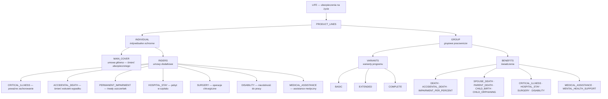
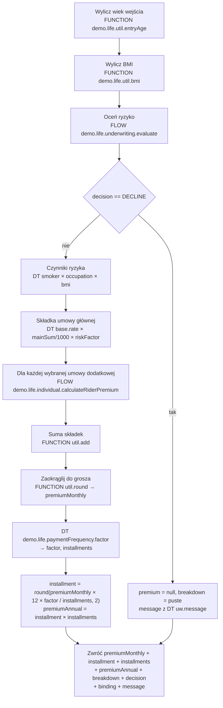
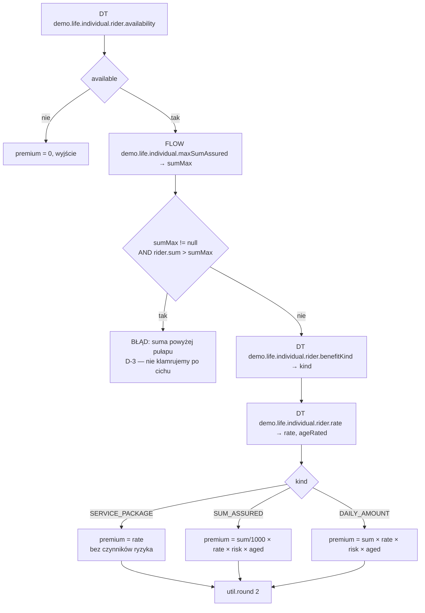
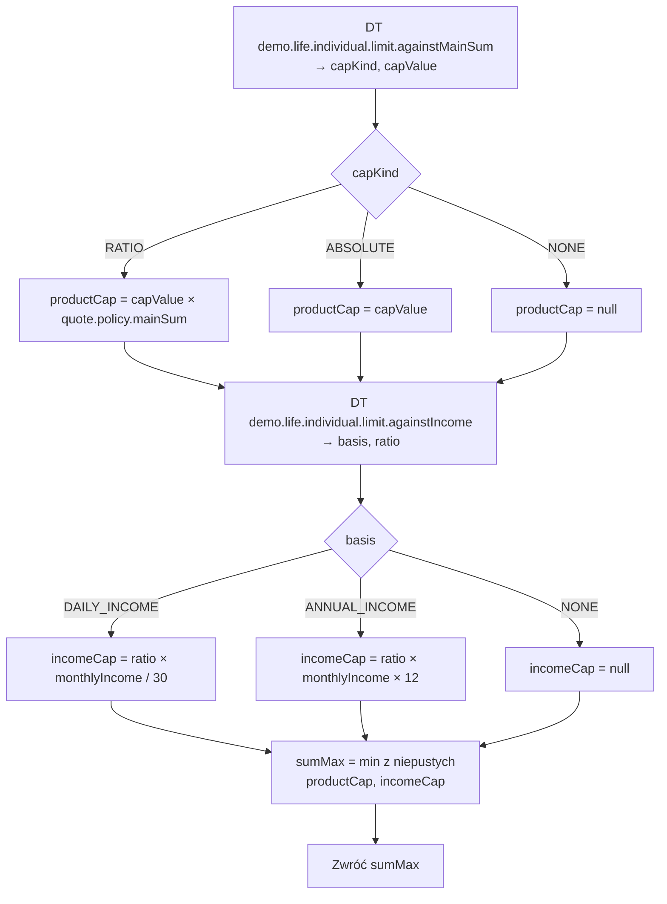
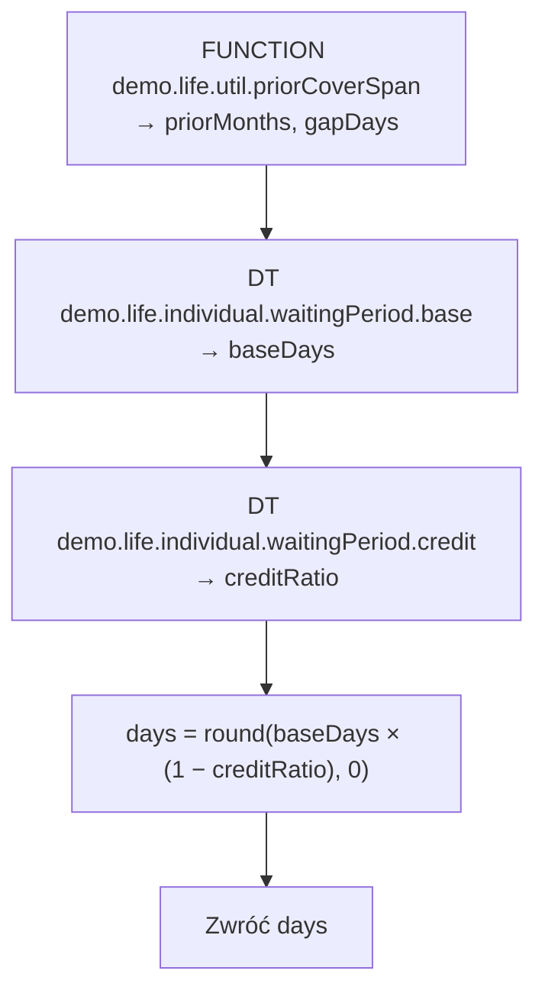
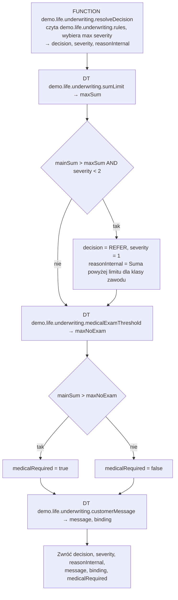
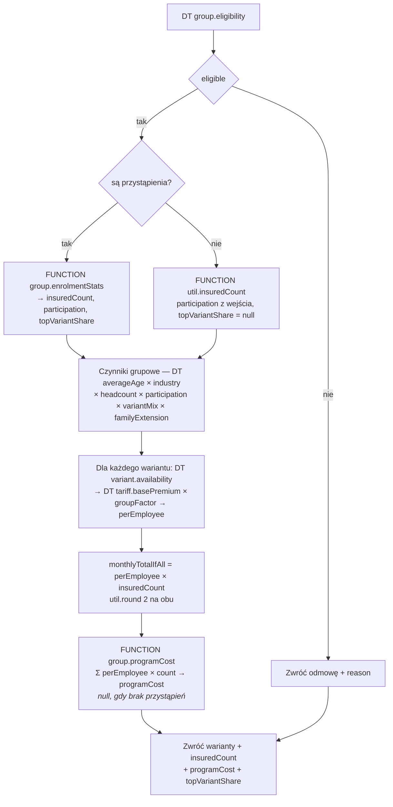

# Profil LIFE — projekt konfiguracji Higson

**Status:** propozycja do pracy. **W Higsonie nic jeszcze nie utworzono.**
**Data:** 2026-08-11
**Zakres:** drzewo domeny, tabele decyzyjne, flow, funkcje Groovy, wersjonowanie datą.

Dokument opisuje konfigurację dla nowego profilu `LIFE`, pokrywającą obie ścieżki demo:
indywidualną ochronną i grupową pracowniczą. Konwencje nazewnicze i układ plików są przeniesione
z istniejącego profilu `DEMO` (motor), żeby snapshot pozostał jednorodny — patrz
`standards/higson/rules-authoring.md` i `standards/higson/snapshot.md`.

---

## 1. Założenia projektowe

| # | Założenie | Konsekwencja |
|---|---|---|
| Z-1 | Pierwszy poziom drzewa dzieli się na **indywidualne** i **grupowe** | Wszystko poniżej jest niezależne — dwie ścieżki nie współdzielą ani atrybutów, ani tabel |
| Z-2 | Parametryzacja w **tabelach decyzyjnych** | Zero stawek i progów w kodzie Java i w Groovy |
| Z-3 | Algorytmy wysokopoziomowe we **flow** | Kolejność kroków widoczna na diagramie, nie w kodzie |
| Z-4 | Groovy **tylko tam, gdzie tabela nie wystarcza** | Osiem funkcji, każda uzasadniona w §6 — kryterium: arytmetyka, której tabela nie zrobi, albo pętla, której flow nie ma |
| Z-5 | **Dwie wersje sterowane datą** | Region `LIFE` + dwa timeline'y, §7 — obejmujące zarówno wartości, jak i zbiór elementów domeny (D-4) |
| Z-6 | Ubezpieczenie grupowe **nie ma indywidualnej oceny ryzyka** | Gałąź `GROUP` nie ma dostępu do atrybutów osoby — to nie uproszczenie, to produkt |
| Z-7 | Brak różnicowania po płci | Wyrok **Test-Achats** obowiązuje w UE od XII 2012. Żadna tabela nie ma poziomu `gender` |

---

## 2. Drzewo domeny

Drzewo ma się czytać jak spis treści oferty, a nie jak model danych. Każdy węzeł nazywa to, co
klient kupuje; nazwy są pełne, bez skrótów, żeby oglądający rozumiał produkt bez legendy.



**`MAIN_COVER` stoi obok `RIDERS`, a nie w nich.** Umowa główna jest obowiązkowa i to ona definiuje
sumę, do której odnoszą się wszystkie pozostałe — pytanie „czy jest dostępna" nie ma dla niej sensu,
a suma nie pochodzi z katalogu, tylko z wniosku. Wrzucona do tej samej kolekcji co umowy dodatkowe
wymagałaby wiersza w trzech tabelach tylko po to, żeby udawać, że jest jedną z wielu. Rozdzielenie
pokazuje też strukturę produktu tak, jak opisuje ją OWU: jedna umowa główna, do niej opcjonalne
dodatki.

**Warianty grupowe nazywają się `BASIC` / `EXTENDED` / `COMPLETE`, a nie I / II / III.** Rynek
używa rzymskich, ale numer nie mówi, czym wariant się różni — na demo widz musiałby zaglądać do
tabeli, żeby wiedzieć, który jest bogatszy. Kolejność i tak niesie atrybut `POSITION`.

### 2.1 Dlaczego świadczenia wiszą pod `GROUP`, a nie pod każdym wariantem

Bo wtedy dodanie wariantu IV to jeden element, a nie dwanaście. Zależność „które świadczenie
w którym wariancie i na jaką sumę" jest **relacją**, więc jej miejscem jest tabela decyzyjna
o dwóch poziomach wejściowych (`benefit`, `variant`) — dokładnie tak, jak `demo.motor.coverage.availability`
wiąże pokrycie z opcją w profilu motor. Powielanie świadczeń pod wariantami przeniosłoby tę relację
do struktury drzewa, gdzie nie da się jej zmienić bez edycji domeny.

### 2.2 Typy domenowe i atrybuty

Ścieżki są zapisywane tak, jak konsumuje je `domain.get()`:
`domain.get('LIFE', '/PRODUCT_LINES[INDIVIDUAL]/RIDERS[CRITICAL_ILLNESS]')`.

#### `PRODUCT_LINE` — poziom pierwszy

| Atrybut | Typ | Źródło | Uwagi |
|---|---|---|---|
| `IS_AVAILABLE` | boolean | `demo.life.productLine.availability` | Pozwala wyłączyć całą linię bez zmiany kodu |
| `POSITION` | number | `demo.life.productLine.position` | Kolejność na ekranie wyboru |
| `NAME` | string | LITERAL | „Indywidualne ochronne" / „Grupowe pracownicze" |

#### `RIDER` — umowa główna i umowy dodatkowe (gałąź `INDIVIDUAL`)

| Atrybut | Typ | Źródło | Uwagi |
|---|---|---|---|
| `IS_AVAILABLE` | boolean | `demo.life.individual.rider.availability` | Zależy od wieku i od tego, czy umowa główna jest wybrana |
| `POSITION` | number | `demo.life.individual.rider.position` | |
| `COVER_KIND` | string | `demo.life.individual.rider.benefitKind` | `SUM_ASSURED` / `DAILY_AMOUNT` / `SERVICE_PACKAGE` |
| `SUMS` | number[] | `demo.life.individual.rider.sumsOffered [sums]` | Katalog sum — **niezależny od sumy głównej** |
| `SUM_DEFAULT` | number | `demo.life.individual.rider.sumsOffered [default]` | |
| `SUM_MAX` | number | FLOW `demo.life.individual.maxSumAssured` | Efektywny pułap; `null` = brak pułapu (D-3) |
| `WAITING_PERIOD_DAYS` | number | FLOW `demo.life.individual.effectiveWaitingPeriod` | Po zaliczeniu poprzedniej ochrony (D-5); 0 = brak karencji |
| `RATE` | number | `demo.life.individual.rider.rate` | Stawka jednostkowa, **wersjonowana** |
| `AGE_RATED` | boolean | `demo.life.individual.rider.rate [ageRated]` | Czy stawka skaluje się wiekiem |
| `PREMIUM` | number | FLOW `demo.life.individual.calculateRiderPremium` | Wynik, nie parametr |
| `DESCRIPTION` | string | LITERAL | Opis pokazywany w UI |

#### `VARIANT` — wariant grupowy (gałąź `GROUP`)

| Atrybut | Typ | Źródło | Uwagi |
|---|---|---|---|
| `IS_AVAILABLE` | boolean | `demo.life.group.variant.availability` | Wariant COMPLETE bywa niedostępny dla małych grup |
| `POSITION` | number | `demo.life.group.variant.position` | |
| `BASE_PREMIUM` | number | `demo.life.group.tariff.basePremium` | Składka bazowa na pracownika, **wersjonowana** |
| `PREMIUM_PER_EMPLOYEE` | number | FLOW `demo.life.group.calculateQuote [perEmployee]` | Wynik, nie parametr |
| `MONTHLY_TOTAL_IF_ALL` | number | FLOW `demo.life.group.calculateQuote [monthlyTotalIfAll]` | Hipoteza „gdyby wszyscy wybrali ten wariant" (D-2) |

> Wariant **nie ma** własnego flow wyceny. Składka per wariant powstaje wewnątrz
> `demo.life.group.calculateQuote` (§5.6), bo czynniki grupowe — wiek, branża, wielkość, partycypacja,
> mieszanka — są **wspólne dla całego programu** i liczone raz. Osobny flow per wariant liczyłby je
> trzykrotnie i musiałby dostać ten sam kontekst trzy razy.

#### `BENEFIT` — świadczenie grupowe

| Atrybut | Typ | Źródło | Uwagi |
|---|---|---|---|
| `IS_AVAILABLE` | boolean | `demo.life.group.benefit.availability` | Klucz: (`benefit`, `variant`) |
| `SUM` | number | `demo.life.group.benefit.sumAssured` | Klucz: (`benefit`, `variant`) |
| `POSITION` | number | `demo.life.group.benefit.position` | |
| `COVER_KIND` | string | `demo.life.group.benefit.benefitKind` | `SUM_ASSURED` / `DAILY_AMOUNT` / `SERVICE_PACKAGE` |

---

## 3. Kontekst wejściowy

Poziomy wejściowe tabel wiążą `property == source` do ścieżek modelu — reguła
z `rules-authoring.md`. Ścieżki zaczynają się od korzenia wystawionego przez adapter.

### 3.0 Wspólne

| Ścieżka kontekstu | Typ | Skąd |
|---|---|---|
| `quote.line.code` | string | wybór linii produktu — `INDIVIDUAL` albo `GROUP` |

Jedyna ścieżka widoczna po obu stronach drzewa. Rozstrzyga, którą gałąź w ogóle się liczy, więc
musi być czytelna przed wejściem w którąkolwiek z nich.

### 3.1 Ścieżka indywidualna

| Ścieżka kontekstu | Typ | Skąd |
|---|---|---|
| `quote.insured.birthDate` | date | wejście |
| `quote.insured.entryAge` | number | wyliczane, `demo.life.util.entryAge` |
| `quote.insured.smoker` | boolean | wejście |
| `quote.insured.heightCm` | number | wejście |
| `quote.insured.weightKg` | number | wejście |
| `quote.insured.bmi` | number | wyliczane, `demo.life.util.bmi` |
| `quote.insured.occupationClass` | number | wejście, 1–4 |
| `quote.policy.startDate` | date | wejście — **klucz do wersji taryfy**, §7 |
| `quote.policy.mainSum` | number | wejście |
| `quote.policy.paymentFrequency` | string | wejście — `MONTHLY`/`QUARTERLY`/`SEMIANNUAL`/`ANNUAL` (D-6) |
| `quote.insured.monthlyIncome` | number | wejście, opcjonalne — wymagane tylko przy SZP i NDP (D-7) |
| `rider.code` | string | iteracja po domenie |
| `rider.sum` | number | wybór użytkownika |
| `claim.cause` | string | `ILLNESS` / `ACCIDENT` — tylko przy sprawdzaniu karencji (§4.3) |
| `quote.insured.priorCoverFrom` | date | wejście, opcjonalne — początek poprzedniej ochrony (D-5) |
| `quote.insured.priorCoverTo` | date | wejście, opcjonalne — koniec poprzedniej ochrony |
| `quote.insured.priorCoverMonths` | number | wyliczane, `demo.life.util.priorCoverSpan` |
| `quote.insured.priorCoverGapDays` | number | wyliczane, `demo.life.util.priorCoverSpan` |

> Pytamy o **dwie daty**, a nie o „ile miesięcy" i „ile dni przerwy". Klient zna daty ze swojej
> poprzedniej polisy; liczby wyliczone z nich w głowie byłyby zgadywaniem, a zgadnięta liczba
> miesięcy decyduje tu o skróceniu karencji. Oba pola są opcjonalne i w interfejsie chowają się
> za jednym pytaniem „czy miałeś wcześniejszą ochronę" — brak odpowiedzi znaczy brak zaliczenia,
> co jest bezpiecznym domyślnym.

### 3.2 Ścieżka grupowa

| Ścieżka kontekstu | Typ | Skąd |
|---|---|---|
| `quote.group.headcount` | number | wejście |
| `quote.group.averageAge` | number | wejście |
| `quote.group.industryClass` | number | wejście, 1–4 |
| `quote.group.participation` | number | wejście w fazie oferty, **wyliczane** w fazie programu (D-2) |
| `quote.group.includeSpouse` | boolean | wejście |
| `quote.group.includeAdultChild` | boolean | wejście |
| `quote.policy.startDate` | date | wejście — **klucz do wersji taryfy** |
| `variant.code` | string | iteracja po domenie |
| `benefit.code` | string | iteracja po domenie |

Dodatkowo, wyłącznie w **fazie programu** (D-2, §10) — kiedy znamy już rzeczywiste wybory
pracowników:

| Ścieżka kontekstu | Typ | Skąd |
|---|---|---|
| `quote.group.enrolment` | kolekcja | wejście — deklaracje przystąpienia |
| `quote.group.enrolment[].variantCode` | string | wybór pracownika |
| `quote.group.enrolment[].count` | number | liczba pracowników w tym wariancie |
| `quote.group.topVariantShare` | number | wyliczane, `demo.life.group.enrolmentStats` |

> Lista `enrolment` nie zawiera osób, tylko liczności. Program grupowy nie potrzebuje wiedzieć, **kto**
> wybrał wariant COMPLETE — potrzebuje wiedzieć, **ilu**. Trzymanie się tego rozróżnienia utrzymuje
> zasadę z ramki wyżej: gałąź `GROUP` nadal nie widzi żadnej osoby.

> ⚠️ **Gałąź `GROUP` nie ma dostępu do `quote.insured.*`.** To nie jest kwestia stylu — polisa
> grupowa nie prowadzi indywidualnej oceny ryzyka, więc tabela grupowa, która czytałaby BMI,
> modelowałaby produkt, który nie istnieje. Rozdzielenie na poziomie kontekstu sprawia, że taka
> pomyłka jest niemożliwa, a nie tylko niezalecana.

---

## 4. Tabele decyzyjne

Kod parametru odzwierciedla ścieżkę pliku w snapshocie (`/` → `.`), pod prefiksem `demo.life.*`.
Wszystkie z `cacheable = true`. Tabele z `nullable = false` otwiera wiersz `*`.

### 4.1 Wspólne

#### `demo.life.productLine.availability`
```
IN   line     string   quote.line.code
OUT  available boolean
```
```
line;available
*;no
INDIVIDUAL;yes
GROUP;yes
```

### 4.2 Indywidualne — taryfa

#### `demo.life.individual.tariff.baseRate` ⭐ **wersjonowana**
Stawka miesięczna za 1 000 zł sumy z umowy głównej.
```
IN   age       number   quote.insured.entryAge   matcher: between/ii
OUT  rate      number
```
```
age;rate
* - *;3.10
18-29;0.09
30-34;0.13
35-39;0.19
40-44;0.29
45-49;0.46
50-54;0.75
55-59;1.22
60-64;1.95
65-70;3.10
```

#### `demo.life.individual.rider.rate` ⭐ **wersjonowana**
Stawka umowy dodatkowej i informacja, czy skaluje się wiekiem.
```
IN   rider     string   rider.code
OUT  rate      number
OUT  ageRated  boolean
```
```
rider;rate;ageRated
*;0;no
CRITICAL_ILLNESS;0.36;yes
ACCIDENTAL_DEATH;0.035;no
PERMANENT_IMPAIRMENT;0.075;no
HOSPITAL_STAY;0.115;yes
SURGERY;0.14;yes
DISABILITY;0.21;yes
MEDICAL_ASSISTANCE;9.00;no
```

> `MEDICAL_ASSISTANCE` ma `rate` w złotych, nie za 1 000 zł — bo jego `COVER_KIND` to `SERVICE_PACKAGE`. Rodzaj pokrycia
> decyduje o interpretacji stawki i to flow, nie tabela, wybiera wzór (§5.2).

#### `demo.life.individual.factor.smoker`
```
IN   smoker    boolean  quote.insured.smoker
OUT  factor    number
```
```
smoker;factor
*;1.00
no;1.00
yes;1.75
```

#### `demo.life.individual.factor.occupation`
```
IN   class     number   quote.insured.occupationClass
OUT  factor    number
```
```
class;factor
*;1.90
1;1.00
2;1.15
3;1.40
4;1.90
```

#### `demo.life.individual.factor.bmi`
```
IN   bmi       number   quote.insured.bmi   matcher: between/ie
OUT  factor    number
```
```
bmi;factor
* - *;1.00
* - 18.5;1.15
18.5 - 27;1.00
27 - 32;1.25
32 - *;1.60
```

### 4.3 Indywidualne — dostępność i konfiguracja

#### `demo.life.individual.rider.availability`
Umowa dodatkowa dostępna tylko w wieku, w którym ubezpieczyciel ją oferuje.
```
IN   rider     string   rider.code
IN   age       number   quote.insured.entryAge   matcher: between/ii
OUT  available boolean
```
```
rider;age;available
*;* - *;no
MAIN_COVER;18-70;yes
CRITICAL_ILLNESS;18-60;yes
ACCIDENTAL_DEATH;18-70;yes
PERMANENT_IMPAIRMENT;18-65;yes
HOSPITAL_STAY;18-65;yes
SURGERY;18-65;yes
DISABILITY;18-55;yes
MEDICAL_ASSISTANCE;18-70;yes
```

#### `demo.life.individual.rider.sumsOffered`
```
IN   rider     string   rider.code
OUT  sums      number[]
OUT  default   number
```
```
rider;sums;default
*;;0
MAIN_COVER;50000,100000,150000,200000,300000,500000,750000,1000000;300000
CRITICAL_ILLNESS;20000,50000,100000,150000,200000;50000
ACCIDENTAL_DEATH;50000,100000,200000,300000,500000;100000
PERMANENT_IMPAIRMENT;20000,50000,100000,150000;50000
HOSPITAL_STAY;50,100,150,200,300;100
SURGERY;10000,20000,30000,50000;20000
DISABILITY;50000,100000,200000,300000;100000
MEDICAL_ASSISTANCE;;0
```

#### `demo.life.individual.limit.againstMainSum`
Pułap sumy umowy dodatkowej względem umowy głównej — decyzja **D-3** (§10). Rodzaj pułapu idzie
za `COVER_KIND`, bo dla świadczenia dziennego iloraz sumy głównej jest bez sensu wymiarowego.
```
IN   rider     string   rider.code
OUT  capKind   string    RATIO | ABSOLUTE | NONE
OUT  capValue  number
```
```
rider;capKind;capValue
*;NONE;0
CRITICAL_ILLNESS;RATIO;1.00
ACCIDENTAL_DEATH;RATIO;2.00
PERMANENT_IMPAIRMENT;RATIO;0.50
SURGERY;RATIO;0.25
DISABILITY;RATIO;1.00
HOSPITAL_STAY;ABSOLUTE;300
MEDICAL_ASSISTANCE;NONE;0
```

> **Sprawdzenie, które musi przejść przy każdej zmianie tych liczb:** przy **najniższej** sumie
> głównej z katalogu (50 000 zł) każda umowa dodatkowa musi mieć co najmniej jedną wybieralną sumę.
> Dziś: PZ → 50 000 (2 opcje), NW → 100 000 (2), UT → 25 000 (**1**), OP → 12 500 (**1**),
> NDP → 50 000 (**1**).
> Pułap, który zeruje listę, zamienia umowę dodatkową w martwy wiersz w interfejsie — widoczny,
> ale niewybieralny, bez żadnego komunikatu. Test `ind.cap.nie.zeruje` (§9) pilnuje tego wprost.

#### `demo.life.individual.limit.againstIncome`
Drugi pułap — względem **dochodu**, nie sumy głównej. Decyzja **D-7** (§10). Dotyczy wyłącznie
świadczeń, które zastępują dochód; obowiązuje **łącznie** z pułapem produktowym, przez `min`.
```
IN   rider     string   rider.code
OUT  basis     string    NONE | DAILY_INCOME | ANNUAL_INCOME
OUT  ratio     number
```
```
rider;basis;ratio
*;NONE;0
HOSPITAL_STAY;DAILY_INCOME;0.60
DISABILITY;ANNUAL_INCOME;3.00
```

> **Dlaczego tylko te dwie umowy.** SZP wypłaca za każdy dzień nieobecności, NDP zastępuje utracone
> zarobki. W obu świadczenie wyższe od dochodu odwraca bodziec: przebywanie w szpitalu albo pozostanie
> niezdolnym staje się opłacalne. Reszta umów wypłaca jednorazowo za zdarzenie, którego nikt nie
> przedłuża — tam dochód nie jest właściwą miarą i wiersza nie ma.
>
> **Sprawdzenie analogiczne jak przy pułapie produktowym:** przy jakim dochodzie lista się zeruje?
> SZP potrzebuje `0.60 × dochód/30 ≥ 50`, czyli **2 500 zł** miesięcznie; NDP potrzebuje
> `3 × dochód × 12 ≥ 50 000`, czyli **1 389 zł**. Oba progi leżą poniżej płacy minimalnej, więc
> żaden pracujący wnioskodawca nie zobaczy pustej listy. Ten rachunek trzeba powtórzyć przy każdej
> zmianie `ratio` albo katalogu sum.

#### `demo.life.paymentFrequency.factor`
Częstotliwość płatności — decyzja **D-6** (§10). Taryfa jest **miesięczna**, więc czynnik jest
poniżej 1: rzadsza płatność jest tańsza, bo znika ryzyko zerwania w trakcie roku i koszt obsługi
dwunastu przelewów.
```
IN   frequency     string   quote.policy.paymentFrequency
OUT  factor        number
OUT  installments  number
```
```
frequency;factor;installments
*;1.000;12
MONTHLY;1.000;12
QUARTERLY;0.980;4
SEMIANNUAL;0.965;2
ANNUAL;0.940;1
```

#### `demo.life.individual.waitingPeriod.base`
Karencja **bazowa** — reguła samego produktu, niezależna od historii klienta.
```
IN   rider   string   rider.code
IN   cause   string   claim.cause          ILLNESS | ACCIDENT
OUT  days    number
```
```
rider;cause;days
*;*;0
CRITICAL_ILLNESS;ILLNESS;90
HOSPITAL_STAY;ILLNESS;30
SURGERY;ILLNESS;180
DISABILITY;ILLNESS;180
```

> 🇵🇱 **Karencja nie obowiązuje, gdy zdarzenie jest następstwem nieszczęśliwego wypadku.** To jest
> zapis z OWU praktycznie każdego polskiego ubezpieczenia ochronnego i pierwsza rzecz, której szuka
> ktoś z branży. Wyrażamy go **poziomem wejściowym `cause`**, a nie zdaniem w dokumentacji: wiersze
> istnieją tylko dla `ILLNESS`, więc `ACCIDENT` wpada w domyślne zero. Reguła jest widoczna
> w konfiguracji i daje się zmienić bez dotykania kodu — czyli dokładnie to, co demo ma pokazywać.
>
> Sens jest ubezpieczeniowy, nie formalny: karencja chroni przed kupnem polisy przez kogoś, kto już
> wie, że zachoruje. Wypadku nikt nie zna z góry, więc nie ma przed czym chronić.

#### `demo.life.individual.waitingPeriod.credit`
Zaliczenie poprzedniej ochrony — decyzja **D-5** (§10). Osobna tabela, bo to osobna decyzja
produktowa: „ile trwa karencja" i „komu ją skracamy" zmieniają się niezależnie.
```
IN   rider        string   rider.code
IN   priorMonths  number   quote.insured.priorCoverMonths   matcher: between/ii
IN   gapDays      number   quote.insured.priorCoverGapDays  matcher: between/ii
OUT  creditRatio  number
```
```
rider;priorMonths;gapDays;creditRatio
*;* - *;* - *;0.00
CRITICAL_ILLNESS;6 - *;0-30;0.50
HOSPITAL_STAY;1-5;0-30;0.50
HOSPITAL_STAY;6 - *;0-30;1.00
SURGERY;1-5;0-30;0.50
SURGERY;6 - *;0-30;1.00
DISABILITY;6 - *;0-30;0.50
```

> **Przerwa dłuższa niż 30 dni nie zalicza się w ogóle** — wpada w wiersz domyślny. Przerwa jest
> dokładnie tym oknem, przed którym karencja chroni: kto był bez ochrony przez kwartał, mógł się
> w tym czasie dowiedzieć, po co ją wznawia. Trzydzieści dni to tolerancja na obieg dokumentów,
> nie na namysł.
>
> **PZ i NDP zatrzymują połowę karencji nawet przy pełnej ciągłości.** Poważne zachorowanie
> i niezdolność do pracy to dwa ryzyka, w których choroba istniejąca przed wnioskiem waży najwięcej,
> a przeniesienie polisy jest najczęstszym ruchem kogoś, kto zna już swoje rozpoznanie. Pozostałe
> umowy zalicza się w całości.
>
> ⚠️ **Tabela jest wyliczona jawnie, bez częściowych wildcardów.** Kuszące byłoby napisanie
> `*;6 - *;0-30;1.00` i nadpisanie wyjątków wierszami dla `CRITICAL_ILLNESS` i `DISABILITY` — ale wiersz domyślny
> z gwiazdką w **każdej** kolumnie jest w tym projekcie sprawdzony (MOTO tak robi
> w `demo.motor.coverage.availability`), a wiersz z gwiazdką **tylko w części** kolumn nie jest.
> Poleganie na pierwszeństwie wiersza bardziej szczegółowego wymagałoby najpierw potwierdzenia tej
> semantyki w Studio. Siedem wierszy nie jest warte tego ryzyka.

#### `demo.life.individual.rider.benefitKind`
Rodzaj świadczenia — **jedyny atrybut mówiący, czym jest liczba w polu „suma"**. Steruje wzorem na
składkę (§5.2), znaczeniem pułapu (§5.3) i sposobem prezentacji w interfejsie.
```
rider;kind
*;SUM_ASSURED
HOSPITAL_STAY;DAILY_AMOUNT
MEDICAL_ASSISTANCE;SERVICE_PACKAGE
```

| Rodzaj | Znaczenie liczby | Przykład |
|---|---|---|
| `SUM_ASSURED` | Jednorazowa suma za zdarzenie | 100 000 zł przy poważnym zachorowaniu |
| `DAILY_AMOUNT` | Kwota **za każdy dzień** | 150 zł za dzień pobytu w szpitalu |
| `PER_PERCENT` | Kwota **za 1% uszczerbku** | 600 zł × 30% = 18 000 zł |
| `SERVICE_PACKAGE` | Pakiet usług, bez sumy | Konsultacje, transport, opieka |

> ⚠️ `PER_PERCENT` nie występuje w gałęzi indywidualnej — tam trwały uszczerbek ma sumę i procent
> stosuje się do niej. Jest za to **konieczny w grupowej** (§4.5): bez niego liczba `600` przy
> `IMPAIRMENT_PER_PERCENT` czyta się jako całe świadczenie za trwały uszczerbek, co jest kwotą
> absurdalną i pierwszą rzeczą, którą wyłapie ktokolwiek z branży.

### 4.4 Indywidualne — underwriting

#### `demo.life.underwriting.medicalExamThreshold` ⭐ **wersjonowana**
Suma, powyżej której wymagane są badania — zależna od wieku.
```
IN   age        number  quote.insured.entryAge  matcher: between/ii
OUT  maxNoExam  number
```
```
age;maxNoExam
* - *;100000
18-35;600000
36-45;400000
46-55;250000
56-70;100000
```

#### `demo.life.underwriting.rules` — tabela **wielowierszowa**
Katalog przesłanek underwritingowych. Jedna ocena może trafić w **kilka wierszy naraz** — to jest
zamierzone i wymaga świadomej obsługi (patrz ramka niżej).
```
IN   age        number   quote.insured.entryAge     matcher: between/ii
IN   bmi        number   quote.insured.bmi          matcher: between/ie
IN   smoker     boolean  quote.insured.smoker
IN   occupation number   quote.insured.occupationClass
OUT  decision       string
OUT  severity       number
OUT  reasonInternal string
```
```
age;bmi;smoker;occupation;decision;severity;reasonInternal
* - *;* - *;*;*;ACCEPT;0;
* - *;40 - *;*;*;DECLINE;2;BMI powyżej 40
* - *;* - 16;*;*;DECLINE;2;BMI poniżej 16
61-70;32 - *;yes;*;DECLINE;2;Wiek, BMI i palenie łącznie
* - *;32 - 40;*;*;REFER;1;Podwyższone BMI
56-70;* - *;yes;*;REFER;1;Wiek i palenie
* - *;* - *;*;4;REFER;1;IV klasa ryzyka zawodowego
```

> 🔒 Kolumna nazywa się `reasonInternal`, bo **nigdy nie trafia do klienta** — patrz decyzja
> **D-1** (§10). „BMI powyżej 40" jest uzasadnieniem dla underwritera i dla logu, nie komunikatem
> na kalkulatorze.

> ⚠️ **To jedyna tabela w projekcie, która celowo łamie wzorzec „jeden wiersz na wejście".**
> W profilu motor każda tabela ma klucze rozłączne, więc dopasowuje się dokładnie jeden wiersz.
> Tutaj tak być nie może: 62-latek z BMI 34, palący, w IV klasie zawodu trafia w **cztery** wiersze
> jednocześnie. Higson przy `distinct = false` zwróci je wszystkie, a `getDecimal`/`getString`
> wzięłyby po prostu pierwszy — czyli decyzja zależałaby od kolejności wierszy w matrycy,
> co jest cichym błędem najgorszego rodzaju: konfiguracja wygląda poprawnie, a wynik zmienia się
> przy przestawieniu wiersza.
>
> Dlatego kolumna `severity` jest **częścią kontraktu**, a nie ozdobą, i odczyt idzie przez
> `higson.getValue()` + funkcję `demo.life.underwriting.resolveDecision` (§6.5), która wybiera wiersz o najwyższej
> wadze. Alternatywa — rozbicie na wzajemnie wykluczające się klucze — dałaby macierz rzędu
> kilkuset wierszy, w której dopisanie jednej przesłanki wymaga przeliczenia wszystkich kombinacji.

#### `demo.life.underwriting.customerMessage`
Treść pokazywana klientowi — jedna na decyzję, niezależna od przesłanki. Trzy wiersze, bo to
cały zakres tego, co wolno powiedzieć.
```
IN   decision  string   uw.decision
OUT  message   string
OUT  binding   boolean
```
```
decision;message;binding
*;Skontaktuj się z doradcą, żeby dokończyć wniosek.;no
ACCEPT;;yes
REFER;Składka wstępna. Warunki ostateczne ustalimy po ocenie medycznej.;no
DECLINE;Tego wniosku nie możemy obsłużyć online — skontaktuj się z doradcą.;no
```

#### `demo.life.underwriting.sumLimit`
Maksymalna suma bez skierowania do oceny ręcznej.
```
IN   occupation number  quote.insured.occupationClass
OUT  maxSum     number
```
```
occupation;maxSum
*;300000
1;1000000
2;750000
3;500000
4;300000
```

### 4.5 Grupowe — dostępność i sumy

#### `demo.life.group.benefit.availability`
```
IN   benefit   string   benefit.code
IN   variant   string   variant.code
OUT  available boolean
```
```
benefit;variant;available
*;*;no
DEATH;BASIC;yes
DEATH;EXTENDED;yes
DEATH;COMPLETE;yes
ACCIDENTAL_DEATH;BASIC;yes
ACCIDENTAL_DEATH;EXTENDED;yes
ACCIDENTAL_DEATH;COMPLETE;yes
IMPAIRMENT_PER_PERCENT;BASIC;yes
IMPAIRMENT_PER_PERCENT;EXTENDED;yes
IMPAIRMENT_PER_PERCENT;COMPLETE;yes
SPOUSE_DEATH;BASIC;yes
SPOUSE_DEATH;EXTENDED;yes
SPOUSE_DEATH;COMPLETE;yes
PARENT_DEATH;EXTENDED;yes
PARENT_DEATH;COMPLETE;yes
CHILD_BIRTH;EXTENDED;yes
CHILD_BIRTH;COMPLETE;yes
CHILD_ORPHANING;EXTENDED;yes
CHILD_ORPHANING;COMPLETE;yes
CRITICAL_ILLNESS;EXTENDED;yes
CRITICAL_ILLNESS;COMPLETE;yes
HOSPITAL_STAY;EXTENDED;yes
HOSPITAL_STAY;COMPLETE;yes
SURGERY;COMPLETE;yes
DISABILITY;COMPLETE;yes
MEDICAL_ASSISTANCE;COMPLETE;yes
MENTAL_HEALTH_SUPPORT;COMPLETE;yes
```

> Wiersz `MENTAL_HEALTH_SUPPORT` jest **globalny, a mimo to nieosiągalny przed `2026-07-01`** — element domeny
> o tym kodzie istnieje dopiero w wersji 2 regionu (§7.2, D-4), więc w wersji 1 iteracja po
> `BENEFITS` nigdy o niego nie zapyta. Wiersz jest bezczynny, nie błędny.

#### `demo.life.group.benefit.sumAssured`
⚠️ **Liczba znaczy co innego w zależności od `benefitKind`.** `HOSPITAL_STAY` = 100 to sto złotych
**za dzień**, `IMPAIRMENT_PER_PERCENT` = 900 to dziewięćset złotych **za 1% uszczerbku** (przy 30%
uszczerbku wypłata wynosi 27 000 zł), a `DEATH` = 120 000 to cała suma. `MEDICAL_ASSISTANCE`
i `MENTAL_HEALTH_SUPPORT` nie mają wiersza, bo są pakietami usług — wpadają w `*` i zwracają 0,
a interfejs pokazuje „w pakiecie" zamiast kwoty.
```
IN   benefit   string   benefit.code
IN   variant   string   variant.code
OUT  sum       number
```
```
benefit;variant;sum
*;*;0
DEATH;BASIC;50000
DEATH;EXTENDED;80000
DEATH;COMPLETE;120000
ACCIDENTAL_DEATH;BASIC;100000
ACCIDENTAL_DEATH;EXTENDED;160000
ACCIDENTAL_DEATH;COMPLETE;240000
IMPAIRMENT_PER_PERCENT;BASIC;400
IMPAIRMENT_PER_PERCENT;EXTENDED;600
IMPAIRMENT_PER_PERCENT;COMPLETE;900
SPOUSE_DEATH;BASIC;20000
SPOUSE_DEATH;EXTENDED;30000
SPOUSE_DEATH;COMPLETE;45000
PARENT_DEATH;EXTENDED;2000
PARENT_DEATH;COMPLETE;3000
CHILD_BIRTH;EXTENDED;1500
CHILD_BIRTH;COMPLETE;2500
CHILD_ORPHANING;EXTENDED;8000
CHILD_ORPHANING;COMPLETE;15000
CRITICAL_ILLNESS;EXTENDED;10000
CRITICAL_ILLNESS;COMPLETE;20000
HOSPITAL_STAY;EXTENDED;60
HOSPITAL_STAY;COMPLETE;100
SURGERY;COMPLETE;5000
DISABILITY;COMPLETE;30000
```

### 4.6 Grupowe — taryfa

#### `demo.life.group.tariff.basePremium` ⭐ **wersjonowana**
```
IN   variant   string   variant.code
OUT  base      number
```
```
variant;base
*;0
BASIC;42.00
EXTENDED;63.00
COMPLETE;89.00
```

#### `demo.life.group.factor.averageAge`
```
IN   avgAge    number   quote.group.averageAge   matcher: between/ie
OUT  factor    number
```
```
avgAge;factor
* - *;1.00
* - 30;0.85
30 - 40;1.00
40 - 50;1.25
50 - *;1.60
```

#### `demo.life.group.factor.industry`
```
class;factor
*;1.70
1;1.00
2;1.15
3;1.35
4;1.70
```

#### `demo.life.group.factor.headcount`
```
IN   headcount number   quote.group.headcount   matcher: between/ie
OUT  factor    number
```
```
headcount;factor
* - *;1.15
* - 10;1.15
10 - 50;1.00
50 - 200;0.94
200 - *;0.88
```

#### `demo.life.group.factor.participation` ⭐ **wersjonowana**
Kontrola antyselekcji — czynnik, który najbardziej odróżnia biznes grupowy.
```
IN   participation number  quote.group.participation  matcher: between/ie
OUT  factor        number
```
```
participation;factor
* - *;1.12
* - 50;1.12
50 - 75;1.00
75 - *;0.93
```

#### `demo.life.group.factor.variantMix` ⭐ **wersjonowana**
Druga oś antyselekcji, czynna **wyłącznie w fazie programu** (D-2). Kiedy pracownicy wybierają
wariant sami, skupienie w najbogatszym wariancie jest sygnałem, że wybierają go ci, którzy
spodziewają się świadczenia.
```
IN   topVariantShare  number  quote.group.topVariantShare   matcher: between/ie
OUT  factor    number
```
```
topVariantShare;factor
* - *;1.00
* - 40;1.00
40 - 60;1.06
60 - 80;1.13
80 - *;1.22
```

> Wiersz `* - *` daje `1.00`, więc w **fazie oferty** — gdzie `topVariantShare` jeszcze nie istnieje —
> czynnik jest neutralny i nic nie trzeba wyłączać warunkiem. Tabela włącza się sama, kiedy pojawi
> się dana, która ją karmi.

#### `demo.life.group.factor.familyExtension`
```
IN   spouse    boolean  quote.group.includeSpouse
IN   child     boolean  quote.group.includeAdultChild
OUT  factor    number
```
```
spouse;child;factor
*;*;1.00
no;no;1.00
yes;no;1.35
no;yes;1.12
yes;yes;1.51
```

### 4.7 Grupowe — reguły dostępności programu

#### `demo.life.group.eligibility`
```
IN   headcount     number  quote.group.headcount      matcher: between/ii
IN   participation number  quote.group.participation  matcher: between/ii
OUT  eligible      boolean
OUT  reason        string
```
```
headcount;participation;eligible;reason
* - *;* - *;no;Poza zakresem oferty
3-9;50-100;yes;
3-9;10-49;no;Grupa poniżej 10 osób wymaga partycypacji min. 50%
10-5000;10-100;yes;
```

> Tutaj kolumna nazywa się `reason`, a nie `reasonInternal` — i to jest zamierzona asymetria wobec
> D-1 (§10). Powód odmowy grupowej mówi o liczebności i partycypacji, czyli o faktach, które
> pracodawca sam podał i sam kontroluje. Nie ma tu czego chronić, a ukrycie powodu odebrałoby
> jedyną informację, dzięki której klient wie, co zmienić, żeby oferta się pojawiła.

#### `demo.life.group.variant.availability`
```
IN   variant   string  variant.code
IN   headcount number  quote.group.headcount  matcher: between/ii
OUT  available boolean
```
```
variant;headcount;available
*;* - *;no
BASIC;3-5000;yes
EXTENDED;3-5000;yes
COMPLETE;20-5000;yes
```

---

## 5. Flow — algorytmy wysokopoziomowe

Sześć flow. Każdy czyta tabele i wywołuje funkcje; żaden nie zawiera stawek ani progów.

### 5.1 `demo.life.individual.calculateQuote` — wycena indywidualna



**Zmienne flow:** `entryAge`, `bmi`, `decision`, `severity`, `reasonInternal`, `riskFactor`,
`mainPremium`, `ridersPremium`, `premiumMonthly` *(returned)*, `installment` *(returned)*,
`installments` *(returned)*, `premiumAnnual` *(returned)*, `breakdown` *(returned)*,
`binding` *(returned)*, `message` *(returned)*, `medicalRequired` *(returned)*.

> ⚠️ **`premiumAnnual` jest wyliczane z zaokrąglonej raty, nie liczone niezależnie** — decyzja
> **D-6** (§10). Gdyby powstawało własnym torem, `12 × rata` i „składka roczna" potrafiłyby się
> rozjechać o kilka groszy i nie byłoby sposobu rozstrzygnąć, która jest prawdziwa. Rata jest tym,
> co realnie obciąża konto, więc rata jest źródłem prawdy, a roczna to jej wielokrotność.

> **Tylko `DECLINE` wychodzi bez ceny.** `REFER` przechodzi przez pełną wycenę i wraca ze składką
> oznaczoną `binding = false` — decyzja **D-1** (§10).

> ⚠️ Zaokrąglenie **na linię, raz** — nie na sumie. Zsumowanie niezaokrąglonych linii i zaokrąglenie
> całości daje total, który nie zgadza się z własnymi składnikami; to jedyny błąd arytmetyczny,
> który czytelnik oferty zawsze wyłapie.

### 5.2 `demo.life.individual.calculateRiderPremium` — składka pojedynczej umowy dodatkowej



> `SERVICE_PACKAGE` celowo omija czynniki ryzyka: assistance kupuje usługi, nie transfer ryzyka, więc wiek
> i palenie nie mają na co działać. To reguła produktowa, więc siedzi we flow, a nie w komentarzu.

### 5.3 `demo.life.individual.maxSumAssured` — efektywny pułap sumy



> Trzy gałęzie w górnej połowie, bo pułap produktowy znaczy trzy różne rzeczy — i **dokładnie ten
> sam podział**, co przy wyborze wzoru na składkę w §5.2. `SUM_ASSURED` skaluje się sumą główną, `DAILY_AMOUNT`
> ma pułap kwotowy, `SERVICE_PACKAGE` nie ma sumy, więc nie ma czego ograniczać. To nie zbieg okoliczności:
> `COVER_KIND` jest jedynym atrybutem, który mówi, **czym jest liczba w polu „suma"**, więc wszystko,
> co tę liczbę interpretuje, musi się o niego oprzeć.
>
> **Dolna połowa to `min`, a nie zastąpienie** (D-7). Oba pułapy obowiązują naraz i każdy pilnuje
> czego innego: produktowy tego, żeby umowa dodatkowa nie przerosła głównej, dochodowy tego, żeby
> świadczenie nie przerosło zarobków. Wybranie „właściwszego" z nich zamiast obu zostawiłoby otwartą
> drugą furtkę. Brak dochodu w kontekście daje `incomeCap = null` i wtedy `min` przepuszcza sam pułap
> produktowy — pole opcjonalne nie blokuje wyceny umów, których nie dotyczy.

### 5.4 `demo.life.individual.effectiveWaitingPeriod` — karencja po zaliczeniu



**Wynik dla pełnej ciągłości (≥6 mies., przerwa ≤30 dni):**

| Umowa | Baza | Zaliczenie | Efektywna karencja |
|---|---|---|---|
| PZ | 90 | 0.50 | **45 dni** |
| SZP | 30 | 1.00 | **0 dni** |
| OP | 180 | 1.00 | **0 dni** |
| NDP | 180 | 0.50 | **90 dni** |

> Karencja bazowa i zaliczenie zostają **dwiema tabelami**, a nie jedną o trzech dodatkowych
> poziomach. To ta sama decyzja, co rozdzielenie katalogu sum od pułapu w D-3: „ile trwa karencja"
> jest własnością produktu, „komu ją skracamy" jest polityką akwizycyjną, a te dwie rzeczy zmieniają
> różne osoby w różnych momentach. Zlanie ich w jedną macierz oznaczałoby, że zmiana karencji dla
> jednej umowy wymaga przejścia po wszystkich kombinacjach historii klienta.

### 5.5 `demo.life.underwriting.evaluate` — underwriting



**Priorytet rozstrzygnięć:** `DECLINE` (severity 2) > `REFER` (1) > `ACCEPT` (0).
Podniesienie do `REFER` z tytułu limitu sumy **nie może obniżyć** decyzji — jeśli
`demo.life.underwriting.resolveDecision` zwróciło `DECLINE`, gałąź `C → D` jej nie nadpisuje. Węzeł `D` ustawia
`REFER` wyłącznie wtedy, gdy `severity < 2`.

### 5.6 `demo.life.group.calculateQuote` — wycena grupowa

Jeden flow obsługuje **obie fazy** z D-2 (§10). Różnicę robi obecność listy przystąpień `enrolment`, a nie
przełącznik trybu.



> **Dwa węzły złożone celowo, jeden warunek usunięty.** Odczyt dostępności wariantu i jego stawki
> to jedna myśl („wyceń wariant"), więc siedzą w jednym węźle; podobnie oba zaokrąglenia. Drugie
> pytanie o przystąpienia zniknęło — `programCost` zwraca `null` sam, gdy lista jest pusta, więc
> rozgałęzianie było powtórzeniem warunku, który funkcja i tak sprawdza. Jedno wyjście zamiast
> trzech. Flow zszedł z **15 do 12 nodów** i ma zapas na rozbudowę.

**Co się nie zmienia między fazami.** Wycena pojedynczego wariantu — węzły `D → G` — jest
identyczna. Faza programu nie ma własnej taryfy; dostaje tę samą, tylko karmioną lepszymi danymi:
`participation` przestaje być deklaracją pracodawcy, a staje się ilorazem policzonym z rzeczywistych
przystąpień. Dlatego `variant.code` **pozostaje iteracją** w obu fazach — rozkład wyborów wchodzi
dopiero przy agregacji, a nie przy wycenie.

> ⚠️ **`monthlyTotalIfAll`, nie `monthlyTotal`.** W fazie oferty ta liczba odpowiada na pytanie
> „ile kosztowałby program, gdyby **wszyscy** wybrali ten wariant" — a przy wyborze per pracownik
> to jest hipoteza, nie koszt. Rzeczywisty koszt niesie `programCost` i istnieje wyłącznie wtedy,
> gdy znamy rozkład. Nazwa to koszt jednego słowa; pomylenie tych dwóch liczb w rozmowie
> z pracodawcą kosztuje więcej.
>
> 📌 **Do poprawy na froncie:** obecny ekran grupowy (`frontend/src/app/demos/life/group/`) etykietuje
> wiersz `monthlyTotal` jako „Koszt programu miesięcznie". Pod D-2 ta etykieta jest nieprawdziwa —
> powinna brzmieć „Koszt, gdyby wszyscy wybrali ten wariant". Zmiana **nie została wykonana**, bo
> ten dokument niczego nie implementuje.

---

## 6. Funkcje Groovy — osiem, każda uzasadniona

Zasada z `rules-authoring.md`: ciało funkcji czyta wyłącznie `ctx` i helpery `higson`, zero importów
i zero referencji do klas aplikacji. Nagłówek TOML generowany, `#Full code` zgodny ze ścieżką,
`ctx` zawsze pierwszym argumentem, jawny `return`.

| Funkcja | Dlaczego nie tabela |
|---|---|
| `demo.life.util.entryAge` | Arytmetyka dat — różnica między `policy.startDate` a `insured.birthDate` w pełnych latach. Tabela nie liczy |
| `demo.life.util.bmi` | Dzielenie przez kwadrat wzrostu. Tabela przedziałowa dostaje BMI jako **wejście**, więc ktoś musi je wyliczyć |
| `demo.life.util.insuredCount` | `round(headcount × participation / 100)` z podłogą 1 |
| `demo.life.util.ageRatingFactor` | Iloraz stawki bazowej dla wieku ubezpieczonego i dla wieku odniesienia (35 lat) — wymaga **dwóch odczytów tej samej tabeli** z różnym kontekstem, czego wyrażenie kaskadowe nie zrobi |
| `demo.life.underwriting.resolveDecision` | Iteracja po **wielowierszowym** wyniku `demo.life.underwriting.rules` i wybór najwyższej wagi. Flow nie ma pętli po wierszach `ParamValue` |
| `demo.life.group.enrolmentStats` | Agregaty z listy przystąpień `enrolment`: suma liczności, partycypacja, udział najbogatszego wariantu |
| `demo.life.group.programCost` | Suma ważona `Σ perEmployee_v × count_v` po listy przystąpień `enrolment` |
| `demo.life.util.priorCoverSpan` | Arytmetyka dat: długość poprzedniej ochrony w miesiącach i przerwa w dniach (D-5) |

> Cztery z siedmiu funkcji (`uw.resolve`, `mix.stats`, `mix.total`, częściowo `agedFactor`) istnieją
> z **jednego** powodu: flow nie iteruje po kolekcjach ani po wierszach `ParamValue`. To jest jedyna
> systematyczna luka, którą Groovy tu łata — i dobre kryterium na przyszłość. Jeśli nowa funkcja nie
> mieści się w „arytmetyka, której tabela nie zrobi" albo „pętla, której flow nie ma", prawdopodobnie
> jest regułą biznesową, która uciekła z tabeli.

### 6.1 `demo.life.util.entryAge`

```groovy
/*
#Full code: demo.life.util.entryAge
arguments = ["ctx"]
*/
def birth = ctx.get('quote.insured.birthDate')
def start = ctx.get('quote.policy.startDate')
if (birth == null || start == null) {
    throw new RuntimeException('Brak daty urodzenia lub daty początku ochrony')
}
return date.diff(start, birth, 'Y')
```

### 6.2 `demo.life.util.bmi`

```groovy
/*
#Full code: demo.life.util.bmi
arguments = ["ctx"]
*/
def cm = ctx.getDecimal('quote.insured.heightCm')
def kg = ctx.getDecimal('quote.insured.weightKg')
// Wzrost 0 jest danymi bezsensownymi, nie sytuacją wyjątkową — zwracamy 0, żeby tabela
// przedziałowa trafiła w wiersz domyślny zamiast wywalić się na dzieleniu przez zero.
if (cm == null || kg == null || cm <= 0) {
    return 0
}
def m = cm / 100
return math.round(kg / (m * m), 1)
```

### 6.3 `demo.life.util.ageRatingFactor`

```groovy
/*
#Full code: demo.life.util.ageRatingFactor
arguments = ["ctx"]
*/
// Umowy dodatkowe skalują się wiekiem łagodniej niż umowa główna: bierzemy iloraz stawki dla
// wieku ubezpieczonego i dla wieku odniesienia. DWA odczyty tej samej tabeli z różnym kontekstem —
// dlatego funkcja, a nie wyrażenie kaskadowe.
def age = ctx.getNumber('quote.insured.entryAge')
def rateNow = higson.getDecimal('demo.life.individual.tariff.baseRate', ctx)
def rateRef = higson.getDecimal('demo.life.individual.tariff.baseRate',
        higson.createContext('quote.insured.entryAge', 35))
if (rateNow == null || rateRef == null || rateRef == 0) {
    throw new RuntimeException('Brak stawki bazowej dla wieku: ' + age)
}
return rateNow / rateRef
```

> ⚠️ `getDecimal`, nie `getNumber`. `getNumber` zwraca `0.0` przy braku dopasowania, więc brakująca
> stawka zamieniłaby się w cichą składkę zerową zamiast w błąd.

### 6.4 `demo.life.util.insuredCount`

```groovy
/*
#Full code: demo.life.util.insuredCount
arguments = ["ctx"]
*/
def head = ctx.getNumber('quote.group.headcount')
def part = ctx.getNumber('quote.group.participation')
def count = math.round(head * part / 100, 0)
return count < 1 ? 1 : count
```

### 6.5 `demo.life.underwriting.resolveDecision`

```groovy
/*
#Full code: demo.life.underwriting.resolveDecision
arguments = ["ctx"]
*/
// demo.life.underwriting.rules jest wielowierszowa z założenia — jedna ocena trafia w kilka przesłanek
// naraz. Wybieramy najcięższą. Bez tego decyzja zależałaby od kolejności wierszy w matrycy.
def pv = higson.getValue('demo.life.underwriting.rules', ctx)
if (pv.isEmpty()) {
    throw new RuntimeException('Brak reguł underwritingowych dla: ' + ctx)
}

def best = null
for (def row in pv) {
    def sev = row.getDecimal('severity')
    if (best == null || sev > best.getDecimal('severity')) {
        best = row
    }
}

return type.paramValue()
        .withCodes('decision', 'severity', 'reasonInternal')
        .withTypes('string', 'number', 'string')
        .addValues(best.getString('decision'), best.getDecimal('severity'),
                best.getString('reasonInternal'))
        .create()
```

> Przy remisie wag wygrywa wiersz napotkany pierwszy — i to jest w porządku, bo wiersze o tej samej
> wadze prowadzą do tej samej decyzji; różnią się wyłącznie uzasadnieniem. Gdyby uzasadnienie miało
> znaczenie prawne, potrzebny byłby dodatkowy porządek, a nie poleganie na kolejności.

### 6.6 `demo.life.group.enrolmentStats`

```groovy
/*
#Full code: demo.life.group.enrolmentStats
arguments = ["ctx"]
*/
// Faza programu: rozkład wyborów pracowników jest źródłem prawdy. Partycypacja przestaje być
// deklaracją pracodawcy i staje się ilorazem policzonym z rzeczywistych przystąpień.
def enrolment = ctx.get('quote.group.enrolment')
def head = ctx.getNumber('quote.group.headcount')
if (enrolment == null || enrolment.isEmpty()) {
    throw new RuntimeException('Faza programu wymaga niepustej listy przystąpień')
}

def insured = 0
def topPosition = 0
def topCount = 0

for (def entry in enrolment) {
    def count = entry.getNumber('count')
    insured = insured + count

    // Najbogatszy wariant to ten o najwyższej POSITION w domenie — nie zakładamy, jak się nazywa.
    def position = domain.get('LIFE',
            '/PRODUCT_LINES[GROUP]/VARIANTS[' + entry.getString('variantCode') + ']')
            .getAttrDecimal('POSITION', ctx)

    if (position > topPosition) {
        topPosition = position
        topCount = count          // nowy lider — licznik startuje od zera
    } else if (position == topPosition) {
        topCount = topCount + count
    }
}

if (insured <= 0) {
    throw new RuntimeException('Lista przystąpień sumuje się do zera')
}

return type.paramValue()
        .withCodes('insuredCount', 'participation', 'topVariantShare')
        .withTypes('number', 'number', 'number')
        .addValues(insured,
                math.round(insured * 100 / head, 2),
                math.round(topCount * 100 / insured, 2))
        .create()
```

> ⚠️ `head` może być mniejsze niż `insured`, jeśli pracodawca poda nieaktualny stan zatrudnienia —
> wtedy `participation` wyjdzie powyżej 100. Tabela `demo.life.group.factor.participation` ma
> przedział `75 - *`, więc trafi w najniższy czynnik i **nie wywali się**. Nie walidujemy tego tutaj:
> to sprzeczność w danych wejściowych, a jej miejscem jest walidacja na wejściu, nie taryfa.

### 6.7 `demo.life.group.programCost`

```groovy
/*
#Full code: demo.life.group.programCost
arguments = ["ctx", "variantPremiums"]
*/
// Rzeczywisty koszt programu: suma ważona po wariantach. Bez rozkładu ta liczba nie istnieje —
// i nie wolno jej zastąpić żadnym "typowym" rozkładem, bo to byłaby zmyślona cena.
def enrolment = ctx.get('quote.group.enrolment')
def total = 0
for (def entry in enrolment) {
    def code = entry.getString('variantCode')
    def premium = variantPremiums.get(code)
    if (premium == null) {
        throw new RuntimeException('Wariant wybrany przez pracowników nie ma wyceny: ' + code)
    }
    total = total + premium * entry.getNumber('count')
}
return math.round(total, 2)
```

> Rzut wyjątku przy nieznanym wariancie jest tu celowy. Wariant, który zniknął z oferty, a został
> w deklaracjach, to niezgodność konfiguracji z rzeczywistością — cicha zamiana na zero zaniżyłaby
> koszt programu dokładnie o tych pracowników, którzy są ubezpieczeni.

### 6.8 `demo.life.util.priorCoverSpan`

```groovy
/*
#Full code: demo.life.util.priorCoverSpan
arguments = ["ctx"]
*/
// Brak poprzedniej ochrony to nie błąd — to najczęstszy przypadek. Zwracamy zera, żeby tabela
// zaliczenia trafiła w wiersz domyślny i nie przyznała niczego.
def from = ctx.get('quote.insured.priorCoverFrom')
def to = ctx.get('quote.insured.priorCoverTo')
if (from == null || to == null) {
    return type.paramValue()
            .withCodes('priorMonths', 'gapDays')
            .withTypes('number', 'number')
            .addValues(0, 0)
            .create()
}

def start = ctx.get('quote.policy.startDate')
def months = date.diff(to, from, 'M')
def gap = date.diff(start, to, 'D')

// Ochrona kończąca się PO starcie nowej polisy to nakładanie się, nie przerwa. Ujemny gap
// wpadłby w przedział 0-30 przypadkiem, więc podnosimy go do zera świadomie, a nie milcząco.
if (gap < 0) {
    gap = 0
}
if (months < 0) {
    throw new RuntimeException('Poprzednia ochrona kończy się przed swoim początkiem')
}

return type.paramValue()
        .withCodes('priorMonths', 'gapDays')
        .withTypes('number', 'number')
        .addValues(months, gap)
        .create()
```

> **Rozważona i odrzucona alternatywa:** wyrażenie kaskadowe `$u diff(ctx.priorCoverTo,
> ctx.priorCoverFrom, M)` jako źródło poziomu wejściowego — bez funkcji. Odrzucone, bo wszystkie
> 58 poziomów wejściowych w tym projekcie wiążą `property == source` do zwykłej ścieżki modelu
> (`standards/higson/rules-authoring.md`), a to byłby pierwszy wyjątek. Funkcja idzie tym samym
> torem, co `entryAge`, który już liczy różnicę dat — jeden wzorzec zamiast dwóch.

---

## 7. Wersjonowanie datą — dwie wersje konfiguracji

Mechanizm: **Region + Timeline** (natywne wersjonowanie Higsona), nie dodatkowy poziom `validFrom`
w tabelach. Powód: poziom daty w tabeli trzeba by dodać do **każdej** wersjonowanej tabeli i do
każdego zapytania, a i tak nie objąłby zmian w domenie. Region robi to raz, dla całego zestawu.

### 7.1 Region `LIFE`

| Wersja | Opis | VALID FROM | Zmiany względem poprzedniej |
|---|---|---|---|
| **1** | Taryfa 2026 H1 | `2026-01-01` | Stan bazowy — wartości z §4 |
| **2** | Taryfa 2026 H2 | `2026-07-01` | Cztery zmiany, niżej |

### 7.2 Elementy przypisane do regionu

Region obejmuje **dwa różne wymiary**, używane do dwóch różnych rzeczy — decyzja **D-4** (§10).

**Parametry** (`@params/.../@regions/LIFE/{1,2}/`) — zmiana **wartości**:

- `demo.life.individual.tariff.baseRate`
- `demo.life.individual.rider.rate`
- `demo.life.underwriting.medicalExamThreshold`
- `demo.life.group.tariff.basePremium`
- `demo.life.group.factor.participation`
- `demo.life.group.factor.variantMix`

**Konfiguracja domeny** (`@conf/.../@regions/LIFE/2/`) — zmiana **zbioru elementów**:

- `PRODUCT_LINES/GROUP/BENEFITS/MENTAL_HEALTH_SUPPORT` — świadczenie istniejące **wyłącznie od wersji 2**

Reszta konfiguracji pozostaje globalna i wspólna dla obu wersji. W szczególności
`demo.life.group.benefit.sumAssured` **nie** jest wersjonowana: sumy świadczeń się nie zmieniają, zmienia
się to, jakie świadczenia istnieją — a to inny wymiar.

### 7.3 Co zmienia wersja 2

**Zmiana 1 — podwyżka stawek w starszych przedziałach wiekowych (+8%)**

`demo.life.individual.tariff.baseRate`, wersja 2:
```
age;rate
* - *;3.35
18-29;0.09
30-34;0.13
35-39;0.19
40-44;0.29
45-49;0.50   ← było 0.46
50-54;0.81   ← było 0.75
55-59;1.32   ← było 1.22
60-64;2.11   ← było 1.95
65-70;3.35   ← było 3.10
```

**Zmiana 2 — obniżenie progu badań lekarskich**

`demo.life.underwriting.medicalExamThreshold`, wersja 2:
```
age;maxNoExam
* - *;80000
18-35;500000   ← było 600000
36-45;300000   ← było 400000
46-55;200000   ← było 250000
56-70;80000    ← było 100000
```

**Zmiana 3 — ostrzejsza kontrola antyselekcji w grupówce, na obu osiach**

`demo.life.group.factor.participation`, wersja 2:
```
participation;factor
* - *;1.20
* - 50;1.20    ← było 1.12
50 - 75;1.03   ← było 1.00
75 - *;0.93
```

`demo.life.group.factor.variantMix`, wersja 2:
```
topVariantShare;factor
* - *;1.00
* - 40;1.00
40 - 60;1.09   ← było 1.06
60 - 80;1.18   ← było 1.13
80 - *;1.30    ← było 1.22
```

> Obie tabele opisują to samo zjawisko z dwóch stron, więc zaostrzenie jednej bez drugiej zostawiłoby
> otwartą furtkę: program z wysoką partycypacją, ale skupiony w wariancie COMPLETE, wyglądałby jak
> zdrowy. Wiersz `* - *` w `factor.mix` zostaje na `1.00` również w wersji 2 — faza oferty ma być
> neutralna niezależnie od tego, jak ostra jest taryfa.

**Zmiana 4 — nowe świadczenie w wariancie COMPLETE (zmiana *kształtu*, nie wartości)**

Od `2026-07-01` wariant COMPLETE zawiera **wsparcie psychologiczne** (`MENTAL_HEALTH_SUPPORT`) — pakiet konsultacji,
więc `COVER_KIND = SERVICE_PACKAGE` i brak sumy, dokładnie jak assistance. Element domeny istnieje wyłącznie
w wersji 2:

```
@domains/LIFE/@conf/PRODUCT_LINES/GROUP/BENEFITS/@regions/LIFE/2/MENTAL_HEALTH_SUPPORT/{info.txt,attributes.txt}
```

Za nowe świadczenie płaci podniesiona składka bazowa — i **tylko w wariancie COMPLETE**, bo tylko on je
dostał. `demo.life.group.tariff.basePremium`, wersja 2:
```
variant;base
*;0
BASIC;42.00
EXTENDED;63.00
COMPLETE;94.00   ← było 89.00
```

> ⚠️ **Wiersze w tabelach wartości dla `MENTAL_HEALTH_SUPPORT` są globalne, nie wersjonowane.**
> `benefit.availability`, `benefit.sum`, `benefit.kind` i `benefit.position` dostają swoje wiersze
> raz, bez regionu. W wersji 1 są **nieosiągalne**, bo element nie istnieje, więc iteracja po
> `BENEFITS` nigdy o nie nie zapyta. Istnienie elementu jest bramką — i to jest cały powód, dla
> którego warto wersjonować domenę zamiast rozdmuchiwać każdą tabelę wartości o wymiar czasu.

### 7.4 Jak to zademonstrować

Ta sama wycena, zmieniona wyłącznie `quote.policy.startDate`:

| Scenariusz | `startDate` | Aktywna wersja | Oczekiwany efekt |
|---|---|---|---|
| 50-latek, 300 000 zł | `2026-06-30` | 1 | Stawka 0.75 → składka bazowa 225,00 zł |
| Ten sam wniosek | `2026-07-01` | 2 | Stawka 0.81 → składka bazowa 243,00 zł |
| 40-latek, 300 000 zł | dowolna | 1 lub 2 | **Bez zmian** — przedział 40-44 nietknięty |
| 40-latek, 350 000 zł | `2026-06-30` | 1 | Bez badań — próg dla 36-45 to 400 000 |
| Ten sam wniosek | `2026-07-01` | 2 | Badania wymagane — próg spadł do 300 000 |
| Grupa, partycypacja 45% | `2026-06-30` | 1 | Czynnik 1.12 |
| Ta sama grupa | `2026-07-01` | 2 | Czynnik 1.20 |
| Program, 85% w wariancie COMPLETE | `2026-06-30` | 1 | Czynnik mieszanki 1.22 |
| Ten sam program | `2026-07-01` | 2 | Czynnik mieszanki 1.30 |
| Oferta bez rozkładu (faza oferty) | dowolna | 1 lub 2 | **Bez zmian** — `factor.mix` = 1.00 po obu stronach |
| Tabela porównawcza wariantów | `2026-06-30` | 1 | 12 wierszy świadczeń |
| Ta sama tabela | `2026-07-01` | 2 | **13 wierszy** — `MENTAL_HEALTH_SUPPORT` pojawia się w kolumnie III |
| Wariant BASIC i EXTENDED | `2026-07-01` | 2 | Składka bazowa **bez zmian** — nowe świadczenie dostał tylko III |

**Trzeci wiersz jest najważniejszy w całej tabeli.** Pokazuje, że wersjonowanie jest **selektywne**,
a nie globalnym przełącznikiem: konfiguracja nieprzypisana do regionu zachowuje się identycznie po
obu stronach daty. To samo robią wiersze o `factor.mix` i o wariantach BASIC i EXTENDED. Demo, w którym po
przesunięciu daty zmienia się wszystko, nie dowodzi niczego poza tym, że są dwie konfiguracje.

**Dwa ostatnie bloki pokazują to, czego sama zmiana liczb pokazać nie może.** Po przesunięciu daty
zmienia się nie tylko cena, ale i **to, co jest w ofercie** — w tabeli porównawczej przybywa wiersz
świadczenia. Wersjonowanie wartości i wersjonowanie kształtu to dwa osobne narzędzia (D-4), a demo
pokazujące tylko pierwsze zostawia widza z wrażeniem, że datą da się sterować wyłącznie cennikiem.

---

## 8. Układ plików w snapshocie

```
src/main/higson/
├── @domains/LIFE/
│   ├── @def/LIFE.xml
│   └── @conf/PRODUCT_LINES/
│       ├── INDIVIDUAL/{info.txt,attributes.txt}
│       │   └── RIDERS/{MAIN_COVER,CRITICAL_ILLNESS,ACCIDENTAL_DEATH,PERMANENT_IMPAIRMENT,HOSPITAL_STAY,SURGERY,DISABILITY,MEDICAL_ASSISTANCE}/{info.txt,attributes.txt}
│       └── GROUP/{info.txt,attributes.txt}
│           ├── VARIANTS/{BASIC,EXTENDED,COMPLETE}/{info.txt,attributes.txt}
│           └── BENEFITS/{DEATH,ACCIDENTAL_DEATH,...}/{info.txt,attributes.txt}
│               └── @regions/LIFE/2/MENTAL_HEALTH_SUPPORT/{info.txt,attributes.txt}
│                   ↑ element istniejący dopiero od wersji 2 — wzorzec żywcem
│                     z MOTO: @conf/PLANS/FULL/DISCOUNTS/@regions/MOTOR/1/DE/
├── @params/@global/demo/life/
│   ├── productLine/{availability,position}.{def,mat}
│   ├── paymentFrequency/factor.{def,mat}
│   ├── individual/
│   │   ├── tariff/baseRate.{def,mat}               ← @regions/LIFE/{1,2}/
│   │   ├── rider/{availability,sumsOffered,benefitKind,position}.{def,mat}
│   │   ├── rider/rate.{def,mat}                    ← @regions/LIFE/{1,2}/
│   │   ├── waitingPeriod/{base,credit}.{def,mat}
│   │   ├── limit/{againstMainSum,againstIncome}.{def,mat}
│   │   └── factor/{smoker,occupation,bmi}.{def,mat}
│   ├── underwriting/
│   │   ├── rules.{def,mat}                         ← wielowierszowa, §4.4
│   │   ├── customerMessage.{def,mat}               ← treść dla klienta, D-1
│   │   ├── sumLimit.{def,mat}
│   │   └── medicalExamThreshold.{def,mat}          ← @regions/LIFE/{1,2}/
│   └── group/
│       ├── benefit/{availability,sumAssured,benefitKind,position}.{def,mat}
│       ├── variant/{availability,position}.{def,mat}
│       ├── eligibility.{def,mat}
│       ├── tariff/basePremium.{def,mat}            ← @regions/LIFE/{1,2}/
│       ├── factor/{averageAge,industry,headcount,familyExtension}.{def,mat}
│       ├── factor/participation.{def,mat}          ← @regions/LIFE/{1,2}/
│       └── factor/variantMix.{def,mat}             ← @regions/LIFE/{1,2}/
├── @flows/@global/demo/life/
│   ├── individual/calculateQuote.flow
│   ├── individual/calculateRiderPremium.flow
│   ├── individual/maxSumAssured.flow
│   ├── individual/effectiveWaitingPeriod.flow
│   ├── underwriting/evaluate.flow
│   └── group/calculateQuote.flow
├── @functions/@global/demo/life/
│   ├── util/{entryAge,bmi,ageRatingFactor,insuredCount,priorCoverSpan}.groovy
│   ├── underwriting/resolveDecision.groovy
│   └── group/{enrolmentStats,programCost}.groovy
└── @tests/demo/life/…
```

---

## 9. Testy reguł

Zgodnie z `standards/testing/rule-tests.md` pokrycie logiki biznesowej należy do `@tests`
w snapshocie, uruchamianych ze Studio lub z runtime'u na `HigsonSnapshotDataSource` — offline,
bez bazy i bez sieci.

| Test | Co pilnuje |
|---|---|
| `ind.tariff.wiek` | Każdy przedział wiekowy trafia we właściwą stawkę; granice przedziałów (29/30, 34/35) po obu stronach |
| `ind.tariff.czynniki` | Palenie, klasa zawodu i BMI mnożą się, a nie zastępują |
| `ind.ryczalt` | `MEDICAL_ASSISTANCE` ignoruje wiek i palenie |
| `ind.suma.proporcjonalnosc` | Połowa sumy to połowa składki umowy głównej |
| `ind.cap.nie.zeruje` | Przy **najniższej** sumie głównej (50 000 zł) każda umowa dodatkowa ma ≥1 wybieralną sumę. Jedyny test, który wyłapie pułap zerujący listę — żaden test składki tego nie zobaczy, bo składka się nie liczy (D-3) |
| `ind.cap.blad.nie.przyciecie` | Suma powyżej pułapu kończy się **błędem**, a nie składką za niższą sumę |
| `ind.cap.dzienne.niezalezne` | Pułap SZP nie zmienia się wraz z sumą główną — `ABSOLUTE`, nie `RATIO` |
| `ind.cap.ryczalt.bez.pulapu` | AM (`SERVICE_PACKAGE`) wycenia się niezależnie od sumy głównej i nie da się go odrzucić pułapem |
| `ind.cap.dochod.min` | Przy `min(pułapProduktowy, pułapDochodowy)` wygrywa **niższy** — sprawdzone w obie strony, żeby test nie przeszedł przez przypadek (D-7) |
| `ind.cap.dochod.opcjonalny` | Brak dochodu w kontekście nie blokuje wyceny umów bez pułapu dochodowego |
| `ind.cap.dochod.nie.zeruje` | Przy płacy minimalnej SZP i NDP mają ≥1 wybieralną sumę |
| `ind.karencja.ciaglosc` | Pełna ciągłość: PZ 45, SZP 0, OP 0, NDP 90 dni (D-5) |
| `ind.karencja.przerwa` | Przerwa 31 dni **nie zalicza nic** — granica sprawdzona po obu stronach (30 i 31) |
| `ind.karencja.brak.historii` | Brak dat poprzedniej ochrony daje karencję bazową, a nie błąd |
| `ind.karencja.nakladanie` | Poprzednia ochrona kończąca się **po** starcie nowej polisy daje `gapDays = 0`, nie ujemny |
| `ind.rata.suma.sie.zgadza` | `składkaRoczna` równa się dokładnie `rata × liczbaRat` dla wszystkich czterech częstotliwości (D-6) |
| `ind.rata.czestotliwosc` | `ANNUAL` jest tańsze od `MONTHLY` w ujęciu rocznym, i to o zadeklarowany czynnik |
| `ind.rata.raty.rowne` | Wszystkie raty są identyczne — żadna nie absorbuje różnicy zaokrąglenia |
| `ind.rozbicie.sumuje` | Total równa się sumie zaokrąglonych linii |
| `uw.decline` | BMI > 40 i BMI < 16 dają `DECLINE` niezależnie od reszty |
| `uw.priorytet` | `DECLINE` nie jest obniżane do `REFER` przez limit sumy |
| `uw.refer.wycenia` | `REFER` wraca z **niezerową** składką i `binding = false`; `DECLINE` z `premium = null`. Bez tego testu D-1 rozpadnie się przy pierwszej refaktoryzacji flow |
| `uw.badania.po.limicie` | Wniosek podniesiony do `REFER` z tytułu limitu sumy **nadal** przechodzi przez próg badań — regresja na błąd opisany w D-1 |
| `uw.brak.wycieku` | Żaden `reasonInternal` nie pojawia się w polu `message` — dla wszystkich wierszy `uw.rules` |
| `uw.wielowierszowa` | Profil trafiający w cztery przesłanki naraz (62 lata, BMI 34, palący, IV klasa) daje `DECLINE`, a wynik **nie zmienia się po przestawieniu wierszy w matrycy** — to jedyny test, który pilnuje, że `severity` faktycznie działa |
| `group.noIndividualUnderwriting` | Tabele `grp.*` nie mają poziomu czytającego `quote.insured.*` |
| `group.participation.direction` | Niska partycypacja **podnosi** składkę — kierunek, nie wartość |
| `group.phases.consistent` | Ten sam program w fazie oferty i w fazie programu, przy `enrolment` odtwarzającym zadeklarowaną partycypację, daje **identyczne** `perEmployee` — dowód, że faza programu nie ma własnej taryfy (D-2) |
| `group.enrolment.antiSelection` | Rozkład skupiony w wariancie COMPLETE podnosi składkę względem rozkładu równomiernego przy tej samej liczbie ubezpieczonych |
| `group.enrolment.neutralWhenAbsent` | Bez listy przystąpień `enrolment` czynnik `factor.mix` wynosi dokładnie `1.00` i nie zmienia wyniku |
| `group.programCost.weighted` | `programCost` równa się `Σ perEmployee_v × count_v`, a **nie** `perEmployee × insuredCount` dla żadnego wariantu — chyba że rozkład jest jednowariantowy |
| `group.enrolment.unknownVariant` | Wariant w `enrolment`, którego nie ma w ofercie, kończy się błędem, a nie cichym zerem |
| `group.variantLadder` | Każdy wariant niesie więcej świadczeń niż poprzedni i żadna suma nie maleje w górę drabiny |
| `wersja.data.granica` | Ta sama wycena `2026-06-30` vs `2026-07-01` daje różne składki w przedziale 45+ |
| `wersja.selektywnosc` | Ta sama wycena po obu stronach daty daje **identyczny** wynik w przedziale 40-44 |
| `wersja.ksztalt` | Iteracja po `BENEFITS` zwraca 12 elementów dla `2026-06-30` i 13 dla `2026-07-01` — wersjonowanie domeny, nie wartości (D-4) |
| `wersja.wiersz.bezczynny` | Wiersz `MENTAL_HEALTH_SUPPORT` w `benefit.availability` jest globalny, a mimo to w wersji 1 **nikt o niego nie pyta** — dowód, że bramką jest element, nie tabela |
| `wersja.cena.za.ksztalt` | Wersja 2 podnosi bazę **tylko** wariantu COMPLETE; BASIC i EXTENDED bez zmian — nowe świadczenie płaci ten, kto je dostał |

---

## 10. Decyzje

### D-1 — `REFER` pokazuje cenę, `DECLINE` nie *(rozstrzyga O-1)*

**Decyzja.** Underwriting ma trzy wyjścia, nie dwa:

| `decision` | `premium` | `binding` | Co widzi klient |
|---|---|---|---|
| `ACCEPT` | wyliczona | `true` | Cenę, którą może kupić |
| `REFER` | **wyliczona** | `false` | Tę samą cenę + „Składka wstępna. Warunki ostateczne ustalimy po ocenie medycznej." |
| `DECLINE` | `null` | `false` | Brak ceny + skierowanie do doradcy |

**Dlaczego `REFER` wycenia.** Skierowanie do oceny ręcznej to normalny bieg sprawy w ubezpieczeniu
na życie, a nie awaria — trafia tam każdy wniosek z podwyższonym BMI albo wysoką sumą, czyli spora
część rynku. Zablokowanie ceny w tym miejscu zamienia najczęstszy scenariusz w ślepy zaułek:
klient nie dostaje nic, na czym mógłby oprzeć decyzję, i wychodzi. Wszystkie dane potrzebne do
wyceny już są — nic nie stoi na przeszkodzie, żeby policzyć.

**Dlaczego to musi być osobne pole, a nie brak wartości.** Kuszące jest zakodowanie tego w samym
`premium`: jest liczba — można kupić, jest `null` — nie można. To się rozpada w dwóch miejscach
naraz. Po pierwsze, front nie odróżni „brak ceny, bo odmowa" od „brak ceny, bo poszło coś nie tak"
i pokaże to samo w obu przypadkach. Po drugie — poważniejsze — nie odróżni ceny wiążącej od
wstępnej, więc **pokaże składkę `REFER` tak samo jak `ACCEPT`**, a to już jest wprowadzanie
w błąd co do warunków oferty. `binding` jest boolean-em dlatego, że niesie informację, której
`premium` unieść nie może.

**Dlaczego uzasadnienie się rozdwaja.** Wiersze `demo.life.underwriting.rules` mówią „BMI powyżej 40",
„Wiek i palenie". To są uzasadnienia dla underwritera i dla logu — nigdy komunikaty dla klienta.
Wyświetlenie ich na kalkulatorze to informowanie osoby o ocenie jej stanu zdrowia w kanale, który
nie jest do tego przeznaczony, i to na podstawie danych, które sama podała trzy pola wcześniej.
Stąd rozdział: `reasonInternal` zostaje w tabeli reguł, a `demo.life.underwriting.customerMessage` trzyma trzy zdania
przeznaczone dla klienta — po jednym na decyzję, niezależnie od przesłanki. Jest to bezpośrednie
zastosowanie `standards/global/error-handling.md`: komunikat użytkownika oddzielony od szczegółu
wewnętrznego.

**Konsekwencje w konfiguracji:**
- `demo.life.underwriting.rules` — kolumna `reason` → `reasonInternal` (§4.4)
- nowa tabela `demo.life.underwriting.customerMessage` — 3 wiersze, `message` + `binding` (§4.4)
- `demo.life.underwriting.evaluate` zwraca dodatkowo `message` i `binding` (§5.5)
- `demo.life.individual.calculateQuote` przerywa wycenę **wyłącznie** dla `DECLINE` (§5.1)
- `demo.life.underwriting.resolveDecision` — zmiana nazwy kolumny (§6.5)

**Znaleziony przy okazji błąd we flow.** W poprzedniej wersji §5.5 gałąź podnosząca decyzję do
`REFER` z tytułu limitu sumy szła prosto do wyjścia, **omijając próg badań lekarskich** — więc
wniosek na sumę powyżej limitu zawodowego wracał z `medicalRequired = false` niezależnie od
wysokości sumy. Poprawione: obie gałęzie schodzą się przed węzłem progu.

**Czego świadomie nie robimy.** Nie doliczamy prowizorycznej zwyżki do składki `REFER`. Byłaby to
liczba, której nie wyprodukował żaden underwriter, pokazana klientowi jako cena — a w demo dla
ubezpieczycieli pierwsze pytanie brzmiałoby „skąd te 25%?" i nie byłoby na nie odpowiedzi.
Jeśli zwyżki mają się pojawić, to jako osobna tabela `demo.life.underwriting.extraPremium` oparta na realnych
danych, a nie jako założenie w tym dokumencie.

---

### D-2 — wariant wybiera pracownik; wycena i agregacja to dwie różne rzeczy *(rozstrzyga O-4)*

**Decyzja.** Program oferuje wszystkie warianty dostępne dla danej wielkości grupy, a **każdy
pracownik wybiera jeden** przy przystąpieniu. Tak działa dominujący model polskiego rynku
pracowniczego: pracodawca negocjuje program z wariantami, deklaracja przystąpienia wskazuje wariant,
a pracodawca zwykle finansuje określony poziom i dopłata za wyższy obciąża pracownika.

**Odpowiedź na pytanie z O-4 brzmi jednak „ani jedno, ani drugie".** Pytanie zakładało wybór:
`variant.code` jest **wejściem** albo **iteracją**. Prawdziwy podział przebiega gdzie indziej — nie
przez rodzaj parametru, tylko przez **fazę**:

| | Faza oferty | Faza programu |
|---|---|---|
| Pytanie | „Ile kosztuje wariant X na pracownika?" | „Ile kosztuje **ten** program?" |
| Kto pyta | Pracodawca przed decyzją | Ubezpieczyciel po zebraniu deklaracji |
| `variant.code` | **iteracja** | **iteracja** |
| `quote.group.enrolment` | brak | kolekcja liczności |
| `participation` | deklaracja pracodawcy | **wyliczana** z przystąpień |
| Wynik | `perEmployee` + `monthlyTotalIfAll` | dodatkowo `programCost` |

`variant.code` pozostaje iteracją w **obu** fazach, bo wycena pojedynczego wariantu jest w obu
identyczna. Rozkład wyborów nie wchodzi do wyceny — wchodzi do **agregacji**, o jeden krok później.
To jest cała różnica strukturalna i dlatego mieści się w jednym flow (§5.6), a nie w dwóch.

**Faza programu nie ma własnej taryfy.** Dostaje tę samą, tylko karmioną lepszymi danymi:
`participation` przestaje być szacunkiem pracodawcy, a staje się ilorazem z rzeczywistych
przystąpień. Istniejąca tabela `demo.life.group.factor.participation` działa bez zmian — po prostu
dostaje prawdę zamiast prognozy. Gdyby fazy miały osobne taryfy, każda zmiana stawki wymagałaby
dwóch edycji i pierwsza rozbieżność między nimi byłaby niewykrywalna.

**Wybór per pracownik otwiera drugi kanał antyselekcji — i trzeba go wycenić.** Skoro pracownik
wybiera sam, to skupienie w najbogatszym wariancie znaczy to samo, co niska partycypacja: wybierają
ci, którzy spodziewają się świadczenia. Dokument traktuje antyselekcję jako cechę definiującą biznes
grupowy, więc zostawienie tego kanału nieopłaconego byłoby niekonsekwencją, a nie brakiem dodatku.
Stąd `demo.life.group.factor.variantMix` (§4.6) — jedna tabela, ta sama rola co `factor.participation`, tylko
na drugiej osi.

**Tabela `factor.mix` włącza się sama.** Jej wiersz domyślny `* - *` daje `1.00`, więc w fazie
oferty — gdzie `topVariantShare` nie istnieje — czynnik jest neutralny i nic nie trzeba wyłączać warunkiem
we flow. Reguła „ten czynnik nie dotyczy fazy oferty" siedzi w danych, tam gdzie da się ją zmienić
bez dotykania algorytmu.

**Konsekwencje w konfiguracji:**
- nowe ścieżki kontekstu `quote.group.enrolment[]` i `quote.group.topVariantShare` (§3.2)
- nowa tabela `demo.life.group.factor.variantMix`, wersjonowana wraz z resztą taryfy (§4.6, §7.2)
- `demo.life.group.calculateQuote` rozgałęzia się na obecność listy przystąpień — dwa węzły decyzyjne (§5.6)
- dwie nowe funkcje: `grp.mix.stats` i `grp.mix.total` (§6.6, §6.7)
- `monthlyTotal` → **`monthlyTotalIfAll`**; rzeczywisty koszt to nowe `programCost`

**Zmiana nazwy, która jest zmianą znaczenia.** `monthlyTotal` = `perEmployee × insuredCount`
odpowiadało na pytanie „ile, gdyby wszyscy wybrali ten wariant". Dopóki wariant był jeden na
program, to była odpowiedź na pytanie o koszt. Przy wyborze per pracownik ta sama liczba jest
hipotezą — prawdziwy koszt to suma ważona rozkładem. Obie liczby są potrzebne i obie zostają, ale
pod nazwami, które mówią, czym są. **Etykieta na obecnym ekranie grupowym („Koszt programu
miesięcznie") staje się przez to nieprawdziwa** — poprawki nie wykonano, bo ten dokument niczego
nie implementuje.

**Czego świadomie nie robimy.** Nie podstawiamy „typowego" rozkładu, gdy `enrolment` jest pusta, żeby
`programCost` zawsze coś zwracał. Wymyślony rozkład dałby koszt programu, którego nikt nie policzył,
w polu nazwanym tak, jakby go policzono. Brak danych zostaje brakiem: `programCost = null`.

---

### D-3 — pułap sumy istnieje, ale nie jest jedną liczbą *(rozstrzyga O-3)*

**Decyzja.** Suma umowy dodatkowej **nie może** przekraczać pułapu wyznaczonego przez umowę główną.
Pułap jest per umowa i ma **trzy rodzaje**, nie jeden:

| `capKind` | Umowy | Pułap | Dlaczego tak |
|---|---|---|---|
| `RATIO` | PZ, NW, UT, OP, NDP | krotność sumy głównej | Świadczenie jest sumą, więc skaluje się razem z ochroną podstawową |
| `ABSOLUTE` | SZP | kwota dzienna | **Nie da się** odnieść 150 zł/dzień do 300 000 zł sumy — to nie ta sama wielkość |
| `NONE` | AM | brak | Assistance nie ma sumy, więc nie ma czego ograniczać |

**To jest ten sam podział, co przy wzorze na składkę.** `COVER_KIND` (`SUM_ASSURED`/`DAILY_AMOUNT`/`SERVICE_PACKAGE`)
rozstrzyga w §5.2, jak liczyć składkę, i rozstrzyga w §5.3, co znaczy pułap. Nie przypadek: to
jedyny atrybut, który mówi, **czym jest liczba w polu „suma"**, więc każda reguła, która tę liczbę
interpretuje, musi się o niego oprzeć. Pułap wyrażony jednym ilorazem dla wszystkich siedmiu umów
byłby albo bez sensu dla SZP, albo wymagałby wyjątku zaszytego w kodzie.

**Katalog sum zostaje nietknięty.** `demo.life.individual.rider.sumsOffered` nadal zwraca pełną listę
niezależną od sumy głównej, a pułap ją zawęża dopiero przy prezentacji. Alternatywa — dopisanie
`mainSum` jako poziomu wejściowego z matcherem przedziałowym — rozsadziłaby macierz na iloczyn
7 umów × przedziały sumy głównej, i każda zmiana katalogu wymagałaby przejścia po wszystkich
kombinacjach. Katalog i pułap są dwiema niezależnymi decyzjami produktowymi i zostają dwiema
tabelami.

**Naruszenie pułapu to błąd, nie ciche przycięcie.** Kuszące jest zredukowanie sumy do pułapu
i policzenie składki — wniosek przechodzi, nikt nie widzi błędu. I dokładnie dlatego jest to złe:
klient dostaje cenę za ochronę, o którą nie prosił, w polu wyglądającym jak odpowiedź na jego
pytanie. To ta sama klasa pomyłki, co pokazanie składki `REFER` bez `binding = false` (D-1).
Suma powyżej pułapu może przyjść tylko z pominięciem interfejsu, więc odpowiedzią jest błąd.

**Interfejs ma sprawić, że ten błąd jest normalnie nieosiągalny.** Domena wystawia `SUM_MAX`, front
renderuje z katalogu tylko pozycje `≤ SUM_MAX` — dokładnie tak, jak MOTO nie rysuje pokryć z
`IS_AVAILABLE = false`. Reguła pozostaje w Higsonie, front tylko nie rysuje tego, czego reguła nie
dopuszcza. To jest też wprost `standards/global/validation.md`: walidacja po stronie serwera zawsze
egzekwowana, po stronie klienta wyłącznie dla wygody.

**Konsekwencje w konfiguracji:**
- nowa tabela `demo.life.individual.limit.againstMainSum` (§4.3)
- nowy flow `demo.life.individual.maxSumAssured` (§5.3) — trzy gałęzie, po jednej na `capKind`
- nowy atrybut domenowy `SUM_MAX` na `RIDER` (§2.2)
- walidacja w `demo.life.individual.calculateRiderPremium`, przed odczytem stawki (§5.2)

**Test, który musi istnieć.** Przy najniższej sumie głównej z katalogu (50 000 zł) **każda** umowa
dodatkowa musi mieć co najmniej jedną wybieralną sumę. Dziś przechodzi z zapasem jednej opcji dla
UT, OP i NDP — czyli następna korekta pułapu w dół zeruje którąś listę. Umowa z pustą listą to
martwy wiersz w interfejsie: widoczny, niewybieralny, bez komunikatu. Tego nie wyłapie żaden test
składki, bo składka się nie liczy.

**Czego świadomie nie robimy — i co z tego wynika.** Pułap dla SZP jest kwotą wziętą z sufitu
(300 zł/dzień), bo prawdziwym ogranicznikiem świadczenia dziennego jest **dochód**, a nie suma
główna: 500 zł za dzień w szpitalu przy zarobkach 3 000 zł miesięcznie tworzy zachętę do
przedłużania pobytu. Tego samego dotyczy NDP. Nie zbieramy dochodu w tej ścieżce, więc kwota
absolutna jest protezą — działającą, ale protezą. Zapisane jako **O-7**.

**Ten przypadek nie potrzebował funkcji Groovy — i to jest sprawdzian kryterium z D-2.** Pułap to
mnożenie i trzy gałęzie, czyli flow. Zawężenie katalogu to porównanie na liście po stronie
prezentacji, czyli nic. Funkcji nadal jest siedem.

---

### D-4 — region obejmuje domenę, ale do czego innego niż parametry *(rozstrzyga O-6)*

**Najpierw korekta założenia.** O-6 brzmiało: „zmiana sum świadczeń grupowych w czasie wymagałaby
wersjonowania `@conf`, nie tylko parametrów". **To nieprawda.** Sumy świadczeń grupowych mieszkają
w `demo.life.group.benefit.sumAssured`, czyli w parametrze — wystarczy dopisać go do regionu i sumy zmieniają
się z datą bez tykania domeny. Pytanie było postawione na błędnej przesłance, więc rozstrzygnięcie
zaczyna się od jej naprawienia, a nie od odpowiedzi.

**Decyzja.** Region `LIFE` obejmuje **oba** wymiary, ale służą do rozłącznych rzeczy:

| Wymiar | Ścieżka | Odpowiada na pytanie | Kiedy użyć |
|---|---|---|---|
| Parametry | `@params/.../@regions/LIFE/{1,2}/` | **Ile wynosi?** | Stawka, próg, czynnik, suma, pułap |
| Domena | `@conf/.../@regions/LIFE/{1,2}/` | **Co istnieje?** | Nowe/wycofane świadczenie, wariant, umowa dodatkowa |

Kryterium jest jedno: czy zmienia się **wartość**, czy **zbiór elementów**. Wartość → parametr.
Zbiór → domena. Sumy świadczeń to wartości, więc parametr; nowe świadczenie to element, więc domena.

**Mechanizm jest sprawdzony w tym repozytorium, nie zakładany.** MOTO ma pod
`@conf/PLANS/FULL/DISCOUNTS/` dwie zniżki: `GD` globalnie i `DE` **wyłącznie w wersji 1 regionu
`MOTOR`**. Co ważniejsze, atrybuty `DE` wskazują na zwykły globalny parametr
(`demo.motor.discount.drivingExperience`) — czyli MOTO wersjonuje **istnienie elementu**, zostawiając
jego wartości poza regionem. Ten sam wzorzec stosuje `MENTAL_HEALTH_SUPPORT` w wersji 2 (§7.2, §7.3 Zmiana 4).

**Istnienie elementu jest bramką — i to jest cały zysk.** Wiersze `MENTAL_HEALTH_SUPPORT` w
`benefit.availability`, `benefit.sum`, `benefit.kind` i `benefit.position` są **globalne**. W wersji 1
są nieosiągalne, bo iteracja po `BENEFITS` nie zwraca elementu, którego nie ma. Wiersz jest bezczynny,
nie błędny. Gdyby zamiast tego wersjonować tabele wartości, każda z tych czterech tabel musiałaby
mieć dwa warianty, a wprowadzenie piątego świadczenia w 2027 dołożyłoby trzeci — dla wszystkich
czterech, także tych, w których nic się nie zmienia. Wersjonowanie domeny kosztuje **jeden katalog**
zamiast czterech macierzy.

**Konsekwencje w konfiguracji:**
- §7.2 rozbite na dwie listy — parametry i domena, z jawnym kryterium
- nowe świadczenie `MENTAL_HEALTH_SUPPORT` (`SERVICE_PACKAGE`, wariant COMPLETE) jako Zmiana 4 w wersji 2 (§7.3)
- `demo.life.group.tariff.basePremium` wersja 2 podnosi **tylko wariant COMPLETE** (89,00 → 94,00) — płaci za to,
  co dostał; wcześniej ta tabela była przypisana do regionu, ale nie miała żadnej zmiany, co czyniło
  przypisanie martwym
- `benefit.*` pozostają globalne, z jawną adnotacją, dlaczego wiersz `MENTAL_HEALTH_SUPPORT` jest bezczynny w v1
- dwa nowe scenariusze demonstracyjne: 12 → 13 wierszy tabeli porównawczej po przesunięciu daty

**Dlaczego to trafiło do wersji 2, a nie zostało jako możliwość.** Demo pokazujące wyłącznie zmianę
liczb zostawia widza z wnioskiem, że datą da się sterować cennikiem. Produkt zmienia w czasie także
**kształt** — świadczenia się pojawiają i znikają — i to jest trudniejsza część, więc warta pokazania.
Wiersz przybywający w tabeli porównawczej po przesunięciu jednej daty jest dowodem, którego żadna
zmiana stawki nie zastąpi.

**Czego świadomie nie robimy.** Nie wersjonujemy `@def/LIFE.xml` — definicji typów domenowych.
Dodanie atrybutu do typu `BENEFIT` w połowie roku znaczyłoby, że elementy z wersji 1 mają atrybut,
którego ich definicja nie przewiduje. Zmiana definicji typu jest zmianą modelu, nie konfiguracji
produktu, i należy do migracji, a nie do timeline'u.

---

### D-5 — karencję zalicza się, ale częściowo i tylko przy zachowanej ciągłości *(rozstrzyga O-2)*

**Decyzja.** Poprzednia ochrona **skraca** karencję, w stopniu zależnym od jej długości, przerwy
i konkretnej umowy dodatkowej. Nie jest to przełącznik „znosimy / nie znosimy".

Trzy warunki muszą zajść naraz, żeby cokolwiek się zaliczyło:

| Warunek | Próg | Dlaczego akurat tam |
|---|---|---|
| Przerwa w ochronie | ≤ 30 dni | Trzydzieści dni to obieg dokumentów. Kwartał bez ochrony to czas, w którym można się dowiedzieć, po co ją wznawiać — a karencja istnieje dokładnie po to |
| Długość poprzedniej ochrony | ≥ 1 mies. (połowa), ≥ 6 mies. (całość) | Polisa trzymana dwa tygodnie nie „odsłużyła" 180 dni karencji operacyjnej |
| Rodzaj umowy | PZ i NDP zawsze zatrzymują połowę | Choroba istniejąca przed wnioskiem waży tu najwięcej, a przeniesienie polisy jest najczęstszym ruchem kogoś, kto zna już rozpoznanie |

**Odpowiedź na O-2 nie brzmi „dodać poziom do `waitingPeriod.base`".** Pytanie sugerowało dopisanie
wymiaru „poprzednia polisa" do istniejącej tabeli. To rozsadziłoby macierz i — ważniejsze — zlałoby
dwie niezależne decyzje w jedną. Karencja bazowa jest własnością **produktu**; zaliczenie jest
**polityką akwizycyjną**. Zmienia je kto inny, w innym momencie i z innego powodu. Zostają dwiema
tabelami, a mnoży je flow (§5.4).

**To trzeci raz, kiedy ten sam kształt okazuje się właściwy** — i warto go nazwać:

> **Reguła bazowa × reguła modyfikująca.** Kiedy pojawia się nowy wymiar, odruchem jest dopisanie
> poziomu wejściowego do istniejącej tabeli. Prawie zawsze lepiej jest zostawić tabelę bazową
> nietkniętą i dołożyć drugą, która ją modyfikuje, a złożenie zrobić we flow. Tak powstało:
> katalog sum × pułap (**D-3**), wartość × zbiór elementów (**D-4**), karencja × zaliczenie (**D-5**).
> Macierz rośnie wtedy addytywnie zamiast multiplikatywnie, a każda tabela zostaje przy jednym
> właścicielu biznesowym.

**Wynik dla pełnej ciągłości:** PZ 90 → **45 dni**, SZP 30 → **0**, OP 180 → **0**, NDP 180 → **90**.

**Pytamy o dwie daty, nie o dwie liczby.** Klient zna daty ze swojej poprzedniej polisy; „ile
miesięcy trwała" i „ile dni przerwy" to liczby, które musiałby wyliczyć w głowie — a zgadnięta
liczba miesięcy decyduje tu o skróceniu karencji. Oba pola są opcjonalne i chowają się za jednym
pytaniem „czy miałeś wcześniejszą ochronę". Brak odpowiedzi = brak zaliczenia, czyli bezpieczna
wartość domyślna.

**Konsekwencje:** nowa tabela `demo.life.individual.waitingPeriod.credit` (§4.3), nowy flow
`demo.life.individual.effectiveWaitingPeriod` (§5.4), `WAITING_PERIOD_DAYS` przechodzi z parametru na flow
(§2.2), nowa funkcja `demo.life.util.priorCoverSpan` (§6.8), dwie nowe ścieżki kontekstu (§3.1).

**Pułapka, którą ominąłem świadomie.** Tabela zaliczenia jest wyliczona jawnie, bez częściowych
wildcardów. Wiersz z gwiazdką w **każdej** kolumnie jest w tym projekcie sprawdzony — MOTO tak robi
w `demo.motor.coverage.availability`. Wiersz z gwiazdką **tylko w części** kolumn opiera się na
pierwszeństwie wiersza bardziej szczegółowego, a tej semantyki nie potwierdziłem w Studio. Siedem
wierszy nie jest warte tego ryzyka. **To jest do zweryfikowania przed implementacją** — jeśli
pierwszeństwo działa, kilka tabel w tym dokumencie da się skrócić.

---

### D-6 — rata jest źródłem prawdy, składka roczna jest jej wielokrotnością *(rozstrzyga O-5)*

**Decyzja o walucie: jedna, PLN, i nie jest wymiarem.** Żadna tabela nie dostaje poziomu `currency`.
Kolumna, która zawsze przyjmuje jedną wartość, nie niesie informacji — może tylko zostać kiedyś
wypełniona źle. Waluta wraca do kontraktu API jako stała, a nie jako parametr konfiguracji.
Gdyby demo kiedyś wyszło poza Polskę, walutę doda się razem z drugą taryfą, bo bez drugiej taryfy
i tak nie ma czego przeliczać.

**Decyzja o częstotliwości: taryfa zostaje miesięczna, czynnik jest poniżej 1.** Konwencja
ubezpieczeniowa liczy zwykle od składki rocznej w górę, ale ten produkt jest wszędzie pokazywany
miesięcznie — na ekranie, w rozbiciu, w porównaniu wariantów. Odwrócenie referencji zmusiłoby do
dzielenia w każdym z tych miejsc. Rzadsza płatność jest **tańsza** (`ANNUAL` 0.940), bo znika
ryzyko zerwania w trakcie roku i koszt obsługi dwunastu przelewów.

**Decyzja o zaokrąglaniu — i to jest sedno O-5.** Składka roczna **nie jest liczona osobno**:

```
rata          = round(składkaMiesięczna × 12 × czynnik / liczbaRat, 2)
składkaRoczna = rata × liczbaRat
```

Gdyby obie powstawały własnym torem, `12 × rata` i „składka roczna" rozjeżdżałyby się o kilka
groszy przy większości wejść, i nie byłoby sposobu rozstrzygnąć, która jest prawdziwa. Rata jest
tym, co realnie obciąża konto, więc rata jest źródłem prawdy. Ta konstrukcja **usuwa całą klasę
błędu zamiast ją obsługiwać** — nie ma drugiej liczby, która mogłaby się nie zgodzić.

**Czego świadomie nie robimy.** Nie wyrównujemy różnicy na ostatniej racie. Praktyka rynkowa to zna,
ale wymaga reguły „która rata absorbuje" i sprawia, że jedna rata w roku jest inna niż pozostałe —
czyli dokładnie tej niespójności, którą powyższa konstrukcja eliminuje. Wszystkie raty są równe,
a suma z definicji się zgadza. To jest ta sama zasada, co zaokrąglanie **na linię, raz** w §5.1.

**Konsekwencje:** nowa tabela `demo.life.paymentFrequency.factor` (§4.3), dwa nowe kroki na końcu
`demo.life.individual.calculateQuote` (§5.1), `premium` rozpada się na `premiumMonthly`, `installment`,
`installments` i `premiumAnnual`.

---

### D-7 — dochód wchodzi jako drugi pułap, obowiązujący łącznie z produktowym *(rozstrzyga O-7)*

**Decyzja.** Zbieramy dochód i limitujemy nim SZP oraz NDP. Pułap dochodowy **nie zastępuje**
produktowego z D-3 — oba obowiązują naraz, a obowiązuje **niższy**:

```
sumMax = min(pułapProduktowy, pułapDochodowy)   // z pominięciem pustych
```

**Dlaczego `min`, a nie „ten właściwszy".** Każdy pilnuje czego innego: produktowy tego, żeby umowa
dodatkowa nie przerosła głównej, dochodowy tego, żeby świadczenie nie przerosło zarobków. Wybór
jednego zostawiłby drugą furtkę otwartą. `min` z dwóch niezależnych ograniczeń to standardowa
konstrukcja i składa się z D-3 bez żadnej przeróbki — pułap dochodowy dokłada dolną połowę flow
(§5.3), górna zostaje nietknięta. **Czwarte wystąpienie wzorca „reguła bazowa × reguła
modyfikująca"** z D-5.

**Dlaczego tylko SZP i NDP.** SZP wypłaca za każdy dzień nieobecności, NDP zastępuje utracone
zarobki. W obu świadczenie wyższe od dochodu odwraca bodziec: przebywanie w szpitalu albo
pozostanie niezdolnym staje się opłacalne. Pozostałe umowy wypłacają jednorazowo za zdarzenie,
którego nikt nie przedłuża — tam dochód nie jest właściwą miarą, więc wiersza po prostu nie ma,
zamiast wpisywać sztuczny mnożnik.

**Co to naprawia w D-3.** Pułap SZP wynosił tam 300 zł/dzień — kwotę wziętą z sufitu, opisaną wprost
jako proteza. Teraz kwota absolutna zostaje jako **twardy sufit produktowy**, a dochód wyznacza
rzeczywisty limit dla konkretnego wnioskodawcy: `0.60 × dochód/30`. Przy dochodzie 6 000 zł to
120 zł/dzień, czyli znacznie poniżej sufitu. Proteza przestaje być jedynym ograniczeniem, choć nadal
działa dla skrajnie wysokich dochodów.

**Pole jest opcjonalne i warunkowe.** Dochód to dana wrażliwa i niesprawdzalna na etapie wyceny
(weryfikuje ją underwriting). Pytamy o niego wyłącznie wtedy, gdy klient wybierze SZP albo NDP.
Brak dochodu daje `incomeCap = null`, a `min` przepuszcza wtedy sam pułap produktowy — pole
opcjonalne nie może blokować wyceny umów, których nie dotyczy.

**Sprawdzenie, które musi przejść** — analogiczne do tego z D-3. Przy jakim dochodzie lista sum się
zeruje? SZP wymaga `0.60 × dochód/30 ≥ 50`, czyli **2 500 zł**; NDP wymaga `3 × dochód × 12 ≥ 50 000`,
czyli **1 389 zł**. Oba progi leżą poniżej płacy minimalnej, więc żaden pracujący wnioskodawca nie
zobaczy pustej listy. Rachunek trzeba powtórzyć przy każdej zmianie `ratio` albo katalogu sum.

---

## 11. Budżet złożoności — konfiguracja ma się dać pokazać

Ten profil jest materiałem demonstracyjnym, więc **rozmiar artefaktu jest wymaganiem, nie skutkiem
ubocznym**. Reguła, której nie widać w całości na ekranie, nie zostaje wytłumaczona — zostaje
przewinięta.

| Artefakt | Limit | Maksimum w projekcie | Zapas |
|---|---|---|---|
| Funkcja Groovy | 80 linii | **44** — `group.enrolmentStats` | 45% |
| Tabela decyzyjna | 30 wierszy | **27** — `group.benefit.availability` | 10% |
| Flow | 15 nodów | **13** — `individual.calculateQuote` | 13% |
| Poziomy wejściowe tabeli | 4 | **4** — `underwriting.rules` | 0% |

**Dwa miejsca bez realnego zapasu i co z nimi zrobić, zanim urosną:**

`group.benefit.availability` (27/30) rośnie o 1–3 wiersze z każdym nowym świadczeniem. Czternaste
świadczenie w trzech wariantach przekroczy limit. Wyjście jest gotowe i już opisane w D-4: nowe
świadczenia dokłada się jako **elementy domeny w kolejnej wersji regionu**, a nie jako kolejne
wiersze do jednej rosnącej macierzy. Gdyby lista miała naprawdę spuchnąć, tabelę dzieli się per
wariant — trzy macierze po ~9 wierszy czytają się lepiej niż jedna po 30.

`underwriting.rules` ma cztery poziomy wejściowe i to jest sufit czytelności: przy pięciu kolumnach
wejściowych widz przestaje śledzić, który wiersz dopasowuje się do jego przypadku. Piąta przesłanka
underwritingowa powinna trafić do **drugiej tabeli** złożonej przez `resolveDecision`, a nie do
piątej kolumny — czyli znów wzorzec „reguła bazowa × reguła modyfikująca" (D-5).

**Czego ten budżet celowo nie obejmuje.** `individual.rider.sumsOffered` trzyma tablice sum
w jednej komórce, więc formalnie ma 9 wierszy, ale jedna komórka mieści osiem liczb. To jest
świadome: katalog sum jest **danymi**, nie regułą, a rozbicie go na 40 wierszy zamieniłoby tabelę
z jednego ekranu w cztery i niczego nie wyjaśniło.

---

## 12. Do zweryfikowania przed implementacją

**Otwartych kwestii produktowych: zero.** Wszystkie siedem z pierwszej wersji dokumentu zostało
rozstrzygniętych jako D-1…D-7. To nie znaczy, że dokument jest kompletny — znaczy, że nie ma w nim
już pytań, na które odpowiedź zmienia strukturę. Zostają cztery rzeczy innego rodzaju: dwie do
sprawdzenia w Studio, jedna dyskwalifikująca liczby jako produkcyjne i jedna do poprawienia
w istniejącym kodzie.

| # | Do zweryfikowania | Gdzie |
|---|---|---|
| W-1 | Czy Higson przyznaje pierwszeństwo wierszowi bardziej szczegółowemu przy **częściowym** wildcardzie | D-5; jeśli tak, kilka macierzy da się skrócić |
| W-2 | Czy `demo.life.group.programCost` może przyjąć mapę wycen jako argument, czy musi ją odczytać z kontekstu | §6.7 |
| W-3 | Wszystkie stawki, czynniki i progi są **wymyślone na potrzeby demo** — żadna nie pochodzi z danych aktuarialnych | całość §4 |
| W-4 | Etykieta „Koszt programu miesięcznie" na obecnym ekranie grupowym SPA jest nieprawdziwa pod D-2 | `frontend/src/app/demos/life/group/group.html` |
| W-5 | Kształt krzywej taryfy: relacja stawki do śmiertelności jest płaska na młodym końcu (18–29 daje ~1.08‰ przy śmiertelności ~1‰) i stroma na starym. Realne taryfy mają **wyższy** narzut przy młodych, bo koszty stałe rozkładają się na małą składkę | §4.2 `individual.tariff.baseRate` |
| W-6 | Świadomie pominięte, a rozpoznawalne na polskim rynku: **uposażony**, **indeksacja składki i sumy**, **wiek dożycia** (koniec ochrony), **kontynuacja indywidualna po odejściu z pracy**. Żadne nie zmienia struktury — każde to jedna tabela lub atrybut | całość |
