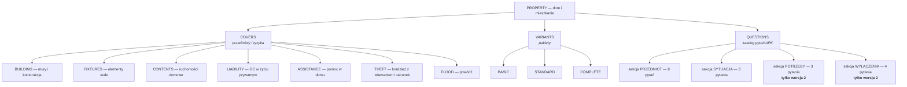
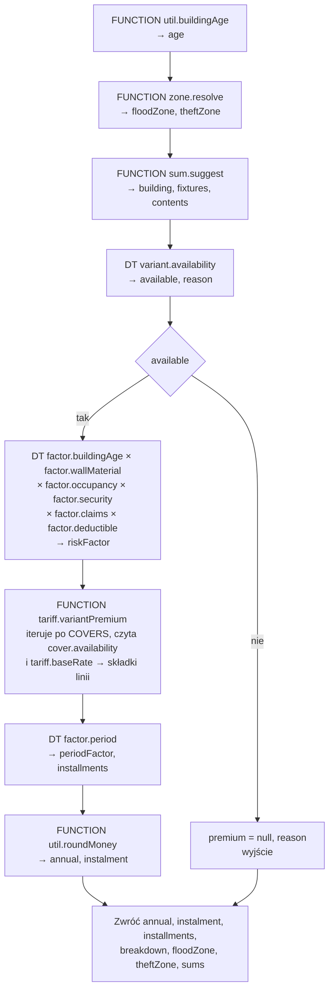
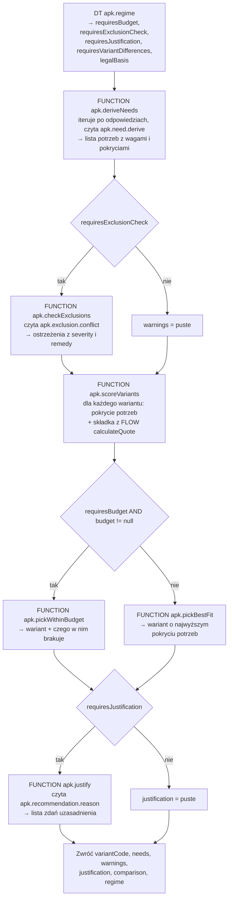

# Profil PROPERTY — projekt konfiguracji Higson

**Status:** propozycja do pracy. **W Higsonie nic jeszcze nie utworzono.**
**Data:** 2026-08-20
**Zakres:** ubezpieczenie domu i mieszkania (detal) — drzewo domeny, kontekst, tabele decyzyjne,
flow, funkcje Groovy, wersjonowanie datą **oraz analiza potrzeb klienta (APK) jako konfiguracja**.
**Podstawa faktograficzna:** `.maister/tasks/development/2026-08-20-property-demo/analysis/market-research.md`
— wnioski **R-1…R-15** i braki **B-1…B-8**. Każde odwołanie „(R-n)" wskazuje tam.

Konwencje nazewnicze i układ plików przeniesione z profili `DEMO` (motor) i `LIFE`, żeby snapshot
pozostał jednorodny — `standards/higson/rules-authoring.md` i `standards/higson/snapshot.md`.

---

## 1. Założenia projektowe

| # | Założenie | Konsekwencja |
|---|---|---|
| Z-1 | **APK jest konfiguracją, nie kodem** | Katalog pytań, ich widoczność, mapowanie na potrzeby, wyliczenie sumy, konfrontacja wyłączeń i treść uzasadnienia żyją w Higsonie. **Java nie zna ani jednego pytania i ani jednego progu** |
| Z-2 | **Wersjonowanie APK datą polisy** | Region `PROPERTY` z dwoma timeline'ami wokół `2027-07-01` — terminu z §2 uchwały KNF 190/2026. Przesunięcie daty zmienia ankietę **i** zachowanie rekomendacji |
| Z-3 | Wersjonowanie obejmuje **dwa wymiary naraz** | Domena odpowiada na „jakie pytania w ogóle istnieją", parametr `apk.regime` na „co z odpowiedziami wolno zrobić". Wzorzec D-4 z LIFE, tu rozwinięty — **D-5** |
| Z-4 | Parametryzacja w **tabelach decyzyjnych** | Zero stawek, progów i treści komunikatów w Javie i w Groovym |
| Z-5 | Groovy **tylko tam, gdzie tabela nie wystarcza** | Kryterium z LIFE: arytmetyka, której tabela nie zrobi, albo pętla, której flow nie ma. Osiem funkcji, każda uzasadniona w §6 |
| Z-6 | **Suma ubezpieczenia jest liczona, nie wybierana** | `SU = metraż × stawka(strefa, standard)` — mechanizm udokumentowany rynkowo (Generali §27, R-3a), nie wymyślony na demo |
| Z-7 | **Strefa geograficzna to pierwszy wymiar przestrzenny w tej aplikacji** | Dwie strefy z jednego adresu: powodziowa (dostępność) i kradzieżowa (składka) — **D-3** |
| Z-8 | Rekomendacja ma **uzasadniać, a nie tylko wyceniać** | Wynik APK to wariant + lista powodów + różnice między wariantami + ostrzeżenia. Rek. 8.7 i 9.3 |
| Z-9 | **Wszystkie liczby taryfowe są demonstracyjne** | Żadne OWU nie publikuje taryfy (B-1). Stawki zł/m² też nie (B-2). Nie ma tu ani jednej liczby aktuarialnej — **W-2** |
| Z-10 | Zakres świadomie **nie obejmuje NNW i zdrowia** | ERGO wciąga je do polisy majątkowej (R-13), ale w tej aplikacji to terytorium demo LIFE. Dwa dema nie mają pokazywać tego samego |

---

## 2. Drzewo domeny

Drzewo dzieli się na **trzy kolekcje pod korzeniem**, bo profil odpowiada na trzy różne pytania:
*co można kupić*, *w jakich pakietach* i **o co się pyta klienta**. Trzecia kolekcja jest tym,
czego nie ma ani MOTO, ani LIFE.



**`QUESTIONS` jest kolekcją domeny, a nie tabelą.** Pytanie ma tożsamość — kod, treść, typ,
obowiązkowość, sekcję, kolejność — i **istnieje albo nie istnieje w danej wersji regionu**. To jest
dokładnie ta własność, której tabela nie ma: wiersz zawsze istnieje, można go tylko wyzerować.
Cała demonstracja z §7 opiera się na tym, że siedem pytań **nie istnieje** przed `2027-07-01`,
a nie na tym, że mają wtedy `visible = false`.

**`FLOOD` i `THEFT` stoją obok `BUILDING`, choć są ryzykami, a nie przedmiotami.** Na rynku
sprzedaje się je jako osobno dokupywane rozszerzenia z własną decyzją o dostępności ([S5] §21 dla
powodzi, [S3] §40 ust. 4 dla stref kradzieżowych) — a w tej konfiguracji o wszystkim, co się
dokupuje, decyduje ta sama para tabel `cover.availability` / `cover.limitRule`. Rozdzielenie
„przedmiotów" od „ryzyk" na poziomie drzewa wymagałoby drugiego kompletu tabel po to, żeby
odwzorować rozróżnienie, którego oferta i tak nie robi.

### 2.1 Typy domenowe i atrybuty

Ścieżki tak, jak konsumuje je `domain.get()`:
`domain.get('PROPERTY', '/COVERS[BUILDING]')`, `domain.get('PROPERTY', '/QUESTIONS[AREA]')`.

#### `COVER` — przedmiot lub ryzyko

| Atrybut | Typ | Źródło | Uwagi |
|---|---|---|---|
| `NAME` | string | LITERAL | „Mury i konstrukcja", „Elementy stałe", … |
| `POSITION` | number | `demo.property.cover.position` | Kolejność na ekranie |
| `IS_AVAILABLE` | boolean | `demo.property.cover.availability` | Klucz: (`cover.code`, `variant.code`) |
| `SUM_BASIS` | string | `demo.property.cover.sumBasis` | `COMPUTED` / `DERIVED` / `CATALOGUE` / `NONE` — skąd bierze się suma |
| `CAP_KIND` | string | `demo.property.cover.limitRule [capKind]` | `RATIO` / `ABSOLUTE` / `BOTH` / `NONE` (R-5) |
| `CAP_RATIO` | number | `demo.property.cover.limitRule [capRatio]` | Ułamek sumy odniesienia |
| `CAP_ABSOLUTE` | number | `demo.property.cover.limitRule [capAbsolute]` | Kwota |
| `DESCRIPTION` | string | LITERAL | Zdanie pokazywane w porównaniu wariantów |

#### `VARIANT` — pakiet

| Atrybut | Typ | Źródło | Uwagi |
|---|---|---|---|
| `NAME` | string | LITERAL | „Podstawowy" / „Standardowy" / „Pełny" |
| `POSITION` | number | `demo.property.variant.position` | |
| `IS_AVAILABLE` | boolean | `demo.property.variant.availability` | Klucz: (`variant.code`, `quote.zone.flood`) |
| `LIABILITY_SUM` | number | `demo.property.variant.liabilitySum` | Suma gwarancyjna OC — jedyna suma z katalogu, nie z wyliczenia |
| `ANNUAL_PREMIUM` | number | FLOW `demo.property.calculateQuote [annual]` | Wynik, nie parametr |

#### ⭐ `QUESTION` — pytanie APK

To jest **serce tego profilu**. Każdy atrybut odpowiada jednemu wymogowi rekomendacji 8.

| Atrybut | Typ | Źródło | Wymóg, który realizuje |
|---|---|---|---|
| `TEXT` | string | LITERAL | 8.2.a — zrozumiałość; treść pytania jest **konfiguracją**, nie stringiem w szablonie |
| `KIND` | string | LITERAL | `CHOICE` / `MULTI` / `NUMBER` / `MONEY` / `BOOLEAN` / `TEXT` — jak renderować kontrolkę |
| `OPTIONS` | string | `demo.property.apk.question.options [options]` | Lista wartości rozdzielona przecinkami (patrz W-5) |
| `OPTION_LABELS` | string | `demo.property.apk.question.options [labels]` | Etykiety w tej samej kolejności |
| `IS_REQUIRED` | boolean | `demo.property.apk.question.required` | 8.4 — obowiązkowość jest regułą, nie atrybutem HTML |
| `SECTION` | string | LITERAL | `SUBJECT` / `SITUATION` / `NEEDS` / `EXCLUSIONS` — grupowanie na ekranie |
| `POSITION` | number | `demo.property.apk.question.position` | Kolejność w ankiecie |
| `IS_VISIBLE` | boolean | `demo.property.apk.question.visibility` | 8.1.b — widoczność zależna od wcześniejszych odpowiedzi |
| `HELP` | string | LITERAL | 8.2.a — wyjaśnienie przy pytaniu |
| `PREFILL_SOURCE` | string | `demo.property.apk.question.prefill [source]` | **8.3** — skąd pochodzi wartość podpowiedziana; puste = klient podał sam |
| `REFUSAL_MESSAGE` | string | `demo.property.apk.question.prefill [refusal]` | **8.4** — konsekwencja odmowy odpowiedzi |

> **Dlaczego `TEXT`, `KIND`, `SECTION` i `HELP` są `LITERAL`, a reszta idzie przez tabele.**
> Litery należą do pytania i zmieniają się razem z nim — nowe pytanie przynosi swoją treść.
> Widoczność, obowiązkowość i kolejność są **relacjami**: „to pytanie jest obowiązkowe, gdy
> nieruchomością jest dom", „to stoi przed tamtym". Relacja o dwóch stronach ma miejsce w tabeli,
> tak samo jak w LIFE suma świadczenia w wariancie (§2.1 tamtego dokumentu). Gdyby obowiązkowość
> była literałem, zmiana „w wersji 2 metraż jest obowiązkowy" wymagałaby edycji elementu domeny
> — czyli tego samego, co przebudowa formularza, tylko w innym narzędziu.

### 2.2 Katalog pytań — 18 elementów, 11 w wersji 1

Kolejność w tabeli = `POSITION`. Kolumna „Wersja" pokazuje, w której wersji regionu element
**istnieje** (D-5).

| # | Kod | Treść (`TEXT`) | `KIND` | Sekcja | Wersja | Widoczność |
|---|---|---|---|---|---|---|
| 10 | `PROPERTY_KIND` | Co chcesz ubezpieczyć? | CHOICE | SUBJECT | 1 i 2 | zawsze |
| 20 | `AREA` | Powierzchnia użytkowa w metrach kwadratowych | NUMBER | SUBJECT | 1 i 2 | zawsze |
| 30 | `CONSTRUCTION_YEAR` | Rok budowy | NUMBER | SUBJECT | 1 i 2 | zawsze |
| 40 | `WALL_MATERIAL` | Z czego są ściany? | CHOICE | SUBJECT | 1 i 2 | **tylko dla domu** |
| 50 | `FLOOR` | Na którym piętrze jest mieszkanie? | NUMBER | SUBJECT | 1 i 2 | **tylko dla mieszkania** |
| 60 | `RENOVATED` | Czy budynek przeszedł remont? | BOOLEAN | SUBJECT | 1 i 2 | **tylko gdy wiek > 50 lat** |
| 70 | `FINISH_STANDARD` | Jaki jest standard wykończenia? | CHOICE | SUBJECT | 1 i 2 | zawsze |
| 80 | `POSTCODE` | Kod pocztowy miejsca ubezpieczenia | TEXT | SUBJECT | 1 i 2 | zawsze |
| 90 | `OCCUPANCY` | Jak korzystasz z nieruchomości? | CHOICE | SITUATION | 1 i 2 | zawsze |
| 100 | `SECURITY` | Jakie masz zabezpieczenia? | CHOICE | SITUATION | 1 i 2 | zawsze |
| 110 | `CLAIMS_3Y` | Ile szkód zgłaszałeś w ostatnich trzech latach? | NUMBER | SITUATION | 1 i 2 | zawsze |
| 200 | `CIRCUMSTANCES` | Na wypadek jakich zdarzeń chcesz ochrony? | MULTI | NEEDS | **2** | zawsze |
| 210 | `COVER_PERIOD` | Na jaki okres chcesz ochrony? | CHOICE | NEEDS | **2** | zawsze |
| 220 | `BUDGET` | Jaka roczna składka jest dla Ciebie akceptowalna? | MONEY | NEEDS | **2** | zawsze |
| 300 | `VACANCY` | Czy nieruchomość bywa pusta dłużej niż 60 dni z rzędu? | BOOLEAN | EXCLUSIONS | **2** | zawsze |
| 310 | `BUSINESS_USE` | Czy prowadzisz tam działalność gospodarczą? | BOOLEAN | EXCLUSIONS | **2** | zawsze |
| 320 | `HIGH_VALUE_ITEMS` | Czy masz rzeczy o wartości jednostkowej powyżej 30 000 zł? | BOOLEAN | EXCLUSIONS | **2** | zawsze |
| 330 | `INSPECTIONS` | Czy przeglądy instalacji gazowej, elektrycznej i kominowej są aktualne? | BOOLEAN | EXCLUSIONS | **2** | zawsze |

**Trzy pytania są ukryte warunkowo już w wersji 1** (`WALL_MATERIAL`, `FLOOR`, `RENOVATED`).
To jest celowe: gdyby widoczność warunkowa pojawiała się dopiero w wersji 2, widz mógłby wziąć ją
za część zmiany regulacyjnej. Warunkowa ankieta jest normalną praktyką od zawsze — nowe jest
**to, o co się pyta**, a nie **to, że pytania się chowają**.

**Sekcje NEEDS i EXCLUSIONS istnieją wyłącznie w wersji 2** i to jest bezpośrednie odwzorowanie
rekomendacji: `CIRCUMSTANCES` i `COVER_PERIOD` realizują 8.2.b („na wypadek jakich okoliczności
i w jakim okresie"), `BUDGET` — 8.2.d („akceptowalna dla klienta wartość składki"), a cała sekcja
EXCLUSIONS — 8.2.c („czy wyłączenia nie stoją w sprzeczności z wymaganiami i potrzebami").
Wszystkie cztery pytania z sekcji EXCLUSIONS mają pokrycie w OWU (R-9), więc żadne z nich nie jest
pytaniem dla samego pytania.

---

## 3. Kontekst wejściowy

Poziomy wejściowe wiążą `property == source` do ścieżek modelu — `rules-authoring.md`. Ścieżki
zaczynają się od korzenia wystawionego przez adapter.

### 3.1 Nieruchomość

| Ścieżka | Typ | Skąd |
|---|---|---|
| `quote.property.kind` | string | odpowiedź `PROPERTY_KIND` — `HOUSE` / `FLAT` |
| `quote.property.area` | number | odpowiedź `AREA` |
| `quote.property.constructionYear` | number | odpowiedź `CONSTRUCTION_YEAR` |
| `quote.property.age` | number | **wyliczane**, `demo.property.util.buildingAge` |
| `quote.property.wallMaterial` | string | odpowiedź `WALL_MATERIAL` — `BRICK` / `WOOD_FRAME` |
| `quote.property.floor` | number | odpowiedź `FLOOR` |
| `quote.property.renovated` | boolean | odpowiedź `RENOVATED` |
| `quote.property.finishStandard` | string | odpowiedź `FINISH_STANDARD` — `BASIC` / `STANDARD` / `PREMIUM` |
| `quote.property.postcode` | string | odpowiedź `POSTCODE` |
| `quote.property.postcodeArea` | string | **wyliczane** — dwie pierwsze cyfry, klucz obu stref |
| `quote.property.occupancy` | string | `PERMANENT` / `SEASONAL` / `RENTED` |
| `quote.property.security` | string | `NONE` / `DOOR` / `ALARM` / `MONITORED` |
| `quote.property.claims3y` | number | odpowiedź `CLAIMS_3Y` |

### 3.2 Polisa i strefy

| Ścieżka | Typ | Skąd |
|---|---|---|
| `quote.policy.startDate` | date | wejście — **klucz do wersji regionu**, §7 |
| `quote.policy.periodMonths` | number | odpowiedź `COVER_PERIOD`; w wersji 1 domyślnie 12 |
| `quote.policy.deductible` | number | wybór klienta — franszyza redukcyjna (D-8) |
| `quote.zone.flood` | string | **wyliczane**, `demo.property.zone.resolve` — `Z0` / `Z1` / `Z2` / `ZX` |
| `quote.zone.theft` | string | **wyliczane**, `demo.property.zone.resolve` — `T1` / `T2` / `T3` |

### 3.3 Potrzeby i sytuacja (wersja 2)

| Ścieżka | Typ | Skąd |
|---|---|---|
| `quote.needs.budget` | number | odpowiedź `BUDGET`; `null` = klient nie podał |
| `quote.situation.vacancy` | boolean | odpowiedź `VACANCY` |
| `quote.situation.businessUse` | boolean | odpowiedź `BUSINESS_USE` |
| `quote.situation.highValueItems` | boolean | odpowiedź `HIGH_VALUE_ITEMS` |
| `quote.situation.inspections` | boolean | odpowiedź `INSPECTIONS` |

> ⚠️ **`CIRCUMSTANCES` nie ma własnej ścieżki kontekstu.** Jest pytaniem wielokrotnego wyboru,
> a Higson nie potrzebuje tu kolekcji: Java iteruje po zaznaczonych wartościach i przy każdej
> woła tabelę z parą (`question.code = CIRCUMSTANCES`, `answer.value = FIRE`). Ta sama sztuczka,
> którą LIFE robi na parze (`benefit.code`, `variant.code`). Kolekcja w kontekście byłaby tu
> **droższa i mniej czytelna** — a przede wszystkim zamknęłaby drogę do tego, żeby dowolne inne
> pytanie stało się wielokrotne bez zmiany adaptera.

### 3.4 Sumy

| Ścieżka | Typ | Skąd |
|---|---|---|
| `quote.sums.building` | number | wyliczane, może być podniesione przez klienta (D-2) |
| `quote.sums.fixtures` | number | jw. |
| `quote.sums.contents` | number | jw. |
| `quote.sums.suggestedBuilding` | number | wyliczane — **wartość odniesienia dla ostrzeżenia** |

### 3.5 Elementy iteracji

| Ścieżka | Typ | Kiedy |
|---|---|---|
| `question.code` | string | iteracja po `QUESTIONS` |
| `answer.value` | string | wartość odpowiedzi jako tekst — przy odczycie potrzeb i wyłączeń |
| `cover.code` | string | iteracja po `COVERS` |
| `variant.code` | string | iteracja po `VARIANTS` |
| `reason.code` | string | składanie uzasadnienia |

Elementy iteracji adresowane nazwą typu, tak jak `coverage.code` w MOTO i `rider.code` w LIFE —
nie występują na liście ścieżek kontekstu i to jest w porządku (W-7 z planu LIFE).

---

## 4. Tabele decyzyjne

Kod parametru odzwierciedla ścieżkę pliku (`/` → `.`) pod prefiksem `demo.property.*`.
Wszystkie `inMemory = true`. Konwencje przedziałów z planu LIFE: `18 - 29` ze spacjami,
`true`/`false` dla boolean, tablice w jednej komórce po przecinku.

> ⚠️ **Reguła z LIFE, obowiązująca tu bez zmian:** w tabeli, w której **wszystkie** kolumny
> wejściowe są przedziałowe, **nie dajemy wiersza `* - *`** — silnik dopasowuje go równolegle
> z właściwym pasmem i zwraca dwie wartości. Kolumna dopasowywana dokładnie neutralizuje problem.
> Dotyczy tu wyłącznie `factor.buildingAge` i `factor.claims`.

### 4.1 APK — katalog pytań

#### `demo.property.apk.question.visibility`
Realizuje 8.1.b. Cztery wiersze wystarczają, bo **domyślną odpowiedzią jest „pokaż"**.
```
IN   question  string   question.code
IN   kind      string   quote.property.kind
IN   age       number   quote.property.age        matcher: between/ii
OUT  visible   boolean
```
```
question;kind;age;visible
*;*;* - *;true
WALL_MATERIAL;FLAT;* - *;false
FLOOR;HOUSE;* - *;false
RENOVATED;*;* - 50;false
```

> **Wiersz `*;*;* - *;true` jest tu bezpieczny**, mimo reguły z ramki wyżej, bo dwie pierwsze
> kolumny dopasowują się dokładnie. To jedyne miejsce w tym profilu, gdzie ten wyjątek ma
> znaczenie — i dlatego jest opisany, a nie milcząco wykorzystany.

#### `demo.property.apk.question.required`
```
IN   question  string   question.code
IN   kind      string   quote.property.kind
OUT  required  boolean
```
```
question;kind;required
*;*;true
BUDGET;*;false
FLOOR;*;false
RENOVATED;*;false
```

> `BUDGET` jest **nieobowiązkowy z rozmysłu**. Rekomendacja 8.2.d mówi „z uwzględnieniem
> akceptowalnej dla klienta wartości składki", a nie „po wymuszeniu jej podania". Wymuszony budżet
> jest budżetem zmyślonym, a rekomendacja zbudowana na zmyślonym budżecie jest gorsza niż
> rekomendacja zbudowana bez niego. Ścieżka „nie podam" ma swój komunikat (8.4) — patrz **D-6**.

#### `demo.property.apk.question.position`
```
IN   question  string   question.code
OUT  position  number
```
```
question;position
*;999
PROPERTY_KIND;10
AREA;20
CONSTRUCTION_YEAR;30
WALL_MATERIAL;40
FLOOR;50
RENOVATED;60
FINISH_STANDARD;70
POSTCODE;80
OCCUPANCY;90
SECURITY;100
CLAIMS_3Y;110
CIRCUMSTANCES;200
COVER_PERIOD;210
BUDGET;220
VACANCY;300
BUSINESS_USE;310
HIGH_VALUE_ITEMS;320
INSPECTIONS;330
```
*19 wierszy.*

#### `demo.property.apk.question.options`
Warianty odpowiedzi i ich etykiety. Dwie kolumny wyjściowe, obie tablicowe w jednej komórce —
wzorzec `individual.rider.sumsOffered` z LIFE.
```
IN   question  string   question.code
OUT  options   string
OUT  labels    string
```
```
question;options;labels
*;;
PROPERTY_KIND;HOUSE,FLAT;Dom jednorodzinny,Mieszkanie
WALL_MATERIAL;BRICK,WOOD_FRAME;Murowane,Szkieletowe drewniane
FINISH_STANDARD;BASIC,STANDARD,PREMIUM;Podstawowy,Podwyższony,Wysoki
OCCUPANCY;PERMANENT,SEASONAL,RENTED;Mieszkam na stałe,Korzystam sezonowo,Wynajmuję
SECURITY;NONE,DOOR,ALARM,MONITORED;Brak,Drzwi antywłamaniowe,Alarm,Alarm z monitoringiem
CIRCUMSTANCES;FIRE,FLOOD,THEFT,LIABILITY,SURGE;Pożar i zdarzenia losowe,Powódź,Kradzież,Szkody wyrządzone innym,Przepięcie
COVER_PERIOD;12,24,36;Rok,Dwa lata,Trzy lata
```
*8 wierszy.*

#### `demo.property.apk.question.prefill`
Realizuje **8.3** i **8.4** naraz, bo obie informacje dotyczą tego samego: skąd wartość pochodzi
i co się stanie, gdy klient jej nie poda.
```
IN   question  string   question.code
OUT  source    string
OUT  refusal   string
```
```
question;source;refusal
*;;Bez tej informacji nie możemy ocenić Twoich potrzeb i przedstawimy ofertę wyłącznie orientacyjną.
POSTCODE;Adres z poprzedniej polisy;Bez kodu pocztowego nie ustalimy strefy powodziowej — ochrona od powodzi nie będzie dostępna.
CLAIMS_3Y;Historia szkód w bazie UFG;Bez historii szkód przyjmiemy najostrożniejsze założenie, co podniesie składkę.
BUDGET;;Bez informacji o budżecie zaproponujemy wariant najpełniej odpowiadający potrzebom, bez względu na cenę.
AREA;Metraż z poprzedniej polisy;Bez metrażu nie wyliczymy rekomendowanej sumy ubezpieczenia.
```
*6 wierszy.*

> **Kolumna `source` jest wypełniona tylko tam, gdzie prefill jest realny** (poprzednia polisa,
> UFG). Rekomendacja 8.3 wymaga poinformowania **wtedy, gdy** korzysta się z danych z innego
> źródła — więc puste pole ma tu znaczenie „klient podał sam", a nie „nie wiem".

### 4.2 APK — potrzeby, wyłączenia, uzasadnienie

#### `demo.property.apk.need.derive`
Mapowanie **odpowiedź → potrzeba** (rek. 8.2.b). Jedna odpowiedź może rodzić jedną potrzebę;
wiele odpowiedzi może wskazać to samo pokrycie i wtedy jego waga rośnie.
```
IN   question  string   question.code
IN   answer    string   answer.value
OUT  need      string
OUT  cover     string
OUT  weight    number
```
```
question;answer;need;cover;weight
*;*;;;0
PROPERTY_KIND;HOUSE;Ochrona konstrukcji budynku;BUILDING;3
PROPERTY_KIND;FLAT;Ochrona lokalu i elementów stałych;FIXTURES;3
CIRCUMSTANCES;FIRE;Ochrona przed pożarem i zdarzeniami losowymi;BUILDING;3
CIRCUMSTANCES;FLOOD;Ochrona przed powodzią;FLOOD;3
CIRCUMSTANCES;THEFT;Ochrona przed kradzieżą z włamaniem;THEFT;3
CIRCUMSTANCES;LIABILITY;Odpowiedzialność za szkody wyrządzone innym;LIABILITY;3
CIRCUMSTANCES;SURGE;Ochrona sprzętu przed przepięciem;CONTENTS;2
OCCUPANCY;RENTED;Ochrona przy wynajmie lokalu;LIABILITY;2
OCCUPANCY;SEASONAL;Ochrona nieruchomości okresowo pustej;THEFT;2
SECURITY;NONE;Pilna potrzeba ochrony przed kradzieżą — brak zabezpieczeń;THEFT;2
HIGH_VALUE_ITEMS;true;Podwyższony limit na przedmioty wartościowe;CONTENTS;2
BUSINESS_USE;true;Ochrona sprzętu wykorzystywanego zawodowo;CONTENTS;1
FINISH_STANDARD;PREMIUM;Ochrona wysokiego standardu wykończenia;FIXTURES;2
```
*14 wierszy.*

> **Wiersze `PROPERTY_KIND` i `OCCUPANCY` działają także w wersji 1**, mimo że `CIRCUMSTANCES`
> jeszcze nie istnieje. To jest ważne dla demonstracji: wersja 1 **też** wyprowadza potrzeby,
> tylko z bardzo ubogiego materiału — trzy potrzeby zamiast ośmiu. Różnica jest wtedy widoczna
> jako różnica jakości analizy, a nie jako „przedtem nic, potem coś".

#### ⭐ `demo.property.apk.exclusion.conflict`
Realizuje **8.2.c**. Każdy wiersz ma pokrycie w OWU — kolumna „Źródło" w §7 researchu.
```
IN   question   string   question.code
IN   answer     string   answer.value
OUT  exclusion  string
OUT  severity   number
OUT  warning    string
OUT  remedy     string
```
```
question;answer;exclusion;severity;warning;remedy
*;*;;0;;
VACANCY;true;VACANCY_60D;2;Nieruchomość pozostawiona bez opieki dłużej niż 60 dni jest w warunkach uznawana za pustostan, a szkody w niej są wyłączone z ochrony.;Zgłoś planowane okresy nieobecności przed zawarciem umowy — wtedy ochrona zostaje utrzymana.
INSPECTIONS;false;NO_INSPECTION;2;Brak aktualnych przeglądów instalacji gazowej, elektrycznej i kominowej ogranicza odpowiedzialność za szkody, które z nich wynikną.;Wykonaj przeglądy przed początkiem ochrony i zachowaj protokoły.
RENOVATED;false;OLD_UNRENOVATED;2;Budynek starszy niż 50 lat bez remontu wycenia się w wartości rzeczywistej, czyli pomniejszonej o zużycie techniczne.;Udokumentuj przeprowadzone remonty — wtedy wycena idzie w wartości nowej.
OCCUPANCY;RENTED;TENANT_DAMAGE;1;Szkody wyrządzone przez najemcę nie są objęte OC w życiu prywatnym właściciela.;Rozszerz zakres o OC najemcy.
OCCUPANCY;SEASONAL;SEASONAL_USE;1;Nieruchomość użytkowana sezonowo bywa traktowana jak dom letniskowy — węższy zakres i wypłata w wartości rzeczywistej.;Zadeklaruj rzeczywisty sposób użytkowania, żeby uniknąć sporu po szkodzie.
BUSINESS_USE;true;BUSINESS_PROPERTY;1;Mienie służące działalności gospodarczej ma osobny, niższy limit odpowiedzialności.;Rozważ osobne ubezpieczenie sprzętu firmowego.
HIGH_VALUE_ITEMS;true;VALUABLES_LIMIT;1;Przedmioty o wartości jednostkowej powyżej 30 000 zł są objęte ochroną wyłącznie po zgłoszeniu i udokumentowaniu.;Dołącz spis przedmiotów wartościowych do wniosku.
SECURITY;NONE;THEFT_SECURITY;1;Bez zabezpieczeń przeciwwłamaniowych ochrona od kradzieży bywa ograniczona albo niedostępna.;Zamontuj drzwi antywłamaniowe albo alarm.
```
*9 wierszy.*

> **`severity` istnieje po to, żeby ekran nie krzyczał jednakowo.** `2` znaczy „ta odpowiedź
> wyłącza albo istotnie ogranicza ochronę, której klient chce" i idzie na czerwono nad
> rekomendację; `1` znaczy „ograniczenie, o którym trzeba wiedzieć" i idzie żółtym paskiem przy
> odpowiednim pokryciu. Bez tego rozróżnienia osiem ostrzeżeń naraz jest tym samym, co zero.

> **Kolumna `remedy` nie jest ozdobą.** Rekomendacja 8.2.c mówi o ocenie, „czy wyłączenia nie
> stoją w **sprzeczności z wymaganiami i potrzebami**". Samo pokazanie sprzeczności jej nie
> usuwa — usuwa ją dopiero informacja, co z tym zrobić. To jest jedyne miejsce w tym profilu,
> gdzie reguła **odradza własny produkt**, i dlatego zostaje w tabeli, a nie w komentarzu.

#### `demo.property.apk.recommendation.reason`
Realizuje **8.7** — dokumentacja ma *wykazać* zgodność, więc jej treść jest regułą.
```
IN   reason    string   reason.code
OUT  text      string
OUT  position  number
```
```
reason;text;position
*;;999
NEEDS_MATCHED;Wariant {0} obejmuje wszystkie {1} potrzeby, które wynikają z Twoich odpowiedzi.;10
NEEDS_PARTIAL;Wariant {0} obejmuje {1} z {2} potrzeb wynikających z Twoich odpowiedzi. Poza zakresem zostaje: {3}.;10
SUM_COMPUTED;Sumę ubezpieczenia murów wyliczyliśmy jako {0} m² × {1} zł/m² dla Twojej lokalizacji i standardu wykończenia.;20
SUM_RAISED;Podniosłeś sumę powyżej wyliczonej — to zwiększa ochronę i składkę.;25
SUM_LOWERED;Obniżyłeś sumę poniżej wyliczonej wartości odtworzeniowej. Przy szkodzie całkowitej odszkodowanie nie pokryje odbudowy.;25
BUDGET_FIT;Roczna składka {0} zł mieści się w podanym budżecie {1} zł.;30
BUDGET_EXCEEDED;Wariant najpełniej odpowiadający potrzebom kosztuje {0} zł rocznie, czyli powyżej Twojego budżetu {1} zł. Proponujemy wariant {2} i wskazujemy, czego w nim brakuje.;30
BUDGET_ABSENT;Nie podałeś akceptowalnej składki, więc proponujemy wariant najpełniej odpowiadający potrzebom.;30
FLOOD_UNAVAILABLE;W Twojej lokalizacji ochrona od powodzi nie jest dostępna — miejsce leży w strefie o najwyższym zagrożeniu.;40
FLOOD_DEDUCTIBLE;Ochrona od powodzi w Twojej lokalizacji wymaga franszyzy redukcyjnej {0} zł.;40
FLOOD_WAITING;Ochrona od powodzi zaczyna działać po {0} dniach od zawarcia umowy.;45
EXCLUSIONS_FOUND;Twoje odpowiedzi wskazują {0} sytuacji, w których warunki ograniczają ochronę. Opisujemy je nad propozycją.;50
LEGAL_BASIS;Analizę przeprowadziliśmy zgodnie z: {0}.;90
```
*14 wierszy.*

> **Placeholdery `{0}`, `{1}` — nie konkatenacja w Groovym.** Treść ma zostać po stronie
> konfiguracji w całości, razem z szykiem zdania i interpunkcją. Funkcja `apk.justify` wstawia
> wartości w miejsca, ale **nie decyduje o kolejności słów** — bo to jest decyzja redakcyjna,
> a redakcja komunikatu do klienta zmienia się częściej niż algorytm.

#### `demo.property.apk.regime` ⭐ **wersjonowana**
Reżim APK jako **parametr**, obok wersjonowanego zbioru pytań. To jest druga połowa D-5.
```
OUT  code                       string
OUT  name                       string
OUT  legalBasis                 string
OUT  requiresBudget             boolean
OUT  requiresExclusionCheck     boolean
OUT  requiresJustification      boolean
OUT  requiresVariantDifferences boolean
```
Wersja 1:
```
code;name;legalBasis;requiresBudget;requiresExclusionCheck;requiresJustification;requiresVariantDifferences
STATUTORY;APK — minimum ustawowe;art. 8 ustawy z 15.12.2017 r. o dystrybucji ubezpieczeń;false;false;false;false
```
Wersja 2:
```
code;name;legalBasis;requiresBudget;requiresExclusionCheck;requiresJustification;requiresVariantDifferences
KNF_190_2026;APK wg Rekomendacji KNF;Rekomendacje 8 i 9 — uchwała KNF nr 190/2026 z 26.06.2026 r.;true;true;true;true
```

> **Tabela bez ani jednej kolumny wejściowej.** To nie jest błąd projektowy — to jest cała jej
> istota. Odpowiada na pytanie „**jaki reżim obowiązuje**", a jedynym wejściem jest data polisy,
> którą region już czyta. Dodanie kolumny `validFrom` odtworzyłoby wersjonowanie ręcznie obok
> mechanizmu, który jest w silniku (§7).

### 4.3 Suma ubezpieczenia

#### `demo.property.sum.ratePerSqm` ⭐ **wersjonowana**
Stawka odtworzeniowa zł/m². Wersjonowana, bo ceny budowlane zmieniają się częściej niż release —
i to jest drugi, niezależny od APK powód, dla którego ten profil ma region.
```
IN   area      string   quote.property.postcodeArea
IN   kind      string   quote.property.kind
IN   standard  string   quote.property.finishStandard
OUT  rate      number
```
Wersja 1 (`2026-01-01`) — ⚠️ **liczby demonstracyjne (W-2)**:
```
area;kind;standard;rate
*;*;*;4200
*;HOUSE;BASIC;3800
*;HOUSE;STANDARD;4600
*;HOUSE;PREMIUM;5900
*;FLAT;BASIC;4400
*;FLAT;STANDARD;5300
*;FLAT;PREMIUM;6800
00;FLAT;STANDARD;7900
02;FLAT;STANDARD;7400
30;FLAT;STANDARD;6600
80;FLAT;STANDARD;6100
50;FLAT;STANDARD;5900
```
*12 wierszy.*

#### `demo.property.sum.derivedRatio`
Sumy elementów stałych i ruchomości jako ułamek sumy murów. Rynkowo to jest właśnie relacja —
Generali §27 ust. 4 wyprowadza je z „własnych danych statystycznych", nie z osobnego pomiaru.
```
IN   cover     string   cover.code
IN   standard  string   quote.property.finishStandard
OUT  ratio     number
```
```
cover;standard;ratio
*;*;0
FIXTURES;BASIC;0.15
FIXTURES;STANDARD;0.22
FIXTURES;PREMIUM;0.32
CONTENTS;BASIC;0.10
CONTENTS;STANDARD;0.15
CONTENTS;PREMIUM;0.24
```
*7 wierszy.*

#### ⭐ `demo.property.fixtures.model`
**To jest R-2 zamienione w konfigurację.** Granica mury/elementy stałe to trzy niezależne
parametry, więc jest to jedna tabela o trzech kolumnach wyjściowych, a nie trzy decyzje w kodzie.
```
OUT  mode              string    SEPARATE | INCLUDED
OUT  sublimitRatio     number
OUT  externalJoinery   string    BUILDING | FIXTURES
```
```
mode;sublimitRatio;externalJoinery
SEPARATE;0;FIXTURES
```

> **Model demo to wariant PZU** — elementy stałe z własną sumą, stolarka po stronie wykończenia.
> Wybrany dlatego, że tylko przy `SEPARATE` widać na ekranie **dwie wyliczone sumy**, czyli to,
> co §5 briefu nazywa „suma liczona, nie wybierana". Ale **przełączenie na model Warty
> (`INCLUDED`, `sublimitRatio = 0`), Link4 (`INCLUDED`, `0.30`) albo ERGO (`externalJoinery =
> BUILDING`) to zmiana trzech komórek** — bez dotykania Javy, ekranu i pozostałych tabel.
> To jest najkrótsza demonstracja tezy całego produktu, jaką ten profil ma: różnica, o którą
> polski rynek naprawdę się różni, mieści się w jednym wierszu.

### 4.4 Strefy

#### `demo.property.zone.flood`
```
IN   area   string   quote.property.postcodeArea
OUT  zone   string
```
⚠️ **Przypisanie stref do obszarów pocztowych jest demonstracyjne (B-6)** — Generali wyznacza je
„w oparciu o statystykę zdarzeń szkodowych" i mapy nie publikuje. Wybrano obszary, które
w powszechnej świadomości kojarzą się z powodziami z 1997 i 2024 r., żeby demo było czytelne.
```
area;zone
*;Z0
50;Z2
51;Z2
57;ZX
43;Z1
44;Z1
30;Z1
80;Z1
70;Z1
87;Z1
```
*10 wierszy.*

#### `demo.property.zone.theft`
Druga strefa z tego samego adresu — **czynnik, nie dostępność** (D-3).
```
IN   area    string   quote.property.postcodeArea
OUT  zone    string
OUT  factor  number
```
```
area;zone;factor
*;T1;1.00
00;T3;1.35
01;T3;1.35
02;T3;1.30
03;T2;1.18
30;T3;1.28
31;T2;1.18
80;T2;1.20
50;T2;1.18
60;T2;1.15
40;T2;1.15
```
*11 wierszy.*

#### `demo.property.flood.availability`
**Odwzorowanie [S5] §21 ust. 1 co do znaku** (R-10).
```
IN   zone               string   quote.zone.flood
OUT  available          boolean
OUT  requiresDeductible boolean
OUT  minDeductible      number
OUT  message            string
```
```
zone;available;requiresDeductible;minDeductible;message
*;false;false;0;Nie ustaliliśmy strefy zagrożenia powodziowego dla tego adresu.
Z0;true;false;0;
Z1;true;false;0;
Z2;true;true;1000;W Twojej lokalizacji ochrona od powodzi wymaga franszyzy redukcyjnej co najmniej 1000 zł.
ZX;false;false;0;Miejsce ubezpieczenia leży w strefie o najwyższym zagrożeniu powodziowym — ochrona od powodzi nie jest dostępna.
```
*6 wierszy.*

#### `demo.property.flood.waitingPeriod`
```
IN   priorCover  boolean  quote.property.priorFloodCover
OUT  days        number
```
```
priorCover;days
*;30
true;0
false;30
```

### 4.5 Taryfa

#### `demo.property.tariff.baseRate` ⭐ **wersjonowana**
Stawka roczna w promilach sumy ubezpieczenia; `FLAT` znaczy kwotę w złotych, nie promil.
```
IN   cover   string   cover.code
OUT  rate    number
OUT  basis   string    SUM | FLAT
```
Wersja 1 — ⚠️ **liczby demonstracyjne (W-2)**:
```
cover;rate;basis
*;0;FLAT
BUILDING;0.85;SUM
FIXTURES;1.40;SUM
CONTENTS;2.60;SUM
THEFT;3.20;SUM
FLOOD;1.90;SUM
LIABILITY;0.09;SUM
ASSISTANCE;72;FLAT
```
*8 wierszy.*

#### `demo.property.factor.buildingAge`
```
IN   age     number   quote.property.age   matcher: between/ii
OUT  factor  number
```
⚠️ Sama kolumna przedziałowa → **bez wiersza `* - *`**, `matchRequired = false`, obsługa `null`
w funkcji.
```
age;factor
* - 10;0.92
10 - 30;1.00
30 - 50;1.12
50 - 80;1.30
80 - *;1.55
```

#### `demo.property.factor.wallMaterial`
```
IN   material  string   quote.property.wallMaterial
OUT  factor    number
```
```
material;factor
*;1.00
BRICK;1.00
WOOD_FRAME;1.45
```

#### `demo.property.factor.occupancy`
```
IN   occupancy  string   quote.property.occupancy
OUT  factor     number
```
```
occupancy;factor
*;1.00
PERMANENT;1.00
SEASONAL;1.30
RENTED;1.20
```

#### `demo.property.factor.security`
Zniżka za zabezpieczenia. **Celowo NIE wersjonowana** — to jest dowód selektywności (§7.4).
```
IN   security  string   quote.property.security
OUT  factor    number
```
```
security;factor
*;1.00
NONE;1.15
DOOR;1.00
ALARM;0.92
MONITORED;0.85
```

#### `demo.property.factor.claims`
```
IN   claims  number   quote.property.claims3y   matcher: between/ii
OUT  factor  number
```
⚠️ Sama kolumna przedziałowa → bez `* - *`.
```
claims;factor
* - 0;0.90
1 - 1;1.15
2 - 2;1.45
3 - *;1.90
```

#### `demo.property.factor.deductible`
Franszyza w roli **obniżki składki** — pierwsza z dwóch ról z D-8.
```
IN   deductible  number   quote.policy.deductible
OUT  factor      number
```
```
deductible;factor
*;1.00
0;1.00
200;0.95
500;0.90
1000;0.84
```

#### `demo.property.factor.period`
```
IN   months       number   quote.policy.periodMonths
OUT  factor       number
OUT  installments number
```
```
months;factor;installments
*;1.00;1
12;1.00;1
24;1.92;2
36;2.76;3
```

> **Czynnik jest mniejszy niż wielokrotność okresu** — 24 miesiące kosztują 1.92 rocznej, a nie 2.0.
> To jest zniżka za dłuższe zobowiązanie, wprost wymieniana wśród czynników taryfowych przez
> Allianz („długość okresu ubezpieczenia", [S4] pkt 134) i ERGO ([S3] §40 ust. 2 pkt 3).

### 4.6 Zakres i warianty

#### `demo.property.cover.availability`
Klucz (`cover`, `variant`) — ta sama relacja co `group.benefit.availability` w LIFE.
```
IN   cover      string   cover.code
IN   variant    string   variant.code
OUT  available  boolean
```
```
cover;variant;available
*;*;false
BUILDING;BASIC;true
BUILDING;STANDARD;true
BUILDING;COMPLETE;true
FIXTURES;BASIC;false
FIXTURES;STANDARD;true
FIXTURES;COMPLETE;true
CONTENTS;BASIC;false
CONTENTS;STANDARD;true
CONTENTS;COMPLETE;true
LIABILITY;BASIC;false
LIABILITY;STANDARD;true
LIABILITY;COMPLETE;true
ASSISTANCE;BASIC;false
ASSISTANCE;STANDARD;false
ASSISTANCE;COMPLETE;true
THEFT;BASIC;false
THEFT;STANDARD;false
THEFT;COMPLETE;true
FLOOD;BASIC;false
FLOOD;STANDARD;false
FLOOD;COMPLETE;true
```
*22 wiersze.*

> **Drabinka jest ścisła: każdy wariant zawiera wszystko, co poprzedni.** Bez tego rekomendacja
> z §5.2 przestaje mieć sens — „najtańszy wariant pokrywający potrzeby" zakłada, że warianty da się
> uporządkować. Test `variant.ladder` (§9) pilnuje tego wprost, bo jest to własność, którą łatwo
> zepsuć jednym wierszem przy dokładaniu pokrycia.

#### `demo.property.cover.position`
```
cover;position
*;999
BUILDING;10
FIXTURES;20
CONTENTS;30
THEFT;40
FLOOD;50
LIABILITY;60
ASSISTANCE;70
```

#### `demo.property.cover.sumBasis`
```
IN   cover      string   cover.code
OUT  basis      string    COMPUTED | DERIVED | CATALOGUE | NONE
OUT  reference  string
```
```
cover;basis;reference
*;NONE;
BUILDING;COMPUTED;
FIXTURES;DERIVED;BUILDING
CONTENTS;DERIVED;BUILDING
THEFT;DERIVED;CONTENTS
FLOOD;DERIVED;BUILDING
LIABILITY;CATALOGUE;
ASSISTANCE;NONE;
```
*8 wierszy.*

#### `demo.property.cover.limitRule`
Wzorzec `min(ratio × SU, kwota)` z **R-5** — dokładnie to, co [S1] §46 ust. 3 nazywa „najniższym
limitem spośród tych, do których kwalifikuje się przedmiot".
```
IN   cover        string   cover.code
OUT  capKind      string    RATIO | ABSOLUTE | BOTH | NONE
OUT  capRatio     number
OUT  capAbsolute  number
OUT  label        string
```
```
cover;capKind;capRatio;capAbsolute;label
*;NONE;0;0;
CONTENTS;BOTH;0.10;10000;Gotówka — 10% sumy ruchomości, nie więcej niż 10 000 zł
THEFT;BOTH;0.40;50000;Biżuteria i wyroby z metali szlachetnych — 40% sumy, nie więcej niż 50 000 zł
FIXTURES;RATIO;0.30;0;Elementy stałe w pomieszczeniach przynależnych — 30% sumy
LIABILITY;NONE;0;0;
ASSISTANCE;ABSOLUTE;0;3000;Jednorazowa interwencja — do 3 000 zł
FLOOD;NONE;0;0;
BUILDING;NONE;0;0;
```
*9 wierszy. Wartości `capRatio`/`capAbsolute` przepisane z limitów PZU (§5 researchu) — jedyne
liczby w tym profilu, które **nie są wymyślone**.*

#### `demo.property.variant.availability`
```
IN   variant    string   variant.code
IN   zone       string   quote.zone.flood
OUT  available  boolean
OUT  reason     string
```
```
variant;zone;available;reason
*;*;true;
COMPLETE;ZX;false;Wariant pełny zawiera ochronę od powodzi, która w tej lokalizacji nie jest dostępna.
```

> **Strefa `ZX` nie wycina powodzi po cichu — wycina cały wariant i mówi dlaczego.**
> Wariant COMPLETE bez powodzi byłby wariantem COMPLETE tylko z nazwy, a klient dowiedziałby się
> o tym dopiero z polisy. To jest ta sama zasada, co D-3 w LIFE: naruszenie pułapu jest błędem,
> nie cichym przycięciem.

#### `demo.property.variant.position` i `demo.property.variant.liabilitySum`
```
variant;position
*;999
BASIC;10
STANDARD;20
COMPLETE;30
```
```
variant;sum
*;0
BASIC;0
STANDARD;200000
COMPLETE;2000000
```
*Suma 2 000 000 zł dla wariantu pełnego przepisana z ERGO 7 („Suma gwarancyjna w Wariancie III to
aż 2 mln zł", [S3]).*

---

## 5. Flow — algorytmy wysokopoziomowe

Dwa flow. Reszta algorytmiki jest w funkcjach, bo **`EXPRESSION` we flow nie działa** (W-15 z planu
LIFE) i **nie ma `ctx.set`** (W-10), więc flow nie potrafi ani liczyć, ani przekazać wyliczonej
wartości do tabeli kluczowanej tą wartością.

### 5.1 `demo.property.calculateQuote` — wycena jednego wariantu



**Zmienne flow:** `age`, `floodZone`, `theftZone`, `sumBuilding`, `sumFixtures`, `sumContents`,
`available`, `reason`, `riskFactor`, `periodFactor`, `installments`, `annual` *(returned)*,
`instalment` *(returned)*, `breakdown` *(returned)*.

**11 nodów** — mieści się w limicie 15 z §11.

> ⚠️ **Zaokrąglenie na linię, raz — nie na sumie.** Ta sama zasada, co w LIFE §5.1: suma
> niezaokrąglonych linii zaokrąglona na końcu daje total, który nie zgadza się z własnym
> rozbiciem, a czytelnik oferty zawsze to wyłapie.

> **Czynniki mnożą się, nie zastępują.** Sześć czynników w jednym węźle, bo to jest jedna myśl
> („oceń ryzyko"), a rozbicie na sześć węzłów zamieniłoby diagram w listę.

### 5.2 ⭐ `demo.property.apk.recommend` — rekomendacja z uzasadnieniem

To jest flow, dla którego ten profil istnieje. Realizuje 8.2.d, 8.7, 9.1 i 9.3 naraz.



**13 nodów** — na styk, ale w limicie. Droga wyjścia opisana w §11.

> **Trzy bramki na `requires*` to nie są trzy warunki — to jest jedna decyzja regulacyjna,
> rozłożona na trzy miejsca, w których się objawia.** Wersja 1 przechodzi przez ten sam flow
> i wychodzi z niego z wariantem, ale **bez ostrzeżeń, bez uzasadnienia i bez porównania**.
> Gdyby wersje miały osobne flow, demo pokazywałoby, że da się mieć dwa algorytmy — a ma pokazać,
> że **ten sam algorytm zachowuje się inaczej, bo zmieniła się konfiguracja**.

> ⚠️ **`requiresVariantDifferences` nie ma własnej bramki we flow.** Steruje wyłącznie tym, czy
> `comparison` trafia na ekran — a `comparison` i tak powstaje, bo `scoreVariants` musi wycenić
> wszystkie warianty, żeby wybrać jeden. Osobna bramka oszczędzałaby zero pracy i dokładała node.

### 5.3 Czego świadomie **nie ma** we flow

| Rzecz | Gdzie jest zamiast tego | Dlaczego |
|---|---|---|
| Budowa ankiety | Java iteruje `QUESTIONS`, czyta cztery tabele `apk.question.*` per pytanie | Flow nie iteruje po kolekcjach domeny; a iteracja po elementach domeny to jest dokładnie to, co Java w tej aplikacji już robi (`loadGroupBenefits` w LIFE) |
| Wyliczenie sumy | `demo.property.sum.suggest` | Arytmetyka — mnożenie metrażu przez stawkę i ułamki pochodne |
| Rozstrzygnięcie stref | `demo.property.zone.resolve` | Wymaga wycięcia dwóch pierwszych znaków kodu pocztowego **i** reguły „mieszkanie powyżej parteru = strefa 0" ([S5] §21 ust. 2), czyli warunku na innym polu niż klucz |
| Efektywny limit | `demo.property.limit.effective` | `min` z dwóch wartości, z których jedna może być `null` |

---

## 6. Funkcje Groovy — osiem, każda uzasadniona

Zasada z `rules-authoring.md`: ciało czyta wyłącznie `ctx` i helpery `higson`, zero importów, zero
referencji do klas aplikacji. Nagłówek TOML, `#Full code` zgodny ze ścieżką, **`ctx` zawsze
pierwszym argumentem** (W-20 z planu LIFE), jawny `return`.

| Funkcja | Dlaczego nie tabela |
|---|---|
| `demo.property.util.buildingAge` | Arytmetyka dat — różnica między rokiem polisy a rokiem budowy |
| `demo.property.zone.resolve` | Wycięcie prefiksu kodu pocztowego **i** nadpisanie strefy dla mieszkania powyżej parteru — dwa różne pola w jednej regule |
| `demo.property.sum.suggest` | Mnożenie metrażu przez stawkę i trzy wartości pochodne w jednym wyniku |
| `demo.property.limit.effective` | `min` z dwóch pułapów, z których jeden bywa nieokreślony |
| `demo.property.tariff.variantPremium` | **Pętla po pokryciach** — flow nie iteruje po kolekcji domeny |
| `demo.property.apk.deriveNeeds` | Pętla po odpowiedziach + agregacja wag per pokrycie |
| `demo.property.apk.scoreVariants` | Pętla po wariantach × pętla po potrzebach — dwie zagnieżdżone, których flow nie ma |
| `demo.property.apk.justify` | Składanie listy zdań z podstawieniem wartości w placeholdery z tabeli |

> Sześć z ośmiu istnieje z **jednego** powodu: flow nie iteruje. To ta sama systematyczna luka,
> którą opisał dokument LIFE (§6), i to samo kryterium na przyszłość: funkcja, która nie mieści się
> w „arytmetyka, której tabela nie zrobi" albo „pętla, której flow nie ma", jest regułą biznesową,
> która uciekła z tabeli.

### 6.1 `demo.property.util.buildingAge`

```groovy
/*
#Full code: demo.property.util.buildingAge
arguments = ["ctx"]
*/
def year = ctx.getNumber('quote.property.constructionYear')
def start = ctx.get('quote.policy.startDate')
if (year == null || year <= 0 || start == null) {
    return 0
}
// W-17 z LIFE: ctx.get zwraca daty jako String, więc rok bierzemy z pierwszych czterech znaków,
// a nie przez Calendar — ta sama pułapka, ten sam objaw.
def startYear = start.toString().substring(0, 4).toInteger()
def age = startYear - year.intValue()
return age < 0 ? 0 : age
```

### 6.2 `demo.property.zone.resolve`

```groovy
/*
#Full code: demo.property.zone.resolve
arguments = ["ctx"]
*/
def postcode = ctx.getString('quote.property.postcode')
if (postcode == null || postcode.length() < 2) {
    return type.paramValue().value('flood', 'Z0').value('theft', 'T1').build()
}
def area = postcode.replace('-', '').substring(0, 2)
def areaCtx = higson.createContext('quote.property.postcodeArea', area)
def flood = higson.getString('demo.property.zone.flood', areaCtx)
def theft = higson.getString('demo.property.zone.theft', areaCtx)

// [S5] §21 ust. 2: mieszkanie powyżej parteru jest uznawane za położone w strefie 0 niezależnie
// od adresu. To jest reguła o INNYM polu niż klucz tabeli, więc nie da się jej wyrazić wierszem.
def kind = ctx.getString('quote.property.kind')
def floor = ctx.getNumber('quote.property.floor')
if ('FLAT' == kind && floor != null && floor >= 1) {
    flood = 'Z0'
}
return type.paramValue().value('flood', flood).value('theft', theft).build()
```

### 6.3 `demo.property.sum.suggest`

```groovy
/*
#Full code: demo.property.sum.suggest
arguments = ["ctx"]
*/
def area = ctx.getDecimal('quote.property.area')
if (area == null || area <= 0) {
    throw new RuntimeException('Brak powierzchni użytkowej — nie da się wyliczyć sumy ubezpieczenia')
}
// getDecimal, nie getNumber: brak stawki ma być błędem, a nie cichą sumą zero.
def rate = higson.getDecimal('demo.property.sum.ratePerSqm', ctx)
if (rate == null) {
    throw new RuntimeException('Brak stawki odtworzeniowej dla tej lokalizacji i standardu')
}
def building = math.round(area * rate, 0)

def fixturesRatio = higson.getDecimal('demo.property.sum.derivedRatio',
        higson.createContext('cover.code', 'FIXTURES',
                'quote.property.finishStandard', ctx.getString('quote.property.finishStandard')))
def contentsRatio = higson.getDecimal('demo.property.sum.derivedRatio',
        higson.createContext('cover.code', 'CONTENTS',
                'quote.property.finishStandard', ctx.getString('quote.property.finishStandard')))

return type.paramValue()
        .value('building', building)
        .value('fixtures', math.round(building * fixturesRatio, 0))
        .value('contents', math.round(building * contentsRatio, 0))
        .value('rate', rate)
        .build()
```

### 6.4 `demo.property.limit.effective`

```groovy
/*
#Full code: demo.property.limit.effective
arguments = ["ctx"]
*/
def kind = higson.getString('demo.property.cover.limitRule', ctx)
def ratio = higson.getDecimal('demo.property.cover.limitRule', ctx)
// Dwie kolumny z jednego wiersza czyta się przez row(), bo selektor [kolumna] w API Groovy
// nie działa — W-16 z planu LIFE.
def row = higson.get('demo.property.cover.limitRule', ctx).row(0)
def capKind = row.getString('capKind')
def capRatio = row.getBigDecimal('capRatio')
def capAbsolute = row.getBigDecimal('capAbsolute')
def base = ctx.getDecimal('quote.sums.contents')

if ('NONE' == capKind || base == null) {
    return null
}
if ('RATIO' == capKind) {
    return math.round(base * capRatio, 0)
}
if ('ABSOLUTE' == capKind) {
    return capAbsolute
}
def fromRatio = base * capRatio
return math.round(fromRatio < capAbsolute ? fromRatio : capAbsolute, 0)
```

### 6.5 `demo.property.tariff.variantPremium`

```groovy
/*
#Full code: demo.property.tariff.variantPremium
arguments = ["ctx"]
*/
def variant = ctx.getString('variant.code')
def risk = ctx.getDecimal('quote.risk.factor')
def total = 0
def lines = []
for (cover in domain.get('PROPERTY', '/COVERS').getChildren()) {
    def code = cover.getCode()
    def cellCtx = higson.createContext('cover.code', code, 'variant.code', variant)
    if (!higson.getBoolean('demo.property.cover.availability', cellCtx)) {
        continue
    }
    def rateRow = higson.get('demo.property.tariff.baseRate',
            higson.createContext('cover.code', code)).row(0)
    def rate = rateRow.getBigDecimal('rate')
    def basis = rateRow.getString('basis')

    def premium
    if ('FLAT' == basis) {
        // Assistance kupuje usługi, nie transfer ryzyka — czynniki ryzyka nie mają na co działać.
        premium = rate
    } else {
        def sum = ctx.getDecimal('quote.sums.' + code.toLowerCase())
        premium = sum == null ? 0 : sum * rate / 1000 * risk
    }
    premium = math.round(premium, 2)
    total = total + premium
    lines.add(code + '=' + premium)
}
return type.paramValue()
        .value('premium', math.round(total, 2))
        .value('breakdown', lines.join(';'))
        .build()
```

*29 linii — najdłuższa funkcja w profilu.*

### 6.6 `demo.property.apk.deriveNeeds`

```groovy
/*
#Full code: demo.property.apk.deriveNeeds
arguments = ["ctx", "answers"]
*/
// answers to lista "kod=wartość" złożona przez Javę z udzielonych odpowiedzi. Przekazujemy ją
// argumentem, a nie przez kontekst, bo liczba odpowiedzi zmienia się z wersją regionu i żadna
// stała ścieżka kontekstu jej nie opisze.
def needs = [:]
for (entry in answers.split(';')) {
    if (entry.isEmpty()) {
        continue
    }
    def parts = entry.split('=')
    def row = higson.get('demo.property.apk.need.derive',
            higson.createContext('question.code', parts[0], 'answer.value', parts[1])).row(0)
    def need = row.getString('need')
    if (need == null || need.isEmpty()) {
        continue
    }
    def cover = row.getString('cover')
    def weight = row.getBigDecimal('weight')
    def current = needs.get(cover)
    if (current == null || current[1] < weight) {
        needs.put(cover, [need, weight])
    }
}
def out = []
for (e in needs) {
    out.add(e.key + '|' + e.value[0] + '|' + e.value[1])
}
return out.join(';')
```

*26 linii.*

### 6.7 `demo.property.apk.scoreVariants`

```groovy
/*
#Full code: demo.property.apk.scoreVariants
arguments = ["ctx", "needs"]
*/
def wanted = []
for (n in needs.split(';')) {
    if (!n.isEmpty()) {
        wanted.add(n.split('\\|')[0])
    }
}
def out = []
for (variant in domain.get('PROPERTY', '/VARIANTS').getChildren()) {
    def code = variant.getCode()
    def covered = 0
    def missing = []
    for (cover in wanted) {
        def cellCtx = higson.createContext('cover.code', cover, 'variant.code', code)
        if (higson.getBoolean('demo.property.cover.availability', cellCtx)) {
            covered = covered + 1
        } else {
            missing.add(cover)
        }
    }
    out.add(code + '|' + covered + '|' + wanted.size() + '|' + missing.join(','))
}
return out.join(';')
```

*24 linie.*

### 6.8 `demo.property.apk.justify`

```groovy
/*
#Full code: demo.property.apk.justify
arguments = ["ctx", "reasons"]
*/
// reasons to lista "kod|arg0|arg1|..." złożona przez flow. Funkcja podstawia argumenty
// w placeholdery {0}, {1} — ale NIE decyduje o szyku zdania, bo ten należy do tabeli.
def out = []
for (entry in reasons.split(';')) {
    if (entry.isEmpty()) {
        continue
    }
    def parts = entry.split('\\|')
    def row = higson.get('demo.property.apk.recommendation.reason',
            higson.createContext('reason.code', parts[0])).row(0)
    def text = row.getString('text')
    if (text == null || text.isEmpty()) {
        continue
    }
    for (int i = 1; i < parts.length; i++) {
        text = text.replace('{' + (i - 1) + '}', parts[i])
    }
    out.add(row.getBigDecimal('position') + '|' + text)
}
out.sort()
return out.join(';')
```

*24 linie.*

---

## 7. Wersjonowanie datą — dwie wersje konfiguracji

Mechanizm: **Region + Timeline**, natywne wersjonowanie Higsona. Powód ten sam co w LIFE: poziom
`validFrom` w tabeli trzeba by dodać do każdej wersjonowanej tabeli i do każdego zapytania, a i tak
nie objąłby zmian w domenie — a **tu zmiana w domenie jest głównym efektem**.

### 7.1 Region `PROPERTY`

| Wersja | Opis | VALID FROM | Podstawa daty |
|---|---|---|---|
| **1** | APK — minimum ustawowe | `2026-01-01` | stan bazowy |
| **2** | APK wg Rekomendacji KNF 190/2026 | **`2027-07-01`** | §2 ust. 1 uchwały KNF nr 190/2026: „dostosują swoją działalność […] **nie później niż w terminie do dnia 1 lipca 2027 r.**" |

**Data nie jest wymyślona i to jest istotne dla wiarygodności demo.** Przy MOTO i LIFE data podziału
jest umowna; tutaj wynika z aktu prawnego, który da się otworzyć obok ekranu.

### 7.2 Elementy przypisane do regionu

Region obejmuje **dwa różne wymiary**, użyte do dwóch różnych rzeczy — **D-5**.

**Parametry** (`@params/.../@regions/PROPERTY/{1,2}/`) — zmiana **wartości i zachowania**:

| Parametr | Co zmienia |
|---|---|
| `demo.property.apk.regime` | **cztery przełączniki zachowania APK** + podstawa prawna na ekranie |
| `demo.property.sum.ratePerSqm` | stawki odtworzeniowe — rosną między wersjami |
| `demo.property.tariff.baseRate` | stawki taryfowe |

**Konfiguracja domeny** (`@conf/QUESTIONS/@regions/PROPERTY/2/`) — zmiana **zbioru elementów**:

`CIRCUMSTANCES`, `COVER_PERIOD`, `BUDGET`, `VACANCY`, `BUSINESS_USE`, `HIGH_VALUE_ITEMS`,
`INSPECTIONS` — **siedem pytań istniejących wyłącznie od wersji 2**.

Cała reszta konfiguracji zostaje globalna. W szczególności **wiersze tych siedmiu pytań w tabelach
`apk.question.*`, `apk.need.derive` i `apk.exclusion.conflict` są globalne, nie wersjonowane** —
w wersji 1 są nieosiągalne, bo iteracja po `QUESTIONS` nigdy o nie nie zapyta. Bramką jest element,
nie wiersz. Wzorzec żywcem z LIFE (D-4) i z MOTO (`DISCOUNTS/@regions/MOTOR/1/DE`).

### 7.3 Co zmienia wersja 2

**Zmiana 1 — reżim APK (`apk.regime`)**

| Kolumna | Wersja 1 | Wersja 2 |
|---|---|---|
| `code` | `STATUTORY` | `KNF_190_2026` |
| `name` | APK — minimum ustawowe | APK wg Rekomendacji KNF |
| `legalBasis` | art. 8 ustawy z 15.12.2017 r. o dystrybucji ubezpieczeń | Rekomendacje 8 i 9 — uchwała KNF nr 190/2026 z 26.06.2026 r. |
| `requiresBudget` | `false` | **`true`** |
| `requiresExclusionCheck` | `false` | **`true`** |
| `requiresJustification` | `false` | **`true`** |
| `requiresVariantDifferences` | `false` | **`true`** |

**Zmiana 2 — siedem nowych pytań** (§7.2). Ankieta rośnie z **11 do 18** pozycji, a w praktyce
z **9 do 16 widocznych** przy typowym mieszkaniu (`WALL_MATERIAL` i `RENOVATED` schowane).

**Zmiana 3 — stawki odtworzeniowe w górę (`sum.ratePerSqm`)**

Wersja 2, zmienione wiersze — ⚠️ liczby demonstracyjne:
```
area;kind;standard;rate
*;*;*;4700          ← było 4200
*;HOUSE;BASIC;4200  ← było 3800
*;HOUSE;STANDARD;5100  ← było 4600
*;HOUSE;PREMIUM;6500   ← było 5900
*;FLAT;BASIC;4900      ← było 4400
*;FLAT;STANDARD;5900   ← było 5300
*;FLAT;PREMIUM;7500    ← było 6800
00;FLAT;STANDARD;8800  ← było 7900
02;FLAT;STANDARD;8200  ← było 7400
30;FLAT;STANDARD;7300  ← było 6600
80;FLAT;STANDARD;6800  ← było 6100
50;FLAT;STANDARD;5900  ← BEZ ZMIAN
```

> **Wiersz `50;FLAT;STANDARD` celowo się nie zmienia.** Jeden niezmieniony wiersz w wersjonowanej
> tabeli dowodzi więcej niż jedenaście zmienionych: pokazuje, że wersjonowanie działa **na wiersz**,
> a nie na tabelę.

**Zmiana 4 — stawka taryfowa pokrycia FLOOD (`tariff.baseRate`)**
```
cover;rate;basis
FLOOD;2.40;SUM     ← było 1.90
```
Pozostałe siedem wierszy **bez zmian**.

### 7.4 Jak to zademonstrować

Ta sama ankieta, zmieniona wyłącznie `quote.policy.startDate`:

| # | Scenariusz | `startDate` | Wersja | Oczekiwany efekt |
|---|---|---|---|---|
| 1 | Mieszkanie 60 m², Warszawa `00-xxx`, standard | `2027-06-30` | 1 | **9 widocznych pytań**, brak sekcji POTRZEBY i WYŁĄCZENIA |
| 2 | Ten sam wniosek | `2027-07-01` | 2 | **16 widocznych pytań**, dochodzą obie sekcje |
| 3 | Podpis reżimu na ekranie | `2027-06-30` | 1 | „APK — minimum ustawowe · art. 8 ustawy o dystrybucji ubezpieczeń" |
| 4 | Ten sam ekran | `2027-07-01` | 2 | „APK wg Rekomendacji KNF · Rekomendacje 8 i 9 — uchwała KNF nr 190/2026" |
| 5 | Rekomendacja | `2027-06-30` | 1 | wariant **bez uzasadnienia**, bez porównania różnic |
| 6 | Ta sama | `2027-07-01` | 2 | wariant **z listą powodów** i jawną tabelą różnic (9.3) |
| 7 | `VACANCY = tak` | `2027-06-30` | 1 | **pytania nie ma**, więc i ostrzeżenia nie ma |
| 8 | `VACANCY = tak` | `2027-07-01` | 2 | **czerwone ostrzeżenie** o pustostanie + sposób naprawy |
| 9 | Budżet 900 zł, potrzeby na COMPLETE | `2027-07-01` | 2 | propozycja STANDARD + zdanie, **czego w niej brakuje** |
| 10 | SU murów, 60 m², `00-xxx`, standard | `2027-06-30` | 1 | 60 × 7 900 = **474 000 zł** |
| 11 | Ta sama | `2027-07-01` | 2 | 60 × 8 800 = **528 000 zł** |
| 12 | SU murów, 60 m², `50-xxx`, standard | dowolna | 1 lub 2 | **474 000 zł po obu stronach — bez zmian** |
| 13 | Zniżka za monitoring | dowolna | 1 lub 2 | czynnik **0.85 po obu stronach** — tabela nie jest w regionie |
| 14 | Adres `57-xxx` (strefa ZX) | dowolna | 1 lub 2 | wariant COMPLETE **niedostępny**, z podanym powodem |

**Wiersze 12 i 13 są najważniejsze w tej tabeli.** Pokazują, że wersjonowanie jest **selektywne** —
konfiguracja nieprzypisana do regionu zachowuje się identycznie po obu stronach daty. Demo,
w którym po przesunięciu daty zmienia się wszystko, nie dowodzi niczego poza tym, że są dwie
konfiguracje.

**Wiersze 1–2 i 7–8 pokazują to, czego sama zmiana liczb pokazać nie może:** po przesunięciu daty
zmienia się nie tylko wynik, ale i **to, o co się pyta**, a w konsekwencji **jakiego problemu
klienta w ogóle da się zauważyć**. W wersji 1 pustostan nie jest przemilczany — on jest
**niewidoczny**, bo nikt o niego nie zapytał. To jest różnica między złym produktem a produktem
sprzed zmiany prawa, i tylko wersjonowanie domeny umie ją pokazać.

---

## 8. Układ plików w snapshocie

```
src/main/higson/
├── @domains/PROPERTY/
│   ├── @def/PROPERTY.xml
│   └── @conf/
│       ├── COVERS/{BUILDING,FIXTURES,CONTENTS,LIABILITY,ASSISTANCE,THEFT,FLOOD}/{info.txt,attributes.txt}
│       ├── VARIANTS/{BASIC,STANDARD,COMPLETE}/{info.txt,attributes.txt}
│       └── QUESTIONS/
│           ├── {PROPERTY_KIND,AREA,CONSTRUCTION_YEAR,WALL_MATERIAL,FLOOR,RENOVATED,
│           │    FINISH_STANDARD,POSTCODE,OCCUPANCY,SECURITY,CLAIMS_3Y}/{info.txt,attributes.txt}
│           └── @regions/PROPERTY/2/
│               └── {CIRCUMSTANCES,COVER_PERIOD,BUDGET,VACANCY,BUSINESS_USE,
│                    HIGH_VALUE_ITEMS,INSPECTIONS}/{info.txt,attributes.txt}
│                   ↑ siedem pytań istniejących dopiero od wersji 2 — cała demonstracja D-5
├── @params/@global/demo/property/
│   ├── apk/
│   │   ├── regime.{def,mat}                  ← @regions/PROPERTY/{1,2}/
│   │   ├── question/{visibility,required,position,options,prefill}.{def,mat}
│   │   ├── need/derive.{def,mat}
│   │   ├── exclusion/conflict.{def,mat}
│   │   └── recommendation/reason.{def,mat}
│   ├── sum/
│   │   ├── ratePerSqm.{def,mat}              ← @regions/PROPERTY/{1,2}/
│   │   └── derivedRatio.{def,mat}
│   ├── fixtures/model.{def,mat}
│   ├── zone/{flood,theft}.{def,mat}
│   ├── flood/{availability,waitingPeriod}.{def,mat}
│   ├── tariff/baseRate.{def,mat}             ← @regions/PROPERTY/{1,2}/
│   ├── factor/{buildingAge,wallMaterial,occupancy,security,claims,deductible,period}.{def,mat}
│   ├── cover/{availability,position,sumBasis,limitRule}.{def,mat}
│   └── variant/{availability,position,liabilitySum}.{def,mat}
├── @flows/@global/demo/property/
│   ├── calculateQuote.flow
│   └── apk/recommend.flow
├── @functions/@global/demo/property/
│   ├── util/buildingAge.groovy
│   ├── zone/resolve.groovy
│   ├── sum/suggest.groovy
│   ├── limit/effective.groovy
│   ├── tariff/variantPremium.groovy
│   └── apk/{deriveNeeds,scoreVariants,justify}.groovy
└── @tests/demo/property/…
```

---

## 9. Testy reguł

Zgodnie z `standards/testing/rule-tests.md` pokrycie logiki biznesowej należy do `@tests`
w snapshocie. ⚠️ Snapshot nie jest w gicie, więc te testy **nie będą widoczne w repozytorium** —
tak samo jak testy LIFE.

| Test | Czego pilnuje |
|---|---|
| `apk.wersja.ksztalt` | Iteracja po `QUESTIONS` zwraca **11** pozycji dla `2027-06-30` i **18** dla `2027-07-01` — D-5, połowa domenowa |
| `apk.wersja.rezim` | `apk.regime` zwraca cztery `false` przed datą i cztery `true` po — D-5, połowa parametryczna |
| `apk.wersja.niezalezna` | Wyłączenie **jednej** z dwóch połówek psuje demo w rozpoznawalny sposób: same pytania bez reżimu dają ankietę bez uzasadnień, sam reżim bez pytań daje uzasadnienie oparte na trzech potrzebach. Test wymusza, żeby obie były przypięte |
| `apk.wiersz.bezczynny` | Wiersz `VACANCY` w `exclusion.conflict` jest globalny, a mimo to w wersji 1 **nikt o niego nie pyta** — dowód, że bramką jest element, nie tabela |
| `apk.widocznosc.dom` | `WALL_MATERIAL` widoczne dla `HOUSE`, ukryte dla `FLAT`; `FLOOR` odwrotnie — po obu stronach daty |
| `apk.widocznosc.wiek` | `RENOVATED` ukryte przy wieku 50, widoczne przy 51 — granica sprawdzona po obu stronach |
| `apk.obowiazkowosc.budzet` | `BUDGET` **nie jest obowiązkowy** nawet w wersji 2 — D-6 |
| `apk.odmowa.komunikat` | Każde pytanie ma niepusty `refusal`; brak wiersza własnego daje wiersz `*`, a nie `null` |
| `apk.prefill.tylko.gdzie.jest` | `source` niepuste **wyłącznie** dla `POSTCODE`, `CLAIMS_3Y`, `AREA` — 8.3 wymaga informowania tylko wtedy, gdy dane pochodzą skądinąd |
| `apk.potrzeby.wersja1` | Wersja 1 wyprowadza **3** potrzeby dla typowego wniosku, wersja 2 — **8**. Nie zero i coś, tylko mniej i więcej |
| `apk.potrzeba.waga.max` | Dwie odpowiedzi wskazujące to samo pokrycie dają **jedną** potrzebę o wyższej wadze, nie dwie |
| `apk.wyklucz.severity` | `VACANCY=true` i `INSPECTIONS=false` dają `severity = 2`; `BUSINESS_USE=true` daje `1` |
| `apk.wyklucz.remedy` | Każdy wiersz o `severity > 0` ma niepuste `remedy` — ostrzeżenie bez wyjścia jest niedokończone |
| `apk.rekomendacja.budzet` | Budżet niższy niż składka COMPLETE daje STANDARD **i niepustą listę braków** — 8.2.d + 9.3 |
| `apk.rekomendacja.bez.budzetu` | Brak budżetu daje wariant o najwyższym pokryciu potrzeb i powód `BUDGET_ABSENT` |
| `apk.uzasadnienie.puste.w.v1` | Wersja 1 zwraca **pustą** listę uzasadnienia, a nie listę z domyślnym zdaniem |
| `apk.uzasadnienie.kolejnosc` | Zdania wychodzą posortowane po `position`, niezależnie od kolejności zgłoszenia |
| `suma.iloczyn` | 60 m² × 7 900 zł = 474 000 zł; podwojenie metrażu podwaja sumę |
| `suma.pochodne` | `FIXTURES` i `CONTENTS` są ułamkiem `BUILDING`, a nie liczone osobno — zmiana metrażu rusza wszystkie trzy |
| `suma.brak.metrazu` | Zerowy metraż kończy się **błędem**, a nie sumą zero |
| `suma.wersja.granica` | 474 000 zł dla `2027-06-30` i 528 000 zł dla `2027-07-01` |
| `suma.wersja.selektywna` | Obszar `50` daje **identyczną** sumę po obu stronach daty |
| `strefa.powodz.dostepnosc` | `Z0`/`Z1` dostępne bez warunków, `Z2` z franszyzą, `ZX` niedostępne — R-10 |
| `strefa.powodz.pietro` | Mieszkanie na 3. piętrze w obszarze `57` (ZX) dostaje `Z0` — [S5] §21 ust. 2 |
| `strefa.zx.wycina.wariant` | Strefa `ZX` czyni wariant COMPLETE **niedostępnym z podanym powodem**, a nie po cichu bez powodzi |
| `strefa.kradziez.czynnik` | Strefa kradzieżowa mnoży składkę, ale **nie zmienia dostępności** — dwie strefy, dwie role (D-3) |
| `limit.min.wygrywa` | `min(ratio × SU, kwota)` sprawdzone w obie strony, żeby test nie przeszedł przypadkiem |
| `limit.brak.nie.zeruje` | `capKind = NONE` daje `null`, a nie 0 — zero znaczyłoby „brak ochrony" |
| `granica.model.przelaczalny` | Zmiana `fixtures.model` z `SEPARATE` na `INCLUDED` przenosi sumę elementów stałych do murów **bez zmiany żadnej innej tabeli** — D-1 |
| `wariant.drabina` | Każdy wariant zawiera **wszystko**, co poprzedni; test przechodzi po całej macierzy `cover.availability` |
| `taryfa.czynniki.mnoza` | Wiek, materiał, użytkowanie, zabezpieczenia i szkody **mnożą się**, a nie zastępują |
| `taryfa.ryczalt` | `ASSISTANCE` (`basis = FLAT`) ignoruje sumę i czynniki ryzyka |
| `taryfa.rozbicie.sumuje` | Total równa się sumie zaokrąglonych linii |
| `taryfa.okres.zniżka` | 24 miesiące kosztują **mniej** niż dwa razy 12 miesięcy |
| `wersja.zabezpieczenia.stale` | `factor.security` daje 0.85 po obu stronach daty — dowód selektywności |

---

## 10. Decyzje

### D-1 — Granica mury/elementy stałe to trzy parametry, nie jedna decyzja *(z R-2)*

**Decyzja.** `demo.property.fixtures.model` ma **trzy kolumny wyjściowe**:

| Kolumna | Wartości | Co rozstrzyga |
|---|---|---|
| `mode` | `SEPARATE` / `INCLUDED` | czy elementy stałe mają własną sumę |
| `sublimitRatio` | 0 albo ułamek | czy w trybie `INCLUDED` obowiązuje podlimit |
| `externalJoinery` | `BUILDING` / `FIXTURES` | po której stronie leży stolarka zewnętrzna |

**Dlaczego.** Research pokazał **cztery** modele rynkowe, które różnią się właśnie tymi trzema
osiami, a nie listą przedmiotów: PZU (`SEPARATE`), Warta/ERGO/Generali (`INCLUDED`, bez
podlimitu), Link4 (`INCLUDED`, 30%) i ERGO w jednym dodatkowym miejscu (`externalJoinery =
BUILDING`, bo okna zewnętrzne należą do *Domu*). Zapisanie tego jako jednej wartości typu
„model PZU" wyglądałoby porządnie do pierwszej chwili, w której ktoś chce PZU z podlimitem.

**Czego to unika.** Trzy `if`-y rozrzucone po `sum.suggest`, konwerterze DTO i szablonie ekranu —
w trzech językach i trzech plikach, uzgadniane ręcznie.

**Koszt.** Jedna tabela bez kolumn wejściowych, którą trzeba czytać w dwóch miejscach.
Zaakceptowany, bo alternatywą jest wiedza produktowa rozsmarowana po warstwach.

---

### D-2 — Suma jest liczona i można ją podnieść, ale obniżenie kosztuje ostrzeżenie *(z R-3a, R-4)*

**Decyzja.**

1. `sum.suggest` liczy `SU murów = metraż × stawka(obszar, rodzaj, standard)` i wyprowadza z niej
   sumy elementów stałych i ruchomości przez `sum.derivedRatio`.
2. Klient może każdą z nich **podnieść** — wtedy powód `SUM_RAISED`.
3. Klient może **obniżyć** — wtedy powód `SUM_LOWERED` z jawną treścią: *„Przy szkodzie całkowitej
   odszkodowanie nie pokryje odbudowy"*.
4. **Nie ma zasady proporcji.**

**Dlaczego punkt 4.** Bo research go wywrócił. Zaczynałem od założenia, że niedoubezpieczenie
w Polsce oznacza proporcjonalne obniżenie odszkodowania. **Pięć z ośmiu OWU w ogóle nie zna tego
pojęcia**, InterRisk wyklucza je wprost („nie ma zastosowania zasada proporcji", [S6] §6),
a Generali sprzedaje mienie na pierwsze ryzyko. Komunikat „obniżymy odszkodowanie proporcjonalnie"
byłby po prostu nieprawdziwy dla większości rynku — a demo, które kłamie w komunikacie do klienta,
jest gorsze niż demo, które go nie ma.

**Czego to unika.** Ostrzeżenia, które brzmi groźnie i jest fałszywe. Prawdziwe brzmienie jest
łagodniejsze i **trudniejsze do zbycia**: suma jest pułapem, a pułap poniżej odbudowy znaczy
brakującą różnicę.

**Świadomie pominięte.** Bufor 115% za akceptację sugerowanej sumy (Generali §27 ust. 3).
Realny, ładny, ale wymaga trzeciej sumy obok wyliczonej i wybranej — **W-6**.

---

### D-3 — Jeden adres, dwie strefy, dwie różne role *(z R-10)*

**Decyzja.** `zone.resolve` zwraca **dwie** wartości z tego samego kodu pocztowego:

| Strefa | Wartości | Rola |
|---|---|---|
| powodziowa | `Z0` / `Z1` / `Z2` / `ZX` | **dostępność** — czy pokrycie w ogóle wolno sprzedać i na jakim warunku |
| kradzieżowa | `T1` / `T2` / `T3` | **czynnik** — mnoży składkę |

**Dlaczego.** [S5] §21 ust. 1 mówi wprost, że w strefie X ryzyka powodzi **nie można objąć
ubezpieczeniem**, a w strefie 2 tylko z franszyzą. To nie jest wysoki mnożnik — to jest brak
produktu. Równolegle [S3] §40 ust. 4 opisuje strefę **regionalną** wpływającą na składkę od
kradzieży. Ten sam adres, dwa różne podziały, dwa różne skutki.

**Czego to unika.** Modelowania niedostępności jako mnożnika 999, co jest klasycznym sposobem na
sprzedanie polisy, której nie wolno sprzedać, w momencie gdy ktoś doda rabat.

**Konsekwencja.** Strefa `ZX` **wycina cały wariant COMPLETE** z podanym powodem
(`variant.availability`), zamiast po cichu usuwać z niego jedno pokrycie.

---

### D-4 — Pytanie jest elementem domeny, nie wierszem tabeli i nie polem formularza

**Decyzja.** Katalog pytań to kolekcja `QUESTIONS` w drzewie domeny. Treść, typ, sekcja i pomoc to
atrybuty `LITERAL`; widoczność, obowiązkowość, kolejność, opcje, prefill i komunikat o odmowie to
odczyty z tabel kluczowanych `question.code`.

**Dlaczego nie wiersz tabeli.** Wiersz **zawsze istnieje** — można go tylko wyzerować. Element
domeny może **nie istnieć w danej wersji regionu**, i to jest jedyna konstrukcja w Higsonie, która
umie odpowiedzieć „tego pytania wtedy nie było". Cały §7.4 stoi na tej różnicy.

**Dlaczego nie pole formularza.** Bo wtedy dodanie pytania jest wdrożeniem, a to jest teza,
którą to demo ma **obalić**.

**Czego to unika.** Drabiny `if` w komponencie Angulara, która rośnie z każdą zmianą regulacji
i której nie da się zwersjonować datą.

**Koszt.** Java musi iterować po elementach domeny i wołać cztery tabele na pytanie. To jest
18 × 4 = 72 odczyty na wycenę w wersji 2. Zaakceptowane: wszystkie tabele są `inMemory`, a demo
liczy jeden wniosek na żądanie, nie portfel.

---

### D-5 — Wersjonowanie musi objąć **oba** wymiary, bo każdy sam jest bezużyteczny

**Decyzja.** Region `PROPERTY` obejmuje:

- **domenę** — siedem pytań istniejących wyłącznie w wersji 2,
- **parametr** `apk.regime` — cztery przełączniki zachowania.

**Dlaczego oba.** To jest rozwinięcie D-4 z LIFE i **jedyna decyzja w tym dokumencie, którą
wyprowadziłem z tego, co by się stało, gdyby jej nie było**:

| Co przypięte | Co się dzieje |
|---|---|
| tylko pytania | Ankieta rośnie o siedem pozycji, klient odpowiada na pytanie o budżet — **i nic z tego nie wynika**, bo `requiresBudget = false`. Najgorszy z możliwych wyników: wygląda jak zgodność, nie jest zgodnością |
| tylko `apk.regime` | Rekomendacja obiecuje uzasadnienie i konfrontację wyłączeń, ale **nie ma z czego ich zbudować** — pytań o sytuację klienta nie ma. Uzasadnienie na trzech potrzebach zamiast ośmiu, zero ostrzeżeń |
| oba | Ankieta i zachowanie zmieniają się razem, bo w rzeczywistości są jedną zmianą |

**Czego to unika.** Wrażenia, że wersjonowanie domeny i wersjonowanie parametrów to alternatywa.
To są dwa narzędzia do dwóch różnych pytań — „co istnieje" i „ile wynosi" — i regulacja zmienia
zwykle **oba naraz**.

**Test, który tego pilnuje:** `apk.wersja.niezalezna` (§9).

---

### D-6 — Odmowa odpowiedzi jest wartością, nie brakiem *(rek. 8.4)*

**Decyzja.** Odpowiedź ma trzy stany, nie dwa: **udzielona**, **nieudzielona jeszcze**,
**odmówiona**. Odmowa wyzwala komunikat z `apk.question.prefill [refusal]` i **nie blokuje wyceny**.

**Dlaczego.** Rekomendacja 8.4 brzmi: „Jeżeli klient odmawia udzielenia informacji […] zakład
ubezpieczeń **informuje klienta o konsekwencjach ich nieudzielenia**". Nie „wymusza", nie
„przerywa" — **informuje**. Zrównanie odmowy z brakiem odpowiedzi zamieniłoby ten wymóg
w walidację formularza, czyli w coś dokładnie przeciwnego.

**Konsekwencja dla `BUDGET`.** Budżet jest **nieobowiązkowy nawet w wersji 2**
(`apk.question.required`), a jego brak ma własny powód rekomendacji `BUDGET_ABSENT`. Wymuszony
budżet jest budżetem zmyślonym, a rekomendacja zbudowana na zmyślonej liczbie jest gorsza niż
rekomendacja zbudowana bez niej.

**Czego to unika.** Ankiety, której nie da się przejść bez podania danych, których klient podać
nie chce — i której skutkiem jest wpisanie czegokolwiek, żeby przejść dalej.

---

### D-7 — Przekroczony budżet nie kończy rozmowy, tylko ją przenosi *(rek. 8.2.d + 9.3)*

**Decyzja.** Gdy wariant najpełniej odpowiadający potrzebom przekracza budżet:

1. propozycją zostaje **najbogatszy wariant mieszczący się w budżecie**,
2. powód `BUDGET_EXCEEDED` podaje **obie liczby** — cenę wariantu pełnego i budżet,
3. lista **czego w proponowanym wariancie brakuje** jest częścią odpowiedzi, nie przypisem.

**Dlaczego.** 8.2.d każe uwzględnić akceptowalną składkę, 9.3 każe **wyraźnie wskazać różnice**
między wariantami odpowiadającymi potrzebom. Pokazanie samego tańszego wariantu spełnia pierwszy
wymóg i łamie drugi; pokazanie samego droższego — odwrotnie. Jedyna odpowiedź spełniająca oba to
tańszy wariant **z nazwaną luką**.

**Czego to unika.** Cichego obniżenia zakresu do budżetu — czyli tego samego błędu, co ciche
przycięcie sumy w D-3 dokumentu LIFE, tylko na innym poziomie.

**Granica.** Gdy **żaden** wariant nie mieści się w budżecie, propozycją zostaje wariant
najtańszy, a `BUDGET_EXCEEDED` mówi to wprost. Rekomendacja 9.1 nie pozwala zaproponować niczego
spoza rynku docelowego, a milczenie nie jest propozycją.

---

### D-8 — Franszyza ma dwie role i to są dwie różne tabele *(z R-7)*

**Decyzja.** `quote.policy.deductible` jest czytana przez:

- `demo.property.factor.deductible` — **obniża składkę** (rola sprzedażowa, wzorzec Allianz pkt 31),
- `demo.property.flood.availability [minDeductible]` — **warunkuje dostępność** powodzi w strefie 2
  (wzorzec Generali §21 ust. 1).

**Dlaczego dwie tabele, nie jedna.** Bo to są dwa różne pytania do tej samej liczby: „ile taniej"
i „czy w ogóle". Zlanie ich w jedną tabelę oznaczałoby, że zmiana progu dostępności powodzi wymaga
przejścia po wszystkich poziomach zniżki — czyli dokładnie ten sam błąd, który D-5 dokumentu LIFE
opisuje przy karencji bazowej i jej zaliczeniu.

**Konsekwencja.** Klient w strefie `Z2`, który wybrał franszyzę 0 zł, dostaje komunikat
z `flood.availability [message]`, a nie cichy brak pokrycia FLOOD w wariancie COMPLETE.

**Wzorzec.** To jest trzecie wystąpienie „reguły bazowej × reguły modyfikującej" w tej rodzinie
profili (LIFE: D-3, D-5, D-7). Nowy wymiar dokłada się **drugą tabelą i złożeniem**, a nie kolejnym
poziomem w macierzy bazowej.

---

## 11. Budżet złożoności

Ten profil jest materiałem demonstracyjnym, więc **rozmiar artefaktu jest wymaganiem, nie skutkiem
ubocznym**. Reguła, której nie widać w całości na ekranie, nie zostaje wytłumaczona — zostaje
przewinięta.

| Artefakt | Limit | Maksimum w projekcie | Zapas |
|---|---|---|---|
| Funkcja Groovy | 80 linii | **29** — `tariff.variantPremium` | 64% |
| Tabela decyzyjna | 30 wierszy | **22** — `cover.availability` | 27% |
| Flow | 15 nodów | **13** — `apk.recommend` | 13% |
| Poziomy wejściowe tabeli | 4 | **3** — `sum.ratePerSqm`, `apk.question.visibility` | 25% |

**Jedyne miejsce bez realnego zapasu i droga wyjścia.**

`apk.recommend` ma 13 z 15 nodów i rośnie o dwa z każdym nowym przełącznikiem w `apk.regime`.
Piąty wymóg regulacyjny przekroczy limit. Wyjście: bramki `requires*` **znikają z flow** i przenoszą
się do funkcji, które i tak są wołane — `checkExclusions` sam zwraca pustą listę, gdy
`requiresExclusionCheck = false`, dokładnie tak jak `group.programCost` w LIFE sam zwraca `null`
przy pustej liście przystąpień. Flow schodzi wtedy do 8 nodów i przestaje rosnąć z regulacją.
**Nie robimy tego teraz**, bo dzisiaj trzy bramki na diagramie są tym, co widz ma zobaczyć.

**Czego ten budżet celowo nie obejmuje.** `apk.question.position` ma 19 wierszy i wygląda na dużą
tabelę, ale jest **danymi**, nie regułą — jeden wiersz na pytanie, bez kombinacji. To samo, co
`individual.rider.sumsOffered` w LIFE.

**Katalog pytań jako całość: 18 elementów domeny × 11 atrybutów.** Formalnie poza budżetem, bo
budżet mierzy artefakty, a nie drzewo. Praktycznie: ekran pokazuje 9 albo 16 pozycji, i to jest
liczba, która ma być czytelna. Gdyby ankieta miała urosnąć powyżej ~25 pytań, właściwym ruchem
jest **podział na kroki po sekcjach** (`SECTION` już to umożliwia), a nie skracanie listy.

---

## 12. Do zweryfikowania przed implementacją

**Otwartych kwestii produktowych: zero.** Wszystko, co zmieniało strukturę, zostało rozstrzygnięte
jako D-1…D-8. Zostaje siedem rzeczy innego rodzaju.

| # | Do zweryfikowania | Gdzie |
|---|---|---|
| **W-1** | ⚠️ **Korekta briefu.** Brief §5 nazywa wersję 1 „APK wg Wytycznych KNF z 2014". Wytyczne z 24.06.2014 r. **nie zawierają APK** — to jest dokument o nadzorze nad dystrybucją i misselingu (sprawdzone w oryginale, §11.1 researchu). Obowiązek APK jest ustawowy: **art. 8 ustawy o dystrybucji ubezpieczeń**. Wersja 1 nazywa się w tym dokumencie „APK — minimum ustawowe" i tak samo brzmi na ekranie. Merytorycznie nic się nie zmienia; zmienia się to, czy podpis jest prawdziwy | §7.1, `apk.regime` |
| **W-2** | Wszystkie stawki, czynniki i progi taryfowe są **wymyślone**. Nie pochodzą z danych aktuarialnych ani z żadnego OWU — żadne OWU ich nie publikuje (B-1). Jedyny wyjątek: `cover.limitRule` przepisane z limitów PZU §46 | całość §4.5, §4.3 |
| **W-3** | Przypisanie obszarów pocztowych do stref powodziowych i kradzieżowych jest **demonstracyjne** (B-6). Generali wyznacza strefy „w oparciu o statystykę zdarzeń szkodowych" i mapy nie publikuje | `zone.flood`, `zone.theft` |
| **W-4** | Czy atrybut domenowy o wartości tablicowej (`OPTIONS`) da się odczytać. W LIFE odczyt katalogu sum przez atrybut kończył się `GettingWrongTypeException` i trzeba było czytać tabelę wprost przez `row(0).getBigDecimalArray`. Tu przyjęto **string rozdzielony przecinkami**, żeby ominąć problem — do potwierdzenia, czy nie da się ładniej | `apk.question.options` |
| **W-5** | Czy `type.paramValue()` przyjmie **cztery** wartości (`sum.suggest`). W LIFE zweryfikowano trzy | §6.3 |
| **W-6** | Bufor **115%** za akceptację sugerowanej sumy (Generali §27 ust. 3) — realny mechanizm rynkowy, świadomie pominięty, bo wymaga trzeciej sumy obok wyliczonej i wybranej | D-2 |
| **W-7** | **Rekomendacja 7.2** — próg 30% oczekiwanych odszkodowań do składek jako wskaźnik wartości produktu. Brief wymienia go jako opcjonalny; **poza zakresem**, bo wymaga danych portfelowych, których demo nie ma i nie umie udawać | poza zakresem |
