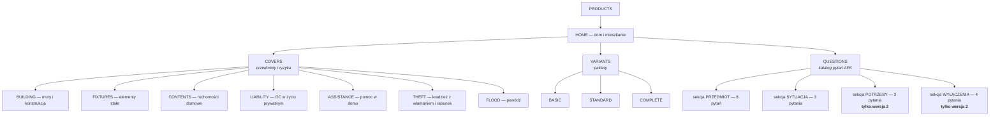
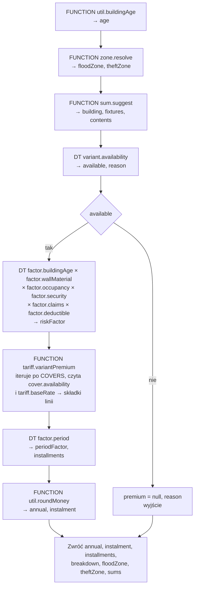
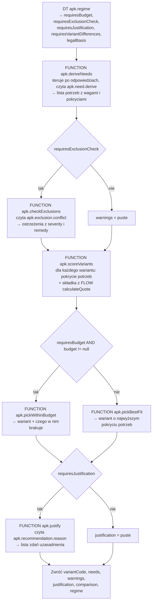

# Profil PROPERTY — projekt konfiguracji Higson

**Status:** ⚙️ **zbudowane i działające** w profilu `PROPERTY` (2026-08-21). Odstępstwa wymuszone
przez API i przez pierwsze uruchomienie — §13.
**Data:** 2026-08-20
**Zakres:** ubezpieczenie domu i mieszkania (detal) — drzewo domeny, kontekst, tabele decyzyjne,
flow, funkcje Groovy, wersjonowanie datą **oraz analiza potrzeb klienta (APK) jako konfiguracja**.
**Podstawa faktograficzna:** `.maister/tasks/development/2026-08-20-property-demo/analysis/market-research.md`
— wnioski **R-1…R-15** i braki **B-1…B-8**. Każde odwołanie „(R-n)" wskazuje tam.

Konwencje nazewnicze i układ plików przeniesione z profili `DEMO` (motor) i `LIFE`, żeby snapshot
pozostał jednorodny — `standards/higson/rules-authoring.md` i `standards/higson/snapshot.md`.

---

## 1. Założenia projektowe

| # | Założenie | Konsekwencja |
|---|---|---|
| Z-1 | **APK jest konfiguracją, nie kodem** | Katalog pytań, ich widoczność, mapowanie na potrzeby, wyliczenie sumy, konfrontacja wyłączeń i treść uzasadnienia żyją w Higsonie. **Java nie zna ani jednego pytania i ani jednego progu** |
| Z-2 | **Wersjonowanie APK datą polisy** | Region `PROPERTY` z dwoma timeline'ami wokół `2027-07-01` — terminu z §2 uchwały KNF 190/2026. Przesunięcie daty zmienia ankietę **i** zachowanie rekomendacji |
| Z-3 | Wersjonowanie obejmuje **dwa wymiary naraz** | Domena odpowiada na „jakie pytania w ogóle istnieją", parametr `apk.regime` na „co z odpowiedziami wolno zrobić". Wzorzec D-4 z LIFE, tu rozwinięty — **D-5** |
| Z-4 | Parametryzacja w **tabelach decyzyjnych** | Zero stawek, progów i treści komunikatów w Javie i w Groovym |
| Z-5 | Groovy **tylko tam, gdzie tabela nie wystarcza** | Kryterium z LIFE: arytmetyka, której tabela nie zrobi, albo pętla, której flow nie ma. Osiem funkcji, każda uzasadniona w §6 |
| Z-6 | **Suma ubezpieczenia jest liczona, nie wybierana** | `SU = metraż × stawka(strefa, standard)` — mechanizm udokumentowany rynkowo (Generali §27, R-3a), nie wymyślony na demo |
| Z-7 | **Strefa geograficzna to pierwszy wymiar przestrzenny w tej aplikacji** | Dwie strefy z jednego adresu: powodziowa (dostępność) i kradzieżowa (składka) — **D-3** |
| Z-8 | Rekomendacja ma **uzasadniać, a nie tylko wyceniać** | Wynik APK to wariant + lista powodów + różnice między wariantami + ostrzeżenia. Rek. 8.7 i 9.3 |
| Z-9 | **Wszystkie liczby taryfowe są demonstracyjne** | Żadne OWU nie publikuje taryfy (B-1). Stawki zł/m² też nie (B-2). Nie ma tu ani jednej liczby aktuarialnej — **W-2** |
| Z-10 | Zakres świadomie **nie obejmuje NNW i zdrowia** | ERGO wciąga je do polisy majątkowej (R-13), ale w tej aplikacji to terytorium demo LIFE. Dwa dema nie mają pokazywać tego samego |

---

## 2. Drzewo domeny

Drzewo dzieli się na **trzy kolekcje pod korzeniem**, bo profil odpowiada na trzy różne pytania:
*co można kupić*, *w jakich pakietach* i **o co się pyta klienta**. Trzecia kolekcja jest tym,
czego nie ma ani MOTO, ani LIFE.



**`QUESTIONS` jest kolekcją domeny, a nie tabelą.** Pytanie ma tożsamość — kod, treść, typ,
obowiązkowość, sekcję, kolejność — i **istnieje albo nie istnieje w danej wersji regionu**. To jest
dokładnie ta własność, której tabela nie ma: wiersz zawsze istnieje, można go tylko wyzerować.
Cała demonstracja z §7 opiera się na tym, że siedem pytań **nie istnieje** przed `2027-07-01`,
a nie na tym, że mają wtedy `visible = false`.

**`FLOOD` i `THEFT` stoją obok `BUILDING`, choć są ryzykami, a nie przedmiotami.** Na rynku
sprzedaje się je jako osobno dokupywane rozszerzenia z własną decyzją o dostępności ([S5] §21 dla
powodzi, [S3] §40 ust. 4 dla stref kradzieżowych) — a w tej konfiguracji o wszystkim, co się
dokupuje, decyduje ta sama para tabel `cover.availability` / `cover.limitRule`. Rozdzielenie
„przedmiotów" od „ryzyk" na poziomie drzewa wymagałoby drugiego kompletu tabel po to, żeby
odwzorować rozróżnienie, którego oferta i tak nie robi.

### 2.1 Typy domenowe i atrybuty

Ścieżki tak, jak konsumuje je `domain.get()`:
`domain.get('PROPERTY', '/PRODUCTS[HOME]').getAll('COVERS')`,
`domain.get('PROPERTY', '/PRODUCTS[HOME]/QUESTIONS[AREA]')`. Węzeł `PRODUCTS[HOME]` istnieje,
bo silnik adresuje kolekcję przez element nadrzędny — §13.

#### `COVER` — przedmiot lub ryzyko

| Atrybut | Typ | Źródło | Uwagi |
|---|---|---|---|
| `NAME` | string | LITERAL | „Mury i konstrukcja", „Elementy stałe", … |
| `POSITION` | number | `demo.property.cover.position` | Kolejność na ekranie |
| `IS_AVAILABLE` | boolean | `demo.property.cover.availability` | Klucz: (`cover.code`, `variant.code`) |
| `SUM_BASIS` | string | `demo.property.cover.sumBasis` | `COMPUTED` / `DERIVED` / `CATALOGUE` / `NONE` — skąd bierze się suma |
| `CAP_KIND` | string | `demo.property.cover.limitRule [capKind]` | `RATIO` / `ABSOLUTE` / `BOTH` / `NONE` (R-5) |
| `CAP_RATIO` | number | `demo.property.cover.limitRule [capRatio]` | Ułamek sumy odniesienia |
| `CAP_ABSOLUTE` | number | `demo.property.cover.limitRule [capAbsolute]` | Kwota |
| `DESCRIPTION` | string | LITERAL | Zdanie pokazywane w porównaniu wariantów |

#### `VARIANT` — pakiet

| Atrybut | Typ | Źródło | Uwagi |
|---|---|---|---|
| `NAME` | string | LITERAL | „Podstawowy" / „Standardowy" / „Pełny" |
| `POSITION` | number | `demo.property.variant.position` | |
| `IS_AVAILABLE` | boolean | `demo.property.variant.availability` | Klucz: (`variant.code`, `quote.zone.flood`) |
| `LIABILITY_SUM` | number | `demo.property.variant.liabilitySum` | Suma gwarancyjna OC — jedyna suma z katalogu, nie z wyliczenia |
| `ANNUAL_PREMIUM` | number | FLOW `demo.property.calculateQuote [annual]` | Wynik, nie parametr |

#### ⭐ `QUESTION` — pytanie APK

To jest **serce tego profilu**. Każdy atrybut odpowiada jednemu wymogowi rekomendacji 8.

| Atrybut | Typ | Źródło | Wymóg, który realizuje |
|---|---|---|---|
| `TEXT` | string | LITERAL | 8.2.a — zrozumiałość; treść pytania jest **konfiguracją**, nie stringiem w szablonie |
| `KIND` | string | LITERAL | `CHOICE` / `MULTI` / `NUMBER` / `MONEY` / `BOOLEAN` / `TEXT` — jak renderować kontrolkę |
| `OPTIONS` | string | `demo.property.apk.question.options [options]` | Lista wartości rozdzielona przecinkami (patrz W-5) |
| `OPTION_LABELS` | string | `demo.property.apk.question.options [labels]` | Etykiety w tej samej kolejności |
| `IS_REQUIRED` | boolean | `demo.property.apk.question.required` | 8.4 — obowiązkowość jest regułą, nie atrybutem HTML |
| `SECTION` | string | LITERAL | `SUBJECT` / `SITUATION` / `NEEDS` / `EXCLUSIONS` — grupowanie na ekranie |
| `POSITION` | number | `demo.property.apk.question.position` | Kolejność w ankiecie |
| `IS_VISIBLE` | boolean | `demo.property.apk.question.visibility` | 8.1.b — widoczność zależna od wcześniejszych odpowiedzi |
| `HELP` | string | LITERAL | 8.2.a — wyjaśnienie przy pytaniu |
| `PREFILL_SOURCE` | string | `demo.property.apk.question.prefill [source]` | **8.3** — skąd pochodzi wartość podpowiedziana; puste = klient podał sam |
| `REFUSAL_MESSAGE` | string | `demo.property.apk.question.prefill [refusal]` | **8.4** — konsekwencja odmowy odpowiedzi |

> **Dlaczego `TEXT`, `KIND`, `SECTION` i `HELP` są `LITERAL`, a reszta idzie przez tabele.**
> Litery należą do pytania i zmieniają się razem z nim — nowe pytanie przynosi swoją treść.
> Widoczność, obowiązkowość i kolejność są **relacjami**: „to pytanie jest obowiązkowe, gdy
> nieruchomością jest dom", „to stoi przed tamtym". Relacja o dwóch stronach ma miejsce w tabeli,
> tak samo jak w LIFE suma świadczenia w wariancie (§2.1 tamtego dokumentu). Gdyby obowiązkowość
> była literałem, zmiana „w wersji 2 metraż jest obowiązkowy" wymagałaby edycji elementu domeny
> — czyli tego samego, co przebudowa formularza, tylko w innym narzędziu.

### 2.2 Katalog pytań — 18 elementów, 11 w wersji 1

Kolejność w tabeli = `POSITION`. Kolumna „Wersja" pokazuje, w której wersji regionu element
**istnieje** (D-5).

| # | Kod | Treść (`TEXT`) | `KIND` | Sekcja | Wersja | Widoczność |
|---|---|---|---|---|---|---|
| 10 | `PROPERTY_KIND` | Co chcesz ubezpieczyć? | CHOICE | SUBJECT | 1 i 2 | zawsze |
| 20 | `AREA` | Powierzchnia użytkowa w metrach kwadratowych | NUMBER | SUBJECT | 1 i 2 | zawsze |
| 30 | `CONSTRUCTION_YEAR` | Rok budowy | NUMBER | SUBJECT | 1 i 2 | zawsze |
| 40 | `WALL_MATERIAL` | Z czego są ściany? | CHOICE | SUBJECT | 1 i 2 | **tylko dla domu** |
| 50 | `FLOOR` | Na którym piętrze jest mieszkanie? | NUMBER | SUBJECT | 1 i 2 | **tylko dla mieszkania** |
| 60 | `RENOVATED` | Czy budynek przeszedł remont? | BOOLEAN | SUBJECT | 1 i 2 | **tylko gdy wiek > 50 lat** |
| 70 | `FINISH_STANDARD` | Jaki jest standard wykończenia? | CHOICE | SUBJECT | 1 i 2 | zawsze |
| 80 | `POSTCODE` | Kod pocztowy miejsca ubezpieczenia | TEXT | SUBJECT | 1 i 2 | zawsze |
| 90 | `OCCUPANCY` | Jak korzystasz z nieruchomości? | CHOICE | SITUATION | 1 i 2 | zawsze |
| 100 | `SECURITY` | Jakie masz zabezpieczenia? | CHOICE | SITUATION | 1 i 2 | zawsze |
| 110 | `CLAIMS_3Y` | Ile szkód zgłaszałeś w ostatnich trzech latach? | NUMBER | SITUATION | 1 i 2 | zawsze |
| 200 | `CIRCUMSTANCES` | Na wypadek jakich zdarzeń chcesz ochrony? | MULTI | NEEDS | **2** | zawsze |
| 210 | `COVER_PERIOD` | Na jaki okres chcesz ochrony? | CHOICE | NEEDS | **2** | zawsze |
| 220 | `BUDGET` | Jaka roczna składka jest dla Ciebie akceptowalna? | MONEY | NEEDS | **2** | zawsze |
| 300 | `VACANCY` | Czy nieruchomość bywa pusta dłużej niż 60 dni z rzędu? | BOOLEAN | EXCLUSIONS | **2** | zawsze |
| 310 | `BUSINESS_USE` | Czy prowadzisz tam działalność gospodarczą? | BOOLEAN | EXCLUSIONS | **2** | zawsze |
| 320 | `HIGH_VALUE_ITEMS` | Czy masz rzeczy o wartości jednostkowej powyżej 30 000 zł? | BOOLEAN | EXCLUSIONS | **2** | zawsze |
| 330 | `INSPECTIONS` | Czy przeglądy instalacji gazowej, elektrycznej i kominowej są aktualne? | BOOLEAN | EXCLUSIONS | **2** | zawsze |

**Trzy pytania są ukryte warunkowo już w wersji 1** (`WALL_MATERIAL`, `FLOOR`, `RENOVATED`).
To jest celowe: gdyby widoczność warunkowa pojawiała się dopiero w wersji 2, widz mógłby wziąć ją
za część zmiany regulacyjnej. Warunkowa ankieta jest normalną praktyką od zawsze — nowe jest
**to, o co się pyta**, a nie **to, że pytania się chowają**.

**Sekcje NEEDS i EXCLUSIONS istnieją wyłącznie w wersji 2** i to jest bezpośrednie odwzorowanie
rekomendacji: `CIRCUMSTANCES` i `COVER_PERIOD` realizują 8.2.b („na wypadek jakich okoliczności
i w jakim okresie"), `BUDGET` — 8.2.d („akceptowalna dla klienta wartość składki"), a cała sekcja
EXCLUSIONS — 8.2.c („czy wyłączenia nie stoją w sprzeczności z wymaganiami i potrzebami").
Wszystkie cztery pytania z sekcji EXCLUSIONS mają pokrycie w OWU (R-9), więc żadne z nich nie jest
pytaniem dla samego pytania.

---

## 3. Kontekst wejściowy

Poziomy wejściowe wiążą `property == source` do ścieżek modelu — `rules-authoring.md`. Ścieżki
zaczynają się od korzenia wystawionego przez adapter.

### 3.1 Nieruchomość

| Ścieżka | Typ | Skąd |
|---|---|---|
| `quote.property.kind` | string | odpowiedź `PROPERTY_KIND` — `HOUSE` / `FLAT` |
| `quote.property.area` | number | odpowiedź `AREA` |
| `quote.property.constructionYear` | number | odpowiedź `CONSTRUCTION_YEAR` |
| `quote.property.age` | number | **wyliczane**, `demo.property.util.buildingAge` |
| `quote.property.wallMaterial` | string | odpowiedź `WALL_MATERIAL` — `BRICK` / `WOOD_FRAME` |
| `quote.property.floor` | number | odpowiedź `FLOOR` |
| `quote.property.renovated` | boolean | odpowiedź `RENOVATED` |
| `quote.property.finishStandard` | string | odpowiedź `FINISH_STANDARD` — `BASIC` / `STANDARD` / `PREMIUM` |
| `quote.property.postcode` | string | odpowiedź `POSTCODE` |
| `quote.property.postcodeArea` | string | **wyliczane** — dwie pierwsze cyfry, klucz obu stref |
| `quote.property.occupancy` | string | `PERMANENT` / `SEASONAL` / `RENTED` |
| `quote.property.security` | string | `NONE` / `DOOR` / `ALARM` / `MONITORED` |
| `quote.property.claims3y` | number | odpowiedź `CLAIMS_3Y` |

### 3.2 Polisa i strefy

| Ścieżka | Typ | Skąd |
|---|---|---|
| `quote.policy.startDate` | date | wejście — **klucz do wersji regionu**, §7 |
| `quote.policy.periodMonths` | number | odpowiedź `COVER_PERIOD`; w wersji 1 domyślnie 12 |
| `quote.policy.deductible` | number | wybór klienta — franszyza redukcyjna (D-8) |
| `quote.zone.flood` | string | **wyliczane**, `demo.property.zone.resolve` — `Z0` / `Z1` / `Z2` / `ZX` |
| `quote.zone.theft` | string | **wyliczane**, `demo.property.zone.resolve` — `T1` / `T2` / `T3` |

### 3.3 Potrzeby i sytuacja (wersja 2)

| Ścieżka | Typ | Skąd |
|---|---|---|
| `quote.needs.budget` | number | odpowiedź `BUDGET`; `null` = klient nie podał |
| `quote.situation.vacancy` | boolean | odpowiedź `VACANCY` |
| `quote.situation.businessUse` | boolean | odpowiedź `BUSINESS_USE` |
| `quote.situation.highValueItems` | boolean | odpowiedź `HIGH_VALUE_ITEMS` |
| `quote.situation.inspections` | boolean | odpowiedź `INSPECTIONS` |

> ⚠️ **`CIRCUMSTANCES` nie ma własnej ścieżki kontekstu.** Jest pytaniem wielokrotnego wyboru,
> a Higson nie potrzebuje tu kolekcji: Java iteruje po zaznaczonych wartościach i przy każdej
> woła tabelę z parą (`question.code = CIRCUMSTANCES`, `answer.value = FIRE`). Ta sama sztuczka,
> którą LIFE robi na parze (`benefit.code`, `variant.code`). Kolekcja w kontekście byłaby tu
> **droższa i mniej czytelna** — a przede wszystkim zamknęłaby drogę do tego, żeby dowolne inne
> pytanie stało się wielokrotne bez zmiany adaptera.

### 3.4 Sumy

| Ścieżka | Typ | Skąd |
|---|---|---|
| `quote.sums.building` | number | wyliczane, może być podniesione przez klienta (D-2) |
| `quote.sums.fixtures` | number | jw. |
| `quote.sums.contents` | number | jw. |
| `quote.sums.suggestedBuilding` | number | wyliczane — **wartość odniesienia dla ostrzeżenia** |

### 3.5 Elementy iteracji

| Ścieżka | Typ | Kiedy |
|---|---|---|
| `question.code` | string | iteracja po `QUESTIONS` |
| `answer.value` | string | wartość odpowiedzi jako tekst — przy odczycie potrzeb i wyłączeń |
| `cover.code` | string | iteracja po `COVERS` |
| `variant.code` | string | iteracja po `VARIANTS` |
| `reason.code` | string | składanie uzasadnienia |

Elementy iteracji adresowane nazwą typu, tak jak `coverage.code` w MOTO i `rider.code` w LIFE —
nie występują na liście ścieżek kontekstu i to jest w porządku (W-7 z planu LIFE).

---

## 4. Tabele decyzyjne

Kod parametru odzwierciedla ścieżkę pliku (`/` → `.`) pod prefiksem `demo.property.*`.
Wszystkie `inMemory = true`. Konwencje przedziałów z planu LIFE: `18 - 29` ze spacjami,
`true`/`false` dla boolean, tablice w jednej komórce po przecinku.

> ⚠️ **Reguła z LIFE, obowiązująca tu bez zmian:** w tabeli, w której **wszystkie** kolumny
> wejściowe są przedziałowe, **nie dajemy wiersza `* - *`** — silnik dopasowuje go równolegle
> z właściwym pasmem i zwraca dwie wartości. Kolumna dopasowywana dokładnie neutralizuje problem.
> Dotyczy tu wyłącznie `factor.buildingAge` i `factor.claims`.

### 4.1 APK — katalog pytań

#### `demo.property.apk.question.visibility`
Realizuje 8.1.b. Cztery wiersze wystarczają, bo **domyślną odpowiedzią jest „pokaż"**.
```
IN   question  string   question.code
IN   kind      string   quote.property.kind
IN   age       number   quote.property.age        matcher: between/ii
OUT  visible   boolean
```
```
question;kind;age;visible
*;*;* - *;true
WALL_MATERIAL;FLAT;* - *;false
FLOOR;HOUSE;* - *;false
RENOVATED;*;* - 50;false
```

> **Wiersz `*;*;* - *;true` jest tu bezpieczny**, mimo reguły z ramki wyżej, bo dwie pierwsze
> kolumny dopasowują się dokładnie. To jedyne miejsce w tym profilu, gdzie ten wyjątek ma
> znaczenie — i dlatego jest opisany, a nie milcząco wykorzystany.

#### `demo.property.apk.question.required`
```
IN   question  string   question.code
IN   kind      string   quote.property.kind
OUT  required  boolean
```
```
question;kind;required
*;*;true
BUDGET;*;false
FLOOR;*;false
RENOVATED;*;false
```

> `BUDGET` jest **nieobowiązkowy z rozmysłu**. Rekomendacja 8.2.d mówi „z uwzględnieniem
> akceptowalnej dla klienta wartości składki", a nie „po wymuszeniu jej podania". Wymuszony budżet
> jest budżetem zmyślonym, a rekomendacja zbudowana na zmyślonym budżecie jest gorsza niż
> rekomendacja zbudowana bez niego. Ścieżka „nie podam" ma swój komunikat (8.4) — patrz **D-6**.

#### `demo.property.apk.question.position`
```
IN   question  string   question.code
OUT  position  number
```
```
question;position
*;999
PROPERTY_KIND;10
AREA;20
CONSTRUCTION_YEAR;30
WALL_MATERIAL;40
FLOOR;50
RENOVATED;60
FINISH_STANDARD;70
POSTCODE;80
OCCUPANCY;90
SECURITY;100
CLAIMS_3Y;110
CIRCUMSTANCES;200
COVER_PERIOD;210
BUDGET;220
VACANCY;300
BUSINESS_USE;310
HIGH_VALUE_ITEMS;320
INSPECTIONS;330
```
*19 wierszy.*

#### `demo.property.apk.question.options`
Warianty odpowiedzi i ich etykiety. Dwie kolumny wyjściowe, obie tablicowe w jednej komórce —
wzorzec `individual.rider.sumsOffered` z LIFE.
```
IN   question  string   question.code
OUT  options   string
OUT  labels    string
```
```
question;options;labels
*;;
PROPERTY_KIND;HOUSE,FLAT;Dom jednorodzinny,Mieszkanie
WALL_MATERIAL;BRICK,WOOD_FRAME;Murowane,Szkieletowe drewniane
FINISH_STANDARD;BASIC,STANDARD,PREMIUM;Podstawowy,Podwyższony,Wysoki
OCCUPANCY;PERMANENT,SEASONAL,RENTED;Mieszkam na stałe,Korzystam sezonowo,Wynajmuję
SECURITY;NONE,DOOR,ALARM,MONITORED;Brak,Drzwi antywłamaniowe,Alarm,Alarm z monitoringiem
CIRCUMSTANCES;FIRE,FLOOD,THEFT,LIABILITY,SURGE;Pożar i zdarzenia losowe,Powódź,Kradzież,Szkody wyrządzone innym,Przepięcie
COVER_PERIOD;12,24,36;Rok,Dwa lata,Trzy lata
```
*8 wierszy.*

#### `demo.property.apk.question.prefill`
Realizuje **8.3** i **8.4** naraz, bo obie informacje dotyczą tego samego: skąd wartość pochodzi
i co się stanie, gdy klient jej nie poda.
```
IN   question  string   question.code
OUT  source    string
OUT  refusal   string
```
```
question;source;refusal
*;;Bez tej informacji nie możemy ocenić Twoich potrzeb i przedstawimy ofertę wyłącznie orientacyjną.
POSTCODE;Adres z poprzedniej polisy;Bez kodu pocztowego nie ustalimy strefy powodziowej — ochrona od powodzi nie będzie dostępna.
CLAIMS_3Y;Historia szkód w bazie UFG;Bez historii szkód przyjmiemy najostrożniejsze założenie, co podniesie składkę.
BUDGET;;Bez informacji o budżecie zaproponujemy wariant najpełniej odpowiadający potrzebom, bez względu na cenę.
AREA;Metraż z poprzedniej polisy;Bez metrażu nie wyliczymy rekomendowanej sumy ubezpieczenia.
```
*6 wierszy.*

> **Kolumna `source` jest wypełniona tylko tam, gdzie prefill jest realny** (poprzednia polisa,
> UFG). Rekomendacja 8.3 wymaga poinformowania **wtedy, gdy** korzysta się z danych z innego
> źródła — więc puste pole ma tu znaczenie „klient podał sam", a nie „nie wiem".

### 4.2 APK — potrzeby, wyłączenia, uzasadnienie

#### `demo.property.apk.need.derive`
Mapowanie **odpowiedź → potrzeba** (rek. 8.2.b). Jedna odpowiedź może rodzić jedną potrzebę;
wiele odpowiedzi może wskazać to samo pokrycie i wtedy jego waga rośnie.
```
IN   question  string   question.code
IN   answer    string   answer.value
OUT  need      string
OUT  cover     string
OUT  weight    number
```
```
question;answer;need;cover;weight
*;*;;;0
PROPERTY_KIND;HOUSE;Ochrona konstrukcji budynku;BUILDING;3
PROPERTY_KIND;FLAT;Ochrona lokalu i elementów stałych;FIXTURES;3
CIRCUMSTANCES;FIRE;Ochrona przed pożarem i zdarzeniami losowymi;BUILDING;3
CIRCUMSTANCES;FLOOD;Ochrona przed powodzią;FLOOD;3
CIRCUMSTANCES;THEFT;Ochrona przed kradzieżą z włamaniem;THEFT;3
CIRCUMSTANCES;LIABILITY;Odpowiedzialność za szkody wyrządzone innym;LIABILITY;3
CIRCUMSTANCES;SURGE;Ochrona sprzętu przed przepięciem;CONTENTS;2
OCCUPANCY;RENTED;Ochrona przy wynajmie lokalu;LIABILITY;2
OCCUPANCY;SEASONAL;Ochrona nieruchomości okresowo pustej;THEFT;2
SECURITY;NONE;Pilna potrzeba ochrony przed kradzieżą — brak zabezpieczeń;THEFT;2
HIGH_VALUE_ITEMS;true;Podwyższony limit na przedmioty wartościowe;CONTENTS;2
BUSINESS_USE;true;Ochrona sprzętu wykorzystywanego zawodowo;CONTENTS;1
FINISH_STANDARD;PREMIUM;Ochrona wysokiego standardu wykończenia;FIXTURES;2
```
*14 wierszy.*

> **Wiersze `PROPERTY_KIND` i `OCCUPANCY` działają także w wersji 1**, mimo że `CIRCUMSTANCES`
> jeszcze nie istnieje. To jest ważne dla demonstracji: wersja 1 **też** wyprowadza potrzeby,
> tylko z bardzo ubogiego materiału — trzy potrzeby zamiast ośmiu. Różnica jest wtedy widoczna
> jako różnica jakości analizy, a nie jako „przedtem nic, potem coś".

#### ⭐ `demo.property.apk.exclusion.conflict`
Realizuje **8.2.c**. Każdy wiersz ma pokrycie w OWU — kolumna „Źródło" w §7 researchu.
```
IN   question   string   question.code
IN   answer     string   answer.value
OUT  exclusion  string
OUT  severity   number
OUT  warning    string
OUT  remedy     string
```
```
question;answer;exclusion;severity;warning;remedy
*;*;;0;;
VACANCY;true;VACANCY_60D;2;Nieruchomość pozostawiona bez opieki dłużej niż 60 dni jest w warunkach uznawana za pustostan, a szkody w niej są wyłączone z ochrony.;Zgłoś planowane okresy nieobecności przed zawarciem umowy — wtedy ochrona zostaje utrzymana.
INSPECTIONS;false;NO_INSPECTION;2;Brak aktualnych przeglądów instalacji gazowej, elektrycznej i kominowej ogranicza odpowiedzialność za szkody, które z nich wynikną.;Wykonaj przeglądy przed początkiem ochrony i zachowaj protokoły.
RENOVATED;false;OLD_UNRENOVATED;2;Budynek starszy niż 50 lat bez remontu wycenia się w wartości rzeczywistej, czyli pomniejszonej o zużycie techniczne.;Udokumentuj przeprowadzone remonty — wtedy wycena idzie w wartości nowej.
OCCUPANCY;RENTED;TENANT_DAMAGE;1;Szkody wyrządzone przez najemcę nie są objęte OC w życiu prywatnym właściciela.;Rozszerz zakres o OC najemcy.
OCCUPANCY;SEASONAL;SEASONAL_USE;1;Nieruchomość użytkowana sezonowo bywa traktowana jak dom letniskowy — węższy zakres i wypłata w wartości rzeczywistej.;Zadeklaruj rzeczywisty sposób użytkowania, żeby uniknąć sporu po szkodzie.
BUSINESS_USE;true;BUSINESS_PROPERTY;1;Mienie służące działalności gospodarczej ma osobny, niższy limit odpowiedzialności.;Rozważ osobne ubezpieczenie sprzętu firmowego.
HIGH_VALUE_ITEMS;true;VALUABLES_LIMIT;1;Przedmioty o wartości jednostkowej powyżej 30 000 zł są objęte ochroną wyłącznie po zgłoszeniu i udokumentowaniu.;Dołącz spis przedmiotów wartościowych do wniosku.
SECURITY;NONE;THEFT_SECURITY;1;Bez zabezpieczeń przeciwwłamaniowych ochrona od kradzieży bywa ograniczona albo niedostępna.;Zamontuj drzwi antywłamaniowe albo alarm.
```
*9 wierszy.*

> **`severity` istnieje po to, żeby ekran nie krzyczał jednakowo.** `2` znaczy „ta odpowiedź
> wyłącza albo istotnie ogranicza ochronę, której klient chce" i idzie na czerwono nad
> rekomendację; `1` znaczy „ograniczenie, o którym trzeba wiedzieć" i idzie żółtym paskiem przy
> odpowiednim pokryciu. Bez tego rozróżnienia osiem ostrzeżeń naraz jest tym samym, co zero.

> **Kolumna `remedy` nie jest ozdobą.** Rekomendacja 8.2.c mówi o ocenie, „czy wyłączenia nie
> stoją w **sprzeczności z wymaganiami i potrzebami**". Samo pokazanie sprzeczności jej nie
> usuwa — usuwa ją dopiero informacja, co z tym zrobić. To jest jedyne miejsce w tym profilu,
> gdzie reguła **odradza własny produkt**, i dlatego zostaje w tabeli, a nie w komentarzu.

#### `demo.property.apk.recommendation.reason`
Realizuje **8.7** — dokumentacja ma *wykazać* zgodność, więc jej treść jest regułą.
```
IN   reason    string   reason.code
OUT  text      string
OUT  position  number
```
```
reason;text;position
*;;999
NEEDS_MATCHED;Wariant {0} obejmuje wszystkie {1} potrzeby, które wynikają z Twoich odpowiedzi.;10
NEEDS_PARTIAL;Wariant {0} obejmuje {1} z {2} potrzeb wynikających z Twoich odpowiedzi. Poza zakresem zostaje: {3}.;10
SUM_COMPUTED;Sumę ubezpieczenia murów wyliczyliśmy jako {0} m² × {1} zł/m² dla Twojej lokalizacji i standardu wykończenia.;20
SUM_RAISED;Podniosłeś sumę powyżej wyliczonej — to zwiększa ochronę i składkę.;25
SUM_LOWERED;Obniżyłeś sumę poniżej wyliczonej wartości odtworzeniowej. Przy szkodzie całkowitej odszkodowanie nie pokryje odbudowy.;25
BUDGET_FIT;Roczna składka {0} zł mieści się w podanym budżecie {1} zł.;30
BUDGET_EXCEEDED;Wariant najpełniej odpowiadający potrzebom kosztuje {0} zł rocznie, czyli powyżej Twojego budżetu {1} zł. Proponujemy wariant {2} i wskazujemy, czego w nim brakuje.;30
BUDGET_ABSENT;Nie podałeś akceptowalnej składki, więc proponujemy wariant najpełniej odpowiadający potrzebom.;30
FLOOD_UNAVAILABLE;W Twojej lokalizacji ochrona od powodzi nie jest dostępna — miejsce leży w strefie o najwyższym zagrożeniu.;40
FLOOD_DEDUCTIBLE;Ochrona od powodzi w Twojej lokalizacji wymaga franszyzy redukcyjnej {0} zł.;40
FLOOD_WAITING;Ochrona od powodzi zaczyna działać po {0} dniach od zawarcia umowy.;45
EXCLUSIONS_FOUND;Twoje odpowiedzi wskazują {0} sytuacji, w których warunki ograniczają ochronę. Opisujemy je nad propozycją.;50
LEGAL_BASIS;Analizę przeprowadziliśmy zgodnie z: {0}.;90
```
*14 wierszy.*

> **Placeholdery `{0}`, `{1}` — nie konkatenacja w Groovym.** Treść ma zostać po stronie
> konfiguracji w całości, razem z szykiem zdania i interpunkcją. Funkcja `apk.justify` wstawia
> wartości w miejsca, ale **nie decyduje o kolejności słów** — bo to jest decyzja redakcyjna,
> a redakcja komunikatu do klienta zmienia się częściej niż algorytm.

#### `demo.property.apk.regime` ⭐ **wersjonowana**
Reżim APK jako **parametr**, obok wersjonowanego zbioru pytań. To jest druga połowa D-5.
```
OUT  code                       string
OUT  name                       string
OUT  legalBasis                 string
OUT  requiresBudget             boolean
OUT  requiresExclusionCheck     boolean
OUT  requiresJustification      boolean
OUT  requiresVariantDifferences boolean
```
Wersja 1:
```
code;name;legalBasis;requiresBudget;requiresExclusionCheck;requiresJustification;requiresVariantDifferences
STATUTORY;APK — minimum ustawowe;art. 8 ustawy z 15.12.2017 r. o dystrybucji ubezpieczeń;false;false;false;false
```
Wersja 2:
```
code;name;legalBasis;requiresBudget;requiresExclusionCheck;requiresJustification;requiresVariantDifferences
KNF_190_2026;APK wg Rekomendacji KNF;Rekomendacje 8 i 9 — uchwała KNF nr 190/2026 z 26.06.2026 r.;true;true;true;true
```

> **Tabela bez ani jednej kolumny wejściowej.** To nie jest błąd projektowy — to jest cała jej
> istota. Odpowiada na pytanie „**jaki reżim obowiązuje**", a jedynym wejściem jest data polisy,
> którą region już czyta. Dodanie kolumny `validFrom` odtworzyłoby wersjonowanie ręcznie obok
> mechanizmu, który jest w silniku (§7).

### 4.3 Suma ubezpieczenia

#### `demo.property.sum.ratePerSqm` ⭐ **wersjonowana**
Stawka odtworzeniowa zł/m². Wersjonowana, bo ceny budowlane zmieniają się częściej niż release —
i to jest drugi, niezależny od APK powód, dla którego ten profil ma region.
```
IN   area      string   quote.property.postcodeArea
IN   kind      string   quote.property.kind
IN   standard  string   quote.property.finishStandard
OUT  rate      number
```
Wersja 1 (`2026-01-01`) — ⚠️ **liczby demonstracyjne (W-2)**:
```
area;kind;standard;rate
*;*;*;4200
*;HOUSE;BASIC;3800
*;HOUSE;STANDARD;4600
*;HOUSE;PREMIUM;5900
*;FLAT;BASIC;4400
*;FLAT;STANDARD;5300
*;FLAT;PREMIUM;6800
00;FLAT;STANDARD;7900
02;FLAT;STANDARD;7400
30;FLAT;STANDARD;6600
80;FLAT;STANDARD;6100
50;FLAT;STANDARD;5900
```
*12 wierszy.*

#### `demo.property.sum.derivedRatio`
Sumy elementów stałych i ruchomości jako ułamek sumy murów. Rynkowo to jest właśnie relacja —
Generali §27 ust. 4 wyprowadza je z „własnych danych statystycznych", nie z osobnego pomiaru.
```
IN   cover     string   cover.code
IN   standard  string   quote.property.finishStandard
OUT  ratio     number
```
```
cover;standard;ratio
*;*;0
FIXTURES;BASIC;0.15
FIXTURES;STANDARD;0.22
FIXTURES;PREMIUM;0.32
CONTENTS;BASIC;0.10
CONTENTS;STANDARD;0.15
CONTENTS;PREMIUM;0.24
```
*7 wierszy.*

#### ⭐ `demo.property.fixtures.model`
**To jest R-2 zamienione w konfigurację.** Granica mury/elementy stałe to trzy niezależne
parametry, więc jest to jedna tabela o trzech kolumnach wyjściowych, a nie trzy decyzje w kodzie.
```
OUT  mode              string    SEPARATE | INCLUDED
OUT  sublimitRatio     number
OUT  externalJoinery   string    BUILDING | FIXTURES
```
```
mode;sublimitRatio;externalJoinery
SEPARATE;0;FIXTURES
```

> **Model demo to wariant PZU** — elementy stałe z własną sumą, stolarka po stronie wykończenia.
> Wybrany dlatego, że tylko przy `SEPARATE` widać na ekranie **dwie wyliczone sumy**, czyli to,
> co §5 briefu nazywa „suma liczona, nie wybierana". Ale **przełączenie na model Warty
> (`INCLUDED`, `sublimitRatio = 0`), Link4 (`INCLUDED`, `0.30`) albo ERGO (`externalJoinery =
> BUILDING`) to zmiana trzech komórek** — bez dotykania Javy, ekranu i pozostałych tabel.
> To jest najkrótsza demonstracja tezy całego produktu, jaką ten profil ma: różnica, o którą
> polski rynek naprawdę się różni, mieści się w jednym wierszu.

### 4.4 Strefy

#### `demo.property.zone.flood`
```
IN   area   string   quote.property.postcodeArea
OUT  zone   string
```
⚠️ **Przypisanie stref do obszarów pocztowych jest demonstracyjne (B-6)** — Generali wyznacza je
„w oparciu o statystykę zdarzeń szkodowych" i mapy nie publikuje. Wybrano obszary, które
w powszechnej świadomości kojarzą się z powodziami z 1997 i 2024 r., żeby demo było czytelne.
```
area;zone
*;Z0
50;Z2
51;Z2
57;ZX
43;Z1
44;Z1
30;Z1
80;Z1
70;Z1
87;Z1
```
*10 wierszy.*

#### `demo.property.zone.theft`
Druga strefa z tego samego adresu — **czynnik, nie dostępność** (D-3).
```
IN   area    string   quote.property.postcodeArea
OUT  zone    string
OUT  factor  number
```
```
area;zone;factor
*;T1;1.00
00;T3;1.35
01;T3;1.35
02;T3;1.30
03;T2;1.18
30;T3;1.28
31;T2;1.18
80;T2;1.20
50;T2;1.18
60;T2;1.15
40;T2;1.15
```
*11 wierszy.*

#### `demo.property.flood.availability`
**Odwzorowanie [S5] §21 ust. 1 co do znaku** (R-10).
```
IN   zone               string   quote.zone.flood
OUT  available          boolean
OUT  requiresDeductible boolean
OUT  minDeductible      number
OUT  message            string
```
```
zone;available;requiresDeductible;minDeductible;message
*;false;false;0;Nie ustaliliśmy strefy zagrożenia powodziowego dla tego adresu.
Z0;true;false;0;
Z1;true;false;0;
Z2;true;true;1000;W Twojej lokalizacji ochrona od powodzi wymaga franszyzy redukcyjnej co najmniej 1000 zł.
ZX;false;false;0;Miejsce ubezpieczenia leży w strefie o najwyższym zagrożeniu powodziowym — ochrona od powodzi nie jest dostępna.
```
*6 wierszy.*

#### `demo.property.flood.waitingPeriod`
```
IN   priorCover  boolean  quote.property.priorFloodCover
OUT  days        number
```
```
priorCover;days
*;30
true;0
false;30
```

### 4.5 Taryfa

#### `demo.property.tariff.baseRate` ⭐ **wersjonowana**
Stawka roczna w promilach sumy ubezpieczenia; `FLAT` znaczy kwotę w złotych, nie promil.
```
IN   cover   string   cover.code
OUT  rate    number
OUT  basis   string    SUM | FLAT
```
Wersja 1 — ⚠️ **liczby demonstracyjne (W-2)**:
```
cover;rate;basis
*;0;FLAT
BUILDING;0.85;SUM
FIXTURES;1.40;SUM
CONTENTS;2.60;SUM
THEFT;3.20;SUM
FLOOD;1.90;SUM
LIABILITY;0.09;SUM
ASSISTANCE;72;FLAT
```
*8 wierszy.*

#### `demo.property.factor.buildingAge`
```
IN   age     number   quote.property.age   matcher: between/ii
OUT  factor  number
```
⚠️ Sama kolumna przedziałowa → **bez wiersza `* - *`**, `matchRequired = false`, obsługa `null`
w funkcji.
```
age;factor
* - 10;0.92
10 - 30;1.00
30 - 50;1.12
50 - 80;1.30
80 - *;1.55
```

#### `demo.property.factor.wallMaterial`
```
IN   material  string   quote.property.wallMaterial
OUT  factor    number
```
```
material;factor
*;1.00
BRICK;1.00
WOOD_FRAME;1.45
```

#### `demo.property.factor.occupancy`
```
IN   occupancy  string   quote.property.occupancy
OUT  factor     number
```
```
occupancy;factor
*;1.00
PERMANENT;1.00
SEASONAL;1.30
RENTED;1.20
```

#### `demo.property.factor.security`
Zniżka za zabezpieczenia. **Celowo NIE wersjonowana** — to jest dowód selektywności (§7.4).
```
IN   security  string   quote.property.security
OUT  factor    number
```
```
security;factor
*;1.00
NONE;1.15
DOOR;1.00
ALARM;0.92
MONITORED;0.85
```

#### `demo.property.factor.claims`
```
IN   claims  number   quote.property.claims3y   matcher: between/ii
OUT  factor  number
```
⚠️ Sama kolumna przedziałowa → bez `* - *`.
```
claims;factor
* - 0;0.90
1 - 1;1.15
2 - 2;1.45
3 - *;1.90
```

#### `demo.property.factor.deductible`
Franszyza w roli **obniżki składki** — pierwsza z dwóch ról z D-8.
```
IN   deductible  number   quote.policy.deductible
OUT  factor      number
```
```
deductible;factor
*;1.00
0;1.00
200;0.95
500;0.90
1000;0.84
```

#### `demo.property.factor.period`
```
IN   months       number   quote.policy.periodMonths
OUT  factor       number
OUT  installments number
```
```
months;factor;installments
*;1.00;1
12;1.00;1
24;1.92;2
36;2.76;3
```

> **Czynnik jest mniejszy niż wielokrotność okresu** — 24 miesiące kosztują 1.92 rocznej, a nie 2.0.
> To jest zniżka za dłuższe zobowiązanie, wprost wymieniana wśród czynników taryfowych przez
> Allianz („długość okresu ubezpieczenia", [S4] pkt 134) i ERGO ([S3] §40 ust. 2 pkt 3).

### 4.6 Zakres i warianty

#### `demo.property.cover.availability`
Klucz (`cover`, `variant`) — ta sama relacja co `group.benefit.availability` w LIFE.
```
IN   cover      string   cover.code
IN   variant    string   variant.code
OUT  available  boolean
```
```
cover;variant;available
*;*;false
BUILDING;BASIC;true
BUILDING;STANDARD;true
BUILDING;COMPLETE;true
FIXTURES;BASIC;false
FIXTURES;STANDARD;true
FIXTURES;COMPLETE;true
CONTENTS;BASIC;false
CONTENTS;STANDARD;true
CONTENTS;COMPLETE;true
LIABILITY;BASIC;false
LIABILITY;STANDARD;true
LIABILITY;COMPLETE;true
ASSISTANCE;BASIC;false
ASSISTANCE;STANDARD;false
ASSISTANCE;COMPLETE;true
THEFT;BASIC;false
THEFT;STANDARD;false
THEFT;COMPLETE;true
FLOOD;BASIC;false
FLOOD;STANDARD;false
FLOOD;COMPLETE;true
```
*22 wiersze.*

> **Drabinka jest ścisła: każdy wariant zawiera wszystko, co poprzedni.** Bez tego rekomendacja
> z §5.2 przestaje mieć sens — „najtańszy wariant pokrywający potrzeby" zakłada, że warianty da się
> uporządkować. Test `variant.ladder` (§9) pilnuje tego wprost, bo jest to własność, którą łatwo
> zepsuć jednym wierszem przy dokładaniu pokrycia.

#### `demo.property.cover.position`
```
cover;position
*;999
BUILDING;10
FIXTURES;20
CONTENTS;30
THEFT;40
FLOOD;50
LIABILITY;60
ASSISTANCE;70
```

#### `demo.property.cover.sumBasis`
```
IN   cover      string   cover.code
OUT  basis      string    COMPUTED | DERIVED | CATALOGUE | NONE
OUT  reference  string
```
```
cover;basis;reference
*;NONE;
BUILDING;COMPUTED;
FIXTURES;DERIVED;BUILDING
CONTENTS;DERIVED;BUILDING
THEFT;DERIVED;CONTENTS
FLOOD;DERIVED;BUILDING
LIABILITY;CATALOGUE;
ASSISTANCE;NONE;
```
*8 wierszy.*

#### `demo.property.cover.limitRule`
Wzorzec `min(ratio × SU, kwota)` z **R-5** — dokładnie to, co [S1] §46 ust. 3 nazywa „najniższym
limitem spośród tych, do których kwalifikuje się przedmiot".
```
IN   cover        string   cover.code
OUT  capKind      string    RATIO | ABSOLUTE | BOTH | NONE
OUT  capRatio     number
OUT  capAbsolute  number
OUT  label        string
```
```
cover;capKind;capRatio;capAbsolute;label
*;NONE;0;0;
CONTENTS;BOTH;0.10;10000;Gotówka — 10% sumy ruchomości, nie więcej niż 10 000 zł
THEFT;BOTH;0.40;50000;Biżuteria i wyroby z metali szlachetnych — 40% sumy, nie więcej niż 50 000 zł
FIXTURES;RATIO;0.30;0;Elementy stałe w pomieszczeniach przynależnych — 30% sumy
LIABILITY;NONE;0;0;
ASSISTANCE;ABSOLUTE;0;3000;Jednorazowa interwencja — do 3 000 zł
FLOOD;NONE;0;0;
BUILDING;NONE;0;0;
```
*9 wierszy. Wartości `capRatio`/`capAbsolute` przepisane z limitów PZU (§5 researchu) — jedyne
liczby w tym profilu, które **nie są wymyślone**.*

#### `demo.property.variant.availability`
```
IN   variant    string   variant.code
IN   zone       string   quote.zone.flood
OUT  available  boolean
OUT  reason     string
```
```
variant;zone;available;reason
*;*;true;
COMPLETE;ZX;false;Wariant pełny zawiera ochronę od powodzi, która w tej lokalizacji nie jest dostępna.
```

> **Strefa `ZX` nie wycina powodzi po cichu — wycina cały wariant i mówi dlaczego.**
> Wariant COMPLETE bez powodzi byłby wariantem COMPLETE tylko z nazwy, a klient dowiedziałby się
> o tym dopiero z polisy. To jest ta sama zasada, co D-3 w LIFE: naruszenie pułapu jest błędem,
> nie cichym przycięciem.

#### `demo.property.variant.position` i `demo.property.variant.liabilitySum`
```
variant;position
*;999
BASIC;10
STANDARD;20
COMPLETE;30
```
```
variant;sum
*;0
BASIC;0
STANDARD;200000
COMPLETE;2000000
```
*Suma 2 000 000 zł dla wariantu pełnego przepisana z ERGO 7 („Suma gwarancyjna w Wariancie III to
aż 2 mln zł", [S3]).*

---

## 5. Flow — algorytmy wysokopoziomowe

Dwa flow. Reszta algorytmiki jest w funkcjach, bo **`EXPRESSION` we flow nie działa** (W-15 z planu
LIFE) i **nie ma `ctx.set`** (W-10), więc flow nie potrafi ani liczyć, ani przekazać wyliczonej
wartości do tabeli kluczowanej tą wartością.

### 5.1 `demo.property.calculateQuote` — wycena jednego wariantu



**Zmienne flow:** `age`, `floodZone`, `theftZone`, `sumBuilding`, `sumFixtures`, `sumContents`,
`available`, `reason`, `riskFactor`, `periodFactor`, `installments`, `annual` *(returned)*,
`instalment` *(returned)*, `breakdown` *(returned)*.

**11 nodów** — mieści się w limicie 15 z §11.

> ⚠️ **Zaokrąglenie na linię, raz — nie na sumie.** Ta sama zasada, co w LIFE §5.1: suma
> niezaokrąglonych linii zaokrąglona na końcu daje total, który nie zgadza się z własnym
> rozbiciem, a czytelnik oferty zawsze to wyłapie.

> **Czynniki mnożą się, nie zastępują.** Sześć czynników w jednym węźle, bo to jest jedna myśl
> („oceń ryzyko"), a rozbicie na sześć węzłów zamieniłoby diagram w listę.

### 5.2 ⭐ `demo.property.apk.recommend` — rekomendacja z uzasadnieniem

To jest flow, dla którego ten profil istnieje. Realizuje 8.2.d, 8.7, 9.1 i 9.3 naraz.



**13 nodów** — na styk, ale w limicie. Droga wyjścia opisana w §11.

> **Trzy bramki na `requires*` to nie są trzy warunki — to jest jedna decyzja regulacyjna,
> rozłożona na trzy miejsca, w których się objawia.** Wersja 1 przechodzi przez ten sam flow
> i wychodzi z niego z wariantem, ale **bez ostrzeżeń, bez uzasadnienia i bez porównania**.
> Gdyby wersje miały osobne flow, demo pokazywałoby, że da się mieć dwa algorytmy — a ma pokazać,
> że **ten sam algorytm zachowuje się inaczej, bo zmieniła się konfiguracja**.

> ⚠️ **`requiresVariantDifferences` nie ma własnej bramki we flow.** Steruje wyłącznie tym, czy
> `comparison` trafia na ekran — a `comparison` i tak powstaje, bo `scoreVariants` musi wycenić
> wszystkie warianty, żeby wybrać jeden. Osobna bramka oszczędzałaby zero pracy i dokładała node.

### 5.3 Czego świadomie **nie ma** we flow

| Rzecz | Gdzie jest zamiast tego | Dlaczego |
|---|---|---|
| Budowa ankiety | Java iteruje `QUESTIONS`, czyta cztery tabele `apk.question.*` per pytanie | Flow nie iteruje po kolekcjach domeny; a iteracja po elementach domeny to jest dokładnie to, co Java w tej aplikacji już robi (`loadGroupBenefits` w LIFE) |
| Wyliczenie sumy | `demo.property.sum.suggest` | Arytmetyka — mnożenie metrażu przez stawkę i ułamki pochodne |
| Rozstrzygnięcie stref | `demo.property.zone.resolve` | Wymaga wycięcia dwóch pierwszych znaków kodu pocztowego **i** reguły „mieszkanie powyżej parteru = strefa 0" ([S5] §21 ust. 2), czyli warunku na innym polu niż klucz |
| Efektywny limit | `demo.property.limit.effective` | `min` z dwóch wartości, z których jedna może być `null` |

---

## 6. Funkcje Groovy — osiem, każda uzasadniona

Zasada z `rules-authoring.md`: ciało czyta wyłącznie `ctx` i helpery `higson`, zero importów, zero
referencji do klas aplikacji. Nagłówek TOML, `#Full code` zgodny ze ścieżką, **`ctx` zawsze
pierwszym argumentem** (W-20 z planu LIFE), jawny `return`.

| Funkcja | Dlaczego nie tabela |
|---|---|
| `demo.property.util.buildingAge` | Arytmetyka dat — różnica między rokiem polisy a rokiem budowy |
| `demo.property.zone.resolve` | Wycięcie prefiksu kodu pocztowego **i** nadpisanie strefy dla mieszkania powyżej parteru — dwa różne pola w jednej regule |
| `demo.property.sum.suggest` | Mnożenie metrażu przez stawkę i trzy wartości pochodne w jednym wyniku |
| `demo.property.limit.effective` | `min` z dwóch pułapów, z których jeden bywa nieokreślony |
| `demo.property.tariff.variantPremium` | **Pętla po pokryciach** — flow nie iteruje po kolekcji domeny |
| `demo.property.apk.deriveNeeds` | Pętla po odpowiedziach + agregacja wag per pokrycie |
| `demo.property.apk.scoreVariants` | Pętla po wariantach × pętla po potrzebach — dwie zagnieżdżone, których flow nie ma |
| `demo.property.apk.justify` | Składanie listy zdań z podstawieniem wartości w placeholdery z tabeli |

> Sześć z ośmiu istnieje z **jednego** powodu: flow nie iteruje. To ta sama systematyczna luka,
> którą opisał dokument LIFE (§6), i to samo kryterium na przyszłość: funkcja, która nie mieści się
> w „arytmetyka, której tabela nie zrobi" albo „pętla, której flow nie ma", jest regułą biznesową,
> która uciekła z tabeli.

### 6.1 `demo.property.util.buildingAge`

```groovy
/*
#Full code: demo.property.util.buildingAge
arguments = ["ctx"]
*/
def year = ctx.getNumber('quote.property.constructionYear')
def start = ctx.get('quote.policy.startDate')
if (year == null || year <= 0 || start == null) {
    return 0
}
// W-17 z LIFE: ctx.get zwraca daty jako String, więc rok bierzemy z pierwszych czterech znaków,
// a nie przez Calendar — ta sama pułapka, ten sam objaw.
def startYear = start.toString().substring(0, 4).toInteger()
def age = startYear - year.intValue()
return age < 0 ? 0 : age
```

### 6.2 `demo.property.zone.resolve`

```groovy
/*
#Full code: demo.property.zone.resolve
arguments = ["ctx"]
*/
def postcode = ctx.getString('quote.property.postcode')
if (postcode == null || postcode.length() < 2) {
    return type.paramValue().value('flood', 'Z0').value('theft', 'T1').build()
}
def area = postcode.replace('-', '').substring(0, 2)
def areaCtx = higson.createContext('quote.property.postcodeArea', area)
def flood = higson.getString('demo.property.zone.flood', areaCtx)
def theft = higson.getString('demo.property.zone.theft', areaCtx)

// [S5] §21 ust. 2: mieszkanie powyżej parteru jest uznawane za położone w strefie 0 niezależnie
// od adresu. To jest reguła o INNYM polu niż klucz tabeli, więc nie da się jej wyrazić wierszem.
def kind = ctx.getString('quote.property.kind')
def floor = ctx.getNumber('quote.property.floor')
if ('FLAT' == kind && floor != null && floor >= 1) {
    flood = 'Z0'
}
return type.paramValue().value('flood', flood).value('theft', theft).build()
```

### 6.3 `demo.property.sum.suggest`

```groovy
/*
#Full code: demo.property.sum.suggest
arguments = ["ctx"]
*/
def area = ctx.getDecimal('quote.property.area')
if (area == null || area <= 0) {
    throw new RuntimeException('Brak powierzchni użytkowej — nie da się wyliczyć sumy ubezpieczenia')
}
// getDecimal, nie getNumber: brak stawki ma być błędem, a nie cichą sumą zero.
def rate = higson.getDecimal('demo.property.sum.ratePerSqm', ctx)
if (rate == null) {
    throw new RuntimeException('Brak stawki odtworzeniowej dla tej lokalizacji i standardu')
}
def building = math.round(area * rate, 0)

def fixturesRatio = higson.getDecimal('demo.property.sum.derivedRatio',
        higson.createContext('cover.code', 'FIXTURES',
                'quote.property.finishStandard', ctx.getString('quote.property.finishStandard')))
def contentsRatio = higson.getDecimal('demo.property.sum.derivedRatio',
        higson.createContext('cover.code', 'CONTENTS',
                'quote.property.finishStandard', ctx.getString('quote.property.finishStandard')))

return type.paramValue()
        .value('building', building)
        .value('fixtures', math.round(building * fixturesRatio, 0))
        .value('contents', math.round(building * contentsRatio, 0))
        .value('rate', rate)
        .build()
```

### 6.4 `demo.property.limit.effective`

```groovy
/*
#Full code: demo.property.limit.effective
arguments = ["ctx"]
*/
def kind = higson.getString('demo.property.cover.limitRule', ctx)
def ratio = higson.getDecimal('demo.property.cover.limitRule', ctx)
// Dwie kolumny z jednego wiersza czyta się przez row(), bo selektor [kolumna] w API Groovy
// nie działa — W-16 z planu LIFE.
def row = higson.get('demo.property.cover.limitRule', ctx).row(0)
def capKind = row.getString('capKind')
def capRatio = row.getBigDecimal('capRatio')
def capAbsolute = row.getBigDecimal('capAbsolute')
def base = ctx.getDecimal('quote.sums.contents')

if ('NONE' == capKind || base == null) {
    return null
}
if ('RATIO' == capKind) {
    return math.round(base * capRatio, 0)
}
if ('ABSOLUTE' == capKind) {
    return capAbsolute
}
def fromRatio = base * capRatio
return math.round(fromRatio < capAbsolute ? fromRatio : capAbsolute, 0)
```

### 6.5 `demo.property.tariff.variantPremium`

```groovy
/*
#Full code: demo.property.tariff.variantPremium
arguments = ["ctx"]
*/
def variant = ctx.getString('variant.code')
def risk = ctx.getDecimal('quote.risk.factor')
def total = 0
def lines = []
for (cover in domain.get('PROPERTY', '/PRODUCTS[HOME]').getAll('COVERS')) {
    def code = cover.getCode()
    def cellCtx = higson.createContext('cover.code', code, 'variant.code', variant)
    if (!higson.getBoolean('demo.property.cover.availability', cellCtx)) {
        continue
    }
    def rateRow = higson.get('demo.property.tariff.baseRate',
            higson.createContext('cover.code', code)).row(0)
    def rate = rateRow.getBigDecimal('rate')
    def basis = rateRow.getString('basis')

    def premium
    if ('FLAT' == basis) {
        // Assistance kupuje usługi, nie transfer ryzyka — czynniki ryzyka nie mają na co działać.
        premium = rate
    } else {
        def sum = ctx.getDecimal('quote.sums.' + code.toLowerCase())
        premium = sum == null ? 0 : sum * rate / 1000 * risk
    }
    premium = math.round(premium, 2)
    total = total + premium
    lines.add(code + '=' + premium)
}
return type.paramValue()
        .value('premium', math.round(total, 2))
        .value('breakdown', lines.join(';'))
        .build()
```

*29 linii — najdłuższa funkcja w profilu.*

### 6.6 `demo.property.apk.deriveNeeds`

```groovy
/*
#Full code: demo.property.apk.deriveNeeds
arguments = ["ctx", "answers"]
*/
// answers to lista "kod=wartość" złożona przez Javę z udzielonych odpowiedzi. Przekazujemy ją
// argumentem, a nie przez kontekst, bo liczba odpowiedzi zmienia się z wersją regionu i żadna
// stała ścieżka kontekstu jej nie opisze.
def needs = [:]
for (entry in answers.split(';')) {
    if (entry.isEmpty()) {
        continue
    }
    def parts = entry.split('=')
    def row = higson.get('demo.property.apk.need.derive',
            higson.createContext('question.code', parts[0], 'answer.value', parts[1])).row(0)
    def need = row.getString('need')
    if (need == null || need.isEmpty()) {
        continue
    }
    def cover = row.getString('cover')
    def weight = row.getBigDecimal('weight')
    def current = needs.get(cover)
    if (current == null || current[1] < weight) {
        needs.put(cover, [need, weight])
    }
}
def out = []
for (e in needs) {
    out.add(e.key + '|' + e.value[0] + '|' + e.value[1])
}
return out.join(';')
```

*26 linii.*

### 6.7 `demo.property.apk.scoreVariants`

```groovy
/*
#Full code: demo.property.apk.scoreVariants
arguments = ["ctx", "needs"]
*/
def wanted = []
for (n in needs.split(';')) {
    if (!n.isEmpty()) {
        wanted.add(n.split('\\|')[0])
    }
}
def out = []
for (variant in domain.get('PROPERTY', '/PRODUCTS[HOME]').getAll('VARIANTS')) {
    def code = variant.getCode()
    def covered = 0
    def missing = []
    for (cover in wanted) {
        def cellCtx = higson.createContext('cover.code', cover, 'variant.code', code)
        if (higson.getBoolean('demo.property.cover.availability', cellCtx)) {
            covered = covered + 1
        } else {
            missing.add(cover)
        }
    }
    out.add(code + '|' + covered + '|' + wanted.size() + '|' + missing.join(','))
}
return out.join(';')
```

*24 linie.*

### 6.8 `demo.property.apk.justify`

```groovy
/*
#Full code: demo.property.apk.justify
arguments = ["ctx", "reasons"]
*/
// reasons to lista "kod|arg0|arg1|..." złożona przez flow. Funkcja podstawia argumenty
// w placeholdery {0}, {1} — ale NIE decyduje o szyku zdania, bo ten należy do tabeli.
def out = []
for (entry in reasons.split(';')) {
    if (entry.isEmpty()) {
        continue
    }
    def parts = entry.split('\\|')
    def row = higson.get('demo.property.apk.recommendation.reason',
            higson.createContext('reason.code', parts[0])).row(0)
    def text = row.getString('text')
    if (text == null || text.isEmpty()) {
        continue
    }
    for (int i = 1; i < parts.length; i++) {
        text = text.replace('{' + (i - 1) + '}', parts[i])
    }
    out.add(row.getBigDecimal('position') + '|' + text)
}
out.sort()
return out.join(';')
```

*24 linie.*

---

## 7. Wersjonowanie datą — dwie wersje konfiguracji

Mechanizm: **Region + Timeline**, natywne wersjonowanie Higsona. Powód ten sam co w LIFE: poziom
`validFrom` w tabeli trzeba by dodać do każdej wersjonowanej tabeli i do każdego zapytania, a i tak
nie objąłby zmian w domenie — a **tu zmiana w domenie jest głównym efektem**.

### 7.1 Region `PROPERTY`

| Wersja | Opis | VALID FROM | Podstawa daty |
|---|---|---|---|
| **1** | APK — minimum ustawowe | `2026-01-01` | stan bazowy |
| **2** | APK wg Rekomendacji KNF 190/2026 | **`2027-07-01`** | §2 ust. 1 uchwały KNF nr 190/2026: „dostosują swoją działalność […] **nie później niż w terminie do dnia 1 lipca 2027 r.**" |

**Data nie jest wymyślona i to jest istotne dla wiarygodności demo.** Przy MOTO i LIFE data podziału
jest umowna; tutaj wynika z aktu prawnego, który da się otworzyć obok ekranu.

### 7.2 Elementy przypisane do regionu

Region obejmuje **dwa różne wymiary**, użyte do dwóch różnych rzeczy — **D-5**.

**Parametry** (`@params/.../@regions/PROPERTY/{1,2}/`) — zmiana **wartości i zachowania**:

| Parametr | Co zmienia |
|---|---|
| `demo.property.apk.regime` | **cztery przełączniki zachowania APK** + podstawa prawna na ekranie |
| `demo.property.sum.ratePerSqm` | stawki odtworzeniowe — rosną między wersjami |
| `demo.property.tariff.baseRate` | stawki taryfowe |

**Konfiguracja domeny** (`@conf/QUESTIONS/@regions/PROPERTY/2/`) — zmiana **zbioru elementów**:

`CIRCUMSTANCES`, `COVER_PERIOD`, `BUDGET`, `VACANCY`, `BUSINESS_USE`, `HIGH_VALUE_ITEMS`,
`INSPECTIONS` — **siedem pytań istniejących wyłącznie od wersji 2**.

Cała reszta konfiguracji zostaje globalna. W szczególności **wiersze tych siedmiu pytań w tabelach
`apk.question.*`, `apk.need.derive` i `apk.exclusion.conflict` są globalne, nie wersjonowane** —
w wersji 1 są nieosiągalne, bo iteracja po `QUESTIONS` nigdy o nie nie zapyta. Bramką jest element,
nie wiersz. Wzorzec żywcem z LIFE (D-4) i z MOTO (`DISCOUNTS/@regions/MOTOR/1/DE`).

### 7.3 Co zmienia wersja 2

**Zmiana 1 — reżim APK (`apk.regime`)**

| Kolumna | Wersja 1 | Wersja 2 |
|---|---|---|
| `code` | `STATUTORY` | `KNF_190_2026` |
| `name` | APK — minimum ustawowe | APK wg Rekomendacji KNF |
| `legalBasis` | art. 8 ustawy z 15.12.2017 r. o dystrybucji ubezpieczeń | Rekomendacje 8 i 9 — uchwała KNF nr 190/2026 z 26.06.2026 r. |
| `requiresBudget` | `false` | **`true`** |
| `requiresExclusionCheck` | `false` | **`true`** |
| `requiresJustification` | `false` | **`true`** |
| `requiresVariantDifferences` | `false` | **`true`** |

**Zmiana 2 — siedem nowych pytań** (§7.2). Ankieta rośnie z **11 do 18** pozycji, a w praktyce
z **9 do 16 widocznych** przy typowym mieszkaniu (`WALL_MATERIAL` i `RENOVATED` schowane).

**Zmiana 3 — stawki odtworzeniowe w górę (`sum.ratePerSqm`)**

Wersja 2, zmienione wiersze — ⚠️ liczby demonstracyjne:
```
area;kind;standard;rate
*;*;*;4700          ← było 4200
*;HOUSE;BASIC;4200  ← było 3800
*;HOUSE;STANDARD;5100  ← było 4600
*;HOUSE;PREMIUM;6500   ← było 5900
*;FLAT;BASIC;4900      ← było 4400
*;FLAT;STANDARD;5900   ← było 5300
*;FLAT;PREMIUM;7500    ← było 6800
00;FLAT;STANDARD;8800  ← było 7900
02;FLAT;STANDARD;8200  ← było 7400
30;FLAT;STANDARD;7300  ← było 6600
80;FLAT;STANDARD;6800  ← było 6100
50;FLAT;STANDARD;5900  ← BEZ ZMIAN
```

> **Wiersz `50;FLAT;STANDARD` celowo się nie zmienia.** Jeden niezmieniony wiersz w wersjonowanej
> tabeli dowodzi więcej niż jedenaście zmienionych: pokazuje, że wersjonowanie działa **na wiersz**,
> a nie na tabelę.

**Zmiana 4 — stawka taryfowa pokrycia FLOOD (`tariff.baseRate`)**
```
cover;rate;basis
FLOOD;2.40;SUM     ← było 1.90
```
Pozostałe siedem wierszy **bez zmian**.

### 7.4 Jak to zademonstrować

Ta sama ankieta, zmieniona wyłącznie `quote.policy.startDate`:

| # | Scenariusz | `startDate` | Wersja | Oczekiwany efekt |
|---|---|---|---|---|
| 1 | Mieszkanie 60 m², Warszawa `00-xxx`, standard | `2027-06-30` | 1 | **9 widocznych pytań**, brak sekcji POTRZEBY i WYŁĄCZENIA |
| 2 | Ten sam wniosek | `2027-07-01` | 2 | **16 widocznych pytań**, dochodzą obie sekcje |
| 3 | Podpis reżimu na ekranie | `2027-06-30` | 1 | „APK — minimum ustawowe · art. 8 ustawy o dystrybucji ubezpieczeń" |
| 4 | Ten sam ekran | `2027-07-01` | 2 | „APK wg Rekomendacji KNF · Rekomendacje 8 i 9 — uchwała KNF nr 190/2026" |
| 5 | Rekomendacja | `2027-06-30` | 1 | wariant **bez uzasadnienia**, bez porównania różnic |
| 6 | Ta sama | `2027-07-01` | 2 | wariant **z listą powodów** i jawną tabelą różnic (9.3) |
| 7 | `VACANCY = tak` | `2027-06-30` | 1 | **pytania nie ma**, więc i ostrzeżenia nie ma |
| 8 | `VACANCY = tak` | `2027-07-01` | 2 | **czerwone ostrzeżenie** o pustostanie + sposób naprawy |
| 9 | Budżet 900 zł, potrzeby na COMPLETE | `2027-07-01` | 2 | propozycja STANDARD + zdanie, **czego w niej brakuje** |
| 10 | SU murów, 60 m², `00-xxx`, standard | `2027-06-30` | 1 | 60 × 7 900 = **474 000 zł** |
| 11 | Ta sama | `2027-07-01` | 2 | 60 × 8 800 = **528 000 zł** |
| 12 | SU murów, 60 m², `50-xxx`, standard | dowolna | 1 lub 2 | **474 000 zł po obu stronach — bez zmian** |
| 13 | Zniżka za monitoring | dowolna | 1 lub 2 | czynnik **0.85 po obu stronach** — tabela nie jest w regionie |
| 14 | Adres `57-xxx` (strefa ZX) | dowolna | 1 lub 2 | wariant COMPLETE **niedostępny**, z podanym powodem |

**Wiersze 12 i 13 są najważniejsze w tej tabeli.** Pokazują, że wersjonowanie jest **selektywne** —
konfiguracja nieprzypisana do regionu zachowuje się identycznie po obu stronach daty. Demo,
w którym po przesunięciu daty zmienia się wszystko, nie dowodzi niczego poza tym, że są dwie
konfiguracje.

**Wiersze 1–2 i 7–8 pokazują to, czego sama zmiana liczb pokazać nie może:** po przesunięciu daty
zmienia się nie tylko wynik, ale i **to, o co się pyta**, a w konsekwencji **jakiego problemu
klienta w ogóle da się zauważyć**. W wersji 1 pustostan nie jest przemilczany — on jest
**niewidoczny**, bo nikt o niego nie zapytał. To jest różnica między złym produktem a produktem
sprzed zmiany prawa, i tylko wersjonowanie domeny umie ją pokazać.

---

## 8. Układ plików w snapshocie

```
src/main/higson/
├── @domains/PROPERTY/
│   ├── @def/PROPERTY.xml
│   └── @conf/
│       ├── COVERS/{BUILDING,FIXTURES,CONTENTS,LIABILITY,ASSISTANCE,THEFT,FLOOD}/{info.txt,attributes.txt}
│       ├── VARIANTS/{BASIC,STANDARD,COMPLETE}/{info.txt,attributes.txt}
│       └── QUESTIONS/
│           ├── {PROPERTY_KIND,AREA,CONSTRUCTION_YEAR,WALL_MATERIAL,FLOOR,RENOVATED,
│           │    FINISH_STANDARD,POSTCODE,OCCUPANCY,SECURITY,CLAIMS_3Y}/{info.txt,attributes.txt}
│           └── @regions/PROPERTY/2/
│               └── {CIRCUMSTANCES,COVER_PERIOD,BUDGET,VACANCY,BUSINESS_USE,
│                    HIGH_VALUE_ITEMS,INSPECTIONS}/{info.txt,attributes.txt}
│                   ↑ siedem pytań istniejących dopiero od wersji 2 — cała demonstracja D-5
├── @params/@global/demo/property/
│   ├── apk/
│   │   ├── regime.{def,mat}                  ← @regions/PROPERTY/{1,2}/
│   │   ├── question/{visibility,required,position,options,prefill}.{def,mat}
│   │   ├── need/derive.{def,mat}
│   │   ├── exclusion/conflict.{def,mat}
│   │   └── recommendation/reason.{def,mat}
│   ├── sum/
│   │   ├── ratePerSqm.{def,mat}              ← @regions/PROPERTY/{1,2}/
│   │   └── derivedRatio.{def,mat}
│   ├── fixtures/model.{def,mat}
│   ├── zone/{flood,theft}.{def,mat}
│   ├── flood/{availability,waitingPeriod}.{def,mat}
│   ├── tariff/baseRate.{def,mat}             ← @regions/PROPERTY/{1,2}/
│   ├── factor/{buildingAge,wallMaterial,occupancy,security,claims,deductible,period}.{def,mat}
│   ├── cover/{availability,position,sumBasis,limitRule}.{def,mat}
│   └── variant/{availability,position,liabilitySum}.{def,mat}
├── @flows/@global/demo/property/
│   ├── calculateQuote.flow
│   └── apk/recommend.flow
├── @functions/@global/demo/property/
│   ├── util/buildingAge.groovy
│   ├── zone/resolve.groovy
│   ├── sum/suggest.groovy
│   ├── limit/effective.groovy
│   ├── tariff/variantPremium.groovy
│   └── apk/{deriveNeeds,scoreVariants,justify}.groovy
└── @tests/demo/property/…
```

---

## 9. Testy reguł

Zgodnie z `standards/testing/rule-tests.md` pokrycie logiki biznesowej należy do `@tests`
w snapshocie. ⚠️ Snapshot nie jest w gicie, więc te testy **nie będą widoczne w repozytorium** —
tak samo jak testy LIFE.

| Test | Czego pilnuje |
|---|---|
| `apk.wersja.ksztalt` | Iteracja po `QUESTIONS` zwraca **11** pozycji dla `2027-06-30` i **18** dla `2027-07-01` — D-5, połowa domenowa |
| `apk.wersja.rezim` | `apk.regime` zwraca cztery `false` przed datą i cztery `true` po — D-5, połowa parametryczna |
| `apk.wersja.niezalezna` | Wyłączenie **jednej** z dwóch połówek psuje demo w rozpoznawalny sposób: same pytania bez reżimu dają ankietę bez uzasadnień, sam reżim bez pytań daje uzasadnienie oparte na trzech potrzebach. Test wymusza, żeby obie były przypięte |
| `apk.wiersz.bezczynny` | Wiersz `VACANCY` w `exclusion.conflict` jest globalny, a mimo to w wersji 1 **nikt o niego nie pyta** — dowód, że bramką jest element, nie tabela |
| `apk.widocznosc.dom` | `WALL_MATERIAL` widoczne dla `HOUSE`, ukryte dla `FLAT`; `FLOOR` odwrotnie — po obu stronach daty |
| `apk.widocznosc.wiek` | `RENOVATED` ukryte przy wieku 50, widoczne przy 51 — granica sprawdzona po obu stronach |
| `apk.obowiazkowosc.budzet` | `BUDGET` **nie jest obowiązkowy** nawet w wersji 2 — D-6 |
| `apk.odmowa.komunikat` | Każde pytanie ma niepusty `refusal`; brak wiersza własnego daje wiersz `*`, a nie `null` |
| `apk.prefill.tylko.gdzie.jest` | `source` niepuste **wyłącznie** dla `POSTCODE`, `CLAIMS_3Y`, `AREA` — 8.3 wymaga informowania tylko wtedy, gdy dane pochodzą skądinąd |
| `apk.potrzeby.wersja1` | Wersja 1 wyprowadza **3** potrzeby dla typowego wniosku, wersja 2 — **8**. Nie zero i coś, tylko mniej i więcej |
| `apk.potrzeba.waga.max` | Dwie odpowiedzi wskazujące to samo pokrycie dają **jedną** potrzebę o wyższej wadze, nie dwie |
| `apk.wyklucz.severity` | `VACANCY=true` i `INSPECTIONS=false` dają `severity = 2`; `BUSINESS_USE=true` daje `1` |
| `apk.wyklucz.remedy` | Każdy wiersz o `severity > 0` ma niepuste `remedy` — ostrzeżenie bez wyjścia jest niedokończone |
| `apk.rekomendacja.budzet` | Budżet niższy niż składka COMPLETE daje STANDARD **i niepustą listę braków** — 8.2.d + 9.3 |
| `apk.rekomendacja.bez.budzetu` | Brak budżetu daje wariant o najwyższym pokryciu potrzeb i powód `BUDGET_ABSENT` |
| `apk.uzasadnienie.puste.w.v1` | Wersja 1 zwraca **pustą** listę uzasadnienia, a nie listę z domyślnym zdaniem |
| `apk.uzasadnienie.kolejnosc` | Zdania wychodzą posortowane po `position`, niezależnie od kolejności zgłoszenia |
| `suma.iloczyn` | 60 m² × 7 900 zł = 474 000 zł; podwojenie metrażu podwaja sumę |
| `suma.pochodne` | `FIXTURES` i `CONTENTS` są ułamkiem `BUILDING`, a nie liczone osobno — zmiana metrażu rusza wszystkie trzy |
| `suma.brak.metrazu` | Zerowy metraż kończy się **błędem**, a nie sumą zero |
| `suma.wersja.granica` | 474 000 zł dla `2027-06-30` i 528 000 zł dla `2027-07-01` |
| `suma.wersja.selektywna` | Obszar `50` daje **identyczną** sumę po obu stronach daty |
| `strefa.powodz.dostepnosc` | `Z0`/`Z1` dostępne bez warunków, `Z2` z franszyzą, `ZX` niedostępne — R-10 |
| `strefa.powodz.pietro` | Mieszkanie na 3. piętrze w obszarze `57` (ZX) dostaje `Z0` — [S5] §21 ust. 2 |
| `strefa.zx.wycina.wariant` | Strefa `ZX` czyni wariant COMPLETE **niedostępnym z podanym powodem**, a nie po cichu bez powodzi |
| `strefa.kradziez.czynnik` | Strefa kradzieżowa mnoży składkę, ale **nie zmienia dostępności** — dwie strefy, dwie role (D-3) |
| `limit.min.wygrywa` | `min(ratio × SU, kwota)` sprawdzone w obie strony, żeby test nie przeszedł przypadkiem |
| `limit.brak.nie.zeruje` | `capKind = NONE` daje `null`, a nie 0 — zero znaczyłoby „brak ochrony" |
| `granica.model.przelaczalny` | Zmiana `fixtures.model` z `SEPARATE` na `INCLUDED` przenosi sumę elementów stałych do murów **bez zmiany żadnej innej tabeli** — D-1 |
| `wariant.drabina` | Każdy wariant zawiera **wszystko**, co poprzedni; test przechodzi po całej macierzy `cover.availability` |
| `taryfa.czynniki.mnoza` | Wiek, materiał, użytkowanie, zabezpieczenia i szkody **mnożą się**, a nie zastępują |
| `taryfa.ryczalt` | `ASSISTANCE` (`basis = FLAT`) ignoruje sumę i czynniki ryzyka |
| `taryfa.rozbicie.sumuje` | Total równa się sumie zaokrąglonych linii |
| `taryfa.okres.zniżka` | 24 miesiące kosztują **mniej** niż dwa razy 12 miesięcy |
| `wersja.zabezpieczenia.stale` | `factor.security` daje 0.85 po obu stronach daty — dowód selektywności |

---

## 10. Decyzje

### D-1 — Granica mury/elementy stałe to trzy parametry, nie jedna decyzja *(z R-2)*

**Decyzja.** `demo.property.fixtures.model` ma **trzy kolumny wyjściowe**:

| Kolumna | Wartości | Co rozstrzyga |
|---|---|---|
| `mode` | `SEPARATE` / `INCLUDED` | czy elementy stałe mają własną sumę |
| `sublimitRatio` | 0 albo ułamek | czy w trybie `INCLUDED` obowiązuje podlimit |
| `externalJoinery` | `BUILDING` / `FIXTURES` | po której stronie leży stolarka zewnętrzna |

**Dlaczego.** Research pokazał **cztery** modele rynkowe, które różnią się właśnie tymi trzema
osiami, a nie listą przedmiotów: PZU (`SEPARATE`), Warta/ERGO/Generali (`INCLUDED`, bez
podlimitu), Link4 (`INCLUDED`, 30%) i ERGO w jednym dodatkowym miejscu (`externalJoinery =
BUILDING`, bo okna zewnętrzne należą do *Domu*). Zapisanie tego jako jednej wartości typu
„model PZU" wyglądałoby porządnie do pierwszej chwili, w której ktoś chce PZU z podlimitem.

**Czego to unika.** Trzy `if`-y rozrzucone po `sum.suggest`, konwerterze DTO i szablonie ekranu —
w trzech językach i trzech plikach, uzgadniane ręcznie.

**Koszt.** Jedna tabela bez kolumn wejściowych, którą trzeba czytać w dwóch miejscach.
Zaakceptowany, bo alternatywą jest wiedza produktowa rozsmarowana po warstwach.

---

### D-2 — Suma jest liczona i można ją podnieść, ale obniżenie kosztuje ostrzeżenie *(z R-3a, R-4)*

**Decyzja.**

1. `sum.suggest` liczy `SU murów = metraż × stawka(obszar, rodzaj, standard)` i wyprowadza z niej
   sumy elementów stałych i ruchomości przez `sum.derivedRatio`.
2. Klient może każdą z nich **podnieść** — wtedy powód `SUM_RAISED`.
3. Klient może **obniżyć** — wtedy powód `SUM_LOWERED` z jawną treścią: *„Przy szkodzie całkowitej
   odszkodowanie nie pokryje odbudowy"*.
4. **Nie ma zasady proporcji.**

**Dlaczego punkt 4.** Bo research go wywrócił. Zaczynałem od założenia, że niedoubezpieczenie
w Polsce oznacza proporcjonalne obniżenie odszkodowania. **Pięć z ośmiu OWU w ogóle nie zna tego
pojęcia**, InterRisk wyklucza je wprost („nie ma zastosowania zasada proporcji", [S6] §6),
a Generali sprzedaje mienie na pierwsze ryzyko. Komunikat „obniżymy odszkodowanie proporcjonalnie"
byłby po prostu nieprawdziwy dla większości rynku — a demo, które kłamie w komunikacie do klienta,
jest gorsze niż demo, które go nie ma.

**Czego to unika.** Ostrzeżenia, które brzmi groźnie i jest fałszywe. Prawdziwe brzmienie jest
łagodniejsze i **trudniejsze do zbycia**: suma jest pułapem, a pułap poniżej odbudowy znaczy
brakującą różnicę.

**Świadomie pominięte.** Bufor 115% za akceptację sugerowanej sumy (Generali §27 ust. 3).
Realny, ładny, ale wymaga trzeciej sumy obok wyliczonej i wybranej — **W-6**.

---

### D-3 — Jeden adres, dwie strefy, dwie różne role *(z R-10)*

**Decyzja.** `zone.resolve` zwraca **dwie** wartości z tego samego kodu pocztowego:

| Strefa | Wartości | Rola |
|---|---|---|
| powodziowa | `Z0` / `Z1` / `Z2` / `ZX` | **dostępność** — czy pokrycie w ogóle wolno sprzedać i na jakim warunku |
| kradzieżowa | `T1` / `T2` / `T3` | **czynnik** — mnoży składkę |

**Dlaczego.** [S5] §21 ust. 1 mówi wprost, że w strefie X ryzyka powodzi **nie można objąć
ubezpieczeniem**, a w strefie 2 tylko z franszyzą. To nie jest wysoki mnożnik — to jest brak
produktu. Równolegle [S3] §40 ust. 4 opisuje strefę **regionalną** wpływającą na składkę od
kradzieży. Ten sam adres, dwa różne podziały, dwa różne skutki.

**Czego to unika.** Modelowania niedostępności jako mnożnika 999, co jest klasycznym sposobem na
sprzedanie polisy, której nie wolno sprzedać, w momencie gdy ktoś doda rabat.

**Konsekwencja.** Strefa `ZX` **wycina cały wariant COMPLETE** z podanym powodem
(`variant.availability`), zamiast po cichu usuwać z niego jedno pokrycie.

---

### D-4 — Pytanie jest elementem domeny, nie wierszem tabeli i nie polem formularza

**Decyzja.** Katalog pytań to kolekcja `QUESTIONS` w drzewie domeny. Treść, typ, sekcja i pomoc to
atrybuty `LITERAL`; widoczność, obowiązkowość, kolejność, opcje, prefill i komunikat o odmowie to
odczyty z tabel kluczowanych `question.code`.

**Dlaczego nie wiersz tabeli.** Wiersz **zawsze istnieje** — można go tylko wyzerować. Element
domeny może **nie istnieć w danej wersji regionu**, i to jest jedyna konstrukcja w Higsonie, która
umie odpowiedzieć „tego pytania wtedy nie było". Cały §7.4 stoi na tej różnicy.

**Dlaczego nie pole formularza.** Bo wtedy dodanie pytania jest wdrożeniem, a to jest teza,
którą to demo ma **obalić**.

**Czego to unika.** Drabiny `if` w komponencie Angulara, która rośnie z każdą zmianą regulacji
i której nie da się zwersjonować datą.

**Koszt.** Java musi iterować po elementach domeny i wołać cztery tabele na pytanie. To jest
18 × 4 = 72 odczyty na wycenę w wersji 2. Zaakceptowane: wszystkie tabele są `inMemory`, a demo
liczy jeden wniosek na żądanie, nie portfel.

---

### D-5 — Wersjonowanie musi objąć **oba** wymiary, bo każdy sam jest bezużyteczny

**Decyzja.** Region `PROPERTY` obejmuje:

- **domenę** — siedem pytań istniejących wyłącznie w wersji 2,
- **parametr** `apk.regime` — cztery przełączniki zachowania.

**Dlaczego oba.** To jest rozwinięcie D-4 z LIFE i **jedyna decyzja w tym dokumencie, którą
wyprowadziłem z tego, co by się stało, gdyby jej nie było**:

| Co przypięte | Co się dzieje |
|---|---|
| tylko pytania | Ankieta rośnie o siedem pozycji, klient odpowiada na pytanie o budżet — **i nic z tego nie wynika**, bo `requiresBudget = false`. Najgorszy z możliwych wyników: wygląda jak zgodność, nie jest zgodnością |
| tylko `apk.regime` | Rekomendacja obiecuje uzasadnienie i konfrontację wyłączeń, ale **nie ma z czego ich zbudować** — pytań o sytuację klienta nie ma. Uzasadnienie na trzech potrzebach zamiast ośmiu, zero ostrzeżeń |
| oba | Ankieta i zachowanie zmieniają się razem, bo w rzeczywistości są jedną zmianą |

**Czego to unika.** Wrażenia, że wersjonowanie domeny i wersjonowanie parametrów to alternatywa.
To są dwa narzędzia do dwóch różnych pytań — „co istnieje" i „ile wynosi" — i regulacja zmienia
zwykle **oba naraz**.

**Test, który tego pilnuje:** `apk.wersja.niezalezna` (§9).

---

### D-6 — Odmowa odpowiedzi jest wartością, nie brakiem *(rek. 8.4)*

**Decyzja.** Odpowiedź ma trzy stany, nie dwa: **udzielona**, **nieudzielona jeszcze**,
**odmówiona**. Odmowa wyzwala komunikat z `apk.question.prefill [refusal]` i **nie blokuje wyceny**.

**Dlaczego.** Rekomendacja 8.4 brzmi: „Jeżeli klient odmawia udzielenia informacji […] zakład
ubezpieczeń **informuje klienta o konsekwencjach ich nieudzielenia**". Nie „wymusza", nie
„przerywa" — **informuje**. Zrównanie odmowy z brakiem odpowiedzi zamieniłoby ten wymóg
w walidację formularza, czyli w coś dokładnie przeciwnego.

**Konsekwencja dla `BUDGET`.** Budżet jest **nieobowiązkowy nawet w wersji 2**
(`apk.question.required`), a jego brak ma własny powód rekomendacji `BUDGET_ABSENT`. Wymuszony
budżet jest budżetem zmyślonym, a rekomendacja zbudowana na zmyślonej liczbie jest gorsza niż
rekomendacja zbudowana bez niej.

**Czego to unika.** Ankiety, której nie da się przejść bez podania danych, których klient podać
nie chce — i której skutkiem jest wpisanie czegokolwiek, żeby przejść dalej.

---

### D-7 — Przekroczony budżet nie kończy rozmowy, tylko ją przenosi *(rek. 8.2.d + 9.3)*

**Decyzja.** Gdy wariant najpełniej odpowiadający potrzebom przekracza budżet:

1. propozycją zostaje **najbogatszy wariant mieszczący się w budżecie**,
2. powód `BUDGET_EXCEEDED` podaje **obie liczby** — cenę wariantu pełnego i budżet,
3. lista **czego w proponowanym wariancie brakuje** jest częścią odpowiedzi, nie przypisem.

**Dlaczego.** 8.2.d każe uwzględnić akceptowalną składkę, 9.3 każe **wyraźnie wskazać różnice**
między wariantami odpowiadającymi potrzebom. Pokazanie samego tańszego wariantu spełnia pierwszy
wymóg i łamie drugi; pokazanie samego droższego — odwrotnie. Jedyna odpowiedź spełniająca oba to
tańszy wariant **z nazwaną luką**.

**Czego to unika.** Cichego obniżenia zakresu do budżetu — czyli tego samego błędu, co ciche
przycięcie sumy w D-3 dokumentu LIFE, tylko na innym poziomie.

**Granica.** Gdy **żaden** wariant nie mieści się w budżecie, propozycją zostaje wariant
najtańszy, a `BUDGET_EXCEEDED` mówi to wprost. Rekomendacja 9.1 nie pozwala zaproponować niczego
spoza rynku docelowego, a milczenie nie jest propozycją.

---

### D-8 — Franszyza ma dwie role i to są dwie różne tabele *(z R-7)*

**Decyzja.** `quote.policy.deductible` jest czytana przez:

- `demo.property.factor.deductible` — **obniża składkę** (rola sprzedażowa, wzorzec Allianz pkt 31),
- `demo.property.flood.availability [minDeductible]` — **warunkuje dostępność** powodzi w strefie 2
  (wzorzec Generali §21 ust. 1).

**Dlaczego dwie tabele, nie jedna.** Bo to są dwa różne pytania do tej samej liczby: „ile taniej"
i „czy w ogóle". Zlanie ich w jedną tabelę oznaczałoby, że zmiana progu dostępności powodzi wymaga
przejścia po wszystkich poziomach zniżki — czyli dokładnie ten sam błąd, który D-5 dokumentu LIFE
opisuje przy karencji bazowej i jej zaliczeniu.

**Konsekwencja.** Klient w strefie `Z2`, który wybrał franszyzę 0 zł, dostaje komunikat
z `flood.availability [message]`, a nie cichy brak pokrycia FLOOD w wariancie COMPLETE.

**Wzorzec.** To jest trzecie wystąpienie „reguły bazowej × reguły modyfikującej" w tej rodzinie
profili (LIFE: D-3, D-5, D-7). Nowy wymiar dokłada się **drugą tabelą i złożeniem**, a nie kolejnym
poziomem w macierzy bazowej.

---

## 11. Budżet złożoności

Ten profil jest materiałem demonstracyjnym, więc **rozmiar artefaktu jest wymaganiem, nie skutkiem
ubocznym**. Reguła, której nie widać w całości na ekranie, nie zostaje wytłumaczona — zostaje
przewinięta.

| Artefakt | Limit | Maksimum w projekcie | Zapas |
|---|---|---|---|
| Funkcja Groovy | 80 linii | **62** — `apk.justify` | 23% |
| Tabela decyzyjna | 30 wierszy | **19** — `apk.question.position` | 37% |
| Flow | 15 nodów | **9** — `apk.recommend` | 40% |
| Poziomy wejściowe tabeli | 4 | **3** — `sum.ratePerSqm`, `apk.question.visibility` | 25% |

**Jedyne miejsce bez realnego zapasu i droga wyjścia.**

`apk.recommend` ma 13 z 15 nodów i rośnie o dwa z każdym nowym przełącznikiem w `apk.regime`.
Piąty wymóg regulacyjny przekroczy limit. Wyjście: bramki `requires*` **znikają z flow** i przenoszą
się do funkcji, które i tak są wołane — `checkExclusions` sam zwraca pustą listę, gdy
`requiresExclusionCheck = false`, dokładnie tak jak `group.programCost` w LIFE sam zwraca `null`
przy pustej liście przystąpień. Flow schodzi wtedy do 8 nodów i przestaje rosnąć z regulacją.
**Nie robimy tego teraz**, bo dzisiaj trzy bramki na diagramie są tym, co widz ma zobaczyć.

**Czego ten budżet celowo nie obejmuje.** `apk.question.position` ma 19 wierszy i wygląda na dużą
tabelę, ale jest **danymi**, nie regułą — jeden wiersz na pytanie, bez kombinacji. To samo, co
`individual.rider.sumsOffered` w LIFE.

**Katalog pytań jako całość: 18 elementów domeny × 11 atrybutów.** Formalnie poza budżetem, bo
budżet mierzy artefakty, a nie drzewo. Praktycznie: ekran pokazuje 9 albo 16 pozycji, i to jest
liczba, która ma być czytelna. Gdyby ankieta miała urosnąć powyżej ~25 pytań, właściwym ruchem
jest **podział na kroki po sekcjach** (`SECTION` już to umożliwia), a nie skracanie listy.

---

## 12. Do zweryfikowania przed implementacją

**Otwartych kwestii produktowych: zero.** Wszystko, co zmieniało strukturę, zostało rozstrzygnięte
jako D-1…D-8. Zostaje siedem rzeczy innego rodzaju.

| # | Do zweryfikowania | Gdzie |
|---|---|---|
| **W-1** | ⚠️ **Korekta briefu.** Brief §5 nazywa wersję 1 „APK wg Wytycznych KNF z 2014". Wytyczne z 24.06.2014 r. **nie zawierają APK** — to jest dokument o nadzorze nad dystrybucją i misselingu (sprawdzone w oryginale, §11.1 researchu). Obowiązek APK jest ustawowy: **art. 8 ustawy o dystrybucji ubezpieczeń**. Wersja 1 nazywa się w tym dokumencie „APK — minimum ustawowe" i tak samo brzmi na ekranie. Merytorycznie nic się nie zmienia; zmienia się to, czy podpis jest prawdziwy | §7.1, `apk.regime` |
| **W-2** | Wszystkie stawki, czynniki i progi taryfowe są **wymyślone**. Nie pochodzą z danych aktuarialnych ani z żadnego OWU — żadne OWU ich nie publikuje (B-1). Jedyny wyjątek: `cover.limitRule` przepisane z limitów PZU §46 | całość §4.5, §4.3 |
| **W-3** | Przypisanie obszarów pocztowych do stref powodziowych i kradzieżowych jest **demonstracyjne** (B-6). Generali wyznacza strefy „w oparciu o statystykę zdarzeń szkodowych" i mapy nie publikuje | `zone.flood`, `zone.theft` |
| **W-4** | Czy atrybut domenowy o wartości tablicowej (`OPTIONS`) da się odczytać. W LIFE odczyt katalogu sum przez atrybut kończył się `GettingWrongTypeException` i trzeba było czytać tabelę wprost przez `row(0).getBigDecimalArray`. Tu przyjęto **string rozdzielony przecinkami**, żeby ominąć problem — do potwierdzenia, czy nie da się ładniej | `apk.question.options` |
| **W-5** | Czy `type.paramValue()` przyjmie **cztery** wartości (`sum.suggest`). W LIFE zweryfikowano trzy | §6.3 |
| **W-6** | Bufor **115%** za akceptację sugerowanej sumy (Generali §27 ust. 3) — realny mechanizm rynkowy, świadomie pominięty, bo wymaga trzeciej sumy obok wyliczonej i wybranej | D-2 |
| **W-7** | **Rekomendacja 7.2** — próg 30% oczekiwanych odszkodowań do składek jako wskaźnik wartości produktu. Brief wymienia go jako opcjonalny; **poza zakresem**, bo wymaga danych portfelowych, których demo nie ma i nie umie udawać | poza zakresem |

---

## 13. Odstępstwa wymuszone przez wykonanie

Profil został zbudowany i uruchomiony **2026-08-21**. Poniżej wszystko, co różni się od §1–§12,
razem z powodem. Żadnej z tych rzeczy nie dało się przewidzieć z dokumentacji — każda wyszła przy
pierwszym wywołaniu.

### 13.1 Struktura

| Co | Jak jest | Dlaczego |
|---|---|---|
| Kolekcje pod korzeniem | `/PRODUCTS[HOME]/{COVERS,VARIANTS,QUESTIONS}` zamiast `/{COVERS,VARIANTS,QUESTIONS}` | Silnik adresuje kolekcję **przez element nadrzędny** (`domain.get(profil, '/PRODUCTS[HOME]').getAll('COVERS')`). Kolekcja wisząca wprost pod `ROOT` nie ma po czym być nawigowana. Ten sam kształt co `PRODUCT_LINES` w LIFE i `PLANS` w MOTO |
| `apk.regime`, `fixtures.model` | **jedna** kolumna wejściowa (`quote.property.kind`) z jedynym wierszem `*` | §4.2 zapowiadał tabelę bez kolumn wejściowych. Zostawiona jedna, dopasowywana zawsze — koszt jednej kolumny za brak ryzyka, że silnik odrzuci parametr bez poziomów. Semantyka bez zmian: tabela odpowiada na „jaki reżim obowiązuje", a odpowiedź wybiera wersja regionu |
| `cover.availability` | **13 wierszy**, nie 22 | Wiersz `*;*;false` pokrywa wszystkie kombinacje niedostępne, więc jawnie wypisane są tylko dostępne. Ta sama macierz, o 9 wierszy mniej do przeczytania |

### 13.2 Dwa nowe atrybuty pytania — i dlaczego oba są potrzebne

`QUESTION` ma **13 atrybutów**, nie 11. Doszły dwa i każdy usuwa inną klasę błędów.

**`CONTEXT_PATH`** — ścieżka kontekstu, pod którą trafia odpowiedź.

To jest atrybut, dzięki któremu **Java nie zna ani jednego kodu pytania**. `PropertyContext` zbiera
odpowiedzi po ścieżce, którą podało Higson, a nie po polach modelu. Bez niego adapter musiałby
wyliczyć pola jeden po drugim i dołożenie pytania w Studio wymagałoby wdrożenia — czyli dokładnie
tego, czemu to demo przeczy. Pytanie wielokrotnego wyboru (`CIRCUMSTANCES`) ma tę ścieżkę **pustą**:
jego wartości nie trafiają do kontekstu w ogóle, tylko iterują się po jednej przez `answer.value`.

**`VALUE_TYPE`** — czym jest wpisana wartość: `STRING`, `INTEGER`, `DECIMAL`, `BOOLEAN`, `DATE`.

⚠️ **Silnik nie konwertuje typów przy dopasowaniu poziomu wejściowego.** `BigDecimal` podany pod
poziom `integer` kończy się `conversion not supported for: class java.math.BigDecimal` — i to jest
**dobry** przypadek, bo widać. Gorszy jest ten, w którym typ się formalnie zgadza, ale nie ten:
tabela cicho spada na wiersz domyślny i wycena wychodzi z liczbą, której nikt nie policzył.

`KIND` mówi, **jak narysować kontrolkę**, `VALUE_TYPE` — **czym jest wartość**. Zlanie ich w jedno
wyglądałoby oszczędniej i nie dałoby się utrzymać: `COVER_PERIOD` jest `CHOICE` do narysowania
i `INTEGER` do dopasowania, a `BUDGET` jest `MONEY` do narysowania i `DECIMAL` do dopasowania.

### 13.3 Trzecia tabela APK: `demo.property.apk.question.defaultAnswer`

Odpowiedzi, którymi demo wypełnia ankietę na starcie — po jednej na pytanie.

Są w Higsonie z tego samego powodu, co wszystko inne: gdyby siedziały w Javie, orkiestrator
musiałby znać kody pytań i nowe pytanie startowałoby puste albo wymagałoby wdrożenia. MOTO i LIFE
seedują wniosek w Javie, bo ich pola są w Javie; tutaj pól nie ma.

### 13.4 Funkcje: **18**, nie 8

Ta sama przyczyna, co przy LIFE (22 zamiast 8): brak `EXPRESSION` we flow przenosi arytmetykę do
Groovy'ego, a rozgałęzienie po skalarze wymaga cienkich nakładek zwracających jedną wartość.

| Grupa | Funkcje |
|---|---|
| Wyliczenia | `util.buildingAge`, `zone.resolve`, `sum.suggest`, `risk.factor`, `limit.effective` |
| Nakładki na tabele wielokolumnowe | `variant.isAvailable`, `variant.unavailableReason`, `apk.requiresExclusionCheck`, `apk.requiresJustification` |
| Taryfa | `tariff.coverPremiums`, `tariff.sumPremiums`, `tariff.annualPremium`, `tariff.instalment` |
| APK | `apk.deriveNeeds`, `apk.checkExclusions`, `apk.scoreVariants`, `apk.pickVariant`, `apk.justify` |

Cztery nakładki zwracają **`'YES'` / `'NO'`, nie `boolean`**. Warunek we flow porównuje wtedy
napisy i nie zależy od tego, jak silnik rzutuje typ zmiennej — a to jest różnica między gałęzią,
która działa, a gałęzią, która milczy.

### 13.5 API, które trzeba było poznać empirycznie

| # | Ustalenie | Skutek, gdy się o nim nie wie |
|---|---|---|
| **A** | `type.paramValue()` ma API `.withCodes(…).withTypes(…).addValues(…).create()` | Zapis `.value(k, v).build()` z §6 dokumentu nie istnieje |
| **B** | Funkcja wołana z flow **musi mieć `ctx` jako pierwszy argument** | `Invalid argument data type passed on position 0 … Expected: BigDecimal` |
| **C** | Atrybut `LITERAL` o pustej wartości **nie powstaje**; `getAttrString` rzuca wtedy NPE głęboko w silniku, bez nazwy atrybutu | Pytanie bez `CONTEXT_PATH` (wielokrotny wybór) wywraca całą wycenę |
| **D** | Java iteruje kolekcję przez `getChildren(kolekcja)`, Groovy przez `getAll(kolekcja)` | Nie kompiluje się albo nie znajduje metody |
| **E** | Zakresu wariantu **nie da się** wyprowadzić z listy braków z `apk.scoreVariants` | Tamta lista jest liczona względem potrzeb klienta, więc pokrycie, o które klient nie prosił, nie trafia ani do pokrytych, ani do brakujących — macierz porównawcza pokazywała ptaszki wszędzie. Zakres czyta się wprost z `cover.availability`, para po parze |

### 13.6 `domain` to pełne API nawigacji, nie tylko `get` + `getAll`

Klasa `io.higson.runtime.rhino.RhinoDomain` i `RhinoDomainElement` dają funkcji Groovy komplet:

| Wywołanie | Co robi |
|---|---|
| `domain.get(profil, ścieżka)` | element drzewa; jest też wariant z kontekstem |
| `element.getAll(kolekcja)` | wszystkie dzieci kolekcji |
| `element.get(kolekcja, kod)` | konkretne dziecko — **rzuca**, gdy nie istnieje |
| `element.getSafe(kolekcja, kod)` | to samo, ale zwraca `null` |
| `element.name()` / `code()` / `getPath()` / `parent()` | tożsamość i nawigacja w górę |
| `element.hasAttr(kod)` / `isAttrSet(kod)` | czy atrybut istnieje — **bez tego `getAttrString` rzuca NPE na pustym literale** |
| `element.getAttrString(kod)` | atrybut **bez kontekstu**, gdy nie jest kluczowany |

**Konsekwencja, którą wprowadzono:** `apk.justify` podaje w uzasadnieniu **nazwy** pokryć
i wariantów, a nie ich kody — „Poza zakresem zostaje: Elementy stałe, Kradzież z włamaniem
i rabunek" zamiast „FIXTURES, THEFT". Tłumaczenie kodu na nazwę **nie musi być w Javie**: nazwa
jest w drzewie domeny, a funkcja to drzewo widzi. To jest granica, którą łatwo postawić w złym
miejscu — tekst dla klienta należy do reguł w całości, razem z nazwami, które w nim padają.

`getSafe` zamiast `get` z rozmysłem: kod, którego nie ma w drzewie, ma zostać sobą, a nie wywalić
całego uzasadnienia. Uzasadnienie z jednym technicznym kodem jest gorsze od ładnego, ale wciąż
czytelne; uzasadnienie, które rzuciło wyjątek, nie istnieje.

### 13.7 Poprawka w regule, którą znalazło uruchomienie

`apk.pickVariant` zwraca **szósty człon**: kod wariantu najlepiej dopasowanego do potrzeb. Bez
niego `apk.justify` wstawiał w komunikat o przekroczonym budżecie cenę wariantu **proponowanego**
i wychodziło zdanie „wariant najpełniej odpowiadający potrzebom kosztuje 545 zł, czyli powyżej
Twojego budżetu 900 zł". Zdanie zbudowane z dwóch prawdziwych liczb, które razem kłamią.

### 13.8 Co zweryfikowano uruchomieniem

Ta sama sesja, zmieniana wyłącznie datą polisy:

| Sprawdzenie | `2026-08-21` (wersja 1) | `2027-08-01` (wersja 2) |
|---|---|---|
| Pytania widoczne | **9** | **16** |
| Sekcje ankiety | SUBJECT, SITUATION | + NEEDS, EXCLUSIONS |
| Podpis reżimu | „APK — minimum ustawowe · art. 8 ustawy o dystrybucji ubezpieczeń" | „APK wg Rekomendacji KNF · uchwała nr 190/2026" |
| Przełączniki reżimu | 0 z 4 | **4 z 4** |
| Suma murów (60 m², obszar `00`) | **474 000 zł** | **528 000 zł** |
| Potrzeby wyprowadzone z odpowiedzi | 1 | **4** |
| Uzasadnienie propozycji | **brak** | **6 zdań** |
| `VACANCY = tak` | pytania nie ma, więc i ostrzeżenia nie ma | **czerwone ostrzeżenie + sposób naprawy** |
| Kod pocztowy `57-xxx`, dom | wariant pełny **niedostępny z podanym powodem** | jw. |
| Obszar `50` (niewersjonowany wiersz) | 474 000 zł | **474 000 zł — bez zmian** |

Ostatni wiersz jest tu z tego samego powodu, co w §7.4: wersjonowanie ma być widocznie
**selektywne**, a nie globalnym przełącznikiem.

---

## 14. Analiza potrzeb wychodzi z Groovy'ego (2026-08-27)

Konfiguracja opisana wyżej się nie zmieniła — zmieniło się, **kto ją wykonuje**.

### 14.1 Co zniknęło

Siedem funkcji Groovy i jeden flow:

| Usunięte | Co robiło |
|---|---|
| `demo.property.apk.deriveNeeds` | pętla po odpowiedziach + odczyt `apk.need.derive` |
| `demo.property.apk.checkExclusions` | to samo dla `apk.exclusion.conflict` |
| `demo.property.apk.scoreVariants` | zliczanie pokrytych potrzeb per wariant |
| `demo.property.apk.pickVariant` | wybór wariantu i konfrontacja z budżetem |
| `demo.property.apk.justify` | zebranie powodów i podstawienie `{0}` |
| `demo.property.apk.requiresExclusionCheck` | przełącznik reżimu — YES/NO dla flow |
| `demo.property.apk.requiresJustification` | jw. |
| flow `demo.property.apk.recommend` | spięcie powyższych |

**Powód: to nie były reguły.** `deriveNeeds` miał 43 linie, z czego 6 czytało tabelę,
a 19 składało i rozbierało łańcuchy `KOD=WARTOŚĆ;KOD=WARTOŚĆ`. Ta marszałka istniała
wyłącznie dlatego, że flow zwraca skalary, a Groovy był jedynym miejscem z pętlą.
Na demie dla biznesu pokazywało to dokładnie odwrotność tezy: zamiast reguły widocznej
w tabeli — 90 linii kodu.

### 14.2 Co zostało

**Wszystkie tabele.** Ani jeden wiersz nie ruszył się z `demo.property.apk.*`. Zostały też
funkcje, które naprawdę liczą: `sum.suggest`, `risk.factor`, `limit.effective`,
`zone.resolve`, `tariff.*`, `util.buildingAge`, `variant.isAvailable`,
`variant.unavailableReason`.

Kryterium podziału: **funkcja zostaje, jeżeli zawiera regułę biznesową** (wzór, mnożnik,
próg). Funkcja znika, jeżeli tylko chodziła po liście i sklejała łańcuchy.

### 14.3 Gdzie to teraz jest

`pl.decerto.higson.demo.apk.ApkAnalysis` — jedna klasa dla trzech profili, cztery przejścia:
`deriveNeeds`, `checkExclusions`, `score`, `justify`.

⛔ **Klasa nie zna ani jednej reguły**: żadnego kodu pytania, kodu pokrycia, progu, mnożnika
ani zdania dla klienta. Dostaje kod tabeli i kontekst, a decyduje silnik. Sprawdzian: dodanie
pytania w Studio nadal nie wymaga rekompilacji, a `grep -c 'PROPERTY\|HOME\|FLOOD' ApkAnalysis.java`
zwraca 0.

`Property.recommend()` woła te cztery przejścia i składa `Recommendation`. Semantyka
`pickVariant` przeniesiona co do joty: kolejność z `variant.position`, przy remisie **niższy
szczebel drabinki**, a przy przekroczonym budżecie propozycja schodzi do najtańszego, który
się mieści, i **mówi to wprost** — uzasadnienie podaje cenę wariantu NAJLEPIEJ dopasowanego,
bo to jego przekroczenie budżetu jest powodem zejścia.

### 14.4 Zweryfikowane, nie tylko skompilowane

Obie wersje regionu na działającej aplikacji, przed i po:

| Data polisy | Reżim | Pytań | Uzasadnienie | Wariant |
|---|---|---|---|---|
| 2026-06-15 | minimum ustawowe | 9 | brak (reżim nie wymaga) | STANDARD, 1 z 1 |
| 2028-01-15 | Rekomendacje KNF | 16 | 5 zdań | COMPLETE, 4 z 4 |

Wersjonowanie działa tak samo jak przed zmianą — bo zmiana go nie dotyczyła.

---

## 15. Domknięcie procesu: oferta i polisa (2026-08-28)

Demo pokazywało analizę, rekomendację i składkę, po czym urywało się w miejscu, w którym
w prawdziwej sprzedaży coś się dopiero zaczyna. Czwarty krok — **tylko w tym profilu** —
domyka proces ofertą, którą da się zaakceptować.

### 15.1 Nowa tabela: `demo.property.offer.terms`

| code | validityDays | paymentDays | needsAnalysisAttached | statement |
|---|---|---|---|---|
| `*` | 30 | 14 | false | Potwierdzam otrzymanie OWU i akceptuję warunki oferty. |
| `KNF_190_2026` | 30 | 14 | **true** | Potwierdzam otrzymanie OWU **oraz dokumentu analizy potrzeb wraz z pisemnym uzasadnieniem rekomendacji** i akceptuję warunki oferty. |

⛔ **Kluczowana KODEM REŻIMU, nie datą — i to jest cała konstrukcja.** Kod przychodzi
z `demo.property.apk.regime`, które JEST wersjonowane regionem PROPERTY, więc ta tabela dostaje
wersjonowanie za darmo. Przesunięcie daty polisy przez 1 lipca 2027 dokłada do oferty **załącznik
z analizą potrzeb** (rek. 8.7) i zmienia oświadczenie klienta — bez wersjonowania tabeli ofertowej
i **bez drugiego progu**, który rozjechałby się przy pierwszej zmianie terminu z uchwały.

To ten sam wzorzec „reguła bazowa × reguła modyfikująca", co przy `demo.life.apk.cover.equivalent`:
nowy wymiar dokłada się tabelą, która czyta wynik poprzedniej.

⚠️ Liczby dni są **demonstracyjne** (W-2). Jedyne, co niesie treść regulacyjną, to
`needsAnalysisAttached` i `statement`.

### 15.2 Czego świadomie NIE ma w regułach

**Numeru dokumentu.** `OF/2026/000001` i `POL/2026/000001` generuje `DocumentNumbers` w Javie.
Numer nie zależy od odpowiedzi klienta, nie zmienia ceny i nie ma wersji datą — jest
identyfikatorem, a nie regułą. Wrzucenie go do tabeli rozmyłoby granicę, którą to demo pokazuje:
w regułach siedzi to, co rozstrzyga o produkcie, a nie wszystko, co da się skonfigurować.

**Długości okresu ochrony** — bierze się z `demo.property.factor.period`, czyli z tej samej tabeli,
która wycenia czynnik okresu. Drugie wyliczenie w Javie dałoby dwie prawdy o tym, jak długo trwa
ochrona.

### 15.3 Oferta i polisa to jeden dokument

`Offer` ma `policyNumber == null` dopóki jest ofertą. Osobnego pola stanu nie ma i nie powinno
być — rozbicie na dwie klasy kusiłoby do przepisywania wszystkiego z jednej do drugiej.

⛔ **Wystawienie ZAMRAŻA wariant i składkę.** Bez tego wystarczyło wrócić do ankiety, zmienić
metraż i polisa cicho pokazywała inną składkę niż ta, na którą klient się zgodził. Zmierzone:
po zmianie metrażu z 60 na 120 m² żywa wycena idzie z 2912,65 zł na 5753,31 zł, a dokument
zostaje przy 2912,65 zł. Żeby zmienić ochronę, trzeba dokument cofnąć — i po to jest „Wróć
do oferty", które przy okazji pozwala przejść demo drugi raz bez restartu.

### 15.4 Zweryfikowane na działającej aplikacji

| Data polisy | Reżim | Załącznik APK | Oświadczenie | Wariant |
|---|---|---|---|---|
| 2026-08-28 | minimum ustawowe | brak | krótkie | Standardowy, 891,50 zł |
| 2028-01-15 | Rekomendacje KNF | **jest** | z dokumentem APK | Pełny, 2912,65 zł |

Wystawienie polisy: `POL/2026/000001`, ochrona 15.01.2028 — 14.01.2029 (12 miesięcy z tabeli
okresu), cofnięcie wraca do oferty.

### 15.5 Dlaczego tylko majątek

Pozostałe dwa dema zatrzymują się na składce świadomie. To samo domknięcie powtórzone trzy razy
nie dodałoby ani jednej nowej rzeczy do pokazania, a kosztowałoby trzy komplety ekranów do
utrzymania. Majątek jest właściwym miejscem, bo to jego osią jest APK — a rek. 8.7 mówi
o **dokumencie wydawanym klientowi**, więc to tutaj widać, po co ta analiza w ogóle powstaje.

---

## §16 Ankieta APK wg uwag analityka (2026-09-03)

Uwagi Mateusza Sendala z 31 sierpnia 2026 do kształtu ankiety APK. Punkt wyjścia był taki, że
ankieta pytała o osiemnaście rzeczy naraz, mieszając potrzeby klienta z charakterystyką przedmiotu
ubezpieczenia — a zakłady zbierają jedno i drugie osobno i tak jest dzisiaj.

### 16.1 Co się zmieniło

| Uwaga | Stan przed | Stan po |
|---|---|---|
| Pytania 1–5 to osobne TAK/NIE per ryzyko | jedno `CIRCUMSTANCES` (wielokrotny wybór) | `NEEDS_PROPERTY`, `NEED_THEFT`, `NEED_FLOOD`, `NEED_PORTABLE`, `RENTED_OUT` |
| „Czy potrzebujesz ubezpieczyć nieruchomość" jako bramka | nie istniało | `NEEDS_PROPERTY` + tabela `apk.question.blocker` |
| Pytanie 6 — oczekiwana składka | `BUDGET` (już było) | przeredagowane, treść mówi wprost, że to nie filtr |
| Szacowana przez klienta wartość nieruchomości (rek. 8.2.c) | nie istniało | `PROPERTY_VALUE` + tabela `sum.valueGap` |
| Charakterystyka przedmiotu w ankiecie | osiem pytań w sekcji `SUBJECT` | sekcje `SUBJECT` i `SITUATION` mają `KIND = KNOWN` |
| Budżet jako filtr zakresu | **obniżał rekomendację** do tańszego wariantu | rekomendacja zostaje przy najlepiej dopasowanym |

### 16.2 D-9 — sekcja ma rodzaj, a nie tylko tytuł

Typ domenowy `SECTION` dostał atrybut `KIND` o dwóch wartościach: `FORM` (o to pytamy klienta)
i `KNOWN` (to już wiemy). Ekran renderuje sekcje `KNOWN` jako zwinięty pasek „Dane, które już
mamy", nad ankietą.

⛔ **Pasek jest w pełni edytowalny.** Read-only wersja byłaby ładniejsza i bezużyteczna: prowadzący
przestawia w nim metraż i kod pocztowy, żeby pokazać, jak przesuwa się suma ubezpieczenia i strefa
powodziowa. Szablon używa jednego bloku pytania (`ng-template #field`) dla obu miejsc — dwa osobne
rozjechałyby się przy pierwszej zmianie.

⛔ **Front nie zna ani jednego kodu sekcji.** Podziałem rządzi wyłącznie `KIND`, więc przeniesienie
sekcji między paskiem a ankietą jest zmianą jednego atrybutu w Studio.

Licznik „pytań w ankiecie" w nagłówku liczy **tylko sekcje `FORM`**. Liczenie wszystkiego cofałoby
dokładnie tę różnicę, którą ekran ma pokazać: 5 pytań zamiast 14.

### 16.3 D-10 — oczekiwana składka NIE jest filtrem zakresu

Najważniejsza poprawka merytoryczna. Poprzednia wersja, przy przekroczeniu budżetu, podmieniała
rekomendację na najbogatszy wariant mieszczący się w kwocie — czyli zakres wychodzący z analizy
potrzeb zależał od ceny. Rek. 8.2.d wymaga odwrotnie: priorytetem jest zaspokojenie potrzeb, a
oczekiwana składka jest **wymaganiem klienta, o którego niespełnieniu trzeba go poinformować**.

Teraz `recommendation.variantCode` niesie wariant najlepiej dopasowany zawsze, a tańszy jedzie obok
jako `alternativeVariantCode` — z listą tego, czego w nim brakuje. Ekran pokazuje alternatywę
**pod** propozycją, drobniej i bez wyróżnionej kwoty: równa waga wizualna sugerowałaby, że to ona
jest właściwym wyborem, i filtr wróciłby, tyle że narysowany zamiast policzonego.

Trzy nowe powody w `apk.recommendation.reason`: `BUDGET_EXCEEDED` (przeredagowany),
`BUDGET_ALTERNATIVE`, `BUDGET_NO_ALTERNATIVE`.

### 16.4 D-11 — dwie nowe konfrontacje

**`demo.property.apk.need.conflict`** — klient odmawia ochrony, której jego sytuacja wymaga.
Cztery poziomy wejściowe: pytanie, odpowiedź, strefa powodziowa, strefa kradzieżowa. Ten sam
kształt wyjścia co `apk.exclusion.conflict`, więc chodzi tym samym kodem (`ApkAnalysis.checkExclusions`)
i sortuje się z nim razem po wadze. Scenariusz z uwag: nieruchomość w strefie zalewowej, a klient
mówi, że powodzi nie chce.

**`demo.property.sum.valueGap`** — oszacowanie klienta zderzone z sumą liczoną z metrażu i stawki
(rek. 8.2.c). Java liczy iloraz, próg jest w tabeli: poniżej 0,85 → `UNDERSTATED`, powyżej 1,15 →
`OVERSTATED`. Zdanie pada także przy zgodności, bo „sprawdziliśmy i się zgadza" jest częścią
wykazania zgodności.

**`demo.property.apk.question.blocker`** — odpowiedź, po której nie ma czego dalej analizować.
Wersja „szybsza" z uwag (walidacja), nie przekierowanie. Bramka blokuje **przejście dalej**, nie
ankietę: wycena leci mimo blokady, żeby cofnięcie odpowiedzi odblokowywało ekran natychmiast.

### 16.5 W-24 — sekcja `NEEDS` jest przypięta do regionu, więc dziedziczą to jej pytania

⚠️ Pułapka, na którą wpadliśmy przy pierwszym podejściu. Pytania utworzone w `SECTIONS[NEEDS]`
odziedziczyły przypięcie do **wersji 2** regionu i nie pokazywałyby się przed 1 lipca 2027 — a
analityk mówi wprost, że pytania 1–5 zakłady mają już dziś. `attach_to_region` odpowiada wtedy
`DOMAIN_CONFIGURATION_ELEMENTS_ALREADY_ASSIGNED_TO_REGION`, co jest jedynym sygnałem.

Rozwiązaniem jest **druga sekcja**: `NEEDS_BASE` („Czego potrzebujesz", pozycja 30), niewersjonowana,
z pytaniami 1–5. `NEEDS` zostaje wersjonowana, przemianowana na „Twoje wymagania wobec oferty"
(pozycja 35) i trzyma okres ochrony, oczekiwaną składkę i wartość nieruchomości. Zestawienie tych
dwóch sekcji jest teraz samo w sobie demonstracją: widać, co rekomendacja KNF faktycznie dokłada.

⚠️ Drugi trap: element domeny utworzony bez **jawnego** `IS_VISIBLE` spada na wartość domyślną
razem z prefiksem `$p `, a silnik szuka wtedy parametru o nazwie `$p demo.property.apk.section.visibility`
i wywala 500. Atrybuty parametrowe na nowym elemencie trzeba ustawić wprost.

### 16.6 Zweryfikowane na działającej aplikacji

| Scenariusz | Wynik |
|---|---|
| Reżim ustawowy | 5 pytań w 1 sekcji, 9 pozycji w pasku „dane, które już mamy" |
| Reżim KNF | 12 pytań w 3 sekcjach (+ oczekiwana składka, wartość nieruchomości, wyłączenia) |
| Budżet 400 zł | rekomendacja **zostaje** Pełny 2912,65 zł, `BUDGET_NO_ALTERNATIVE` |
| Budżet 1200 zł | rekomendacja Pełny, alternatywa Standardowy 993,07 zł z nazwaną luką |
| Wartość 400 000 vs suma 528 000 | ostrzeżenie `UNDERSTATED`, waga 75 |
| Kod 50-001, parter, „nie chcę powodzi" | `FLOOD_DECLINED` waga 80 |
| Strefa kradzieżowa T2, „nie chcę kradzieży" | `THEFT_DECLINED` waga 50 |
| „Nie potrzebuję ubezpieczenia nieruchomości" | przejście dalej zablokowane, komunikat z tabeli; cofnięcie odblokowuje |

### 16.7 Co zostało nierozstrzygnięte

`CIRCUMSTANCES` **nie zostało usunięte**, tylko wygaszone wierszem w `apk.question.visibility`
(`CIRCUMSTANCES;*;* - *;false`) i wyczyszczone z `apk.need.derive` oraz z domyślnych odpowiedzi.
Element nadal jest w drzewie, w sekcji `NEEDS`, na pozycji 290. Do usunięcia ręcznie w Studio, jeśli
uznamy, że nie jest potrzebny jako materiał porównawczy „jak było wcześniej".

Wersja „bardziej dopasowana" bramki z uwag analityka — pytanie „Jakim ubezpieczeniem jesteś
zainteresowany?" z przekierowaniem do dema komunikacyjnego albo życiowego — **nie została
zbudowana**; wybrano wersję szybszą (walidację). Aplikacja ma oba pozostałe dema, więc
przekierowanie byłoby prawdziwe, a nie udawane; to jest najtańsza rzecz do dołożenia, gdyby
prezentacja tego potrzebowała.

---

## §17 Uproszczenie konfiguracji pod demo dla klienta (2026-09-03)

Punkt wyjścia: klienci oglądający demo nie znają wcześniej konfiguracji, a pytanie APK miało
**dwanaście atrybutów**, z których siedem było identycznym wskaźnikiem `$p` na każdym pytaniu.
Widz przewijał dwanaście wierszy, żeby dowiedzieć się dwóch rzeczy.

### 17.1 Co zniknęło i dokąd

| Typ domenowy | Przed | Po | Co się stało z resztą |
|---|---|---|---|
| `QUESTION` | 12 | **5** | sześć ustawień → jeden wiersz tabeli, `VALUE_TYPE` wchłonięty przez `KIND` |
| `COVER` | 7 | **3** | cztery atrybuty, których Java **nigdy nie czytała** |
| `VARIANT` | 4 | **2** | dwa atrybuty, których Java nigdy nie czytała — dostępność bierze flow wprost z tabeli |
| `SECTION` | 4 | 4 | bez zmian, wszystkie są używane |

Pytanie niesie teraz pięć rzeczy, i każda jest przy każdym pytaniu **inna**: `TEXT` (o co pytamy),
`HELP` (jak to wyjaśniamy), `KIND` (jakiego rodzaju jest odpowiedź), `CONTEXT_PATH` (gdzie ona
ląduje) i `IS_VISIBLE` (kiedy pytanie jest widoczne — jedyna reguła na elemencie). Nazwy atrybutów
skrócono do dwóch–czterech słów; opis mechanizmu przeniesiono do opisu typu, gdzie nie zasłania
listy.

### 17.2 D-12 — `KIND` wchłania `VALUE_TYPE`

Dwa atrybuty opisywały tę samą rzecz z dwóch stron: `KIND` mówił, jak narysować kontrolkę,
`VALUE_TYPE` — czym jest wpisana w nią wartość. Dawały cztery kombinacje, z których sensowne były
dwie, a pomyłka **nie wybuchała** — dawała złą liczbę (to jest ten sam mechanizm, który w §13
zabrał całą gałąź `BUDGET_EXCEEDED`).

Rozbicie `NUMBER` na `INTEGER` i `DECIMAL` sprawiło, że rodzaj wyznacza typ jednoznacznie:
`TEXT`/`CHOICE`/`MULTI` → łańcuch, `INTEGER` → `Integer`, `DECIMAL`/`MONEY` → `BigDecimal`,
`BOOLEAN` → `Boolean`. Drugi atrybut przestał być potrzebny — zniknął też z DTO i z modelu frontu.

### 17.3 Trzynaście tabel APK → osiem

| Nowa tabela | Zastąpiła |
|---|---|
| `demo.property.apk.question` — katalog pytań | `question.position`, `question.required`, `question.options`, `question.prefill`, `question.defaultAnswer` |
| `demo.property.apk.answer` — co wynika z odpowiedzi | `apk.need.derive` (+ nowa kolumna `package`) |
| `demo.property.apk.warning` — ostrzeżenia | `apk.exclusion.conflict`, `apk.need.conflict` |

Katalog czyta się jak arkusz z ankietą: jeden wiersz = jedno pytanie. Osiem starych tabel zostało
**usuniętych**, nie osieroconych.

⚠️ Scalenie ostrzeżeń wymusiło **jedną skalę wag 0–100** — wcześniej wyłączenia OWU chodziły po
1–2, a konfrontacje ze strefą po 50–90, więc wspólna lista sortowałaby się po dwóch różnych
miarach. Próg wyróżnienia na froncie przeszedł z `>= 2` na `>= 50`.

### 17.4 D-13 — rekomendację wskazuje tabela, nie algorytm

Druga połowa zmiany. Wybór pakietu robił **algorytm w Javie**: policz, ile potrzeb pokrywa każdy
wariant, weź najlepszy, przy remisie tańszy. Działał, ale nie był widoczny nigdzie w Studio —
rozmowa o rekomendacji toczyła się nad klasą, a nie nad tabelą.

Teraz `demo.property.apk.answer` ma kolumnę **pakiet**: z każdej odpowiedzi wynika, od którego
wariantu ta ochrona jest dostępna. Java przechodzi po udzielonych odpowiedziach, pyta tabelę
i zostawia **najbogatszy wskazany pakiet** — ten sam wzorzec co `deriveNeeds` (pętla w kodzie,
decyzja w tabeli), wyniesiony do `ApkAnalysis.pickPackage`.

⛔ **Tabela jest jedynym autorytetem.** Wskazany pakiet może nie pokrywać wszystkich potrzeb i kod
go z tego powodu **nie podnosi** — luka zostaje nazwana przez `NEEDS_PARTIAL`, tak samo jak luka
budżetowa. Kod, który po cichu podnosiłby wariant, przywróciłby ukryty algorytm i unieważnił
tabelę. Jedyny wyjątek: gdy tabela nie wskaże nic albo wskaże wariant niedostępny w tej strefie,
propozycją zostaje najuboższy dostępny — milczenie nie jest propozycją.

**Zweryfikowane na działającej aplikacji**, łącznie z tezą demo:

| Scenariusz | Rekomendacja |
|---|---|
| mieszkanie, kradzież TAK | Pełny (3/3) |
| mieszkanie, kradzież NIE | Standardowy (2/2) |
| mieszkanie, kradzież NIE, powódź TAK | Pełny (3/3) |
| dom, wszystko NIE | Podstawowy (1/1) |
| **`NEED_THEFT` → `STANDARD` w tabeli, publikacja** | **Standardowy (2/3), „poza zakresem zostaje: Kradzież"** |

Ostatni wiersz to cała demonstracja: przestawienie **jednej komórki** w Studio zmieniło
rekomendację **bez restartu aplikacji** — silnik podchwycił zmianę przy pierwszym odświeżeniu.
Wartość przywrócono po teście.

### 17.5 W-25 — `$p` w wartości domyślnej dubluje się przez API

⚠️ `update_domain_type` **sam dokłada prefiks** `$p` do `defaultValue` typu PARAMETER. Podanie
`"$p demo.property.cover.position"` daje w bazie `$p $p demo.property.cover.position`. Nie widać
tego od razu, bo istniejące elementy mają wartości jawne i działają — ale **pierwszy nowy element
dodany w Studio spada na wartość domyślną i wywala 500** z komunikatem o nieznalezionym parametrze
o nazwie zaczynającej się od `$p`. Podawać **sam kod**, bez prefiksu. To jest ta sama rodzina
błędu co W-24 z §16.

---

## §18 Cztery kroki i ankieta zależna (2026-09-03)

Trzy zmiany w przebiegu demo, wszystkie w profilu majątkowym.

### 18.1 Nowy układ kroków

| | Przed | Po |
|---|---|---|
| 1 | Analiza potrzeb (ankieta + zwinięty pasek danych) | **Analiza potrzeb** — same potrzeby, odsłaniane po kolei |
| 2 | Rekomendacja | **Przedmiot ubezpieczenia** |
| 3 | Składka | **Rekomendacja i składka** |
| 4 | Oferta | Oferta |

Kolejność jest argumentem i teraz mówi go pełniej: najpierw **potrzeby**, potem **przedmiot**,
dopiero na końcu propozycja z ceną. Kalkulatory robią odwrotnie — zaczynają od metrażu i kodu
pocztowego, czyli od rzeczy prowadzących wprost do składki, a o potrzebach pytają na końcu albo
wcale.

### 18.2 Rekomendacja i składka na jednym widoku

Rozdzielone na dwa kroki kazały klientowi **pamiętać propozycję przez przejście dalej**, żeby
zestawić ją z ceną — a rek. 8.2.d mówi o doborze „z uwzględnieniem akceptowalnej dla klienta
wartości składki", czyli o jednej decyzji, nie o dwóch ekranach. Propozycja stoi nad porównaniem
wariantów: ona jest odpowiedzią, tabela jest tym, co pozwala się z nią nie zgodzić.

⚠️ Scalenie odsłoniło powtórzenie: cena wybranego wariantu w podsumowaniu powtarzała kwotę
z nagłówka propozycji, bo domyślnie wybrany **jest** proponowanym. Podsumowanie odzywa się teraz
dopiero, gdy `choiceDiffers()` — czyli gdy klient odszedł od rekomendacji i jest co nazwać.

### 18.3 Przedmiot ubezpieczenia jako osobny krok

Zwinięty pasek „dane, które już mamy" z §16 stał się pełnym krokiem. Ten sam komponent ankiety
renderuje krok 1 i krok 2 — różni je **wyłącznie wejście `kind`** (`FORM` / `KNOWN`), a rodzaj
sekcji przychodzi z atrybutu `KIND` w Higsonie. Przeniesienie sekcji między krokami to nadal
zmiana jednego atrybutu w Studio; zniknął za to cały mechanizm zwijania i osobny styl paska.

Podsumowanie z sumami towarzyszy teraz krokowi 2 (a nie tylko 3): tam każda zmiana metrażu czy
kodu pocztowego ma być widać natychmiast, bo to jest sens tego kroku.

### 18.4 D-14 — ankieta zależna, odsłaniana konfiguracją

Katalog pytań dostał kolumnę **`revealedBy`**: kod pytania, którego domknięcie odsłania to
pytanie. Puste znaczy „widoczne od razu". Łańcuch jest konfiguracją, więc przestawienie kolejności
odsłaniania nie wymaga wdrożenia.

⛔ **Odsłanianie SKŁADA SIĘ z widocznością, nie zastępuje jej.** To dwie różne rzeczy: reguła
`IS_VISIBLE` mówi, czy pytanie w ogóle **dotyczy** tego klienta (piętro nie dotyczy domu), a
łańcuch — czy już **pora** je zadać. Pytanie musi przejść oba testy.

⛔ **Liczy się DOMKNIĘCIE poprzednika, nie odpowiedź.** `Answer` dostał `isSettled()` —
odpowiedziane **albo odmówione**. Gdyby liczyła się sama odpowiedź, pytanie nieobowiązkowe, które
klient pomija (oczekiwana składka, wartość nieruchomości), zatrzymywałoby resztę ankiety na
zawsze. Odmowa jest wartością (rek. 8.4), więc domyka pytanie tak samo jak odpowiedź.

Konsekwencja: **odpowiedzi demonstracyjne zniknęły z pytań ankiety**. Zostały tylko przy
przedmiocie ubezpieczenia, gdzie są tym, czym mają być — danymi z poprzedniej polisy i z rejestrów.
Ankieta zaczyna się pusta, jednym pytaniem, i rośnie w miarę odpowiadania.

Łańcuch: `NEEDS_PROPERTY → NEED_THEFT → NEED_FLOOD → NEED_PORTABLE → RENTED_OUT → COVER_PERIOD →
BUDGET → PROPERTY_VALUE → VACANCY → BUSINESS_USE → HIGH_VALUE_ITEMS → INSPECTIONS`. Przed progiem
KNF urywa się po `RENTED_OUT`, bo dalszych pytań nie ma w wersji 1 regionu — i to samo w sobie
pokazuje, co próg dokłada.

### 18.5 Zweryfikowane na działającej aplikacji

| Scenariusz | Wynik |
|---|---|
| Start, reżim ustawowy | **jedno** pytanie, licznik „1 pytań w ankiecie" |
| Po dwóch odpowiedziach | trzy pytania, licznik „3" |
| Koniec łańcucha przed progiem KNF | pięć pytań |
| Przesunięcie daty za próg | łańcuch idzie dalej — `COVER_PERIOD`, potem `BUDGET` |
| **Odmowa przy nieobowiązkowej składce** | **`PROPERTY_VALUE` i tak się odsłania** |
| Krok 2 | dziewięć pytań w dwóch sekcjach, podsumowanie z sumami obok |
| Krok 3 | propozycja + macierz wariantów + składki na jednym ekranie |

---

## §19 Dostosowanie do specyfikacji PM-a 1.7 (2026-09-03)

Źródło: `higson_apk_demo_spec_1.7.docx` — dokument roboczy przygotowany na podstawie spotkania
Oktawia Jakubik / Cezary Miernik z 3.09.2026 i potwierdzeń Mateusza Sendala. **Ma priorytet nad
ustaleniami roboczymi.**

### 19.1 Co już było zgodne

Pytania 1–7 z logiką warunkową, kolejność „najpierw APK, potem charakterystyka przedmiotu",
charakterystyka wypełniona domyślnie, oczekiwana składka jako wymaganie a nie filtr zakresu oraz
obsługa „NIE" przy pytaniu 1 (specyfikacja dopuszcza walidację jako wariant alternatywny wobec
przekierowania — §5.5).

### 19.2 Trzy luki i jak zamknięte

**Jedno pytanie na ekran (§1).** Mieliśmy rosnącą listę odsłanianych pytań; specyfikacja żąda
ankiety — „jedno pytanie na ekran, nie formularz z wszystkimi polami naraz". Krok 1 renderuje teraz
pojedyncze pytanie z licznikiem, paskiem postępu i własną nawigacją. Krok 2 zostaje listą, bo tam
nic się nie odsłania.

⛔ Licznik liczy po REGULE, nie po odsłonięciu — stąd rozdzielenie `visible` i `revealed` na
drucie. Sklejone dawałyby „Zakończ analizę potrzeb" na pytaniu 1 z 5 i mianownik rosnący z każdą
odpowiedzią.

**Kolejność w kroku 3 (§3).** Specyfikacja wylicza od góry: proponowane składki → rekomendacja →
uzasadnienie. Mieliśmy odwrotnie. Warunek „nie pokazujemy pakietów do wyboru, zanim klient nie
zobaczy rekomendacji" jest spełniony, bo rekomendowany wariant jest w tabeli **zaznaczony** —
klient widzi jedno i drugie naraz.

**Ten sam komponent w podsumowaniu (§3, §5.4).** Krok oferty dostał komponent rekomendacji obok
notatki o zgodności wyboru, którą już miał. Zweryfikowane w obie strony: wybór rekomendowanego daje
„Wybór zgodny z rekomendacją", wybór Podstawowego — „Wybór węższy niż rekomendacja" z listą
niepokrytych potrzeb.

### 19.3 W-26 — `@if` bez klucza gubi odpowiedź przy powtórzeniu

⚠️ **Najkosztowniejsza pułapka w tej zmianie.** `@if` nie ma klucza, więc Angular utrzymywał ten
sam węzeł `mat-button-toggle-group` przy przejściu do następnego pytania i podmieniał mu tylko
wartość. Gdy dwa kolejne pytania miały **tę samą odpowiedź** — „Nie" przy powodzi, potem „Nie"
przy sprzęcie przenośnym — Material nie widział zmiany, nie emitował `change`, odpowiedź nie
leciała na serwer i ankieta stawała w miejscu z wyłączonym „Dalej".

Objaw mylił: wyglądało to na zgubione zdarzenie albo wyścig z przeładowaniem. Lekarstwo to
`@for (question of currentAsList(); track question.code)` — jednoelementowa lista wyłącznie po to,
żeby kontrolka odtwarzała się przy zmianie pytania. Regresja ma test, który upada pod dokładnie tą
mutacją (`@for` → `@if`).

### 19.4 Podpowiedzi przy pytaniach usunięte

Atrybut `HELP` zniknął z typu domenowego — pytanie ma teraz **cztery atrybuty**. Podpowiedź pod
każdym pytaniem dawała drugi akapit tam, gdzie widz ma przeczytać jedno zdanie. Treść pytania musi
wystarczyć sama; jeśli nie wystarcza, to jest źle zadane pytanie, a nie brakujący przypis.

Usunięte treści (do odtworzenia, gdyby decyzja się zmieniła):

| Pytanie | Treść |
|---|---|
| `PROPERTY_KIND` | Dom jednorodzinny albo mieszkanie w budynku wielorodzinnym. |
| `AREA` | Z tej liczby wyliczymy rekomendowaną sumę ubezpieczenia murów. |
| `CONSTRUCTION_YEAR` | Wiek budynku wpływa i na składkę, i na sposób wyceny szkody. |
| `WALL_MATERIAL` | Konstrukcja szkieletowa drewniana jest droższa w ubezpieczeniu niż murowana. |
| `FLOOR` | Mieszkanie powyżej parteru traktujemy jak położone poza strefą zagrożenia powodziowego. |
| `RENOVATED` | Budynek starszy niż 50 lat bez remontu wycenia się w wartości rzeczywistej, czyli pomniejszonej o zużycie techniczne. |
| `FINISH_STANDARD` | Standard decyduje o stawce za metr i o sumach elementów stałych oraz ruchomości. |
| `POSTCODE` | Z kodu wyznaczamy strefę powodziową i strefę kradzieżową. To dwa różne podziały. |
| `OCCUPANCY` | Sposób użytkowania zmienia i składkę, i zakres wyłączeń. |
| `SECURITY` | Zabezpieczenia obniżają składkę, ale muszą działać w chwili szkody. |
| `CLAIMS_3Y` | Historia szkodowa jest czynnikiem taryfowym u wszystkich towarzystw. |
| `NEEDS_PROPERTY` | Od tej odpowiedzi zależy, czy w ogóle jest o czym rozmawiać w tej ścieżce. |
| `NEED_THEFT` | Kradzież z włamaniem i rabunek. Zakres z tą ochroną jest droższy od zakresu bez niej. |
| `NEED_FLOOD` | Powódź i zalanie. Dostępność tej ochrony zależy od strefy, w której leży miejsce ubezpieczenia. |
| `NEED_PORTABLE` | Sprzęt noszony poza mieszkanie. Bez tej odpowiedzi nie proponujemy dodatkowego ryzyka. |
| `RENTED_OUT` | Wynajem otwiera ochronę od szkód wyrządzonych przez osoby trzecie — zakres z nią jest droższy. |
| `COVER_PERIOD` | Rekomendacja 8.2.b — okres ochrony jest częścią Twoich wymagań, a nie tylko parametrem polisy. |
| `BUDGET` | Rekomendacja 8.2.d. Składka jest Twoim wymaganiem, a nie filtrem zakresu — jeśli potrzebnego zakresu nie da się w niej zmieścić, i tak go pokażemy, razem z tańszą alternatywą. |
| `PROPERTY_VALUE` | Rekomendacja 8.2.c. Porównamy Twoje oszacowanie z sumą, którą wyliczają reguły — i powiemy, jeśli te dwie liczby się rozjadą. |
| `VACANCY` | Rekomendacja 8.2.c — sprawdzamy, czy wyłączenia z warunków nie kolidują z Twoją sytuacją. |
| `BUSINESS_USE` | Mienie służące działalności ma osobny, niższy limit odpowiedzialności. |
| `HIGH_VALUE_ITEMS` | Przedmioty powyżej tego progu są chronione dopiero po zgłoszeniu i udokumentowaniu. |
| `INSPECTIONS` | Brak przeglądów ogranicza odpowiedzialność za szkody, które z tych instalacji wynikną. |

---

## §20 Pasek techniczny schodzi z pierwszego planu (2026-09-03)

Nad ekranem stała belka z datą polisy, nazwą reżimu, podstawą prawną i trzema licznikami. Mówiła
prawdę o mechanizmie, ale mówiła ją **najgłośniejszym elementem ekranu** — a demo pokazuje proces
sprzedaży, nie panel konfiguracji.

### 20.1 Co zajęło jej miejsce

**Karta klienta.** To, co w prawdziwej aplikacji jest w tym miejscu: kto siedzi po drugiej stronie.
Inicjały zamiast zdjęcia, nazwisko, PESEL, adres, kontakt — i **źródło danych jako część karty, nie
przypis**. Bez podanego źródła zestaw personaliów na ekranie pokazywanym obcym ludziom wygląda jak
dane prawdziwej osoby.

Dane pochodzą z `policyholder`, który wniosek już niósł — nie trzeba było niczego dokładać po
stronie serwera.

### 20.2 Wysuwany panel „Ustawienia analizy"

Belka przeniosła się w całości do panelu wysuwanego z prawej: data początku ochrony, nazwa reżimu,
podstawa prawna i liczniki ze znacznikami „było N". Zamknięty domyślnie, otwierany cichym
wyzwalaczem, zamykany klawiszem Esc, kliknięciem w tło albo krzyżykiem.

⛔ **Wyzwalacz niesie datę i nazwę reżimu.** To dwie rzeczy, na które warto rzucić okiem bez
otwierania czegokolwiek — reszta jest w panelu.

⛔ **Znacznik zmiany zostaje NA WYZWALACZU.** Przesunięcie daty przez próg KNF jest momentem,
który widz ma zauważyć **także wtedy, gdy panel jest zamknięty**; kropka schowana do środka byłaby
zmianą, o której nikt się nie dowiaduje. Sterują nią te same dane co znacznikami „było N" —
`before()` jest niepuste wyłącznie wtedy, gdy poprzedni odczyt miał inną nazwę reżimu.

⚠️ Pasek w panelu układa się **pionowo**, a liczniki w wiersz. Poziomy układ z `_date-band.less`
był projektowany na pełną szerokość ekranu; w kolumnie 26 rem dawał trzy wysokie słupki z jedną
cyfrą każdy.

### 20.3 Zweryfikowane

| Scenariusz | Wynik |
|---|---|
| Wejście na demo | panel zamknięty, na wierzchu karta klienta i cichy wyzwalacz |
| Kliknięcie wyzwalacza | panel z datą, reżimem, podstawą prawną i licznikami |
| Data przesunięta na 2027-09-01 | reżim KNF, „12 pytań **było 5**", „3 sekcje **było 1**", „tak **było nie**" |
| Esc | panel zamknięty, **kropka zmiany zostaje na wyzwalaczu** |

---

## §21 Ekran przestaje opowiadać o sobie (2026-09-03)

Pod tytułem stało zdanie: „Analiza potrzeb klienta jest konfiguracją w Higsonie, nie formularzem
w kodzie. Java nie zna ani jednego pytania i ani jednego progu."

Było prawdziwe i było **skierowane do niewłaściwej osoby**. Ekran ogląda klient kupujący
ubezpieczenie, a nie architekt oceniający silnik reguł. Tezę o konfiguracji pokazuje samo demo —
przesunięciem daty polisy i przestawieniem jednego wiersza w tabeli — więc wypisana obok tytułu
tylko uprzedzała pointę i brzmiała jak reklama narzędzia w środku procesu sprzedaży.

### 21.1 Co zniknęło

| Miejsce | Tekst |
|---|---|
| Podpis pod tytułem | „…jest konfiguracją w Higsonie, nie formularzem w kodzie…" — **usunięty w całości** |
| Panel ustawień | „…Wersje konfiguracji pilnuje region w Higsonie, nie kod aplikacji." — **usunięty w całości** |
| Podsumowanie, pod sumą murów | „policzona z metrażu i standardu, **nie wpisana**" → „wyliczona z metrażu i standardu wykończenia" |
| Kafelek na ekranie wyboru | „Analiza potrzeb jest konfiguracją, nie formularzem." → opis tego, co klient przechodzi |

Trzeci wiersz jest przeredagowaniem, nie usunięciem: skąd wzięła się suma ubezpieczenia, to
informacja **dla klienta** (rek. 8.2.c). Zniknęło z niej tylko przeciwstawienie „nie wpisana",
czyli uwaga o mechanizmie, a nie o jego wyniku.

### 21.2 Co zostaje i dlaczego

Napisy o **pochodzeniu danych** zostają: „Kartoteka klienta (CRM)" na karcie klienta i
„Podpowiedziane: Metraż z poprzedniej polisy" przy pytaniach. To nie są uwagi o silniku — to
rekomendacja 8.3, która każe powiedzieć klientowi, że wartość nie pochodzi od niego.

⚠️ **Ekran wyboru demo nadal opowiada o silniku** — podtytuł („decyzje podejmują reguły biznesowe
Higsona") i kafelki komunikacyjny oraz życiowy. Zmieniony został wyłącznie kafelek majątkowy, bo
prace toczą się na tym profilu. Do ujednolicenia, jeśli ekran wyboru też ma być pokazywany
klientom.

---

## §22 Koniec z odmową, pytanie na środku ekranu (2026-09-04)

### 22.1 „Nie chcę podać" usunięte

Odmowa była **trzecim stanem odpowiedzi** (decyzja D-6, rek. 8.4) i pełniła w ankiecie zależnej
funkcję, o której łatwo zapomnieć: **domykała pytanie bez odpowiadania na nie**, więc pytanie
nieobowiązkowe — oczekiwana składka, szacowana wartość nieruchomości — nie zatrzymywało łańcucha.

⛔ Usunięcie samego przycisku zrobiłoby z tych dwóch pytań **ślepy zaułek**. Jego rolę przejęła
**sama obowiązkowość**: pytanie nieobowiązkowe wolno pominąć i to ono odsłania następne.

- Serwer: `applyReveal` — osobny przebieg po całej liście pytań, bo odsłonięcie zależy od cudzej
  odpowiedzi **i od cudzej obowiązkowości**. Liczone przy czytaniu pojedynczego pytania musiałoby
  zgadywać, czy pytanie wskazane w `revealedBy` zostało już wczytane.
- Front: `canAdvance` = odpowiedziane **albo** nieobowiązkowe.

⚠️ `Answer.refused`, endpoint `PUT /answer/{code}/refused` i wspólny komponent ankiety **zostają** —
korzystają z nich dema komunikacyjne i życiowe. Zniknęło wyłącznie renderowanie w profilu
majątkowym. Kolumna `refusal` w katalogu pytań jest odtąd **nieużywana** — do usunięcia przy
najbliższej okazji, gdy tabela i tak będzie przebudowywana.

### 22.2 Pytanie wyśrodkowane

Jedno pytanie na ekranie wyrównane do lewej zostawiało po prawej pas pustki szerszy od samego
pytania. Wyśrodkowana kolumna czyta się jak decyzja: ekran ma jedną rzecz i ta rzecz stoi
pośrodku. Nawigacja **nie** jest środkowana — „wstecz" i „dalej" zostają na krawędziach, bo to
sterowniki ekranu, a nie część pytania.

### 22.3 W-27 — nieaktualny identyfikator wiersza po przebudowie kolumn

⚠️ `update_decision_table` (zmiana kolumn) **przenumerowuje wiersze**. Aktualizacja wykonana
później ze starym identyfikatorem nie zgłasza błędu — **tworzy drugi wiersz o tym samym kluczu**.
Tak powstał duplikat `INSPECTIONS`: jeden z pustą odpowiedzią startową, drugi z „true", a silnik
zwracał pierwszy z brzegu. Objawiło się to pojedynczym pytaniem ankiety wypełnionym na starcie,
mimo że katalog wyglądał poprawnie.

**Po każdej zmianie kolumn odczytać macierz na nowo** i dopiero z niej brać identyfikatory.

### 22.4 Przedmiot ubezpieczenia też wyśrodkowany

Krok 2 dostał ten sam rytm co ankieta: wyśrodkowana kolumna, wyśrodkowane etykiety i kontrolki.
Przy okazji zniknął numer porządkowy przy polach — numerowanie miało sens, gdy była to rosnąca
lista pytań ankiety, a przedmiot ubezpieczenia to dane już zebrane, nie kolejne kroki rozmowy.

### 22.5 D-15 — rekomendacja NAD pakietami

Specyfikacja PM-a wylicza w §3 kolejność „od góry: proponowane składki → rekomendacja →
uzasadnienie", ale **ten sam paragraf** kończy się zdaniem: „Priorytet: nie pomijać rekomendacji
ani nie pokazywać klientowi pakietu do wyboru, zanim nie zobaczy rekomendacji i jej uzasadnienia."

Te dwa zdania są ze sobą w napięciu. Tabela nad propozycją spełniała warunek priorytetu tylko
pośrednio — dlatego, że rekomendowany wariant jest w niej **zaznaczony**. Propozycja nad tabelą
spełnia go wprost, a porządek czytania staje się porządkiem rozmowy: **co proponujemy, dlaczego,
i dopiero potem z czego klient może wybrać inaczej**. Rozstrzygnięcie należy do prowadzącego demo
i zapadło na jego korzyść.

⚠️ To było **świadome odstępstwo od litery §3 specyfikacji** na rzecz jej własnego zdania
o priorytecie.

⛔ **COFNIĘTE 4 września 2026.** Ekran wrócił do kolejności z §3: pakiety ze składkami, potem
rekomendacja, potem uzasadnienie. Warunek priorytetu jest spełniony przez to, że rekomendowany
wariant jest w tabeli **zaznaczony** — klient widzi propozycję i wybór naraz, a nie wybór przed
propozycją. Decyzja prowadzącego demo; zmiana to zamiana miejscami dwóch znaczników
w `property.html`, więc obie kolejności są tanie do wypróbowania na żywo.

---

## §23 Sekcje widoczne, domena jako spis treści (2026-09-04)

### 23.1 Sekcje w ankiecie przestają być niewidoczne

Po przejściu na jedno pytanie na ekran sekcje zostały w domenie, ale **na ekranie nie mówiły nic** —
istniały jako atrybut `data-section` w HTML i tyle. Klient przechodził od potrzeb przez wymagania
do wyłączeń, nie wiedząc, że zmienił temat rozmowy, a próg KNF, który dokłada **dwa całe obszary
pytań**, wyglądał jak siedem pytań znikąd.

Dwie rzeczy naprawiają to naraz:

- **Nazwa sekcji nad licznikiem**: „Czego potrzebujesz · Pytanie 3 z 12".
- **Pasek postępu dzielony na sekcje** — jeden segment na sekcję, szeroki proporcjonalnie do
  liczby jej pytań. Odstęp między segmentami jest treścią, nie ozdobą: po przesunięciu daty przez
  próg segmenty przybywają na oczach widza. To ta sama informacja co „12 pytań, było 5" w panelu
  ustawień, tylko bez otwierania panelu.

Zweryfikowane: przed progiem **jeden** segment i „Pytanie 1 z 5", po progu **trzy** i „Pytanie 1 z 12".

### 23.2 D-16 — atrybut domeny jest SPISEM TREŚCI, nie tylko wejściem dla Javy

⛔ **Odwrócenie decyzji z §17.1.** Zdjąłem tam z `COVER` i `VARIANT` sześć atrybutów pod hasłem
„Java ich nie czyta, więc to martwa konfiguracja". Kryterium było błędne. Drzewo domeny istnieje po
to, żeby **organizować i strukturyzować konfigurację** — atrybut wskazujący regułę jest w nim
spisem treści, a nie martwym wpisem, nawet jeśli aplikacja sięga po tę regułę inną drogą.

Objaw był konkretny: z poziomu drzewa **nie dało się znaleźć składki**. `/PRODUCTS[HOME]/VARIANTS[COMPLETE]`
mówiło o pozycji w drabince i sumie gwarancyjnej OC, a o tym, co i gdzie liczy cenę — nic.

Co dołożone:

| Element | Atrybut | Prowadzi do |
|---|---|---|
| `PRODUCT` | `APK_REGIME` | `demo.property.apk.regime [name]` |
| | `SUMS` | `demo.property.sum.suggest` |
| | `RISK_FACTOR` | `demo.property.risk.factor` |
| | `ZONES` | `demo.property.zone.resolve` |
| | `BUILDING_AGE` | `demo.property.util.buildingAge` |
| `VARIANT` | `IS_AVAILABLE` / `UNAVAILABLE_REASON` | `demo.property.variant.availability` |
| | **`PREMIUM`** | **flow `demo.property.calculateQuote`** |
| `COVER` | `IS_AVAILABLE` | `demo.property.cover.availability` |
| | `RATE` / `RATE_BASIS` | `demo.property.tariff.baseRate` |
| | `SUM_REFERENCE` | `demo.property.cover.sumBasis [reference]` |
| | `CAP_KIND` | `demo.property.cover.limitRule [capKind]` |
| | `EFFECTIVE_LIMIT` | `demo.property.limit.effective` |

Węzeł produktu miał **zero atrybutów** — był pustym korzeniem. Teraz jest wejściem: kto otwiera to
drzewo pierwszy raz, ma stąd dojść wszędzie.

⚠️ Java nadal czyta tylko część z nich i to jest w porządku. Zweryfikowane, że dołożenie atrybutów
nie rusza runtime'u: wyceny wariantów bez zmian (489,52 / 891,50 / 2334,17 zł).

⚠️ Kryterium przy kolejnych porządkach brzmi więc: **usuwamy atrybuty, które nie wskazują żadnej
reguły**, a nie te, których nie czyta Java.

---

## §24 Siedem pytań i jeden reżim (2026-09-04)

Dwie decyzje prowadzącego demo, obie zwężające.

### 24.1 Ankieta to dokładnie siedem pytań ze specyfikacji

Usunięte pytania 6 i 9–12, czyli **okres ochrony** oraz **cała sekcja wyłączeń** (`VACANCY`,
`BUSINESS_USE`, `HIGH_VALUE_ITEMS`, `INSPECTIONS`). Zostało dokładnie to, co wylicza §2
specyfikacji PM-a: pięć pytań o potrzeby plus oczekiwana składka i szacowana wartość nieruchomości.

⚠️ **Okres ochrony nie zniknął — przeniósł się do kroku 2.** Karmi `demo.property.factor.period`
(czynnik i liczba rat), więc skasowany zostawiłby wycenę bez podstawy. Jako dana polisy jest
wypełniony domyślnie i nadal edytowalny, więc rabat za dłuższy okres da się pokazać.

Konsekwencja, o której warto wiedzieć: **rek. 8.2.c traci połowę materiału.** Konfrontacja
z wyłączeniami OWU opierała się na tych czterech pytaniach. Zostają ostrzeżenia mocniejsze
demonstracyjnie — konflikt zadeklarowanej potrzeby ze strefą (powódź, kradzież) i rozjazd
oszacowania wartości — ale sam blok „Zanim zdecydujesz" jest teraz chudszy.

Posprzątane razem z pytaniami: wiersze w `apk.question`, `apk.answer` i `apk.warning` oraz sama
sekcja `EXCLUSIONS`.

### 24.2 D-17 — jeden reżim, koniec wersjonowania datą

⛔ **To usuwa oś, na której stał ten profil.** Cały §12 — region `PROPERTY` z dwiema wersjami,
próg 1 lipca 2027, „przesunięcie daty zmienia zestaw pytań i reżim bez wdrożenia" — przestaje być
demonstrowalny. Razem z nim znikają znaczniki „było N" i przyrost segmentów na pasku postępu
z §23.1. Decyzja prowadzącego: demo ma pokazywać jedną, prostą ścieżkę sprzedaży.

⚠️ **Nie ma narzędzia MCP do skasowania wersji regionu.** „Usunięcie wersji 1" zrealizowano przez
`detach_from_region` na wszystkim, co było przypięte — trzech tabelach (`apk.regime`,
`sum.ratePerSqm`, `tariff.baseRate`) i sekcji `NEEDS`. Region istnieje dalej, ale nic nie trzyma.

⚠️ **Odpięcie zachowuje wartości wersji AKTYWNEJ i trzeba to sprawdzić, a nie założyć.** Wersja 1
miała `systemActive: true` (obowiązywała w dniu dzisiejszym), wersja 2 `userActive: true`.
Zachowała się **wersja 2**, czyli ta pożądana — potwierdzone po fakcie na działającej aplikacji:
reżim `KNF_190_2026` przy dzisiejszej dacie, suma murów 528 000 zł (stawka KNF 8800, nie ustawowa
7900) i taryfa 545,29 / 993,07 / 2912,65 zł. Gdyby wyszło odwrotnie, treść wersji 2 była zapisana
przed odpięciem i wystarczyłoby ją przepisać.

### 24.3 Panel ustawień usunięty

Skoro reżim jest jeden, nie ma czym przełączać ani co porównywać — wysuwany panel z §20 zniknął
razem z komponentem `effective-date` profilu majątkowego. Nagłówek to teraz sama karta klienta.
Data polisy pozostaje w modelu i jest datą dzisiejszą; nie ma jej kto zmienić z ekranu.

Komponenty `effective-date` dem komunikacyjnego i życiowego **zostają** — tam wersjonowanie nadal
działa i nadal jest tezą tamtych ekranów. Selektor w `styles/_date-band.less` stracił tylko
gospodarza majątkowego.

### 24.4 Stan końcowy

| | |
|---|---|
| Ankieta (krok 1) | 7 pytań w 2 sekcjach |
| Przedmiot (krok 2) | 10 pól, wszystkie wypełnione domyślnie |
| Reżim | `KNF_190_2026`, zawsze |
| Taryfa | 545,29 / 993,07 / 2912,65 zł |

---

## §25 Blok „Zanim zdecydujesz" usunięty z całej aplikacji (2026-09-04)

Ostrzeżenia znikają z ekranu rekomendacji **we wszystkich trzech demach**. W praktyce traci na tym
tylko majątkowe: komunikacyjne i życiowe deklarowały tytuł bloku w swoich napisach, ale nigdy nie
wypełniały listy — blok nie pokazywał się tam nigdy.

Usunięte razem z blokiem, żeby nie zostawiać martwej ścieżki: `ApkWarningDto` i pole `warnings`
w modelu i w DTO, `Warning`/`WarningDto` po stronie Javy, `ApkAnalysis.checkExclusions`,
`checkValueGap` oraz powód `EXCLUSIONS_FOUND` — ten ostatni mówił „opisujemy je nad propozycją",
co po usunięciu bloku byłoby nieprawdą.

⚠️ **Rekomendacja 8.2.c znika z ekranu.** Konfrontacja sytuacji klienta z wyłączeniami była jedną
z rzeczy, które ten profil pokazywał; po §24.1 straciła połowę materiału, a teraz nie ma jej wcale.
Zostaje w uzasadnieniu: zdania `VALUE_UNDERSTATED` / `VALUE_OVERSTATED` nadal porównują oszacowanie
klienta z sumą wyliczoną z reguł, bo `demo.property.sum.valueGap` jest czytane przez powody,
a nie przez ostrzeżenia.

Treści usuniętej tabeli `demo.property.apk.warning` (do odtworzenia, gdyby blok miał wrócić):

| pytanie / odpowiedź / strefa | waga | treść |
|---|---|---|
| `NEED_FLOOD` / false / Z1 | 60 | Miejsce leży w strefie zagrożenia powodziowego, a rezygnujesz z ochrony od powodzi i zalania. |
| `NEED_FLOOD` / false / Z2 | 80 | Strefa o wysokim zagrożeniu powodziowym — to najczęstsza szkoda w tej lokalizacji. |
| `NEED_FLOOD` / true / ZX | 90 | Zgłaszasz potrzebę ochrony od powodzi, ale w tej strefie nie jest dostępna w żadnym wariancie. |
| `NEED_THEFT` / false / T3 | 70 | Strefa o najwyższej liczbie włamań, a rezygnujesz z ochrony od kradzieży. |
| `NEED_THEFT` / false / T2 | 50 | Strefa o podwyższonej liczbie włamań, a rezygnujesz z ochrony od kradzieży. |
| `OCCUPANCY` / RENTED | 20 | Szkody wyrządzone przez najemcę nie są objęte OC właściciela. |
| `OCCUPANCY` / SEASONAL | 20 | Użytkowanie sezonowe bywa traktowane jak dom letniskowy. |
| `RENOVATED` / false | 40 | Budynek starszy niż 50 lat bez remontu wycenia się w wartości rzeczywistej. |
| `SECURITY` / NONE | 20 | Bez zabezpieczeń ochrona od kradzieży bywa ograniczona albo niedostępna. |

### 25.1 W-28 — stare bundle zostają w `target/` i karmią zakeszowaną kartę

⚠️ `frontend/dist` jest czyszczony przez `ng build`, ale **`target/motor-insurance/` nie jest
czyszczony przez nic**: `maven-war-plugin` dokłada zasoby do istniejącego katalogu. Po kilkunastu
przebudowach WAR wiózł **25 plików `main-*.js`** z różnych wersji.

Skutek jest mylący: przeglądarka z zakeszowanym `index.html` ładuje swój stary `main-*.js`, bo ten
plik **nadal jest w artefakcie** — zamiast dostać 404 i przeładować stronę, działa dalej na kodzie
sprzed kilku zmian. Tak właśnie wyglądał „panel ustawień, który miał zniknąć": był usunięty
z serwowanego bundle'a, ale karta widza trzymała poprzedni.

Lekarstwo: `mvn clean package` albo `rm -rf target/motor-insurance` przed pakowaniem. Przy
sprawdzaniu, czy zmiana doszła, porównywać **serwowany** bundle (`curl .../demo/ | grep main-`),
a nie zawartość WAR-a.

---

## §26 Podsumowanie przestaje powtarzać samo siebie (2026-09-04)

Na kroku oferty pod dokumentem stał komponent rekomendacji — ten sam, co na kroku trzecim.
Dołożyłem go w §19.2, bo §5.4 specyfikacji PM-a każe umieścić w podsumowaniu „wybraną składkę,
rekomendację i uzasadnienie". Był to błąd czytania wymagania **dosłownie zamiast co do treści**:
oferta niesie to wszystko sama i niosła już wcześniej.

| Czego żąda §5.4 | Gdzie to w ofercie jest |
|---|---|
| wybrana składka | nagłówek dokumentu, „Składka za okres ochrony" |
| rekomendacja i zgodność wyboru | notatka „Wybór zgodny z rekomendacją" / „Wybór węższy niż rekomendacja" |
| uzasadnienie | załącznik „Analiza potrzeb klienta" — zgłoszone potrzeby i uzasadnienie rekomendacji |

Komponent obok powtarzał te same zdania drugi raz na tym samym ekranie — łącznie z całą listą
uzasadnienia. Usunięty; wymóg zostaje spełniony **w kształcie dokumentu, a nie ekranu
sprzedażowego**, co dla oferty jest właściwsze.

⚠️ Weryfikacja tej zmiany wymagała **wymuszenia świeżego `index.html`** — przeglądarka trzymała
poprzedni i ładowała bundle sprzed zmiany, mimo że serwer miał już nowy (patrz W-28). Pierwszy
zrzut po przebudowie pokazywał usunięty blok jako nadal obecny.

---

## §27 Podstawa prawna znika z notatki (2026-09-04)

Uzasadnienie rekomendacji kończyło się zdaniem „Analizę przeprowadziliśmy zgodnie z: Rekomendacje
8 i 9 — uchwała KNF nr 190/2026 z 26.06.2026 r.." — powołaniem się na przepis w dokumencie, który
czyta klient. Usunięte: powód `LEGAL_BASIS` z `Property.reasons()` i jego wiersz
z `demo.property.apk.recommendation.reason`.

⚠️ **Reżim i jego podstawa prawna zostają w modelu** (`quote.regime.legalBasis`) i nadal
rozstrzygają, o co wolno zapytać i czego wymaga oferta. Przestały być zdaniem w notatce, a nie
przestały istnieć — gdyby wróciła potrzeba pokazania podstawy, wystarczy jeden wiersz w tabeli
i jedna linia w `reasons()`.

Przy okazji znika drobna wada składu: tekst wzorca kończył się kropką, a wstawiana podstawa prawna
też („…z 26.06.2026 r."), więc zdanie miało dwie kropki na końcu.

---

## §28 `index.html` przestaje być cache'owany (2026-09-04)

⛔ **Trzy razy w jednej sesji zmiana wyglądała na niewdrożoną, a była wdrożona.** Przyczyna nie
była po stronie przeglądarki użytkownika, tylko aplikacji: `index.html` szedł z samym
`Last-Modified`, **bez `Cache-Control`**. Przeglądarka stosuje wtedy **cache heurystyczny** —
przyjmuje własny czas ważności i przez ten czas serwuje kopię z dysku, nie pytając serwera o nic.

Skutek składał się z dwóch rzeczy naraz:

1. stara strona ładowała **stary, zahaszowany bundle**,
2. ten bundle **nadal był w artefakcie**, bo `target/motor-insurance/` nigdy nie jest czyszczony
   (W-28) — więc zamiast 404 i przeładowania dostawała poprawną odpowiedź z kodem sprzed zmian.

`IndexNoCacheFilter` ustawia `Cache-Control: no-cache, must-revalidate` **tylko na dokumencie
HTML**. Zahaszowane zasoby zostają cache'owalne i tak ma być: nowa treść to nowa nazwa pliku.
`no-cache` nie znaczy „nie zapisuj", tylko „zapytaj przed użyciem" — koszt to jedno warunkowe
żądanie na wejście.

⚠️ **Filtr rejestrowany jest JAWNIE w `ApplicationConfig`.** `@ComponentScan` tej aplikacji
obejmuje wyłącznie trzy pakiety dem i nie sięga `pl.decerto` — pierwsza wersja z `@Component`
skompilowała się, wstała i nie zrobiła nic, bo bean nigdy nie powstał. To ta sama pułapka, przed
którą ostrzega komentarz przy skanie, tylko od strony filtra zamiast kontrolera.

---

## §29 Drzewo bez sekcji, pokrycia podpięte pod pakiet (2026-09-04)

Dwie zmiany w drzewie domeny, obie z tego samego powodu: **konfiguracja ma być czytelna dla kogoś,
kto widzi ją pierwszy raz na demie**.

### 29.1 Sekcje zdjęte — pytania wiszą płasko w dwóch gałęziach

`SECTIONS[NEEDS|NEEDS_BASE|SITUATION|SUBJECT|EXCLUSIONS]/QUESTIONS[...]` było piętrem, które po
§24 (siedem pytań APK, jeden reżim) nie niosło już nic: sekcje z zerem pytań, sekcja `NEEDS_BASE`
istniejąca wyłącznie po to, żeby obejść dziedziczenie regionu (W-24), i dwa poziomy kolekcji
prowadzące do jednego pytania. Nowy układ:

```
/PRODUCTS[HOME]
  COVERS      7 pokryc
  VARIANTS    BASIC / STANDARD / COMPLETE
  QUESTIONS   7 pytan APK          (pozycje 200-270)
  SUBJECT     12 pytan o przedmiot (pozycje 10-120)
```

**Podział na dwie gałęzie nie jest tym samym co sekcje.** Sekcje dzieliły jeden formularz na
tematy; `QUESTIONS` i `SUBJECT` to **dwa różne kroki i dwa różne reżimy prawne** — pierwsza gałąź
to analiza potrzeb w rozumieniu rek. 8, druga to charakterystyka przedmiotu ubezpieczenia, którą
zakłady robią od zawsze i której KNF nie dotyka (spec PM-a §4). To odróżnienie klient na demie
widzi jako dwa kroki paska, a w Higsonie jako dwie gałęzie drzewa.

⛔ **Odwraca §23.1.** Nazwa sekcji nad licznikiem i pasek postępu dzielony na segmenty zniknęły —
nie miały czego dzielić. Zostaje sam licznik: „Pytanie 3 z 7". Razem z nimi zniknęły
`demo.property.apk.section.visibility` i typ domenowy `SECTION` przestał mieć elementy (samego typu
Studio nie pozwala usunąć — „cannot be deleted because is in use" — więc został w schemacie pusty).

Po stronie Javy `loadQuestions` czyta dwie płaskie kolekcje i scala je w jedną listę sortowaną po
`position`; `Section.java`, `PropertySectionDto` i pole `sections` w DTO usunięte.

### 29.2 D-18 — skład pakietu jest referencją w drzewie, nie wierszem tabeli

Skład wariantu (`BASIC` → mury; `COMPLETE` → wszystko) siedział w tabeli decyzyjnej. Działało, ale
odpowiedź na pytanie „co obejmuje pakiet Komfortowy" wymagała otwarcia tabeli i przeczytania
wierszy. Teraz pokrycia **wiszą pod pakietem w drzewie jako referencje do elementów `COVERS`**:

```
VARIANTS[BASIC]/COVERS      -> BUILDING
VARIANTS[STANDARD]/COVERS   -> BUILDING, CONTENTS, FIXTURES, LIABILITY
VARIANTS[COMPLETE]/COVERS   -> + THEFT, FLOOD, ASSISTANCE
```

Skład pakietu widać teraz, rozwijając gałąź — bez otwierania czegokolwiek. `applyCovers` czyta
`definition.getChildren("COVERS")` zamiast odpytywać tabelę.

⚠️ To ta sama zasada co D-16: drzewo jest spisem treści konfiguracji. Różnica względem D-16 polega
na tym, że tam atrybut **wskazywał** regułę, a tu gałąź **jest** regułą — skład pakietu nie ma już
drugiego miejsca, w którym mógłby się rozjechać.

### 29.3 Zweryfikowane

Uruchomienie przeglądarką po przebudowie: krok 1 wyświetla „Pytanie 1 z 7" i odsłania kolejne
pytania po odpowiedzi, krok 2 pokazuje 10 widocznych pól przedmiotu (`WALL_MATERIAL` i `RENOVATED`
ukryte dla mieszkania), krok 3 — trzy pakiety, rekomendację `STANDARD` za 993,07 zł i uzasadnienie.
Suma murów 528 000 zł. Testy frontu: 60 przechodzi.

⚠️ Test „sekcja renderuje się tylko, gdy ma widoczne pytanie" zastąpiony testem „renderuje się
tylko gałąź, o którą poproszono" — stara asercja badała `data-section`, którego nie ma.

---

## §30 Ergonomia konfiguracji: puste gałęzie, kolumna, która kłamie, martwe reguły (2026-09-04)

Przegląd całej konfiguracji pod jednym kątem: **co utrudnia pracę komuś, kto ją widzi
pierwszy raz**. Cztery klasy defektów, wszystkie usunięte.

### 30.1 ⛔ `USES` odwrócone — pusta gałąź pod każdym liściem

§29 dał typowi `RULE` kolekcję `USES`, żeby drzewo szło po grafie wywołań. Efekt uboczny:
Higson renderuje kolekcję **także wtedy, gdy jest pusta**, więc pod każdą regułą bez zależności
wisiała gałąź „Korzysta z regul" z zerem elementów. Przy 29 regułach to 22 puste węzły — szum,
w którym ginie ta garść miejsc, gdzie zagnieżdżenie coś znaczyło.

Reguły wracają na płasko, w sześć gałęzi tematycznych. Kto co woła, stoi w **opisie elementu**
(„Woła RATE_PER_SQM i DERIVED_RATIO", „Czyta go ANNUAL_PREMIUM i INSTALMENT"). Opis czyta się
w tym samym panelu co atrybut, więc nitka jest, a pustych węzłów nie ma.

```
/PRODUCTS[HOME]
  COVERS (7) · VARIANTS (3) · QUESTIONS (7) · SUBJECT (12)
  APK      QUESTION_CATALOGUE, BLOCKER, ANSWER_MAP, JUSTIFICATION
  SUMS     SUGGEST, RATE_PER_SQM, DERIVED_RATIO, VALUE_GAP
  ZONES    ZONE_RESOLVE, FLOOD_ZONE, THEFT_ZONE, FLOOD_AVAILABILITY, FLOOD_WAITING
  FACTORS  8 czynnikow taryfowych
  PRICING  QUOTE, RISK_FACTOR, COVER_PREMIUMS, SUM_PREMIUMS, ANNUAL_PREMIUM, INSTALMENT
  OFFER    TERMS, CHOICE
```

### 30.2 D-19 — pakiet wynika ze składu pakietów, nie z kolumny w tabeli

`demo.property.apk.answer` niosła czwartą kolumnę **„pakiet, od którego dostępne"**. To był duplikat
składu pakietów: D-18 przeniósł skład pod pakiet w drzewie, więc każda przebudowa pakietu — a już
na pewno dołożenie czwartego — wymagała ręcznego poprawienia kilkunastu wierszy, **żeby
konfiguracja przestała kłamać**. Klasyczny defekt ergonomii: dwa źródła prawdy o tym samym.

Kolumna usunięta. Tabela mówi teraz tylko, jakiego **pokrycia** wymaga odpowiedź; który pakiet
wystarczy, wynika z `VARIANTS[..]/COVERS`. Propozycją zostaje **najtańszy pakiet pokrywający
wszystkie potrzeby**, a gdy żaden nie pokrywa — ten z największym pokryciem, przy remisie tańszy.

⛔ To **nie** jest powrót do algorytmu sprzed §17. Tamten liczył potrzeby w Javie z listy pokryć,
której nigdzie nie było widać. Teraz obie połowy decyzji są konfiguracją: czego wymaga odpowiedź —
tabela, co zawiera pakiet — drzewo. Java robi tylko `min` i `max`.
⚠️ Reguła z §17 zostaje: pakiet pokrywający nie wszystko **nie jest po cichu podnoszony**, luka
nazywa się w `NEEDS_PARTIAL`. Zweryfikowane na żywo: kradzież + powódź → `COMPLETE`, 4/4.

### 30.3 Martwa konfiguracja usunięta

Trzy artefakty wyglądały na żywe, a nie czytał ich nikt — ani Java, ani Groovy, ani flow:

| Usunięte | Dlaczego było martwe |
|---|---|
| `demo.property.cover.sumBasis` + atrybuty `SUM_BASIS`, `SUM_REFERENCE` | sumy liczą się raz w `SUMS[SUGGEST]`; `coverPremiums` czyta `quote.sums.<kod>`, nie tę tabelę |
| `demo.property.fixtures.model` | nie czytał jej nikt od czasu, gdy model elementów stałych zeszedł do `sum.derivedRatio` |
| flow `demo.property.flood.decision` | Java woła `flood.availability` i `flood.waitingPeriod` wprost; flow powtarzał tę logikę i nigdy się nie uruchamiał |

⚠️ Martwy flow był najgorszy z tej trójki: **wyglądał jak diagram decyzji, którą podejmuje system**,
a można go było zmienić i nic by się nie stało.

### 30.4 Kolumna `refusal` zdjęta z katalogu pytań

§22 usunął przycisk „nie chcę podać" z ekranu majątku, ale kolumna „skutek odmowy" została —
19 wierszy długiego polskiego zdania każdy, w tabeli, którą się na demie pokazuje. Kolumna
usunięta; `Question.refusalMessage` i wspólny komponent ankiety zostają, bo moto i życie nadal
z odmowy korzystają.

### 30.5 Otwarte

⚠️ Typ domenowy `SECTION` nadal jest w schemacie — bez elementów i bez odwołań, od §29. Usunięcie
zostało zablokowane w tej sesji na poziomie uprawnień; do skasowania w Studio jednym kliknięciem.

---

## §31 Pytania razem z regułami, które je rozstrzygają (2026-09-04, poprawione 2026-09-07)

> ⛔ **§31.1 zostało odwrócone 7 września.** Pierwsza wersja grupowała konfigurację w `STEPS`
> o nazwach „Krok 1 — Analiza potrzeb" i „Krok 2 — Przedmiot ubezpieczenia", czyli odwzorowywała
> w drzewie pasek kroków aplikacji. To **wiąże konfigurację z prezentacją**: przestawienie ekranów
> każe przenosić elementy domeny, choć biznesowo nic się nie stało — a ekrany już raz zmieniły
> układ (§18). Obowiązuje wersja z §31.1a: podział **dziedzinowy**, bez języka kroków.

Trzy równoległe analizy całej konfiguracji (duplikaty / możliwości modelu / nawigacja) i jedna
skarga, od której się zaczęło: **„w drzewie są dwie sekcje związane z APK — jedna z pytaniami,
druga z regułami"**. To samo dotyczyło przedmiotu ubezpieczenia: `SUBJECT` stał osobno,
a `ZONES` i `SUMS` osobno, i trzeba było wiedzieć, że mają ze sobą cokolwiek wspólnego.

### 31.1a Jedna gałąź APK, dwie kolekcje (obowiązuje)

```
/PRODUCTS[HOME]
  APK        Analiza potrzeb klienta      ← typ NEEDS_ANALYSIS
     QUESTIONS  7 pytań APK
     RULES      katalog pytań, blokady, mapa odpowiedzi, uzasadnienie
  SUBJECT    12 pól przedmiotu ubezpieczenia
  COVERS 7 · VARIANTS 3 · SUMS 4 · ZONES 5 · FACTORS 8 · PRICING 6 · OFFER 2
```

Skarga, od której się zaczęło: **„w drzewie są dwie sekcje związane z APK — jedna z pytaniami,
druga z regułami"**. Teraz jest jedna: pytania i reguły analizy potrzeb stoją pod wspólnym
elementem, bo **dotyczą tej samej rzeczy** — a nie dlatego, że wyświetlają się na tym samym
ekranie. Reszta zostaje uporządkowana dziedzinami: sumy, strefy, czynniki, wycena, oferta.

⛔ Nie da się tego zrobić jedną kolekcją: **jedna kolekcja = jeden typ**, a pytanie i reguła to
dwa różne typy. Stąd element z dwiema kolekcjami.

⛔ **Kryterium grupowania jest dziedzinowe, nie ekranowe.** Wersja z 4 września nazywała gałęzie
„Krok 1" i „Krok 2" i wieszała je pod `STEPS`; wycofana, bo uzależniała konfigurację od układu
aplikacji. Kolejność i podział ekranów należą do aplikacji i mogą się zmienić bez ruszania drzewa.

⚠️ Typ `STEP` został w schemacie bez elementów — Higson odmawia usunięcia typu, który był
kiedykolwiek użyty („cannot be deleted because is in use"), tak samo jak przy `SECTION` (§30.5).

### 31.2 D-20 — treść pytania to NAZWA elementu

Pytanie miało dwie wersje siebie: nazwę widoczną w drzewie i atrybut `TEXT` widoczny na ekranie.
**Cztery z dziewiętnastu zdążyły się rozjechać** (`BUDGET`, `NEED_PORTABLE`, `AREA`, `CLAIMS_3Y`),
a rozjazd nie objawiał się niczym — konfigurator poprawiał nazwę w drzewie i ekran się nie zmieniał.
`TEXT` usunięty, `Property.readQuestion` czyta `definition.getName()`. Typ `QUESTION` ma teraz
**trzy** atrybuty: rodzaj odpowiedzi, gdzie odpowiedź ląduje, kiedy pytanie dotyczy tego klienta.

### 31.3 Regresja z §30.3 — suma gwarancyjna OC

⛔ **`demo.property.cover.sumBasis` NIE była martwa.** Audyt szukał kodu tabeli w Javie i Groovym
i nie znalazł go, bo Java sięgała po nią **przez atrybut domeny** `SUM_BASIS` — czyli dokładnie tą
drogą, dla której atrybuty istnieją. Jedna komórka była żywa: `LIABILITY = CATALOGUE`, po której
front wybierał sumę gwarancyjną wariantu zamiast sumy pokrycia. Po usunięciu tabeli w §30.3
dokument oferty pokazywał przy OC w życiu prywatnym **kreskę zamiast 200 000 / 2 000 000 zł**.

Naprawione nie przez przywrócenie tabeli, tylko przez usunięcie potrzeby rozstrzygania: suma
gwarancyjna jest cechą PAKIETU, więc Java wypełnia `quote.sums.liability` z wybranego wariantu,
gdy tylko wiadomo, który to wariant. Pokrycie OC ma po prostu swoją sumę jak każde inne, a front
przestaje wiedzieć, że OC jest inne.

⚠️ **Wniosek na przyszłość: „nikt nie czyta tej tabeli" wymaga sprawdzenia OBU dróg** — kodu tabeli
w Javie/Groovym ORAZ atrybutu domeny, który na nią wskazuje. Pierwsze bez drugiego daje fałszywy
wynik dokładnie dla tabel podpiętych pod drzewo, czyli tych najlepiej zorganizowanych.

### 31.4 ⚠️ W-29 — `update_domain_type` domyślnie KASUJE wartości na elementach

`higson_update_domain_type` przyjmuje na atrybucie `action` z domyślną wartością **`SET_TO_ALL`**,
która ustawia `defaultValue` typu **na wszystkich istniejących elementach**. Zdjęcie jednego
atrybutu z typu `QUESTION` wyczyściło przy okazji `KIND` i `CONTEXT_PATH` na wszystkich 19
pytaniach — aplikacja odpowiedziała HTTP 500 („Brak powierzchni użytkowej"), bo `AREA` przestało
mieć ścieżkę kontekstu. To samo wyjaśnia zagadkowe „Deleted: 45" przy imporcie w §29.

Przy każdej zmianie listy atrybutów typu: **`action: "NO_CHANGES"` na atrybutach, które mają
zachować wartości**, albo odtworzenie wartości importem z wcześniejszego eksportu.

⚠️ Odtwarzając wartości importem, dopasowuj po **kodzie ORAZ typie kolekcji** — `FACTORS` ma
elementy `SECURITY`, `OCCUPANCY`, `WALL_MATERIAL` o tych samych kodach co pytania w `SUBJECT`,
więc dopasowanie po samym kodzie wstawia atrybuty pytania do reguły i import się wykłada
(„attribute CONTEXT_PATH was not defined in type").

### 31.5 Co z tej analizy zostało do zrobienia

Trzy niezależne analizy wskazały więcej niż zmieściło się w tej rundzie. Otwarte, w kolejności wagi:

| # | Rzecz | Na czym polega |
|---|---|---|
| 1 | **Prawdziwe referencje** (`reference.txt`) | `VARIANTS[x]/COVERS[...]` to dziś **atrapy** typu `PACKAGE_COVER` z zerem atrybutów i ręcznie przepisaną nazwą (12 kopii). Higson ma wbudowany mechanizm referencji — `<references>` w XSD, `reference.txt` w snapshocie, `addReference`/`getNotRefChildren` w runtimie — i **w całym repo nie ma ani jednego użycia**. Po przetypowaniu kolekcji na `COVER` skład pakietu zostaje widoczny, a klikając pokrycie pod pakietem widzi się prawdziwe pokrycie z jego atrybutami |
| 2 | **Katalog pokryć jedną tabelą** | `cover.position`, `cover.limitRule`, `tariff.baseRate` — trzy tabele po 8 wierszy o identycznym kluczu. Nowe pokrycie to dziś trzy wiersze w trzech plikach; pominięcie `baseRate` daje cichą stawkę 0 |
| 3 | **Region `PROPERTY` do skasowania** | D-17 zdjął wersje, ale sam region z harmonogramem został i **mówi co innego niż `apk.regime`**: harmonogram obiecuje „minimum ustawowe" przed 1 lipca 2027, tabela zwraca KNF zawsze |
| 4 | **Drugi poziom wejściowy w tabelach pokryć** | MOTO kluczuje limity parą `coverage × option`, LIFE parą `benefit × variant`. Majątek nie — dlatego `THEFT` ma ten sam limit w STANDARD i COMPLETE. `PropertyContext` **już niesie oba pola** |
| 5 | **`variant.position`, `variant.availability[COMPLETE×ZX]`, `variant.liabilitySum[BASIC=0]`** | wszystkie trzy wyprowadzalne ze składu pakietu w drzewie |
| 6 | **Martwe resztki** | `QuestionCatalogue.java` czyta 8 atrybutów, których typ `QUESTION` nie ma; osierocony wiersz `CIRCUMSTANCES` w `question.visibility`; martwe typy kontekstu (`Situation`, `Apk`); `quote.property.priorFloodCover`, którego nikt nie ustawia, więc karencja zawsze trafia w wiersz `*`; nieczytane kolumny w `sum.valueGap` i `flood.availability` powtarzające zdania z `reason.mat`; typ `SECTION` |

## §32 Drzewo jako punkt startu, reguły jako zachowanie elementu (2026-09-07/08)

Runda zaczęła się od jednego wymagania: **wszystko, o co aplikacja pyta Higsona, ma być osiągalne
z drzewa domeny** — „nie mogą latać sobie luźne tabele czy funkcje". Konfigurator wchodzi w drzewo,
schodzi w dół po nitce do kłębka i po drodze widzi, co produkt ma i czym to jest rozstrzygane.
Skończyła się przeglądem pięcioma agentami i sprzątaniem po samej sobie.

⛔ **Kryterium jest dziedzinowe, nie ekranowe** — potwierdzenie §31.1a. Drzewo nie odwzorowuje
kroków aplikacji ani jej wyglądu; odwzorowuje produkt.

### 32.1 Co zniknęło z drzewa i dlaczego to nie jest strata

| Gałąź | Powód usunięcia | Co się stało z regułami |
|---|---|---|
| `SUBJECT` (12 pól) | To nie jest analiza potrzeb, tylko dane, które zakład i dziś ma z poprzedniej polisy. W drzewie zaciemniało, bo wyglądało jak drugi katalog pytań | Lista wbita na sztywno w `Property.SUBJECT_FIELDS` — świadomie, jako jedyne miejsce w tym demie, gdzie Java trzyma listę czegokolwiek |
| `FACTORS` (8) | Czynnik składki jest **częścią taryfy**, a nie punktem, od którego ktokolwiek zaczyna czytać produkt | Tabele nietknięte i dalej używane w wycenie; przestały być pozycją w spisie treści |
| `ZONES` (5) | To samo: strefa to wejście do taryfy | Dostępność zeszła **na pokrycie** — jako jego atrybut, tam gdzie się jej szuka |
| `USES` | Puste gałęzie bez atrybutów, artefakt wcześniejszej rundy | — |
| `SECTIONS` | §29 | — |

### 32.2 D-21 — element domeny ma być bogaty, nie być opakowaniem na jedną regułę

Poprzednia wersja dawała elementom po jednym atrybucie `RULE`. To jest wskaźnik przebrany za obiekt:
klikając „Kradzież" widziało się jedną linijkę, a nie pokrycie. Dziś **`COVER` ma 12 atrybutów**
(dostępność, stawka bazowa, limit, podstawa sumy, franszyza, karencja, pozycja, zdanie
uzasadnienia…), a element `APK[NEEDS]` — 9, czyli komplet reguł analizy potrzeb, od widoczności
pytania po treść uzasadnienia rekomendacji. Kryterium doboru atrybutu pozostaje z D-16: **atrybut
istnieje, gdy wskazuje na regułę** — nie „gdy Java go czyta".

### 32.3 D-22 — skład pakietu to prawdziwe referencje (zamyka §31.5 poz. 1)

`VARIANTS[COMPLETE]/COVERS` nie zawiera już atrap typu `PACKAGE_COVER` z ręcznie przepisaną nazwą.
Zawiera **referencje** (`reference.txt` w snapshocie, `<references>` w eksporcie) do elementów
`COVERS[...]`. Klikając pokrycie pod pakietem, wchodzi się w to samo pokrycie z jego dwunastoma
atrybutami — jedna definicja, siedem miejsc, w których jest widoczna.

⚠️ Ścieżka referencji wymaga **ukośnika na końcu**: `/PRODUCTS[HOME]/COVERS[BUILDING]/`. Bez niego
API odpowiada „incorrect path" i nic więcej.

### 32.4 D-23 — stała elementu należy do elementu, nie do tabeli kluczowanej tym elementem

Tabela `demo.property.cover.position` miała jedno wejście — kod pokrycia — i jedno wyjście.
To jest indirekcja bez treści: „żeby dowiedzieć się, jaką pozycję ma pokrycie, wejdź w pokrycie,
przeczytaj wskaźnik, wejdź w tabelę, znajdź wiersz o kodzie tego pokrycia". Takie wartości siedzą
teraz **wprost na elemencie** jako `LITERAL`. Tabela zostaje wtedy i tylko wtedy, gdy ma **drugi
wymiar** — coś, co poza kodem elementu też decyduje.

### 32.5 Możliwe odpowiedzi jako konfiguracja

Pytanie niesie listę dopuszczalnych odpowiedzi; brak listy znaczy **tak/nie**, bo tak wygląda
większość APK. Front nie zna żadnego zestawu odpowiedzi z nazwy — renderuje to, co dostał.

### 32.6 Flow zamiast funkcji, z warunkiem w środku

`demo.property.risk.factor` i dobór pakietu przestały być Groovym i są flow. Arytmetykę robią
**funkcje util** (`multiply`, `round4`) wołane z flow, bo flow nie liczy.

⛔ **`EXPRESSION` jest w akcjach flow ZAKAZANE** — nowsze wersje Higsona wycofały ten typ akcji
i poprawiły dokumentację. Zostają `DECISION_TABLE`, `FUNCTION`, `FLOW`. Zapisane też jako ósmy
standard w `standards/higson/rules-authoring.md`.

⚠️ Akcja typu `FLOW` zwraca `FlowResult`, a nie liczbę — podflow nie da się użyć jak funkcji.

### 32.7 Jedna tabela na pokrycie (zamyka §31.5 poz. 2 i 4 inaczej, niż zakładano)

§31.5 proponował **scalić** trzy tabele o kluczu „kod pokrycia" w jeden katalog. Zrobiliśmy
odwrotnie: każde pokrycie dostało **własną tabelę**, kluczowaną tym, co przy tym pokryciu naprawdę
decyduje — bo przy kradzieży decyduje zabezpieczenie, przy powodzi strefa, a przy OC nic z tego.
Wspólna tabela kluczowana kodem pokrycia jest sumą siedmiu różnych logik zapisaną jednym kluczem
i dlatego musiała być uboga. Osobne tabele są bogatsze i pokazują realne przypadki, w tym
dostępność.

### 32.8 Ostatnia logika, która została w Javie, jest już w Higsonie

Przeniesione w tej rundzie: algorytm doboru pakietu, łańcuch odsłaniania pytań, kolizja potrzeb,
obsługa odmowy, zamrożenie oferty, ręczne nadpisanie sumy, okres ochrony, wyzwalacze zdań
uzasadnienia i werdykt „klient wziął rekomendację / wybrał inaczej". Java pyta i przetwarza
odpowiedź; nie rozstrzyga.

### 32.9 Pięć przeglądów i dwa defekty (2026-09-08)

Pięć równoległych analiz (tabele / funkcje i flow / drzewo / Java / front i dokumentacja).
Usunięto tylko to, co udowodnione **wszystkimi czterema drogami** dojścia do reguły — Java, Groovy,
flow, `refName` atrybutu domeny — bo szukanie samego kodu tabeli w Javie to dokładnie to, co
w §31.3 skasowało żywą tabelę.

Dwa znaleziska były defektami, nie śmieciem:

1. **`demo.property.sum.valueGap` pytała o `quote.value.ratio`, a Java publikuje
   `quote.sums.valueRatio`** (od zmiany nazwy w 680fd97). Tabela nie ma wiersza `*`, więc zdanie
   porównujące wycenę klienta z sumą wyliczoną **nie mogło paść nigdy**. Przed wyjątkiem chroniło
   tylko to, że pytanie jest opcjonalne i nie ma odpowiedzi demonstracyjnej.
2. **Reguły doboru pakietu liczyły pokrycia, których klient nie może kupić.** Java przy punktacji
   już wykluczała pokrycie niedostępne, `apk.indicated` i `apk.alternative` nie — więc przy braku
   zabezpieczeń rekomendacja wybierała COMPLETE, zaliczając kradzież, i w tym samym zdaniu
   raportowała tę kradzież jako lukę. Wybór i punktacja mają teraz jedną definicję
   (`apk.packageCovers`). ⚠️ To **celowo zmienia jeden wynik**: brak zabezpieczeń proponuje dziś
   STANDARD, bo COMPLETE nie pokrywa ani jednej potrzeby więcej, a kosztuje trzy razy tyle.

Usunięte jako martwe: typy `SECTION`, `STEP`, `RULE` (bez elementów — trzymały je przy życiu ich
własne kolekcje), osierocony wiersz `CIRCUMSTANCES`, kolumna `outcome` w `valueGap`, zdublowany
wiersz `ratePerSqm` dla metrażu 50, `minDeductible` i `waitingReason` w sześciu tabelach pokryć,
stała `PARAM_APK_ANSWER`, nieużywany import i `PropertyContext.getQuote`.

Zweryfikowane ośmioma scenariuszami zachowania zdjętymi **przed** sprzątaniem: identyczne poza
zamierzoną zmianą rekomendacji. 11 testów Javy i 60 frontu przechodzi.

### 32.10 Stan konfiguracji po rundzie

```
/PRODUCTS[HOME]                    7 atrybutów
   APK[NEEDS]      9 atrybutów  +  QUESTIONS: 7 pytań
   COVERS          7 pokryć, po 12 atrybutów, każde z własną tabelą
   VARIANTS        BASIC / STANDARD / COMPLETE, skład jako referencje do COVERS
```

32 tabele decyzyjne · 19 funkcji Groovy (w tym util do arytmetyki) · 3 flow.

### 32.11 Otwarte — do decyzji, nie do posprzątania

| # | Rzecz | Na czym polega |
|---|---|---|
| 1 | **Region `PROPERTY`** | Istnieje z dwiema wersjami, ale **nic do niego nie jest podpięte**; sześć komentarzy w Javie obiecuje próg 1 lipca 2027, który niczego nie zmienia. Albo skasować region, albo podpiąć pod niego cokolwiek |
| 2 | **`apk.regime`: `legalBasis`, `requiresExclusionCheck`, `requiresVariantDifferences`** | Kolumny martwe w tym profilu, ale klasa `Regime` jest wspólna z MOTO i LIFE |
| 3 | **Zdanie „nic — pokrywa te same potrzeby"** | Jedyny polski tekst zaszyty w `Property.java` |
| 4 | **12 wierszy równych swojemu `*`** | Nie szkodzą, ale udają, że coś rozstrzygają |
| 5 | **`quote.property.priorFloodCover`** | Nikt tego nie ustawia, więc karencja zawsze trafia w `*` |
| 6 | **Remis wag `NEEDS_PROPERTY` i `PROPERTY_KIND;HOUSE`** | Dwa wiersze o tej samej wadze rozstrzygają o pakiecie kolejnością |
| 7 | **`quote.recalculation`** | Dwie stałe udające regułę |
| 8 | **Domyślne wartości atrybutów `COVER`** | Wskazują na tabelę budynku, więc nowe pokrycie startuje z cudzą taryfą |
| 9 | **`blocked` nie blokuje** | Pytanie oznaczone blokadą jest dalej zadawane |

## §33 Dziewięć otwartych punktów, zamkniętych (2026-09-08)

Lista z §32.11 przeszła w całości. Trzy punkty skończyły się inaczej, niż zakładała lista — i to są
najciekawsze trzy.

### 33.1 Region `PROPERTY` usunięty (§32.11 poz. 1)

⛔ **Region NIE był pusty.** Zapis „nic do niego nie jest podpięte" brał się z tego, że katalogi
`@regions` w snapshocie są puste. W bazie Studia siedziało pod nim **17 żywych wierszy parametrów**
(`apk.regime`, `sum.ratePerSqm`, `tariff.baseRate`) i **55 elementów domeny** — kopie z czasów, gdy
D-17 odpinał tabele. To jest dokładnie uzbrojona pułapka W-24: pierwsze ponowne podpięcie regionu
przywróciłoby stawki z wersji 2.

MCP nie ma narzędzia do kasowania regionów, a UI Studia rysuje kartę regionu z klasą
`no-permissions` dla tego użytkownika. Zadziałało `DELETE /studio/api/regions/PROPERTY?profileCode=PROPERTY`
— własny endpoint produktu, ten sam, którego używa UI. Regiony MOTOR, APK_MOTOR, LIFE i APK_LIFE
zostały nietknięte i **wersjonowanie datą w LIFE dalej działa** (1 marca 2026 → taryfa V1,
1 sierpnia → V2, sprawdzone po usunięciu).

⚠️ Przed operacją: `SCRIPT DROP TO` całej bazy H2 (38 MB spakowane). Snapshot w gicie nie wystarcza,
bo nie niesie regionów w formie, którą da się wgrać z powrotem.

### 33.2 Reżim schudł, ale nie tak, jak zapowiadała lista (§32.11 poz. 2)

Lista mówiła „trzy martwe kolumny". Sprawdzenie po kodzie pokazało co innego:

| Kolumna | Kto czyta | Los |
|---|---|---|
| `requiresBudget` | **MOTO i LIFE** — bramkuje całą ścieżkę budżetu | zostaje w warstwie wspólnej |
| `requiresJustification` | **MOTO, LIFE i PROPERTY** | zostaje we wspólnej, **znika z PROPERTY** |
| `requiresExclusionCheck` | nikt od §25 | usunięta |
| `requiresVariantDifferences` | nikt, nigdy | usunięta |
| `legalBasis` | MOTO i LIFE (ekran), PROPERTY nie od §27 | zostaje we wspólnej, znika z PROPERTY |

⛔ **Pierwsza wersja tej zmiany wycięła wszystkie cztery i zepsułaby MOTO oraz LIFE.** Wyłapane
przed kompilacją, bo `grep` z `head -5` uciął dowody — czytelnicy `isRequiresBudget()` byli
w wierszach 6+. Wniosek: przy dowodzeniu, że coś jest martwe, `head` na wynikach grepa jest wrogiem.

W PROPERTY tabela `demo.property.apk.regime` ma dziś **dwie kolumny** — kod i nazwę — a `PropertyRegimeDto`
przestał istnieć: żaden ekran majątkowy nie czytał reżimu, odkąd §24 usunął panel ustawień.
Uzasadnienie powstaje teraz **zawsze**; warunek stał na przełączniku, który tabela zawsze ustawiała
na `true`.

⚠️ Tabele MOTO i LIFE dalej mają dwie martwe kolumny. Są wersjonowane regionem, a edycja obu wersji
niesie ryzyko nieproporcjonalne do zysku (W-23). Zapisane, nie zrobione.

### 33.3 Ostatnie polskie zdanie z Javy — w gałęzi, która nie może się wykonać (§32.11 poz. 3)

`"nic — pokrywa te same potrzeby"` stało w `Property.java` jako wypełniacz, gdy tańsza alternatywa
nie zostawia żadnej luki. **Ta gałąź jest nieosiągalna**: propozycją jest najtańszy pakiet
pokrywający wszystkie potrzeby (D-19), pakiety są zagnieżdżone, a alternatywa z definicji jest
tańsza — więc pokrywa ściśle mniej. Dlatego nikt nigdy tego zdania nie zobaczył.

Zdanie odeszło do tabeli mimo to, jako **wiersz-strażnik**: liczba luk jest teraz wejściem
`demo.property.apk.reason`, zero ma własny kod zdania (`BUDGET_ALTERNATIVE_EQUAL`), a gdyby reguła
doboru kiedyś się zmieniła, klient dostanie zdanie, a nie kropkę po dwukropku.

### 33.4 Drabinka wag zamiast remisu (§32.11 poz. 6)

`demo.property.apk.answer` ma trzy poziomy wagi, rozłączne w obrębie jednego pokrycia:
**3 — potrzeba zadeklarowana wprost**, **2 — z głównej cechy przedmiotu**, **1 — z cechy dodatkowej**.
Remisy były trzy, nie jeden, i wszystkie rozstrzygała kolejność pytań w ankiecie: dom z zadeklarowaną
potrzebą ochrony murów czytał „Ochrona konstrukcji budynku" (cecha), a nie „Ochrona murów i mienia
przed pożarem" (własna odpowiedź). Po zmianie wygrywa to, co klient powiedział sam.

### 33.5 Karencja powodziowa jako druga oś (§32.11 poz. 5)

`quote.property.priorFloodCover` nikt nie ustawiał, więc karencja zawsze trafiała w wiersz `*`.
Doszło **trzynaste pole przedmiotu ubezpieczenia** — „Czy poprzednia polisa obejmowała powódź?",
z podpowiedzią „Zakres poprzedniej polisy" (rek. 8.3) — i demo dostało moment: przestawienie
odpowiedzi na „Tak" znosi 30-dniową karencję.

⛔ **Zniesiona karencja to INNE ZDANIE, nie to samo z zerem.** Pierwsze uruchomienie wypisało
„zaczyna działać po 0 dniach". Kod zdania jechał z tabeli pokrycia, a liczba dni z tabeli karencji —
dwie tabele na jedną wypowiedź. Teraz `demo.property.flood.waitingPeriod` ma **strefę jako drugie
wejście** i własną kolumnę `reasonCode`: w ZX pusta (o karencji na coś, czego nie można kupić, się
nie mówi), przy ciągłości `FLOOD_WAITING_NONE`, inaczej `FLOOD_WAITING`. Kolumna `waitingReason`
znika z `demo.property.cover.flood`.

### 33.6 Dwie stałe i pusty domyślny (§32.11 poz. 7 i 8)

`demo.property.quote.recalculation` — jedno wejście, jeden wiersz, dwa wyjścia — zniknęła. Wartości
siedzą jako `LITERAL` na elemencie produktu (`OVERWRITE_MANUAL_SUM`, `FREEZE_ISSUED_OFFER`), zgodnie
z D-23. Atrybuty typu `COVER`, które wskazywały kolumny tabeli murów, nie mają już wartości
domyślnej: nowe pokrycie **głośno nie ma reguły**, zamiast cicho mieć cudzą.

⚠️ Pusta wartość domyślna atrybutu typu PARAMETER **nie psuje** odczytu na elementach, które mają
własną wartość — sprawdzone osobnym uruchomieniem, bo pierwszy pomiar sugerował inaczej i pomiar
był błędny (sonda czytała `limit` zamiast `effectiveLimit`).

### 33.7 Blokada, która blokuje (§32.11 poz. 9)

Odpowiedź blokująca zatrzymuje ankietę: „Następne pytanie" gaśnie, komunikat stoi pod pytaniem,
a **pasek kroków zostaje klikalny** — blokada dotyczy ścieżki klienta, nie prowadzącego. Serwer
podaje teraz `blockedBy`, czyli KOD pytania, które zatrzymało analizę; bez tego łańcuch odsłaniał
kolejne pytanie, kursor tam skakał i komunikat „nie prowadzimy dalej tej analizy" wypisywał się pod
pytaniem, na które klient miał właśnie odpowiedzieć.

### 33.8 Czego NIE zrobiono i dlaczego (§32.11 poz. 4)

**Dwanaście wierszy równych swojemu `*` zostaje.** Przegląd wiersz po wierszu pokazał, że wszystkie
dwanaście to **pełnoprawne wartości słownika**, które akurat niosą wartość neutralną: `DOOR` przy
zabezpieczeniach, `FLAT` przy rodzaju nieruchomości, `STANDARD` przy wykończeniu, `BRICK` przy
ścianach, `PERMANENT` przy sposobie korzystania, `12` przy okresie, `0` przy franszyzie, `ZX` przy
powodzi. Usunięcie ich zrobiłoby z każdej z tych tabel listę niepełną — czytelnik musiałby wiedzieć,
że brakujące wartości spadają na `*`. To jest dokładnie odwrotność tego, po co te tabele są.

### 33.9 Reguła kolejności: tabela → flow → funkcja

Z tej rundy wyszła zasada, która trafiła do `standards/higson/rules-authoring.md`: **najpierw tabela
decyzyjna, potem flow, funkcja na końcu** — bo tabela jest najwydajniejsza i jedyna zmienialna przez
biznes bez pomocy, flow rysuje decyzję jako diagram, a funkcja to kod, na którym czytelnik biznesowy
się zatrzymuje. Funkcje zostają do arytmetyki, dat, operacji na zbiorach i drobnych utili.

⛔ **Łańcuch `if`-ów zwracający wartość to tabela, której jeszcze nie napisano** — razem
ze sprawdzeniami `null`, bo źródłem poziomu wejściowego może być funkcja (`$f`, `$u`), a nie tylko
ścieżka kontekstu. Tak zniknęły dwie funkcje: `offer.choiceKind` (38 linii → tabela 3-wierszowa
plus 15-liniowy util liczący różnicę pozycji) i połowa `apk.budgetOutcome` (42 → 9 linii plus
tabela). Wzorzec był w repo od dawna: `demo.motor.risk.gender.mapper` stoi w `source` poziomu MOTO.

⚠️ **W-30: zakres z niedomkniętym końcem łapie także `null` i wygrywa z wierszem `*`.** Wiersz
`* - 1` złapał brak budżetu i zwrócił `BUDGET_FIT` zamiast `BUDGET_ABSENT`. Albo domykać zakresy
z obu stron, albo — jak tutaj — kazać funkcji podawać wartość niemożliwą (`0` dla stosunku), którą
złapie wiersz domknięty.

### 33.10 Stan po rundzie

```
/PRODUCTS[HOME]                    8 atrybutów (dwa nowe LITERAL)
   APK[NEEDS]      9 atrybutów  +  QUESTIONS: 7 pytań
   COVERS          7 pokryć, po 13 atrybutów, każde z własną tabelą
   VARIANTS        BASIC / STANDARD / COMPLETE, skład jako referencje do COVERS
```

33 tabele decyzyjne · 19 funkcji Groovy · 3 flow · **zero regionów**.
13 pól przedmiotu ubezpieczenia (`Property.SUBJECT_FIELDS`), 7 pytań APK.

Zweryfikowane ośmioma scenariuszami zdjętymi przed rundą: **każda składka, suma, limit, strefa,
czynnik ryzyka i liczba zdań uzasadnienia bez zmian**; jedyna różnica to nowe pytanie o poprzednią
ochronę powodziową. Do tego siedem sprawdzeń celowanych: blokada i wyjście z niej, karencja w trzech
strefach, trzy werdykty wyboru wariantu, drabinka wag, alternatywa przy przekroczonym budżecie.
11 testów Javy i 60 frontu przechodzi.

## §34 Pierwsze testy regułowe w tym repozytorium (2026-09-09)

Do wczoraj `standards/testing/rule-tests.md` opisywał pokrycie, którego nie było: katalog `@tests`
nie istniał, a reguły trzymające całe zachowanie systemu sprawdzało wyłącznie ręczne przejście przez
demo. Teraz są **dwa artefakty, po jednym na każdy tryb testowania w Higsonie**.

### 34.1 Dwa tryby, dwa pliki

| Tryb | Artefakt | Zawartość |
|---|---|---|
| **Tester** | `src/main/higson/@tests/PROPERTY - skladka pakietu (...).json` | jeden przypadek — wzorzec |
| **Batch tester** | `src/main/higson-batch/skladka-pakietu-10-przypadkow.xlsx` | dziesięć wierszy wejść dla tego samego flow |

⛔ **O trybie decyduje arkusz `Mark`**, i to jedyna różnica między oboma plikami: `TEST` to
pojedynczy przypadek, `BATCH_TESTS` to paczka wsadowa. Pierwsza wersja paczki miała `TEST` i serwer
odrzucał ją z HTTP 422 (`EXCEL_VALIDATION_INCORRECT_LABEL`, „Niepoprawna nazwa kolumny TEST [arkusz
Mark, wiersz 2, kolumna 1]") — komunikat wskazuje arkusz, ale nie mówi, czego oczekiwał.

⚠️ **`higson_import_tests` to nie jest droga do paczki.** Wciąga z arkusza CASES **tylko pierwszy
wiersz**, bo konwertuje plik na jeden przypadek testowy. Paczkę wsadową przyjmuje wyłącznie
`POST /api/test-packages/convert`, czyli „Load test package" w panelu batch testera.

### 34.2 Co testujemy i dlaczego akurat to

Przedmiotem obu artefaktów jest flow **`demo.property.calculateQuote`** — wycena JEDNEGO pakietu.
To właściwy punkt zaczepienia, bo przechodzi przez wszystko, co składa się na cenę: dostępność
pakietu (tabela), składki pokryć (funkcja wołająca siedem osobnych tabel), sumę linii, czynnik
okresu i ratę. Test na pojedynczej tabelce pilnowałby jednej komórki; ten pilnuje drogi.

⛔ **Oczekiwany wynik to CAŁA struktura zwracana przez flow**, nie jedna liczba: składka roczna,
rata i rozbicie na pokrycia. Pierwsza wersja porównywała samo `1014.94` i wychodziła FAILURE mimo
poprawnego wyniku — flow zwraca komplet zmiennych oznaczonych jako `returned`. Efekt uboczny jest
korzystny: zmiana stawki jednego pokrycia pokazuje się jako różnica **w tej linii**, a nie jako
rozjazd suma-do-sumy.

### 34.3 Dziesięć wierszy paczki

| # | Co pinuje | Wynik |
|---|---|---|
| 01 | Przypadek bazowy: STANDARD, mieszkanie 60 m² — ten sam, co w Testerze | 1 014,94 zł |
| 02 | COMPLETE na tym samym mieszkaniu — siedem pokryć w rozbiciu | 3 082,75 zł |
| 03 | Dom jednorodzinny — inna stawka murów (0,95 zamiast 0,85) i droższy assistance | 634,58 zł |
| 04 | **Brak zabezpieczeń**: kradzież kosztuje `THEFT=0` i zostaje w rozbiciu, zamiast zniknąć | 3 180,35 zł |
| 05 | **Strefa ZX**: pakiet niedostępny, wychodzi z powodem i BEZ ceny | `available=false` |
| 06 | **BASIC w tej samej ZX**: dostępność jest na pakiet, nie globalna | 261,63 zł |
| 07 | Strefa Z2 — droższa powódź (2,90) i franszyza | 1 878,64 zł |
| 08 | Wykończenie PREMIUM — wyższe stawki elementów stałych i ruchomości | 1 265,18 zł |
| 09 | Okres 36 miesięcy — składka ×2,76 i **rata ≠ składka** (3 raty) | 2 801,23 / 933,74 zł |
| 10 | Alarm z monitoringiem — niższa stawka kradzieży i wyższy limit biżuterii | 2 565,81 zł |

Wiersze 04, 05 i 06 są tu najważniejsze, bo pilnują nie liczby, tylko **zachowania**: pokrycie
niedostępne nie znika po cichu, pakiet niedostępny nie udaje darmowego, a jedna niedostępna ochrona
nie kładzie całej oferty. Każdy z nich broni decyzji, która w tej konfiguracji już raz się zepsuła.

⚠️ Wszystkie dziesięć wartości zdjęto z DZIAŁAJĄCEJ konfiguracji, nie policzono ręcznie: każdy
scenariusz przepuszczono przez flow i przepisano wynik, a osiem z nich zgadza się co do grosza ze
scenariuszami bazowymi z §33.

### 34.4 Stan weryfikacji — co sprawdzone, a co nie

⚙️ Sprawdzone: pojedynczy test przechodzi w Testerze; paczka przechodzi konwersję po stronie serwera
(`POST /api/test-packages/convert` → 200, dziesięć przypadków, element `demo.property.calculateQuote`),
zarówno wywołana wprost, jak i przez „Load test package" w panelu; **paczka jest samodzielna** —
konwertuje się, choć w Studio stoi tylko jeden zapisany przypadek testowy.

⚠️ **Nie zmierzyłem przebiegu wszystkich dziesięciu wierszy uruchomionych Z PLIKU.** Dziesięć
zielonych wyników mam z wcześniejszego przebiegu, gdy te same przypadki były zapisane jako osobne
testy w Studio. Wartości oczekiwane są identyczne, więc wynik powinien być ten sam — ale to wniosek,
nie pomiar.

⚠️ Automatyka przeglądarki nie domyka ostatniego kroku: pole „Enter test name" w oknie paczki nie
przyjmuje wpisu programowego (kontrolka zostaje `ng-pristine`, `Save package` wygaszony), a natywne
okno wyboru pliku wymagało wstrzyknięcia pliku przez `DataTransfer`. Ręcznie to cztery kliknięcia:
Load test package → wskaż plik → Upload → Run.

---

## §35 (2026-09-09) — redesign UX: spis pytań, pytania złożone i jedna kolumna, która to wszystko niesie

Makiety od UX-a (`.maister/tasks/development/2026-09-09-ux-redesign-property/`) dołożyły do ekranu
kroku pierwszego **spis pytań** obok pytania bieżącego, a strony 3–4 makiety pokazały **pytanie
z kilkoma polami**. Obie rzeczy okazały się jedną zmianą w konfiguracji: dwiema kolumnami katalogu
`demo.property.apk.question`.

### 35.1 `shortLabel` — druga nazwa pytania, która nie powtarza błędu D-20

Spis potrzebuje krótkiej etykiety („Ochrona przed powodzią"), innej niż treść pytania („Czy chcesz
ubezpieczyć swój majątek na wypadek powodzi?"). D-20 usunął atrybut `TEXT` właśnie dlatego, że
element miał wtedy **dwie wersje siebie** i cztery z dziewiętnastu zdążyły się rozjechać
niewidocznie.

⛔ Tu ryzyko **nie zachodzi i to jest kryterium, a nie wymówka**: treść pytania i pozycja spisu
stoją na ekranie **naraz**, więc rozjazd rzuca się w oczy. Dwie nazwy tego samego są groźne; nazwa
i pozycja w spisie to dwie różne rzeczy.

⛔ **Kolumna katalogu, nie atrybut elementu** — odwrotnie, niż zakładał brief. Ta tabela z założenia
trzyma „wszystko, co jest o pytaniu STAŁE" i §17 przeniósł tam **z** atrybutów siedem takich
rzeczy. Atrybut na typie `QUESTION` kosztowałby wejście w W-29 po jedną linijkę tekstu.

### 35.2 `partOf` — pytanie złożone bez ruszania drzewa

Wiersz z wypełnioną kolumną `partOf` **nie jest osobnym pytaniem**, tylko polem wskazanego.
Pierwszy projekt zakładał kolekcję `FIELDS` pod elementem pytania i został odrzucony po zobaczeniu,
jak katalog jest naprawdę zbudowany: **elementami drzewa są tylko pytania APK**, a trzynaście pól
przedmiotu ubezpieczenia to same wiersze tabeli. Kolekcja pod elementem obsłużyłaby jedną z dwóch
gałęzi; kolumna obsługuje obie i korzysta z mechanizmu, który już istniał — „pytanie, które nie
jest elementem drzewa".

⛔ To **nie** jest grupowanie po ekranie, którego zabrania §31. `partOf` mówi „to pole należy do
tamtego pytania" — zdanie o przedmiocie rozmowy. Odrzucone pozostaje `SCREEN`/`GROUP`, czyli „te
pytania pokazują się razem".

Zasady, które z tego wynikają i są zapisane po obu stronach:

- licznik liczy **rodziców**, nie pola
- `revealedBy` biegnie **między rodzicami**
- rodzic jest domknięty, gdy odpowiedziano na wszystkie pola **wymagane**; gdy żadne nie jest
  wymagane — gdy odpowiedziano na choć jedno. ⚠️ Bez tej drugiej gałęzi pytanie z samych pól
  nieobowiązkowych byłoby ślepym zaułkiem — ten sam błąd, co przy oczekiwanej składce po §22.
- rodzic **nie ma własnej kontrolki**, bo nie ma `CONTEXT_PATH`; jego `KIND` to `GROUP`
- model po stronie Javy zostaje **płaski**, zagnieżdżenie robi konwerter — dzięki temu odpowiedzi,
  wartości demonstracyjne i każde wyszukanie po kodzie działa bez wiedzy o rodzicu

**Zbudowane:** `QUESTIONS[EXPECTATIONS]` — „Twoje oczekiwania wobec ochrony", z polami `BUDGET`
i `PROPERTY_VALUE`. Ankieta ma **sześć pytań zamiast siedmiu**; cofa się to wyczyszczeniem `partOf`
w dwóch wierszach.

### 35.3 Dwie usterki, które wyszły przy pierwszym uruchomieniu

⛔ **`PRIOR_FLOOD_COVER` pokazywał klientowi surowe `true` / `false`.** Wiersz miał **puste**
kolumny odpowiedzi — a pusta wartość we własnym wierszu **nadpisuje** `true,false / Tak,Nie`
z wiersza gwiazdkowego, nie dziedziczy go. Opis tabeli mówi „każde pytanie ma je domyślnie", co
jest prawdą tylko dla pytania, które własnego wiersza nie ma albo zostawia te kolumny nietknięte.

⛔ **Etykiety z makiety nie pasują do pytań, które istnieją.** „Rodzaj nieruchomości",
„Lokalizacja", „Historia szkód", „Data rozpoczęcia ochrony" opisują **przedmiot ubezpieczenia**,
czyli krok 2 — a spis dotyczy kroku 1, w którym pytamy o potrzeby. Projektant wymyślił
prawdopodobne tematy zamiast odczytać istniejące i to jest ogólniejsza przestroga wobec makiet do
tego dema: **rysunek nie zna katalogu pytań**, bo katalog jest w Studio.

### 35.4 Czego ta zmiana NIE dotknęła

Ani jednej tabeli taryfowej, ani jednego flow, ani jednej funkcji. Zmieniły się dwie kolumny
katalogu pytań, jeden nowy element domeny i wartości w dwudziestu wierszach. Dziesięć testów
regułowych z §34 pokrywa `demo.property.calculateQuote` i pozostaje aktualne — składka nie ma z tym
nic wspólnego.

### 35.5 Pytanie zależne — i przeniesienie go tam, gdzie zależność jest prawdziwa

Grupa może mieć pytanie **warunkowe**: takie, które odsłania odpowiedź na inne pytanie tej samej
grupy. Pierwsza wersja postawiła je w „Potrzebie ubezpieczenia", za pytaniem *„czy potrzebujesz
ubezpieczyć nieruchomość"* — czyli za odpowiedzią, którą daje każdy, kto tu przyszedł. Zależność
była pozorna. Pytanie stoi dziś w grupie **„Wynajem"**, za `RENTED_OUT`:

> *Czy chcesz, żeby przy awarii u najemcy fachowiec przyjechał bez Twojego udziału — hydraulik,
> elektryk, ślusarz?*

⛔ **To jest potrzeba klienta, nie cecha przedmiotu ubezpieczenia.** Odrzucone zostały warianty
w rodzaju „czy w okolicy zdarzały się podtopienia" — to charakterystyka sytuacji, czyli krok 2.

**Zmierzony efekt:** te same odpowiedzi wszędzie indziej, a `assistance = Tak` przestawia
proponowany pakiet ze **STANDARD** na **COMPLETE**, bo assistance jest tylko w nim.

### 35.6 Odsłonięcie po ODPOWIEDZI — nowa kolumna `revealedWhen`

Łańcuch z §18 odsłania następne pytanie po **domknięciu** poprzedniego, a domknięciem jest także
odmowa i pominięcie pytania nieobowiązkowego. Dlatego nie zna wartości odpowiedzi — i dlatego
`RENTED_OUT = Nie` odsłaniało pytanie o assistance tak samo jak „Tak". *Pytanie zależne od TAK* nie
było w tej konfiguracji wyrażalne wcale; zostało dołożone 9 września 2026:

| Artefakt | Zmiana |
|---|---|
| `demo.property.apk.question` | kolumna **`revealedWhen`** — odpowiedź, która odsłania; **pusta = każda** |
| `demo.property.apk.question.reveal` | poziom **`matches`** (`reveal.sourceMatches`) i szósty wiersz `true;*;*;*;false → false` |
| Java | `Question.revealedWhen`, `Property.sourceMatches(...)`, piąty argument `withReveal` |

Podział ról jak przy `revealedBy`: **Java rozwiązuje wskazanie i porównuje napisy, wniosek wyciąga
tabela.** Drugie pytanie zależne to jedna komórka w Studio, bez wdrożenia.

⚠️ Pusty `revealedWhen` **musi** znaczyć „każda odpowiedź", inaczej dołożenie kolumny zmienia
zachowanie całego łańcucha zamiast jednego pytania.

⚠️ Warunek postawiony na pytaniu **złożonym** zostawia je ukryte — grupa nie ma własnej odpowiedzi,
o którą warunek mógłby się oprzeć.

⚠️ **W-27 potwierdzone drugi raz:** dołożenie kolumny przenumerowało wszystkie 28 wierszy katalogu.

### 35.7 Treść pytania wraca do atrybutu domeny — częściowe odwrócenie D-20

Typ `QUESTION` ma znów atrybut **`TEXT`** (grupa *Tresc*; `KIND` i `CONTEXT_PATH` w grupie
*Zachowanie*). D-20 usunął go, bo treść stała **w dwóch miejscach naraz** — w nazwie elementu
i w atrybucie — i cztery z dziewiętnastu pytań rozjechały się niewidocznie.

⛔ **Wolno go przywrócić tylko dlatego, że nazwa elementu przestała być tą samą treścią.** Nazwy to
teraz krótkie etykiety gałęzi („Wynajem", „Powódź"), a Java czyta `TEXT` **bez odwrotu do nazwy
elementu**: brak atrybutu daje puste pytanie widoczne na ekranie, a nie cichy powrót do drugiego
źródła prawdy. Odwrót odbudowałby dokładnie to, co D-20 skasował.

Grupa pytań (`QUESTION_GROUP`) atrybutów nie ma — jej `text` bierze się z nazwy elementu, bo nazwa
grupy jest etykietą gałęzi i drugiego miejsca na nią nie ma.

⚠️ **`higson_delete_domain_element` zapisuje się w sesji jako `UPDATE`, nie `DELETE`.** Eksport
konfiguracji niósł dalej skasowany element, import go odtworzył i pytanie stanęło w dwóch grupach.
Sprawdzać `childrenCount` w drzewie, nie samo `status: SUCCESS`.

### 35.8 Odpowiedź na pytanie ukryte przestaje karmić reguły

Pytanie warunkowe można odsłonić, odpowiedzieć i cofnąć odpowiedź, która je odsłoniła. Odpowiedzi
**nie kasujemy** — prowadzący wraca i nie chce wpisywać jej drugi raz — ale przestaje wchodzić do
reguł. Bez tego cofnięcie wynajmu na „Nie" zostawiało potrzebę assistance i pakiet stał na Pełnym
z powodu pytania, którego na ekranie już nie ma.

Filtr po `isRevealed()` stoi w trzech miejscach po stronie majątkowej: `PropertyContext.collectAnswers`
(ścieżki kontekstu), `Property.revealed(quote)` przed `ApkAnalysis.serialize` (lista dla reguły
potrzeb) i `applyBlocker` (miał go od początku).

⛔ **Nie wolno przenieść tego filtra do `ApkAnalysis.flatten`**, mimo że to wspólny lej dla wszystkich
odpowiedzi: `revealed` ustawia wyłącznie profil majątkowy, więc w MOTO i LIFE każde pytanie ma tam
`false` i wspólny filtr wyciąłby im wszystkie odpowiedzi.

### 35.9 Grupy atrybutów na wszystkich typach — 41 z 41

`COVER` i `VARIANT` miały `groupOrder` bez nazw, czyli bezimienne bloki rozdzielone odstępem.
Nazwane i przy okazji przełożone tak, żeby czytały się w kolejności procesu, a w każdej grupie
**pierwszy atrybut był wynikiem**, a kolejne jego składem:

| Typ | Grupy |
|---|---|
| `COVER` | Dostepnosc · Suma ubezpieczenia · Skladka · Limit odpowiedzialnosci · Prezentacja |
| `VARIANT` | Dostepnosc · Suma gwarancyjna · Skladka · Prezentacja |
| `PRODUCT` | Podstawy wyceny · Warunki oferty · Notatka o wyborze klienta |
| `NEEDS_ANALYSIS` | Przebieg ankiety · Od odpowiedzi do potrzeb · Dobor pakietu · Uzasadnienie dla klienta |
| `QUESTION` | Tresc · Zachowanie |

⛔ **`action: NO_CHANGES` na każdym atrybucie** — to jest cała ostrożność w tej operacji (W-29).
Domyślne `SET_TO_ALL` nadpisuje wartość na KAŻDYM elemencie wartością domyślną typu; przy `COVER`
skasowałoby siedem kompletów wskazań na tabele pokryć. Sprawdzone po zapisie na `COVERS[THEFT]`
i `VARIANTS[STANDARD]`: wartości elementów nietknięte, kolekcja `COVERS` pakietu dalej ma 4 dzieci.

⚠️ **Wartości wysyła się BEZ prefiksu `$p`/`$f`/`$w`** — silnik trzyma je bez niego i dokleja przy
wyświetlaniu (W-25). Odesłanie `$p demo.property.variant.availability [available]` podwoiłoby prefiks.

⚠️ **Puste wartości domyślne `COVER` zachowane** — §32 opróżnił je celowo, żeby nowe pokrycie
startowało bez reguły, a nie z taryfą murów. Wysłany `defaultValueType` bez `defaultValue`.

⚠️ Opis typu ma **512 znaków** — pierwsza próba z dłuższym opisem `COVER` padła na
`Value too long for column DESCRIPTION`.

## §36 Element mówi, co robi; jak liczy, stoi w jego tabeli (2026-09-09)

Kryterium właściciela dla tego, co zasługuje na miejsce w drzewie domeny: **atrybut zostaje, gdy
aplikacja czyta go przez atrybut, albo gdy jest tym jednym, po co biznes wchodzi na ten element.**
Reszta jest okablowaniem reguły i należy tam, gdzie reguła.

Skan wykazał, że z **41 atrybutów w pięciu typach** Java czyta przez atrybut **16**, sześć czyta
tylko Groovy, a **19 nie czyta nikt** — Java ma dwadzieścia stałych z kodami tabel i flow i sięga po
nie wprost, z pominięciem atrybutu obok.

### 36.1 Pierwszy krok: `COVER` 13 → 9

Znikły `RATE`, `RATE_BASIS`, `CAP_RATIO`, `CAP_ABSOLUTE` — cztery **wskaźniki na kolumny własnej
tabeli pokrycia** (`demo.property.cover.theft [rate]` i tak dalej). Siedem pokryć niosło dwadzieścia
osiem adresów mówiących to samo, co konwencja nazewnicza. `cover.premium` i `limit.effective`
wyprowadzają teraz nazwę tabeli tak samo, jak już wcześniej wyprowadzały ścieżkę elementu
(`/PRODUCTS[HOME]/COVERS[<kod>]`) — to użycie istniejącego założenia po raz drugi, nie nowe.

Zostaje dziewięć: `IS_AVAILABLE` + `UNAVAILABLE_REASON` · `SUM` + `SUM_BASIS` + `SUM_REFERENCE` ·
`PREMIUM` · `LIMIT` + `LIMIT_LABEL` · `POSITION`.

⛔ **`PREMIUM` miał znikać i to była pomyłka**, wyłapana przez właściciela. Ciąłem tym, co czyta
Java; właściwa linia biegnie inaczej — **wynik zostaje, składnik znika**. Składka pokrycia nie
dociera nawet do klienta (DTO pokrycia nie ma pola `premium`, tabela porównania pokazuje składkę
wariantu), ale „ile kosztuje to pokrycie i jak się je liczy" to pytanie **ubezpieczyciela
konfigurującego produkt**, a kryterium mówi o dostępie dla biznesu, nie o widoczności dla klienta.

⚠️ `SUM_BASIS` i `SUM_REFERENCE` wyglądają na składniki, ale zostają: to **literały**, nie
wskaźniki, a wepchnięte do tabeli byłyby kolumną o tej samej wartości w każdym wierszu — czyli tym,
czemu zapobiega D-23.

⛔ To **zawęża D-16, nie odwraca go**. §23 mówił „usuwamy atrybuty, które nie wskazują na żadną
regułę"; drzewo dalej jest spisem treści, przestaje tylko wypisywać składniki obok wyników.

### 36.2 Kolejność migracji jest częścią zmiany

**Najpierw reguła przestaje czytać atrybut, dopiero potem atrybut znika.** Funkcje → publikacja →
weryfikacja, że liczby są identyczne → zmiana typu. Odwrotna kolejność zostawia okno, w którym
reguła sięga po coś, czego nie ma, a skasowanie atrybutu zabiera jego wartość ze **wszystkich**
elementów naraz — tu dwadzieścia osiem wartości, odtwarzalnych tylko z eksportu.

Weryfikacja: cztery przebiegi na żywo, **zero różnic** wobec bazy zdjętej przed startem — BASIC
545,29 / STANDARD 1014,94 / COMPLETE 3082,75, czynnik ryzyka 1,215, siedem sum i trzy etykiety
limitów. Osobno sprawdzone dwie gałęzie, które ruszyła zmiana: strefa ZX wycina COMPLETE z podanym
powodem, a assistance trzyma stawkę kwotową i limit per rodzaj nieruchomości (3 000 zł mieszkanie /
4 500 zł dom).

### 36.3 ⚠️ Pułapka, która wywaliła wycenę w trakcie

**`higson_update_function` wywołane bez pola `arguments` kasuje dodatkowe argumenty funkcji.**
`cover.premium` przyjmuje `ctx` **i** `coverCode`; po aktualizacji samego ciała deklarowała jeden
argument, a `calculateQuote` dalej podawała dwa:

```
InvalidFunctionArgumentsNumberException: Invalid arguments number. Expected: 1, Passed: 2
```

Ciało reguły było poprawne — odmówił silnik. Schemat narzędzia opisuje `arguments` jako opcjonalne,
w praktyce pominięcie ich **zeruje istniejące**.

⛔ Potwierdziło się przy okazji ostrzeżenie z analizy: `calculate()` nie ma `catch`, a
`GlobalExceptionHandler` obsługuje tylko wyjątki profilu komunikacyjnego, więc niezgodność sygnatury
zwraca **gołe 500 dla całej wyceny**, a nie brakujące pole. Nie ma degradacji częściowej.

### 36.4 Pozostale trzy typy — 37 → 31

Ta sama zasada zastosowana do reszty. Żadna z tych zmian nie wymagała ruszania reguły: wszystkie
sześć atrybutów było **czystą nawigacją** — Java woła te tabele, funkcje i flow po kodzie ze swoich
stałych, z pominięciem atrybutu obok.

| Typ | Było | Jest | Znika | Dlaczego |
|---|---|---|---|---|
| `VARIANT` | 8 | **5** | `ANNUAL_PREMIUM`, `INSTALMENT`, `COVER_PREMIUMS` | kroki flow `calculateQuote`, nie cechy pakietu |
| `NEEDS_ANALYSIS` | 9 | **7** | `REASON_TRIGGER`, `VALUE_GAP` | składniki `JUSTIFICATION` — które zdanie pada i jak wypada porównanie |
| `PRODUCT` | 8 | **7** | `CHOICE_KIND` | składnik `CHOICE_NOTE`: delta → nazwa → zdanie |

**Stan końcowy: 31 atrybutów w pięciu typach** — `COVER` 9, `NEEDS_ANALYSIS` 7, `PRODUCT` 7,
`VARIANT` 5, `QUESTION` 3.

### 36.5 Jak to sprawdzono

Scenariusz porównawczy uruchamiał w jednym przebiegu wszystko, czego dotykały zdejmowane atrybuty:
podana wartość nieruchomości (`sum.valueGap`), budżet niższy od składki (`apk.budget` →
`BUDGET_EXCEEDED`), wybór pakietu **innego niż rekomendowany** (`offer.choiceKind` → `POORER`
i notatka o odstąpieniu) oraz wystawienie polisy (warunki oferty z atrybutów `PRODUCT`).

Po każdej z trzech zmian: **zero różnic** — te same składki i raty, ten sam rekomendowany pakiet,
te same sześć zdań uzasadnienia, ta sama notatka o wyborze, te same daty ważności i płatności.
Jedyne, co się zmienia między przebiegami, to numer oferty, bo jest licznikiem.

Osobno sześć scenariuszy brzegowych: dom i mieszkanie, strefa ZX (COMPLETE niedostępny z powodem),
brak zabezpieczeń (wyższa składka i luka w potrzebach 1/2), odpowiedź blokująca ankietę, pytanie
zależne od wynajmu (2/2 potrzeby). Wszystkie zachowują się jak przed zmianą.

## §37 Uproszczenia i dwie usterki (2026-09-09)

### 37.1 `sum.suggest` — 25 linii do 12

Właściciel: *„funkcje tego typu są skomplikowane, za dużo obsługi błędów jak na demo, do tego
stosujesz skomplikowane konstrukcje jak `createContext` oraz `type.paramValue()`"*. Sprawdzenie
potwierdziło zarzut trzy razy, przy czym dwa razy problemem nie było „za dużo obsługi", tylko
**martwy kod udający obsługę**:

⛔ **Drugi `throw` był nieosiągalny.** `sum.ratePerSqm` ma `nullable = false` i wiersz `*;*;*;4700`,
więc nie może zwrócić nulla. Cztery linie pilnowały sytuacji, która nie zachodzi.

⛔ **Czwarta zwracana wartość nie była czytana.** Funkcja oddawała `building`, `fixtures`,
`contents` i `rate`; Java czytała trzy pierwsze, a stawkę brała osobno wprost z tabeli, do zdania
uzasadnienia.

⛔ **`createContext` dało się usunąć razem z wymiarem tabeli.** `sum.derivedRatio` była kluczowana
`(cover, standard)` — i właśnie dlatego funkcja musiała budować sztuczny kontekst z `cover.code`,
dwa razy, choć na poziomie całej wyceny **żadne pokrycie nie jest jeszcze znane**. Przekształcona na
klucz `standard` z dwiema kolumnami: **jedno wywołanie na zwykłym kontekście, 4 wiersze zamiast 7**.

```
standard;fixtures;contents
*;0;0
BASIC;0.15;0.10
PREMIUM;0.32;0.24
STANDARD;0.22;0.15
```

Zostaje jeden guard — na brak metrażu. ⚠️ Ten **nie** zamienia się w „przypisz 0": zerowy metraż
daje zerową sumę i całą wycenę za zero, podaną jak prawdziwa. Brzydki błąd jest lepszy niż ładna
zła liczba.

`type.paramValue()` zostaje, bo trzy sumy muszą trafić do kontekstu razem — `cover.sum` czyta je
stamtąd przy `SUM_BASIS = COMPUTED`. Chudnie z czterech kodów do trzech.

⚠️ Tabela i funkcja zmienione w **jednej sesji i opublikowane raz** — inaczej silnik zobaczyłby stan
pośredni, w którym jedno nie pasuje do drugiego. To jest wzorzec do powtarzania przy każdej zmianie
kształtu tabeli razem z jej czytelnikiem.

### 37.2 Usterka: oferta obiecywała franszyzę, której nie stosowała

W strefie Z2 załącznik mówił *„Ochrona od powodzi w Twojej lokalizacji wymaga franszyzy redukcyjnej
1 000 zł"*, a tabela pokryć tuż obok — *„Franszyza redukcyjna: 0 zł"*. Jeden ekran, dwie sprzeczne
liczby pod tą samą nazwą.

Przyczyna: to są **dwie różne franszyzy**. `policy.deductible` należy do polisy, nikt jej w tym
demie nie ustawia (front nie woła `updateDeductible` ani razu), więc zawsze wynosi zero.
`minDeductible` z `cover.flood` to warunek **jednego pokrycia**, postawiony przez regułę strefy —
i tylko on jest prawdziwy.

Naprawa: franszyza strefowa trafia na wniosek jako `floodDeductible` i to ją pokazuje oferta,
**tylko wtedy, gdy wybrany pakiet naprawdę niesie ochronę od powodzi**. W Z0 wiersza nie ma wcale
zamiast „0 zł". Franszyza polisy zostaje w modelu i w API — znika z ekranu, na którym kłamała zerem.

### 37.3 Usterka: nieznany pakiet zatruwał wniosek

`PUT /property/variant` przyjmował dowolny napis z **HTTP 200**, a padał dopiero NASTĘPNY `GET`:
reguła sumy OC szuka wtedy `/PRODUCTS[HOME]/VARIANTS[<kod>]` i nie znajduje elementu. Wniosek
zostawał w tym stanie **na stałe** — każde kolejne żądanie wracało 500 aż do resetu procesu.

Naprawa: walidacja przed zapisem, `UnknownVariantException` → **400** z komunikatem, handler dołożony
do `GlobalExceptionHandler`.

⛔ **Pierwsza wersja walidacji była błędna i złapała ją dopiero weryfikacja.** Sprawdzała kod po
`quote.getVariants()`, co wygląda naturalnie — a ta lista jest **pusta zaraz po `PUT /reset`**, bo
wypełnia ją dopiero `calculate()` przy najbliższym odczycie. Poprawny kod dostawał więc odmowę tylko
dlatego, że nikt jeszcze nie zapytał o wycenę, i cichy skutek był taki, że wybór pakietu się nie
zapisywał, a oferta wychodziła „zgodna z rekomendacją" zamiast „węższa". Pytanie idzie teraz do
**drzewa** (`Property.hasVariant`), nie do policzonej wyceny.

⚠️ Ta regresja nie miała żadnego objawu poza czterema polami notatki o wyborze w scenariuszu
porównawczym. Bez porównania pole-po-polu wobec bazy przeszłaby niezauważona.

## §38 Review tabel decyzyjnych i ożywienie franszyzy (2026-09-09)

Ten sam przegląd, który przeszedł po funkcjach, przeprowadzony po **31 tabelach**: martwe wyjścia,
wiersze nieosiągalne, wymiary, które nie różnicują. **Trzydzieści z trzydziestu jeden okazało się
szczelnych** — cała nadmiarowość siedziała w jednej rodzinie i w czterech drobiazgach.

Warunek właściciela dla tej rundy: *„to, co zostanie i będzie zrobione, trzeba wypełnić realną
konfiguracją, tak żeby tabele nie były sztucznymi jednowierszowcami"*. Dlatego żadne cięcie nie
zostawia tu stubu — a jedna tabela, zamiast zniknąć, została **podłączona**.

### 38.1 `shortLabel` — kolumna, której nikt nigdy nie zobaczył

Wypełniona w 13 z 28 wierszy, wyłącznie dla pól przedmiotu ubezpieczenia — i **żadna z tych wartości
nie trafiała na ekran**. Spis pytań istnieje tylko w kroku 1, a jego pozycjami są **grupy**, które
nie mają wiersza w katalogu; krok 2 spisu nie ma wcale i renderuje `question.text`.

Kolumna powstała rano dla spisu, a po południu spis przeszedł na nazwy grup, gdy grupy stały się
poziomem drzewa (§35). Usunięta wraz z polem w `Question`, DTO, modelu frontu i użyciem w komponencie.

### 38.2 Franszyza — zamiast usunąć martwą tabelę, podłączyliśmy ją

`demo.property.factor.deductible` miała pięć wierszy prawdziwej drabinki (200 / 500 / 1000 zł), do
których **nie dało się dojść**: front nie woła `updateDeductible`, więc wejście zawsze wynosiło zero.
Wycięcie zostawiłoby `*;1.00` — dokładnie ten sztuczny jednowierszowiec, którego właściciel zakazał.

Zamiast tego franszyza stała się **pytaniem kroku 2**, w miejsce `RENOVATED` — pola, którego
`quote.property.renovated` nie czytała żadna reguła ani Java. Liczba pól ekranu bez zmian, jedno
martwe zamienione na jedno żywe.

⚙️ **Zero nowych reguł.** Wiersz katalogu z `kind = MONEY` i `contextPath = quote.policy.deductible`
wystarczył: `PropertyContext.convert` robi z odpowiedzi `BigDecimal`, a tabela jest kluczowana tą samą
ścieżką. To jest teza demo w działaniu — nowe pole wyceniające się bez wdrożenia.

| Franszyza | Czynnik ryzyka | BASIC | STANDARD | COMPLETE |
|---|---|---|---|---|
| 0 | 1,215 | 545,29 | 1014,94 | 3082,75 |
| 200 | 1,1543 | 518,05 | 964,24 | 2932,34 |
| 500 | 1,0935 | 490,76 | 913,44 | 2781,67 |
| 1000 | 1,0206 | 458,05 | 852,55 | **2601,02** |
| 750 (spoza drabinki) | 1,215 | 545,29 | 1014,94 | 3082,75 |

**D-8 odzyskało pierwszą rolę.** Druga — franszyza narzucona przez strefę powodziową — dalej stoi
w `cover.flood [minDeductible]` i jest od tamtej niezależna.

⛔ **Pułapka, w którą wszedłem po drodze.** Odpowiedź i model wniosku leżą pod tą samą ścieżką
`quote.policy.deductible`, a `collectComputed` nadpisywał odpowiedź zerem. Pierwsza poprawka —
zamiana kolejności na `collectComputed(); collectAnswers();` — **zepsuła strefy**: `collectComputed`
liczy prefiks kodu pocztowego **z odpowiedzi**, więc musi biec po nich. Objawiło się spadkiem składki
BASIC z 545,29 na 270,81. Właściwe rozwiązanie to `putIfAbsent` na tej jednej ścieżce.

### 38.3 Trzy drobiazgi

| Tabela | Co było | Co jest |
|---|---|---|
| `apk.question.visibility` | 4 wiersze, 3 wejścia; wiersz `RENOVATED` rządził martwym pytaniem, a wymiar `age` obsługiwał tylko jego | 3 wiersze, **2 wejścia** — każdy wymiar różnicuje |
| `flood.waitingPeriod` | `ZX;false;0;` i `ZX;true;0;` dawały ten sam wynik | jeden `ZX;*;0;` |
| `offer.choiceKind` | `* - -1` i `1 - *` | `-999 - -1` i `1 - 999` |

⛔ Wierszy `ZX` **nie wolno usunąć** — pusty `reasonCode` jest strażnikiem ciszy: bez niego ZX spadłoby
na wiersz `*` i klient w strefie, gdzie powodzi się nie sprzedaje, przeczytałby „ochrona zaczyna
działać po 30 dniach".

⚠️ Domknięcie zakresów w `choiceKind` to **W-30**: otwarty koniec dopasowuje `null` i bije wiersz
gwiazdkowy. Opis tabeli twierdził, że „null nie pasuje do żadnego wiersza" — dopiero teraz to prawda.
Sprawdzone, że ścieżka nullowa i tak była nieosiągalna, bo serwer podstawia rekomendowany wariant.

### 38.4 Czego review NIE ruszyło

Po tej rundzie **żadna tabela poza rodziną `cover.*` nie ma ani jednej kolumny o jednej wartości**.

W `cover.*` kolumna `basis` przyjmuje `SUM` w sześciu tabelach i `FLAT` w siódmej, i **ani razu nie
zmienia się wewnątrz tabeli** — jest stałą pokrycia, nie wymiarem. Zostaje świadomie: zgodnie
z zasadą z §36 (*wynik zostaje, składnik znika*) `basis` jest **składnikiem** składki i należy do
tabeli, a jego stałość jest faktem o pokryciach, nie usterką. Zejście na element odwracałoby tamtą
zasadę tydzień po jej ustanowieniu.

⛔ Nie rozbito też `capRatio`/`capAbsolute`/`capLabel`: w `theft` zmieniają się **razem**
(0,40/50 000/„40% sumy" wobec 0,50/75 000/„50% sumy"), a rozdzielenie zerwałoby parę, która jest
treścią reguły.

## §39 Kontekst niesie fakty, nie wyprowadzenia (2026-09-09)

Zasada właściciela: **jeśli z danych, które i tak są w kontekście, da się wyprowadzić inne — Java ich
nie dosyła.** Higson liczy je sam, przez funkcję jako źródło poziomu tabeli (`$f`, §33.9).

`PropertyContext.collectComputed` dosyłał **piętnaście** wartości. Zostało **dziewięć**.

### 39.1 Pięć ścieżek, których nie czytał nikt

`quote.zone.theft`, `quote.sums.theft`, `quote.sums.flood`, `quote.sums.assistance` —
zero czytelników w regułach i zero w Javie. Trzy ostatnie były wręcz **nigdy nieustawiane**: pola
`Sums.theft/flood/assistance` nie miały ani jednego settera, więc do kontekstu szedł null. Pola
usunięte z modelu razem z wpisami.

⚠️ `quote.sums.suggestedBuilding` też wyglądało na nieczytane **i to była pułapka**: żadna reguła go
nie czyta, ale **Java czyta go z powrotem** przez `decimalAt` (`Property.java:867` i `:915`), żeby
porównać sumę wybraną przez klienta z wyliczoną. Usunięcie dodało do uzasadnienia zdanie „Obniżyłeś
sumę poniżej wyliczonej wartości odtworzeniowej" — wyszło w porównaniu z bazą, nie w testach.
Przywrócone z komentarzem, dlaczego zostaje.

⛔ **Wniosek metodyczny: szukając martwej ścieżki kontekstu, trzeba przeszukać reguły ORAZ Javę.**
Java jest tu jednocześnie piszącym i czytającym.

### 39.2 Wiek budynku — cały łańcuch usunięty

`quote.property.age` czytała jedna tabela, `factor.buildingAge`. Java wołała `util.buildingAge`,
zapisywała wynik na wniosku i dosyłała go do kontekstu. Teraz **źródłem poziomu tabeli jest ta sama
funkcja** (`$f demo.property.util.buildingAge`), więc znika: wpis do kontekstu, wywołanie
`engine.call`, stała `FUNCTION_BUILDING_AGE`, pole `PropertyQuote.buildingAge`, pole DTO i pole
w modelu frontu — nierenderowane od dawna.

To jest wzorcowy przykład zasady: funkcja liczy wiek z roku budowy i daty początku ochrony, a obie te
wartości są w kontekście, bo są odpowiedziami klienta.

### 39.3 Strefy po PEŁNYM kodzie pocztowym

Pośrednia warstwa `quote.property.postcodeArea` — dwie pierwsze cyfry kodu — zniknęła w całości.
Najpierw przeniosłem ją do funkcji `demo.property.util.postcodeArea`, ale właściciel rozstrzygnął
inaczej i lepiej: **w demie kodów jest kilkanaście, więc tabele kluczują się pełnym kodem wprost
z odpowiedzi klienta.** Funkcja skasowana, warstwa nie istnieje.

Trzy tabele przeszły na `quote.property.postcode`: `zone.flood`, `zone.theft`, `sum.ratePerSqm`.
Znika przy okazji `PropertyContext.postcodeArea()` — czterolinijkowa metoda, która była **drugą
implementacją** tej samej reguły co usunięty wcześniej `substring` w `zone.resolve`.

| Kod | Powódź | Kradzież | Uwaga |
|---|---|---|---|
| `00-950` | Z0 | T3 (1,35) | domyślny w demie, własna stawka 8800 zł/m² |
| `50-000` | **Z2** | T2 (1,18) | strefa z narzuconą franszyzą |
| `57-000` | **ZX** | T1 | powodzi nie sprzedajemy, COMPLETE wycofany |
| `99-999` | Z0 | T1 | spoza tabel — wiersz gwiazdkowy |

### 39.4 Co zostało w kontekście i dlaczego

| Ścieżka | Dlaczego zostaje |
|---|---|
| `quote.policy.startDate` | fakt, nie wyprowadzenie |
| `quote.policy.deductible` | `putIfAbsent` — odpowiedź klienta wygrywa z wartością modelu |
| `quote.zone.flood` | ⚠️ wyprowadzalna, ale czytają ją też wąskie konteksty w `apk.indicated`/`alternative`; wyprowadzanie w miejscu odczytu wymagałoby przekazywania tam kodu pocztowego, rodzaju nieruchomości i piętra — trzy wartości zamiast jednej |
| `quote.sums.building/fixtures/contents` | wyniki, które aplikacja pokazuje na ekranie i którymi klient może nadpisać sumę murów |
| `quote.sums.suggestedBuilding` | Java czyta z powrotem (39.1) |
| `quote.sums.liability` | zależy od WYBRANEGO pakietu, więc ustawiana per wariant |
| `quote.risk.factor` | wyprowadzalna, ale liczy ją czternastowęzłowy flow; wyprowadzanie w miejscu odczytu uruchamiałoby go 21 razy na wycenę |

⛔ Dwie ostatnie pozycje to **świadome punkty memoizacji**, nie przeoczenie. Zasada mówi „nie dosyłaj
tego, co da się wyprowadzić" — nie „wyprowadzaj wszystko tyle razy, ile razy jest czytane".

## §40 Dostępność pakietu wynika z pokryć (2026-09-09/10)

Tabela `demo.property.variant.availability` **usunięta**. Dostępność pakietu nie ma już własnej
konfiguracji: **pakiet wolno sprzedać dokładnie wtedy, gdy wszystkie jego pokrycia są dostępne**,
a powód odmowy składa się ze zdań tych pokryć, które nie są.

Dwie funkcje zamiast tabeli: `demo.property.variant.available` (idzie po składzie pakietu z drzewa
i wraca `false` na pierwszym niedostępnym pokryciu) i `demo.property.variant.blocked` (składa
zdania). Obie czytają skład **z drzewa** (`VARIANTS[...]/COVERS`), więc przebudowa pakietu nie
wymaga poprawiania żadnej reguły.

⛔ **Powód pakietu jest dosłownie powodem pokrycia.** Pokrycie niesie KOD zdania
(`UNAVAILABLE_REASON`), a treść stoi w `apk.recommendation.reason` — nie ma osobnego tekstu
o wariancie, który mógłby się rozjechać z tekstem o pokryciu:

```
dom, 57-000  → COMPLETE NIEDOSTĘPNY
   „W Twojej lokalizacji ochrona od powodzi nie jest dostępna — miejsce leży w strefie
    o najwyższym zagrożeniu."
bez zabezpieczeń → COMPLETE NIEDOSTĘPNY
   „Ochrona od kradzieży z włamaniem wymaga co najmniej drzwi antywłamaniowych…"
```

### 40.1 Pierwsza wersja miała flagę i to był nadmiar

Pośrednia wersja wprowadzała na pokryciu atrybut `BLOCKS_PACKAGE` — „czy bez tego pokrycia wolno
sprzedać pakiet" — bo dotychczasowe zachowanie było niejednolite: powódź w ZX wycofywała cały
COMPLETE, a kradzież bez zabezpieczeń zostawiała go w sprzedaży ze składką 0 za kradzież.

⛔ **Właściciel rozstrzygnął prościej: wszystkie pokrycia muszą być dostępne, a przypadki
demonstracyjne przygotuje sam.** Flaga skasowana, `COVER` wrócił do 13 atrybutów.

⚠️ **To zmienia jedno zachowanie i trzeba o tym wiedzieć przed pokazem:** brak zabezpieczeń
wycofuje teraz cały pakiet Pełny zamiast wyceniać go z kradzieżą za zero. Rekomendacja i tak
wskazywała wtedy Standardowy, więc zmiana dotyczy tabeli porównania, nie propozycji.

### 40.2 Wąski kontekst — sprzężenie, które trzeba było naprawić

`apk.indicated` i `apk.alternative` sprawdzają dostępność wariantu w **wąskim kontekście** budowanym
przez `higson.createContext`, bo `variant.code` musi tam być, a pełnego kontekstu nie da się
rozszerzyć. Ten kontekst niósł tylko strefę powodziową.

⛔ Po przejściu na „wszystkie pokrycia dostępne" to przestało wystarczać: dostępność kradzieży
kluczuje się zabezpieczeniami, których w wąskim kontekście nie było, więc tabela spadała na wiersz
gwiazdkowy i **rekomendacja widziała COMPLETE jako dostępny, podczas gdy ekran pokazywał go jako
wycofany**. Wąski kontekst niesie teraz `quote.zone.flood` **i** `quote.property.security`.

⚠️ **Zasada na przyszłość: wąski kontekst musi nieść każde pole, po którym kluczuje się dostępność
któregokolwiek pokrycia.** Nowy wymiar dostępności to nowe pole tutaj — inaczej rozjazd jest cichy.

### 40.3 Pakiet traci atrybuty dostępności

Po przejściu na regułę „wszystkie pokrycia dostępne" na `VARIANT` zostały `IS_AVAILABLE`
i `UNAVAILABLE_REASON` jako wskaźniki na dwie nowe funkcje. **Usunięte.**

Sprawdzone: **każdy** odczyt tych dwóch atrybutów w całej konfiguracji i w Javie dotyczy
elementu `COVER`, nigdy `VARIANT` — Java bierze dostępność pakietu z wyniku flow
(`result.get("available")`), nie z atrybutu. To była czysta nawigacja wskazująca na funkcję,
która odpowiedzi szuka gdzie indziej.

⛔ **Otwarcie pakietu nie powinno sugerować, że dostępność da się tam ustawić.** Skoro wynika
z pokryć, to na pokryciach się ją czyta i zmienia.

`VARIANT` ma teraz **trzy** atrybuty: suma gwarancyjna OC, składka i miejsce w drabince.

### 40.4 Bilans dnia w atrybutach domeny

| Typ | Rano | Wieczorem |
|---|---|---|
| `COVER` | 13 | **13** (inna zawartość: wartości zamiast adresów) |
| `NEEDS_ANALYSIS` | 9 | **7** |
| `PRODUCT` | 8 | **7** |
| `VARIANT` | 8 | **3** |
| `QUESTION` | 3 | **3** |
| **Razem** | **41** | **33** |

### 40.5 Martwy filtr w `packageCovers`

`demo.property.apk.packageCovers` odrzucało pokrycia niedostępne przy budowaniu składu pakietu. Po
przejściu na regułę „wszystkie pokrycia dostępne" ten filtr **nigdy już nic nie odrzuca**: pakiet
z choć jednym niedostępnym pokryciem odsiewa wcześniej `variant.available`, więc do `packageCovers`
trafiają wyłącznie pakiety, w których wszystko jest dostępne.

⚠️ Zanim go usunąłem, sprawdziłem jedyną drogę, którą mógłby jeszcze coś robić: `variant.available`
liczy się na WĄSKIM kontekście, a `packageCovers` na pełnym — więc mogłyby się rozejść, gdyby wąski
nie niósł któregoś z pól, po których kluczuje się dostępność. Po poprawce z 40.2 niesie oba (strefa
i zabezpieczenia), więc odpowiedzi są zgodne.

Funkcja jest teraz tym, czym mówi jej nazwa: listą kodów pokryć pakietu, dziesięć linii bez
warunków poza sprawdzeniem argumentu.

### 40.6 `UNAVAILABLE_REASON` schodzi z pokrycia do jego tabeli

Atrybut usunięty z typu `COVER`. Był **drugim wskaźnikiem w tę samą tabelę** co `IS_AVAILABLE` —
ten sam wzorzec, który §36 zdjął ze stawki i limitów.

⚠️ Ma dwóch czytelników i obu trzeba było przepiąć, bo inaczej zniknęłyby dwa zdania na ekranie:
`variant.blocked` (powód niedostępności pakietu) i Java (zdanie do uzasadnienia, gdy klient zgłasza
potrzebę pokrycia, którego nie możemy sprzedać). Oba czytają teraz kolumnę `reason` z tabeli
pokrycia — czyli stamtąd, gdzie zapada decyzja o odmowie, obok kolumny dostępności.

⛔ **To jest ostatni materiał do rek. 8.2.c w tym demie** po usunięciu sekcji wyłączeń w §24/§25.
Dlatego zdanie zostało; zniknął tylko atrybut, który je adresował.

⚠️ Java czyta tabelę pokrycia po konwencji nazewniczej (`demo.property.cover.` + kod małymi literami)
— to samo założenie, po którym reguły wyprowadzają ścieżkę elementu w drzewie, ale po stronie Javy
jest to wywołanie po kodzie, nie przez domenę. Do posprzątania przy przebudowie dostępu Javy.

Tylko `flood` i `theft` mają kolumnę `reason` — i tylko one mogą być niedostępne, więc pozostałe
pięć pokryć nigdy tam nie zagląda.

## §41 Powód niedostępności znika z demo w całości (2026-09-10)

§40.6 przepiął powód niedostępności z atrybutu do kolumny w tabeli pokrycia — i o jedno §
za wcześnie, bo decyzja produktowa brzmi: **w demie nie ma przypadku, w którym pokazujemy klientowi,
dlaczego czegoś nie sprzedajemy**. Warianty muszą być dostępne, a przypadki niedostępności są
preparowane ręcznie na potrzeby pokazu. Cała maszyneria powodu została więc zdjęta, a nie
przeniesiona.

### 41.1 Co zniknęło

| Artefakt | Co to było |
|---|---|
| `demo.property.variant.blocked` | funkcja składająca powód pakietu z powodów jego pokryć |
| kolumna `reason` w `demo.property.cover.theft` | kod zdania o odmowie kradzieży |
| wartości `FLOOD_UNAVAILABLE` w `demo.property.cover.flood` | kod zdania o odmowie powodzi |
| wiersze `FLOOD_UNAVAILABLE` i `THEFT_NO_SECURITY` w `demo.property.apk.recommendation.reason` | treści tych zdań |
| `unavailableReason` na `PropertyVariantDto` (Java + TS) | pole drutu |
| `.compare__reason` w `comparison.less` | styl komunikatu |

Flow `demo.property.calculateQuote` jest po tym **liniowy** — nie ma już rozgałęzienia „policz albo
wyjaśnij, czemu nie".

⛔ **Kolumna `reason` w `demo.property.cover.flood` ZOSTAJE i to nie jest niedoróbka.** Niesie kod
`FLOOD_DEDUCTIBLE` — zdanie o **franszyzie narzuconej przez strefę**, czyli warunek sprzedaży,
a nie odmowę. Sprawdzone na żywo: kod pocztowy 50-000 dalej daje „Ochrona od powodzi w Twojej
lokalizacji wymaga franszyzy redukcyjnej 1 000 zł." i `floodDeductible: 1000`.

Niedostępność sama w sobie działa dalej — 57-000 (strefa ZX) i brak zabezpieczeń nadal wyłączają
COMPLETE. Zmieniło się tylko to, że wariant wraca **bez zdania wyjaśniającego**.

### 41.2 W-27 uderzyło po raz trzeci — i tym razem cicho

Wyczyszczenie `FLOOD_UNAVAILABLE` z dwóch wierszy `cover.flood` **nie nadpisało ich, tylko dołożyło
obok dwa nowe**: po zmianie kolumn identyfikatory wierszy się przenumerowały, a update ze starym id
zakłada wiersz zamiast podmienić istniejący. Tabela miała 7 wierszy zamiast 5, z parami `*` i `ZX`
różniącymi się tylko powodem.

⚠️ **Zachowanie było poprawne mimo defektu** — wygrywał pierwszy pasujący wiersz, ten bez powodu —
więc żaden scenariusz tego nie wykrył. Znalazł to dopiero skan **wszystkich 30 tabel PROPERTY** pod
kątem zduplikowanego klucza wejściowego; poza `cover.flood` nie było ani jednej. Skan jest tani i
warto go puszczać po każdej zmianie kolumn:

```python
cfg = tomllib.load(open(mat[:-4] + ".def", "rb"))
n_in = len(cfg.get("inputLevel", []))
keys = Counter(";".join(r.split(";")[:n_in]) for r in rows)
```

### 41.3 Uszkodzenie pliku regexpem z `DOTALL` — i gorsze ratowanie go

Usuwanie `unavailableReason` z `frontend/src/app/models/property.ts` poszło przez
`re.sub(..., flags=re.S)`. Niechciwy `.*?` z `DOTALL` **przeskoczył granicę interfejsu**: zjadł
~30 linii i skleił `PropertyQuestionDto` z `PropertyVariantDto` w jeden byt. Ten sam wzorzec
zostawił w `comparison.less` osierocony komentarz i wiszący `}` — LESS wywalił się dopiero na
kompilacji, dwa etapy dalej.

⛔ **Ratunek przez `git checkout HEAD -- <plik>` był błędem większym niż usterka.** Plik niósł
zmiany z tego samego dnia, których w HEAD nie ma; przywrócenie go cofnęło je wszystkie i zamieniło
jeden zepsuty interfejs na komplet brakujących pól (`fields`, `variantChosen`). Odtwarzanie ich
z powrotem zajęło więcej niż zajęłaby ostrożna edycja.

Wniosek do standardów: **nie kasować bloków tekstu regexpem z `DOTALL`**, a przy cofaniu sięgać po
`git checkout` tylko wtedy, gdy się wie, że plik nie ma niezacommitowanych zmian.

### 41.4 Weryfikacja

Wszystkie trzy dema porównane z bazą `baza-3-dema.json`. MOTO i ŻYCIE różnią się **wyłącznie datą
polisy** (baza z 9 września, przebieg z 10). W MAJĄTKU każda różnica jest zamierzona przez ten cykl
prac: znikły `buildingAge` (§39), `shortLabel`, `unavailableReason`; `RENOVATED` ustąpiło miejsca
żywej franszyzie `DEDUCTIBLE` (§38). **Żadna składka się nie ruszyła.**

Cztery scenariusze na żywo: bazowy, brak zabezpieczeń, strefa ZX (57-000), strefa Z2 (50-000)
i wynajem z assistance. Testy: 11 Java, 72 front — wszystkie zielone.

⚠️ **W-28 znowu.** Pierwszy przebieg weryfikacji poległ na `UnknownLevelNameException` dla poziomu
`reason` na `demo.property.cover.theft` — a kolumna była już usunięta i w Studio, i w Javie.
W WAR-ze siedziała `Property.class` sprzed półgodziny, bo `target/motor-insurance/` nigdy się nie
czyści. `rm -rf target/motor-insurance target/motor-insurance.war` przed przepakowaniem.

## §42 Java sięga do Higsona wyłącznie przez drzewo (2026-09-10)

§36 policzyło, że aplikacja czyta 16 reguł przez atrybut, a **20 woła po kodzie**, obok stojącego
tuż obok atrybutu. Ten cykl zamyka lukę w całości dla profilu PROPERTY: po nim w `Property.java`
nie ma **ani jednego** kodu reguły i **ani jednego** `engine.get` / `engine.call` / `engine.flow`.
Zostało `engine.getDomain` — wejście w drzewo — i `setEffectiveDate`, które regułą nie jest.

### 42.1 Dlaczego to nie jest kosmetyka

Wołanie po kodzie ma trzy konsekwencje, wszystkie ciche:

- **Przestawienie wskaźnika w Studio nic nie zmienia.** Atrybut `RISK_FACTOR` wskazywał na flow,
  a Java i tak wołała ten sam flow po nazwie — zmiana atrybutu na inny flow nie miała żadnego
  skutku, a wyglądała, jakby miała.
- **Skasowanie elementu nie psuje niczego widocznie.** Reguła żyje dalej, bo adresuje ją Java.
  Drzewo przestaje opisywać system, ale nikt się o tym nie dowiaduje.
- **Aplikacja wie, czym reguła JEST.** `engine.flow(...)` wobec `engine.get(...)` to zaszyta w Javie
  wiedza, że pod spodem jest flow, a nie tabela. Zamiana jednego na drugie stawała się wtedy zmianą
  w kodzie, choć jest zmianą konfiguracji.

### 42.2 Dwie metody, przez które przechodzi wszystko

```java
private ParamValue ruleOf(DomainObject element, String attribute, PropertyContext ctx)
private Map<?, ?> resultOf(DomainObject element, String attribute, PropertyContext ctx)
```

`ruleOf` oddaje **cały wiersz** — kolumnę wybiera wołający, więc jeden atrybut obsługuje regułę
o kilku wyjściach i nie trzeba mnożyć wskaźników per kolumna. `resultOf` obsługuje regułę oddającą
mapę i **nie wie, czy pod atrybutem stoi funkcja, czy flow**: flow oddaje `FlowResult`, funkcja
zwykłą mapę, a odpowiadają na to samo pytanie.

⚠️ Tu leży pułapka, na której padł pierwszy przebieg: **atrybut typu FLOW czytany przez
`getBigDecimal("factor")` leci `UnknownLevelNameException`** — nazwana kolumna to poziom tabeli,
a flow poziomów nie ma. Rozróżnienie musi być w jednym miejscu (`resultOf`), nie u każdego
wołającego, bo inaczej wraca wiedza o rodzaju reguły.

### 42.3 Dziewięć nowych atrybutów

Dziewięć reguł nie miało gdzie zawisnąć — dla nich powstały atrybuty:

| Element | Atrybut | Reguła |
|---|---|---|
| `APK[NEEDS]` | `VISIBILITY` | `apk.question.visibility` |
| `APK[NEEDS]` | `REASON` | `apk.reason` |
| `APK[NEEDS]` | `VALUE_GAP` | `sum.valueGap` |
| `PRODUCTS[HOME]` | `ZONES` | `zone.resolve` |
| `PRODUCTS[HOME]` | `SUM_RATE` | `sum.ratePerSqm` |
| `PRODUCTS[HOME]` | `COVER_PERIOD` | `factor.period` |
| `PRODUCTS[HOME]` | `CHOICE_RELATION` | `offer.choiceKind` |
| `COVERS[FLOOD]` | `DEDUCTIBLE` | `cover.flood` |
| `COVERS[FLOOD]` | `WAITING_PERIOD` | `flood.waitingPeriod` |

⛔ **`DEDUCTIBLE` i `IS_AVAILABLE` wskazują na tę samą tabelę i to jest wyjątek, nie przeoczenie.**
§36 usunęło `RATE` i `CAP_RATIO` właśnie za to — ale tamte były **składnikami** wyniku, obok którego
stał atrybut z gotową odpowiedzią (`PREMIUM`, `LIMIT`), czyli drugą drogą do tego samego. Franszyza
narzucona przez strefę jest **osobną odpowiedzią**, której z dostępności nie da się wyczytać.
Kryterium brzmi „czy ten atrybut prowadzi do innej odpowiedzi", a nie „czy prowadzi do innej tabeli".

⛔ Oba atrybuty pokrycia są **puste na sześciu pozostałych pokryciach** — nowe pokrycie nie
dziedziczy cudzej karencji (ta sama zasada co §33 dla reszty typu `COVER`).

⚙️ `CHOICE_NOTE` straciło przyrostek `[text]`: Java potrzebuje z tego wiersza trzech kolumn, a wybór
kolumny w wartości atrybutu dawał tylko jedną. Wybór kolumny należy do wołającego wtedy, gdy kolumn
jest kilka; `[kolumna]` zostaje tam, gdzie odpowiedź naprawdę jest jedna (`IS_AVAILABLE`, `RATE`).

### 42.4 `ApkAnalysis` przestaje znać adres reguły

`justify` przyjmowało `(engine, kodTabeli, powody, kontekst)` — czyli **wspólna warstwa APK znała
adres reguły**, wprost wbrew temu, co o niej mówi jej własny nagłówek („TA KLASA NIE ZNA ŻADNEJ
REGUŁY"). Teraz przyjmuje `(powody, dostarczyciel wiersza)`: PROPERTY podaje odczyt przez atrybut,
MOTO i ŻYCIE swój dotychczasowy `engine.get`. Cztery parametry zamiast trzech stały się dwoma,
a każdy profil sięga po zdania tak, jak u siebie ma.

⚠️ `deriveNeeds` ma ten sam kształt i **została nietknięta** — woła ją tylko MOTO i ŻYCIE, których
ten cykl nie obejmuje. To jest znany dług, nie przeoczenie.

### 42.5 Weryfikacja

Wszystkie trzy dema porównane pole po polu ze stanem sprzed zmiany: **MOTO, ŻYCIE i MAJĄTEK
identyczne**. Cztery scenariusze (bazowy, brak zabezpieczeń, strefa ZX, strefa Z2 z franszyzą,
wynajem z assistance) bez różnicy w składkach, dostępności i zdaniach. Ścieżka oferty i polisy
przeszła osobno — numer, termin płatności, notatka o wyborze `POORER`, zamrożona składka i okres
ochrony liczony przez `COVER_PERIOD`. Testy: 11 Java, 72 front.

⚠️ Jedyna różnica w porównaniu to **permutacja listy `covers` w pakiecie** — kolejność referencji
z drzewa nie jest stabilna między odczytami. Zbiory są równe, a ekran i tak porządkuje pokrycia po
`POSITION` z globalnej listy, więc to nie jest widoczne; odnotowane, bo w porównaniu wygląda
na zmianę, a nią nie jest.

### 42.6 Co to daje demonstracji

Drzewo domeny przestało być mapą, a stało się **jedyną drogą**. Można pokazać, że przestawienie
wskaźnika `RISK_FACTOR` z flow na funkcję zmienia to, co liczy aplikacja, bez restartu i bez
kompilacji — czego przed tą zmianą pokazać się nie dało, choć wyglądało, jakby się dało.

## §43 Suma gwarancyjna OC — trzy role, dwa zbędne ślady (2026-09-10)

Prześwietlenie `LIABILITY_SUM` przy okazji pytania „po co to jest na wariancie". Odpowiedź: bo
pokrycie OC jest **jedno** (`COVERS[LIABILITY]`), a suma różni się per pakiet — na pokryciu nie
miałaby gdzie się rozdwoić. Atrybut robi trzy rzeczy naraz:

1. **Jest sumą ubezpieczenia OC.** `COVERS[LIABILITY]` ma `SUM_BASIS = CATALOGUE`, a `cover.sum`
   w tej gałęzi idzie po nią do wariantu. Trzy wartości `SUM_BASIS` to trzy odpowiedzi na „skąd
   bierze się suma": `COMPUTED` (z metrażu), `DERIVED` (ułamek innej sumy), `CATALOGUE` (z pakietu).
2. **Jest kluczem taryfy i to on niesie degresję.** `cover.liability` kluczuje się
   `quote.sums.liability`: do 500 tys. 0,09‰, powyżej 0,07‰. STANDARD płaci 21,87 zł przy 200 tys.,
   COMPLETE 170,10 zł przy 2 mln — bez degresji byłoby 218,70 zł.
3. **Idzie na dokument**, żeby oferta pokazała dwa miliony, a nie kreskę.

### 43.1 Zero na pakiecie bez OC

BASIC miał `LIABILITY_SUM = 0`, a **nie ma OC w składzie** (`BASIC: BUILDING`). Wartość nie robiła
nic — `cover.sum` woła się tylko dla pokryć pakietu — ale mówiła nieprawdę: zero czyta się jako
„ochrona na zero złotych", a jej po prostu nie ma.

⛔ To **nie jest** przypadek z §33.8, gdzie dwanaście wierszy równych wierszowi `*` zostało
świadomie: tam zero było jedną z możliwych odpowiedzi w słowniku. Tutaj pytanie w ogóle nie ma
zastosowania. Atrybut jest teraz **pusty na BASIC**, a odczyt w Javie odporny na brak (`attrDecimal`
obok istniejącego `attrString` — pusty atrybut LITERAL **nie powstaje** i `getAttrDecimal` rzuca
wtedy NPE bez nazwy atrybutu w komunikacie).

⚙️ Default na typie `VARIANT` też jest pusty — nowy pakiet nie dziedziczy cudzej sumy gwarancyjnej.
To ta sama zasada, którą §33 zastosowało do `COVER`.

### 43.2 `liabilitySum` na drucie nie miało czytelnika

Pole jechało przez `PropertyVariantDto` do modelu frontu i **żaden szablon go nie renderował**.
Suma OC dociera na ekran inną drogą: backend wypełnia `sum` na samym pokryciu, odkąd wiadomo, który
wariant jest pokazywany. Pole zostało po poprzedniej konstrukcji, w której front musiał wiedzieć,
że OC jest inne. Usunięte z DTO, z modelu domenowego `Variant`, z konwertera i z `property.ts`.

### 43.3 Trzeci ślad, znaleziony przy okazji

`Sums.setLiability(...)` **nie było wołane nigdzie**, a `PropertyContext.collectComputed` wstawiało
`quote.sums.liability` z tego pola — czyli `null` przy każdym wywołaniu. Dokładnie ten wzorzec, który
§39 usunął ("trzy ścieżki oparte na polu modelu bez settera"); przeoczony wtedy, bo w wycenie
pakietów wartość i tak jest **nadpisywana** przez `withComputed`. Pole i wstawka usunięte —
`quote.sums.liability` ma teraz jedno źródło, atrybut pakietu, i nikt go nie zasłania nullem.

### 43.4 Pułapka narzędzia

⚠️ **`higson_update_domain_type` z pominiętym `defaultValue` KASUJE default**, nawet przy
`action: NO_CHANGES` — wartości na elementach zostają, ale definicja typu traci domyślną. Ta sama
rodzina co `higson_update_function` bez `arguments`. Wyczyszczenie jednego defaultu skasowało przy
okazji dwa inne (`PREMIUM`, `POSITION`); wykryte odczytem elementu zaraz po zapisie i przywrócone.
**Podawaj `defaultValue` dla KAŻDEGO atrybutu, który wymieniasz**, także tego, którego nie ruszasz.

### 43.5 Weryfikacja

Trzy dema porównane pole po polu: MOTO i ŻYCIE identyczne, w MAJĄTKU **jedyną różnicą jest zniknięcie
`liabilitySum`** z trzech wariantów. Pięć scenariuszy bez zmiany składek. Degresja OC sprawdzona
osobno (21,87 / 170,10). Ścieżka polisy: COMPLETE, suma OC 2 000 000 w ofercie, okres 12 miesięcy.
Testy: 11 Java, 72 front.

## §44 Pytanie opisuje samo siebie (2026-09-10)

Ekran `APK[NEEDS]` niósł 10 atrybutów i większość z nich brzmiała jak własność pojedynczego
pytania, nie całej analizy. Analiza wykazała, że rzecz jest o jeden poziom głębiej: **katalog
`demo.property.apk.question` robił dwie różne robotki pod jedną nazwą.**

### 44.1 Liczba, która to rozstrzygnęła

Wypełnienie 11 kolumn katalogu, w podziale na to, czy wiersz ma odpowiednik w drzewie:

| kolumna | wypełnionych | z tego elementy drzewa |
|---|---|---|
| `text`, `kind`, `contextPath`, `demoAnswer` | 13 | **0** |
| `prefill` | 4 | **0** |
| `revealedBy` | 6 | **6** |
| `revealedWhen` | 1 | **1** |
| `position`, `required` | 27 | 14 |
| `options`, `labels` | 13 | 6 |

Pięć kolumn obsługiwało **wyłącznie pola przedmiotu**, dwie **wyłącznie pytania w drzewie**. To nie
jest jedna tabela z wyjątkami, tylko dwie tabele w jednym pliku — a wisiała pod analizą potrzeb,
choć w 13 z 27 wierszy opisywała krok drugi, który §29 świadomie z analizy wyprowadziło.

### 44.2 Co zrobiono

**Pytania i grupy opisują się same.** `QUESTION` idzie z 3 atrybutów na **9** (dochodzą `REQUIRED`,
`OPTIONS`, `OPTION_LABELS`, `POSITION`, `REVEALED_BY`, `REVEALED_WHEN`), `QUESTION_GROUP` z zera na
**3** (`REQUIRED`, `POSITION`, `REVEALED_BY`). Czternaście elementów dostało wartości; `revealedBy`
i `revealedWhen` były wypełnione **wyłącznie** dla nich, więc w tabeli nie zostało po nich nic.
To jest czysty D-23, a nie wyjątek z §35: tam argumentem było „katalog już istnieje i owns this
kind" — tu katalog przestaje być katalogiem pytań, więc argument znika.

**Katalog nazywa się tym, czym jest.** `demo.property.apk.question` → **`demo.property.subject.field`**,
28 wierszy → 14, 11 kolumn wyjściowych → 9, i przenosi się spod `APK[NEEDS]` na produkt jako
`SUBJECT_FIELDS`, w nowej grupie „Przedmiot ubezpieczenia" stojącej **przed** podstawami wyceny —
bo tak biegnie proces.

⚙️ Przy okazji `seedDefaults` przestaje pytać katalog o pytania analizy potrzeb. Odpowiedź na
starcie to dane z poprzedniej polisy; §18 wyrzuciło je z ankiety właśnie dlatego, że wypełniona
z góry analiza potrzeb przeczy temu, co ma pokazywać. Kolumna `demoAnswer` była pusta dla wszystkich
14 pytań w drzewie, więc pętla i tak nic nie robiła — teraz nie udaje, że mogłaby.

### 44.3 Czego NIE przeniesiono i dlaczego

Ekran `NEEDS` ma **9 atrybutów, nie 6** — analiza obiecywała 6 i to była w niej pomyłka w arytmetyce
własnych ustaleń. Odszedł jeden atrybut, bo tylko jeden dało się odesłać:

- **`VISIBILITY`** ma 2 realne wiersze — `FLOOR` i `WALL_MATERIAL` — i **oba są polami przedmiotu**,
  które elementami nie są. Nie ma na czym powiesić.
- **`ANSWER_MAP`** ma 12 wierszy rozłożonych po obu światach i drugi wymiar (`answer`). D-23 mówi
  wprost: tabela z drugim wymiarem zostaje tabelą.
- **`BLOCKER`** ma jeden realny wiersz i niesie treść komunikatu — przeniesienie kosztowałoby dwa
  atrybuty puste na 7 z 8 pytań.
- **`REVEAL`** nie ma nawet kolumny `question`: kluczuje się stanem łańcucha
  (`hasSource, answered, refused, required, matches`). To jedna zasada dla wszystkich pytań.

⛔ Granica przebiega tam, gdzie **kończą się elementy drzewa**. Domknąć ją do końca da się tylko
wprowadzając 13 pól przedmiotu jako elementy — co odwraca §29/§32 i nie zostało zrobione, bo to
naprawdę jest formularz, a nie konfiguracja produktu.

### 44.4 Dowód, że rozstrzyga atrybut

Sama zgodność wyników niczego nie dowodzi — dane są te same, więc równie dobrze mogłyby dalej iść
z tabeli. Dowód wykonano wprost: `POSITION` na `BUDGET` przestawione w Studio z 251 na **205**,
publikacja, i po odczekaniu na watcher (10 s) ankieta wróciła z `BUDGET` na pozycji 205 — **bez
restartu aplikacji**, przy niezmienionej wartości 251 w tabeli. Potem cofnięte.

### 44.5 Weryfikacja

Trzy dema porównane pole po polu po każdym z dwóch kroków: **identyczne za każdym razem**. Osobno
sprawdzone mechanizmy, które ta zmiana przenosi: łańcuch odsłaniania (`HOME_ASSISTANCE` odsłania się
przy `RENTED_OUT=true` i nie odsłania przy `false`), bramka ankiety (`NEEDS_PROPERTY=false` blokuje
i nazywa pytanie), kolejność i podpowiedzi kroku drugiego. Testy: 11 Java, 72 front.

⚙️ Wartości na 14 elementach weszły **jednym importem XML**, nie 47 wywołaniami MCP. ⚠️ Import
zaraportował „Deleted: 5" — sprawdzone diffem eksportu przed/po: usunięte były wyłącznie atrybuty
o pustej wartości, żaden element ani wypełniony atrybut nie ucierpiał. Raport importu nie wystarcza,
diff wystarcza.

## §45 Pytanie jako obiekt: widoczność i bramka schodzą na element (2026-09-10)

§44 zdjęło na pytanie to, co było o nim **stałe**. Ten krok idzie dalej, za uwagą właściciela:
pytanie ma samo wiedzieć, **jak się zachowuje** — a wartością atrybutu może być i jedno, i drugie:
`true` wpisane wprost tam, gdzie odpowiedź jest zawsze ta sama, albo wskaźnik na regułę tam, gdzie
zależy od sytuacji. **To jest ta sama komórka**, więc zamiana jednego w drugie nie rusza niczego
poza nią, a patrząc na pytanie widać, czy w ogóle ma o czym rozstrzygać.

`QUESTION` idzie z 9 atrybutów na **12**, `QUESTION_GROUP` z 3 na **4**.

### 45.1 `IS_VISIBLE` — wartość albo reguła w jednym miejscu

Czternaście pytań i grup ma `IS_VISIBLE = true` wprost. Do tej pory każde z nich pytało tabelę,
która dla wszystkich zwracała wiersz `*` — czternaście zapytań o nic.

⛔ **To NIE jest powrót do stanu sprzed §17.** Tamten `IS_VISIBLE` był na wszystkich pytaniach
**tym samym wskaźnikiem na tę samą tabelę** — czternaście kopii jednej informacji, która o pytaniu
nie mówiła nic. `true` obok `$p reguła` mówi: to pytanie dotyczy każdego, a tamto ma warunek.
Kryterium nie brzmi „ile jest wskaźników", tylko „czy wartość niesie treść o tym elemencie".

### 45.2 `BLOCKS_WHEN` / `BLOCK_MESSAGE` — tabela znika

`demo.property.apk.question.blocker` miała **jeden realny wiersz** (`NEEDS_PROPERTY` + `false`)
i wiersz `*`. Jest usunięta; pytanie niesie odpowiedź, która kończy ścieżkę, i zdanie, które wtedy
pada. Pusty `BLOCKS_WHEN` znaczy „to pytanie niczego nie kończy" i tak wygląda na 7 z 8 pytań.

⚙️ Java przestaje pytać o bramkę **pola przedmiotu** — nie mają elementu, a i nie powinny kończyć
analizy: rek. 8 mówi, kiedy nie ma czego dalej badać, a rekomendacja dotyczy potrzeb, nie metrażu.
Nowa metoda `questionElement(Question)` zwraca `null` dla pola przedmiotu i wołający **musi to
znieść** — trzynaście pól elementami nie jest i to jest właściwy stan (§29).

### 45.3 Czego nie przeniesiono i dlaczego — decyzja właściciela

Właściciel wybrał wariant **bez** wprowadzania 13 pól przedmiotu do drzewa, świadom ceny: zasada
obowiązuje w jednej gałęzi z dwóch. Co z tego wynika:

- **`VISIBILITY` zostaje na `NEEDS_ANALYSIS`**, bo jej dwa realne wiersze to `FLOOR`
  i `WALL_MATERIAL` — **oba są polami przedmiotu**, więc nie ma elementu, na którym mogłyby zawisnąć.
  Atrybut zmienia nazwę na „Czy POLE PRZEDMIOTU dotyczy tego klienta", żeby nie udawał ogólnego.
- **`ANSWER_MAP` zostaje tabelą i wskaźnik zostaje na analizie.** ⛔ Przeniesienie go na pytanie
  wymagałoby, żeby czytała go funkcja `demo.property.apk.needs` — a ta iteruje po odpowiedziach
  i musiałaby rozgałęziać się na „element albo tabela" dla każdej z nich. To komplikacja funkcji
  zamiast uproszczenia konfiguracji, dokładnie tego rodzaju, który §37 z funkcji usuwał.
- **`REVEAL` zostaje**, bo nie ma nawet kolumny `question`: kluczuje się stanem łańcucha
  (`hasSource, answered, refused, required, matches`). To jedna zasada dla wszystkich pytań,
  a nie cecha żadnego z nich.

⛔ Granica przebiega tam, gdzie kończą się elementy drzewa, i przebiega **w poprzek głównej zasady**,
a nie na jej marginesie. Domknięcie wymaga wprowadzenia pól przedmiotu jako elementów — co odwraca
§29/§32 i zostało **odłożone, nie odrzucone**. Warto przy tym odnotować, że argument §29 („pola
przedmiotu to formularz, nie konfiguracja produktu") już się nie broni: pytania APK też są
formularzem, a §31 mówi wprost, że kryterium podziału to przedmiot sprawy, nigdy ekran.

⛔ **45.1 i 45.3 zostały tego samego dnia unieważnione przez §46 — czytaj je jako opis drogi, nie
stanu.** `IS_VISIBLE` już nie istnieje: właściciel wskazał, że widoczność i odsłanianie dają ten sam
skutek, i miał rację.

### 45.4 Weryfikacja

Trzy dema identyczne. Bramka sprawdzona w obie strony (`NEEDS_PROPERTY=false` blokuje i nazywa
pytanie, `true` nie blokuje). Widoczność pól przedmiotu dalej działa z reguły: `PROPERTY_KIND=FLAT`
ukrywa `WALL_MATERIAL`, `HOUSE` ukrywa `FLOOR`. Sześć grup widocznych z sześciu. Testy: 11 Java,
72 front. Tabel w profilu: 30 → **29**.

## §46 Jedno pojęcie zamiast dwóch: pytanie się zadaje albo nie (2026-09-10)

§45 dołożyło pytaniu `IS_VISIBLE` obok istniejącego łańcucha `REVEALED_BY`. Właściciel wskazał, że
to jest jedna rzecz w dwóch przebraniach — **efekt obu jest ten sam: pytanie na ekranie albo go nie
ma** — i miał rację. Sprawdzenie potwierdziło to twardo: **część wspólna jest pusta.**

| mechanizm | używają go | krok |
|---|---|---|
| reguła widoczności | `FLOOR`, `WALL_MATERIAL` | drugi (przedmiot) |
| łańcuch `revealedBy` | 6 grup i pytań APK | pierwszy (ankieta) |

Żadne pytanie nie używało obu. To były **dwa mechanizmy w rozłącznych światach**, robiące jedno.

### 46.1 Warunek widoczności to po prostu warunek odsłonięcia

„Piętro nie dotyczy domu" wyraża się bez własnego pojęcia:

```
FLOOR         revealedBy = PROPERTY_KIND   revealedWhen = FLAT
WALL_MATERIAL revealedBy = PROPERTY_KIND   revealedWhen = HOUSE
```

⚙️ Kolumny `revealedBy` / `revealedWhen`, które §44 usunęło z katalogu jako **puste dla wszystkich
pól przedmiotu**, wracają — tym razem z treścią. To jest niezamierzone potwierdzenie, że katalog
i drzewo opisują ten sam byt: mechanizm okazał się potrzebny po obu stronach.

### 46.2 Co zniknęło

- atrybut `IS_VISIBLE` z `QUESTION` i `QUESTION_GROUP` (**dodany tego samego dnia w §45**)
- atrybut `VISIBILITY` z `NEEDS_ANALYSIS` — typ schodzi z 9 atrybutów na **8**
- tabela `demo.property.subject.field.visibility` (przemianowana w tym samym przebiegu
  z `apk.question.visibility`, zanim okazała się zbędna) — profil ma **28** tabel
- pole `visible` z `PropertyQuestionDto`, z modelu TS i z dwóch filtrów we froncie

⛔ `Question.visible` **zostaje we wspólnej warstwie APK** — MOTO i ŻYCIE czytają je z własnych
tabel widoczności i tam rozróżnienie może mieć sens; ten cykl ich nie obejmuje.

### 46.3 Co się zmieniło na ekranie i dlaczego to jest w porządku

Rozróżnienie miało jedno realne następstwo: **licznik postępu liczył po `visible`, a odsłonięcie
decydowało o pokazaniu**. Pytanie niewidoczne nie istniało w spisie, nieodsłonięte było w spisie
jako nieklikalne. Po scaleniu jest tylko to drugie.

⚠️ Dla kroku 1 nie zmienia się nic, bo żadne pytanie APK nie miało `visible = false`. Dla kroku 2
zmienia się mechanizm, nie skutek: pola pokazują się wszystkie naraz, więc lista renderuje teraz
`reachable()` zamiast `asked()`, a `subjectComplete` liczy pola odsłonięte zamiast widocznych —
**pole nieodsłonięte nie może blokować kroku**, tak samo jak wcześniej niewidoczne.

⚠️ Dwa testy frontu kodowały właśnie to rozróżnienie (`visible: false` obok `revealed: false`)
i zostały przepisane na to, co zostało. To jest właściwa reakcja: test, który przestał mieć co
sprawdzać, znika razem z pojęciem — nie zostaje przerobiony tak, żeby przechodził.

### 46.4 Weryfikacja

Trzy dema porównane pole po polu: MOTO i ŻYCIE identyczne. W MAJĄTKU **wszystkie różnice
są zamierzone**: `visible` znika z 19 pytań i 8 pól złożonych, a `WALL_MATERIAL` zmienia
`revealed` z `true` na `false` — bo wcześniej niósł tę informację w drugim polu. Sprawdzone
w obie strony: `PROPERTY_KIND=FLAT` odsłania piętro i chowa materiał ścian, `HOUSE` odwrotnie.
Testy: 11 Java, 72 front.

## §47 Konfiguruje się to, czego nie da się wywnioskować (2026-09-10)

Uwaga właściciela na §45/§46: *„niepotrzebnie komplikujesz i dajesz nadmiarowe konfiguracje dla
rzeczy, które można wywnioskować z obecnych"*. Sprawdzenie pokazało, że `revealedBy` pełniło
**dwie różne role**, a jedna z nich była przepisaniem czegoś, co już stoi obok:

| rola | gdzie | czy wynika z czegoś |
|---|---|---|
| „następne po poprzednim" | 5 grup: THEFT←PROPERTY_NEED, FLOOD←THEFT, PORTABLE←FLOOD, RENTAL←PORTABLE, EXPECTATIONS←RENTAL | **tak — z `POSITION` 200…250** |
| warunek na odpowiedzi | HOME_ASSISTANCE←RENTED_OUT=true, FLOOR←PROPERTY_KIND=FLAT, WALL_MATERIAL←PROPERTY_KIND=HOUSE | nie |

Pięć z ośmiu wpisów niosło kolejność, którą pozycja już mówi. **Kolejność pytań wynika z `POSITION`,
a koniec ankiety to brak następnej pozycji** — jednego i drugiego nie konfiguruje się drugi raz.

### 47.1 Co zniknęło

- `REVEALED_BY` z typu `QUESTION_GROUP` — kroki idą po pozycji; typ schodzi z 4 atrybutów na **3**
- `BLOCKS_WHEN` i `BLOCK_MESSAGE` z `QUESTION` (**dodane tego samego dnia w §45**) — typ z 11 na **9**
- cała ścieżka bramki: `applyBlocker`, `questionElement`, pola `blocked` / `blockedBy` /
  `blockMessage` w modelu, DTO, konwerterze, modelu TS, dwa sygnały, blok szablonu i reguła `.apk__blocked`

⛔ **Bramka nie jest przenoszona ani zastępowana — po prostu jej nie ma.** Nie będzie pokazywana
na demie, a mechanizm, którego się nie pokazuje, jest konfiguracją do utrzymywania bez powodu.

⚙️ `REVEALED_BY`/`REVEALED_WHEN` **zostają na trzech pytaniach**, gdzie niosą realny warunek,
i nazywają się teraz „Pytanie warunkujące — TYLKO dla pytań warunkowych". Puste znaczy „pytamy
na swoim miejscu w kolejności".

### 47.2 Co się zmieniło w ankiecie

Pięć grup jest teraz odsłoniętych **od razu**, zamiast czekać na odpowiedź w poprzedniej. Nawigacja
nie potrzebowała ani jednej zmiany: kursor już szedł po liście posortowanej pozycją, a `canAdvance`
i tak nie puszczał dalej bez odpowiedzi na pytanie obowiązkowe. Koniec ankiety to nadal „kursor na
ostatniej pozycji" — tylko że teraz jest to jedyny mechanizm, a nie drugi obok łańcucha.

⚠️ Spis pytań pokazuje wszystkie kroki jako klikalne od początku. To jest skutek zamierzony:
prowadzący może wejść w dowolny krok, a pytanie warunkowe nadal pojawia się dopiero po swojej
odpowiedzi.

### 47.3 Weryfikacja

MOTO i ŻYCIE identyczne. W MAJĄTKU wszystkie różnice zamierzone: znikły trzy pola bramki, a pięć
grup zmieniło `revealed` z `false` na `true`. Warunek sprawdzony w obie strony — `RENTED_OUT=true`
odsłania pomoc fachowca, `false` chowa; `PROPERTY_KIND` dalej rozstrzyga o piętrze i materiale ścian.
Testy: 11 Java, 72 front.

### 47.4 Wniosek, który wraca trzeci raz tego dnia

§46 scaliło dwa pojęcia o jednym skutku. §47 usuwa konfigurację powtarzającą to, co już stoi obok.
Oba wynikają z tego samego pytania, które trzeba zadawać **przed** dodaniem atrybutu, a nie po:
**czy tę wartość da się wyprowadzić z tego, co element już niesie?** Kolejność odsłaniania dawała
się wyprowadzić z pozycji; widoczność — z warunku odsłonięcia. Trzy atrybuty i jedna tabela powstały
tego dnia po to, żeby jeszcze tego samego dnia zniknąć.

## §48 Zależność między pytaniami to zależność od odpowiedzi (2026-09-10)

Uwaga właściciela, po §45–§47: *„skoro w kontekście przyjdzie ci odpowiedź z pytania, to uzależnij
od niej to, czy kolejne pytanie może być visible — i już masz zależność zrobioną, a nie dokładasz
jakiejś dodatkowej logiki"*. To jest sedno pracy z tym silnikiem i przez trzy poprzednie sekcje
robiłem obok niego własny mechanizm.

### 48.1 Co zastąpiła jedna tabela

`demo.property.apk.question.visible` — trzy wejścia, pięć wierszy:

```
question;propertyKind;rentedOut;visible
*;*;*;true
FLOOR;HOUSE;*;false
HOME_ASSISTANCE;*;*;false
HOME_ASSISTANCE;*;true;true
WALL_MATERIAL;FLAT;*;false
```

Wejścia to `question.code` i **ścieżki kontekstu odpowiedzi** (`quote.property.kind`,
`quote.needs.rentedOut`) — te same, pod którymi odpowiedzi i tak już leżą. Warunek „pomoc fachowca
tylko przy wynajmie" jest wierszem tabeli i niczym więcej.

⚙️ Silnik rozstrzyga po **specyficzności wiersza**, nie po kolejności: brak odpowiedzi trafia
w `HOME_ASSISTANCE;*;*;false`, a `true` w bardziej szczegółowy `HOME_ASSISTANCE;*;true;true`.
Sprawdzone na trzech stanach (brak / false / true).

### 48.2 Co zniknęło

| artefakt | rozmiar |
|---|---|
| tabela `demo.property.apk.question.reveal` | **5 wejść**, 6 wierszy |
| `applyReveal` w Javie | 45 linii |
| `sourceMatches` | 10 linii |
| `withReveal` + 5 pól kontekstu | 20 linii |
| atrybuty `REVEALED_BY`, `REVEALED_WHEN` | typ `QUESTION` 9 → **7** |
| kolumny `revealedBy`, `revealedWhen` w katalogu pól | — |
| `Question.revealed` / `revealedBy` / `revealedWhen` | z warstwy WSPÓLNEJ — używał ich tylko PROPERTY |

Pole na drucie nazywa się znowu `visible`, bo tym jest. Profil ma **28 tabel** (jedna usunięta,
jedna dodana).

### 48.3 Dlaczego to była pomyłka warta zapisania

Łańcuch wyliczał w Javie **stan pytania źródłowego** — odpowiedziane, odmówione, obowiązkowe,
pasujące — podawał go pięcioma polami kontekstu do tabeli o pięciu wejściach i dopiero ta mówiła
„odsłonięte". Cała ta maszyneria istniała po to, żeby wyrazić coś, co silnik potrafi bez niczego:
**odpowiedzi są w kontekście, więc warunek na odpowiedzi jest zwykłym poziomem wejściowym.**

⛔ Sygnałem ostrzegawczym była tabela, która **nie miała kolumny `question`** — kluczowała się
wyłącznie stanem, który sama Java przed chwilą policzyła. Reguła, której wejścia pochodzą z obliczeń
aplikacji, a nie z danych wniosku, opisuje zwykle mechanizm wymyślony obok silnika.

⚠️ §46 i §47 usunęły dwa objawy tego samego błędu (drugą flagę o tym samym skutku, konfigurację
powtarzającą pozycję), ale zostawiły przyczynę. Dopiero §48 ją usuwa.

### 48.4 Weryfikacja

MOTO i ŻYCIE identyczne. W MAJĄTKU **jedyną różnicą jest nazwa pola** — `revealed` → `visible`,
z tymi samymi wartościami na wszystkich 19 pytaniach i 8 polach. Warunki sprawdzone na żywo:
`RENTED_OUT` bez odpowiedzi / `false` / `true` → pomoc fachowca odpowiednio nie / nie / tak;
`PROPERTY_KIND=FLAT` → piętro tak, materiał ścian nie; `HOUSE` → odwrotnie. Testy: 11 Java, 72 front.
Zero błędów w logu aplikacji.

## §49 Reguła należy do pytania; reszta wynika z tego, co już jest (2026-09-10)

Trzy poprawki właściciela do §48, każda usuwająca coś, co dołożyłem bez potrzeby.

### 49.1 Reguła widoczności należy do JEDNEGO pytania

§48 zrobiło **jedną wspólną tabelę** z kolumną `question` i wskaźnikiem na `APK[NEEDS]` — czyli
znowu regułę o pytaniach zamiast reguły pytania, w dodatku mieszającą pola przedmiotu z analizą
potrzeb w jednym miejscu. Rozdzielone:

- **`demo.property.question.assistance.visible`** — należy do `HOME_ASSISTANCE`, wisi pod jego
  atrybutem `IS_VISIBLE` i **nie ma kolumny z kodem pytania**: o kogo chodzi, mówi miejsce w drzewie.
  Dwa wiersze, jedno wejście (`quote.needs.rentedOut`).
- **`demo.property.subject.field.visible`** — należy do kroku drugiego, wisi na produkcie obok
  katalogu pól jako `FIELD_VISIBILITY`. Kolumna z kodem pola jest tu **potrzebna**, bo pola
  przedmiotu elementami nie są i nie mają gdzie nieść własnego wskaźnika.

⛔ To jest ten sam wzorzec co D-21 dla pokryć: **element wskazuje własną tabelę, kluczowaną tym, co
dla niego rozstrzyga**. Tabela z kolumną „o kim mowa" jest potrzebna tylko tam, gdzie nie ma elementu.

### 49.2 Opcje wynikają z rodzaju odpowiedzi

`OPTIONS` i `OPTION_LABELS` znikają z `QUESTION`. Pytanie analizy potrzeb jest **tak-albo-nie**
i innego w tym demie nie będzie, więc `KIND = BOOLEAN` sam mówi, z czego wybierać — atrybut niósł
przy każdym pytaniu tę samą parę wartości. ⚙️ Pola przedmiotu mają własne listy (`CHOICE`
z czterema zabezpieczeniami, trzema standardami wykończenia) i te zostają w katalogu, bo tam
naprawdę różnią się między wierszami. `MONEY` i `INTEGER` nie dostają żadnych — sprawdzone
na wszystkich 21 pytaniach.

### 49.3 Krok bierze się ze swoich pytań

`REQUIRED` znika z `QUESTION_GROUP`: krok trzeba domknąć dokładnie wtedy, gdy **któreś z jego pytań
jest obowiązkowe**. Sprawdzone przed zmianą — wartość grupy zgadzała się z pytaniami 6 razy na 6,
czyli była tą samą regułą zapisaną drugi raz, z możliwością cichego rozjazdu.

⛔ **Widoczność kroku to co innego: krok jest ZAWSZE na liście.** Pierwsza wersja liczyła ją tak samo
jak obowiązkowość („widoczny, gdy któreś pytanie widoczne") i to była pomyłka — spis kroków ma być
stały, żeby prowadzący widział, z ilu etapów składa się rozmowa, zanim padnie pierwsza odpowiedź.
Warunkowość działa **wewnątrz** kroku: pojawiają się i znikają pytania, nie kroki.

⚠️ Regresję złapało porównanie z bazą (sześć grup z `visible: false`), nie scenariusz — bo scenariusz
patrzył na pytania, a nie na kroki.

### 49.4 Stan po tej serii

| typ | atrybutów | jakie |
|---|---|---|
| `QUESTION` | **6** | TEXT, KIND, CONTEXT_PATH, REQUIRED, IS_VISIBLE, POSITION |
| `QUESTION_GROUP` | **1** | POSITION (plus kolekcja pytań) |
| `NEEDS_ANALYSIS` | **6** | ANSWER_MAP, NEEDS, RECOMMENDATION, JUSTIFICATION, REASON, VALUE_GAP |

`QUESTION_GROUP` niósł 4 atrybuty rano, `QUESTION` 12 w szczycie. Wszystkie trzy dema identyczne,
testy 11 Java i 72 front.

## §50 Potrzeba stoi przy pytaniu, które ją zgłasza (2026-09-10)

`ANSWER_MAP` była jedną tabelą o 12 wierszach, wspólną dla pytań analizy potrzeb i pól przedmiotu,
i wisiała na `APK[NEEDS]`. Rozdzielona według tego, **skąd potrzeba się bierze**.

### 50.1 Zgłoszona przy pytaniu, wywnioskowana w tabeli pól

Sześć pytań APK to wszystko tak/nie i każde mapuje jedną odpowiedź na jedno pokrycie — więc dostają
**atrybuty**, nie tabele: `NEED_TEXT` i `NEED_COVER` obok treści pytania. Cztery pola przedmiotu
(sześć wierszy, dwa z nich wieloznaczne) idą do **`demo.property.subject.field.needs`**, bo
elementami nie są. Tabela `demo.property.apk.answer` znika.

⛔ Odpowiedź inna niż „tak" nie zgłasza niczego: „nie" nie jest potrzebą przeciwną, tylko brakiem
potrzeby.

### 50.2 Waga przestaje być liczbą do wpisywania

Właściciel zapytał, czy nie usunąć wagi i dać wszystkim potrzebom równą. **Sprawdzenie pokazało,
że nie można** — waga rozstrzyga cztery kolizje, w trzech zmieniając wynik, i za każdym razem
w jedną stronę:

| pokrycie | z wagą (dziś) | bez wagi |
|---|---|---|
| BUILDING | „Ochrona murów i mienia przed pożarem…" — klient **zgłosił** | „Ochrona konstrukcji budynku" — **wywnioskowane** |
| LIABILITY | „Odpowiedzialność za szkody wyrządzone osobom trzecim…" | „Ochrona przy wynajmie lokalu" |
| THEFT | „Ochrona przed kradzieżą z włamaniem i rabunkiem" | „Ochrona nieruchomości okresowo pustej" |

Bez wagi wygrywa pierwsza odpowiedź w kolejności, a pola przedmiotu mają pozycje 10–120 wobec 200+
u pytań APK — czyli **systematycznie** wygrywałaby wywnioskowana. To są zdania uzasadnienia
rekomendacji, więc dokładnie ten materiał, który demo pokazuje.

⚙️ Ale to, o co chodziło, dało się mieć: po rozdzieleniu waga **wynika ze struktury** — i dlatego
przestała być konfiguracją w ogóle. Najpierw była domyślną wartością typu i kolumną tabeli;
na wniosek właściciela zeszła **na sztywno do Javy** jako `WEIGHT_DECLARED = 2` i
`WEIGHT_INFERRED = 1`, bo skoro podział na zgłoszone i wywnioskowane jest strukturalny, liczba tylko
go zapisuje. Konfigurowana byłaby trzecią wartością do utrzymywania po to, żeby zawsze mieć tę samą.
Atrybut `NEED_WEIGHT` i kolumna `weight` zniknęły; drabinka 1/2/3 spłaszczyła się do dwóch poziomów.
⚠️ Waga jest w DTO i **front jej nie renderuje**; jedyna różnica w porównaniu z bazą to `2 → 1`
przy niezmienionej treści.

### 50.3 Zniknął duplikat, którego nikt nie widział

Funkcja Groovy `demo.property.apk.needs` i java-owe `ApkAnalysis.deriveNeeds` to była **ta sama
reguła, linia w linię** — „gdy dwie odpowiedzi wskazują to samo pokrycie, wygrywa wyższa waga".
PROPERTY liczyło ją w Groovym, MOTOR i LIFE w Javie. Reguła wyjechała do
`ApkAnalysis.strongestByCover(List<Need>)`, wspólnej dla trzech dem; `deriveNeeds` używa jej
wewnętrznie, więc MOTOR i LIFE wyszły bit w bit identyczne. Funkcja usunięta, razem z atrybutem
`NEEDS` i z `parseNeeds` w Javie.

⚙️ `apk.covers` przestaje parsować łańcuch potrzeb — dostaje gotową listę kodów pod
`quote.apk.covers`. ⛔ To **nie** łamie zasady z §39 („kontekst niesie fakty, nie wyprowadzenia"):
potrzeby są tu faktem, wynikiem reguł i wejściem do doboru pakietu; liczenie ich drugi raz wewnątrz
reguły byłoby tą samą robotą w dwóch miejscach. Razem z tym znika `quote.apk.answers`.

### 50.4 Dwie pomyłki po drodze

⚠️ **Usunąłem funkcję bez `find_usages`** — `apk.needs` wołał flow `apk.recommend` przez
`apk.covers`, więc każde `GET /property` poszło na HTTP 500. Narzędzie sprawdzające użycia jest
i trzeba go używać **przed** kasowaniem, nie po pierwszym błędzie.

⚠️ **Zmiana funkcji nie działa bez publikacji sesji.** Poprawiłem `apk.covers`, przebudowałem
i dostałem ten sam błąd — bo `update_function` otwarło nową sesję, której nie opublikowałem.

### 50.5 Stan

| typ | atrybutów |
|---|---|
| `QUESTION` | **8** — TEXT, KIND, CONTEXT_PATH, REQUIRED, NEED_TEXT, NEED_COVER, IS_VISIBLE, POSITION |
| `NEEDS_ANALYSIS` | **4** — RECOMMENDATION, JUSTIFICATION, REASON, VALUE_GAP (plus kolekcja grup) |
| `QUESTION_GROUP` | **1** — POSITION |

Profil: **29 tabel, 19 funkcji**. `NEEDS_ANALYSIS` niósł rano 10 atrybutów; zostały cztery i wszystkie
dotyczą całej analizy, a nie pojedynczego pytania. Trzy dema porównane: MOTOR i LIFE identyczne,
w MAJĄTKU jedna waga. Testy: 11 Java, 72 front.

## §51 Uzasadnienie ma dwa piętra, a trzeci atrybut był drugim zapisem pierwszego (2026-09-10)

Grupa „Uzasadnienie dla klienta" niosła trzy wskaźniki. Analiza pokazała, że **dwa z nich to dwa
różne pytania i zostają**, a trzeci powtarzał kształt jednego z nich.

### 51.1 Jak to działa

**Piętro pierwsze — który przypadek zachodzi.** Java podaje FAKTY (rodzinę, liczbę, warunek
logiczny), `REASON` nazywa przypadek kodem. Progi siedzą w tabeli, więc aplikacja nie wie, że 0,99
to granica ani że pasmo 0,99–1,01 znaczy „różnica poniżej procenta nie jest warta zdania".

**Piętro drugie — jakie zdanie temu odpowiada.** `JUSTIFICATION` to katalog 17 zdań: kod → treść
z parametrami `{0}`, `{1}` i **pozycja**, która sortuje dokument.

⛔ **Tych dwóch pięter nie wolno scalić i to jest liczbowo widoczne: 10 z 17 kodów w ogóle nie
przechodzi przez pierwsze.** `SUM_COMPUTED`, `BUDGET_FIT`, `BUDGET_ABSENT`, `FLOOD_*` Java nadaje
wprost albo biorą się z tabel pokrycia, bo przypadek jest jednoznaczny — nie ma tam progu do
rozstrzygnięcia. Po scaleniu katalog zdań miałby kolumny progów wypełnione w 7 wierszach i puste
w 10, czyli dokładnie tę wadę, którą §44 znalazło w katalogu pytań.

### 51.2 Co było nadmiarem

`VALUE_GAP` (`demo.property.sum.valueGap`) i `REASON` w rodzinie `MANUAL_SUM` to **ten sam kształt**:

| | `sum.valueGap` | `apk.reason` |
|---|---|---|
| wejście | `number`, `between/ii` | `number`, `between/ii` |
| wyjście | `reasonCode` | `reasonCode` |
| treść | trzy progi stosunku | trzy progi stosunku |

Osobna tabela istniała wyłącznie dlatego, że nie miała kolumny `family` — obsługiwała jedną rodzinę.
Trzy wiersze przeniesione do `apk.reason` jako czwarta rodzina `VALUE_GAP`; tabela, atrybut i ścieżka
kontekstu `quote.sums.valueRatio` usunięte. Java woła teraz to samo `reasonFor(...)` co przy
pozostałych progach — dziewięć linii z własnym `withComputed` i własnym dzieleniem zeszło do jednej.

### 51.3 Weryfikacja

Trzy progi sprawdzone na żywo (300 000 / 530 000 / 900 000 zł → zaniżone / zgodne / zawyżone),
zdania identyczne. Trzy dema **identyczne**. Testy: 11 Java, 72 front.

**Profil: 28 tabel.** `NEEDS_ANALYSIS` ma **4** atrybuty (`GROUPS`, `RECOMMENDATION`, `REASON`,
`JUSTIFICATION`) — rano miał 10.

## §52 Uzasadnienie: cztery reguły, zero liczenia w aplikacji (2026-09-10)

Właściciel: *„java mając odpowiedzi z APK i przedmiotu wysyła je w komplecie w ctx, higson robi
resztę, zero magii w java — to logika biznesowa, a biznes nie ma dostępu do javy. I maksymalnie
prosto: tabele z wieloma wejściami, a jeśli trzeba wartość przerobić przed porównaniem, to
w `source` kolumny funkcja `$f`."* Powodem był konkretny problem: **tej konfiguracji nie dało się
wytłumaczyć na prezentacji.**

### 52.1 Dlaczego się nie dało

Jedna tabela `apk.reason` obsługiwała cztery niezależne sprawy, przełączane kolumną `family`.
Wszystkie trzy jej wejścia pochodziły z **obliczeń aplikacji, nie z wniosku**:

- `reason.family` — literał `"COVERAGE"` / `"MANUAL_SUM"` wpisany w Javie w czterech linijkach.
  Nie cecha klienta ani produktu, tylko **nazwa miejsca w kodzie**, z którego przyszła liczba.
- `reason.ratio` — liczba policzona dwie linie wcześniej. W trzech rodzinach stosunek, w czwartej
  **licznik luk** — stąd nazwa kolumny „stosunek albo licznik", czyli przyznanie, że nie da się jej
  nazwać uczciwie.
- `reason.flag` — jedno wyliczenie, używane w jednej rodzinie z czterech.

⛔ To jest dokładnie ten wzorzec, który §48 usunęło z odsłaniania pytań: **reguła kluczowana stanem,
który aplikacja przed chwilą policzyła.** Czytając tabelę w Studio nie dało się dowiedzieć, co
z czym jest porównywane — trzeba było otworzyć Javę.

### 52.2 Cztery tabele, każda przy swojej sprawie

| tabela | kolumna wejściowa | źródło kolumny |
|---|---|---|
| `apk.reason.coverage` | udział pokrytych potrzeb | `$f util.coverageRatio` |
| `apk.reason.sum` | suma wybrana do wyliczonej | `$f util.sumRatio` |
| `apk.reason.value` | oszacowanie klienta do wyliczenia | `$f util.valueRatio` |
| `apk.reason.budget` | czy coś się mieści + ile luk | kontekst + `$f util.alternativeGaps` |

⚙️ **Kolumna bierze wartość z funkcji podpiętej pod `source`** — wzorzec, który w tym profilu już
działał (`offer.choiceKind` przez `util.choiceDelta`), tylko nie był stosowany tam, gdzie najbardziej
zaciemniał. Funkcje mają po kilka linii: czytają kontekst, dzielą, oddają liczbę.

Java przestaje liczyć cokolwiek. Podaje **fakty** — potrzeby klienta, kod proponowanego pakietu, kod
alternatywy i czy alternatywa istnieje — i pyta o kod zdania. `family`, `flag` i cztery działania
arytmetyczne zniknęły z `Property.java`; zostało podstawianie liczb w `{0}`, `{1}`, czyli
formatowanie.

### 52.3 W-30 uderzyło natychmiast

⚠️ **Otwarty zakres `* - 0.85` łapie `null`** — a `null` znaczy tu „klient nie podał wartości".
Pierwsza wersja wypisywała więc zdanie o zaniżonym oszacowaniu klientowi, który niczego nie
oszacował. Wcześniej chronił przed tym `if` w Javie; po przeniesieniu decyzji do reguły ochrona
musi być **w regule**: dolne granice są zamknięte (`0.001 - 0.85`, `0 - 0.999`), więc brak wartości
nie trafia w żaden wiersz i tabela milczy.

⚠️ **W-27 trzykrotnie w jednym przebiegu.** `UPDATE` wiersza bez wcześniejszego
`higson_open_decision_table` **dokłada wiersz zamiast podmienić** — trzy tabele skończyły
z duplikatem, a zachowanie pozostało poprawne, bo wygrywał wiersz bardziej szczegółowy. Wykryte
dopiero przy oglądaniu snapshotu. ⛔ Kolejność jest obowiązkowa: **`open` → `get` → `update`**;
sam `get` daje id, których zapis nie użyje.

### 52.4 Weryfikacja

Cztery progi wartości sprawdzone osobno — **brak odpowiedzi → milczenie**, 300 000 → zaniżone,
528 000 → zgodne, 900 000 → zawyżone. Pełny przebieg z siedmioma zdaniami identyczny co do znaku.
Trzy dema **identyczne**. Testy: 11 Java, 72 front.

**Profil: 31 tabel, 23 funkcje** — o trzy tabele i cztery funkcje więcej niż przed zmianą, i to jest
świadomy koszt: konfiguracja urosła, żeby dało się ją przeczytać bez kodu.

## §53. Potrzeba zgłoszona a potrzeba wywnioskowana (2026-09-10)

Rekomendacja 8.3 KNF pozwala zakładowi **analizować informacje, których klient nie podał jako
potrzebę** — ale wymaga, żeby klient wiedział, że tak się stało. Ekran tego nie odróżniał: „chcę
ubezpieczenie od kradzieży" i „nie ma zabezpieczeń, więc kradzież jest tu pilna" stały obok siebie
w jednej liście jako to samo.

### 53.1 Rozróżnienie już było w konfiguracji

⚙️ **Zero nowych reguł.** Tabela `demo.property.apk.need` od §50 ma kolumnę `priority` — `1` dla
wierszy kluczowanych odpowiedzią z ankiety, `2` dla wierszy kluczowanych cechą przedmiotu
(`propertyKind`, `security`, `occupancy`, `finishStandard`). To jest dokładnie granica
„zgłoszone / wywnioskowane"; służyła dotąd tylko do tego, żeby przy dwóch wierszach na to samo
pokrycie wygrywało zdanie klienta. Java czyta tę samą kolumnę drugi raz:

    need.setDeclared(intOrZero(row.getInteger("priority")) <= 1);

⛔ Przez to samo `priority` biznes steruje obiema rzeczami naraz i nie da się ich rozjechać: wiersz
przestawiony na `1` staje się jednocześnie ważniejszy i podpisany jako zgłoszony przez klienta.

### 53.2 Droga na ekran

`Need.declared` → `NeedDto.declared` → `apk.ts` → `recommendation.ts` (`needRows` niesie
`inferred`) → dopisek pod treścią potrzeby. Tekst idzie przez `ApkRecommendationCopy.needInferred`,
jak każde inne słowo tego komponentu — **pole jest opcjonalne i puste znaczy „ta linia nie
rozróżnia"**. MOTO i ŻYCIE go nie podają, bo ich potrzeby biorą się wyłącznie z ankiety; `declared`
ma domyślnie `true`, więc obie te ścieżki wyglądają jak przedtem.

Nagłówek listy zmienił się z „Potrzeby wynikające z odpowiedzi" na **„Twoje potrzeby"** — po
dołożeniu wierszy wywnioskowanych stary tytuł był po prostu nieprawdziwy.

### 53.3 Weryfikacja

Trzy przypadki na żywo: zgłoszona kradzież przy drzwiach (`ZGŁOSZONA THEFT`), brak zabezpieczeń bez
zgłoszenia (`WYWNIOSKOWANA THEFT — pilna potrzeba…`), oraz oba naraz — wtedy wygrywa zdanie
klienta, bo wiersz `priority = 1` jest pierwszy. Porównanie pełnych odpowiedzi trzech dem: jedyna
różnica to nowe pole `declared` (MOTO `true`, ŻYCIE `true`, MAJĄTEK `false` na potrzebie
wywnioskowanej z rodzaju nieruchomości). Testy: 11 Java, 72 front.

## §54. Martwa sekcja „Co z tego wynika" na pytaniu (2026-09-10)

Właściciel wskazał na ekranie pytania `NEED_FLOOD` grupę atrybutów **„Co z tego wynika"**
(`NEED_TEXT`, `NEED_COVER`) i orzekł: do usunięcia. Sprawdzenie potwierdziło — i pokazało, że to
**gorszy rodzaj martwej konfiguracji, bo cichy**: zmiana `NEED_TEXT` w Studio nie zmieniała nic,
a wyglądała jak zmiana treści potrzeby.

### 54.1 Skąd się wzięła i dlaczego umarła

§50 przeniósł `ANSWER_MAP` na pytania: sześć pytań ankiety dostało `NEED_TEXT`/`NEED_COVER` jako
własne atrybuty. §52 przebudował etap pierwszy — potrzeby wyznacza **jedna tabela
`demo.property.apk.need`**, kluczowana bezpośrednio ścieżkami odpowiedzi (10 kolumn wejściowych),
z kolumnami `need`, `cover` i `priority`. Od tamtej chwili teksty potrzeb żyją w tabeli, a atrybuty
na pytaniach zostały kopią, której nikt nie czyta.

Dowód, że nikt: `grep` po regułach — zero trafień poza definicją typu i wartościami na elementach;
`Property.java` — obie stałe **zadeklarowane i nigdzie nie użyte**. Przy okazji poszła trzecia,
`ATTR_FIELD_NEEDS`, wskazująca na `demo.property.subject.field.needs` — tabelę usuniętą razem
z §52, atrybutu `FIELD_NEEDS` nie ma dziś w domenie w ogóle.

### 54.2 Co zostało

`QUESTION` schodzi z **8 do 6** atrybutów: `TEXT` (treść), `KIND`/`CONTEXT_PATH`/`REQUIRED`
(odpowiedź), `IS_VISIBLE`/`POSITION` (miejsce w ankiecie). Opis typu mówi teraz wprost, gdzie
mieszka to, co z odpowiedzi wynika — żeby nikt nie odtworzył tych atrybutów w dobrej wierze.

⚠️ **W-29 obeszłam świadomie**: `update_domain_type` przy każdym wymienianym atrybucie dostał
`action: NO_CHANGES` **i swój `defaultValue`**, także tam, gdzie się go nie ruszało; element
odczytany zaraz po zapisie potwierdził, że `REQUIRED = true`, `IS_VISIBLE = true` i `POSITION = 999`
przetrwały jako domyślne. Zmiana typu domenowego **nie jest sesyjna** — nie ma czego publikować
i nie ma czego odrzucić.

### 54.3 Weryfikacja

Porównanie pełnych odpowiedzi trzech dem względem stanu sprzed zmiany: **zero różnic**. Trzy
scenariusze potrzeb (zgłoszona powódź, brak zabezpieczeń, dom na wynajem) oddają te same zdania co
przedtem — czyli biorą się z tabeli, nie ze skasowanych atrybutów. Testy: 11 Java, 72 front.
Snapshot zsynchronizowany eksportem z Studia; różnice w drzewie to dokładnie te dwa atrybuty
i opis typu.

## §55. Dwa źródła potrzeby, dwie tabele; rekomendacja jako diagram z tabelą w środku (2026-09-10)

Dwie zmiany tego samego dnia, obie na wniosek właściciela i obie o tym samym: **konfiguracja ma
dać się przeczytać bez kodu**. Pierwsza rozbija tabelę potrzeb, druga rozgęszcza flow rekomendacji.

### 55.1 `demo.property.apk.need` → `…need.declared` + `…need.inferred`

Tabela miała **10 kolumn wejściowych i 12 wierszy**, a siedem kolumn każdego wiersza było
gwiazdkami — bo połowa wierszy kluczowała się odpowiedziami z ankiety, a druga cechami przedmiotu
ubezpieczenia i te dwie połowy nie miały ze sobą nic wspólnego. To ta sama usterka, którą §44
znalazł w katalogu pytań: **jedna tabela robiąca dwie rzeczy pod jedną nazwą**.

Po rozbiciu: `demo.property.apk.need.declared` — 6 wierszy, 6 kolumn (odpowiedzi ankiety);
`demo.property.apk.need.inferred` — 6 wierszy, 4 kolumny (rodzaj nieruchomości, zabezpieczenia,
sposób korzystania, standard wykończenia). Żadna komórka nie jest już gwiazdką „bo tak wypadło".

⚙️ **Kolumna `priority` znika z konfiguracji.** Niosła dwie rzeczy naraz (pierwszeństwo przy tym
samym pokryciu ORAZ etykietę „zgłoszona/wywnioskowana" z §53) i po rozbiciu obie **wynikają
ze struktury**: źródłem potrzeby jest tabela, w której wiersz stoi. To dokładnie droga, którą §50
przeszedł z wagą — wartość, która daje się wyprowadzić, przestaje być konfiguracją. Zniknął też
`sort = "priority ascending"`.

Java scala **kolejnością odczytu**: `collectNeedsFrom(…, NEEDS_DECLARED, true, …)` przed
`NEEDS_INFERRED`, pierwszy wpis na pokrycie wygrywa. `declared` jest teraz argumentem wywołania,
nie odczytem kolumny. Na elemencie `APK[NEEDS]` atrybut `NEEDS` zastępują **`NEEDS_DECLARED`
i `NEEDS_INFERRED`** (typ `NEEDS_ANALYSIS`: 3 → 4 atrybuty).

⚠️ **Kolejność zwracanych wierszy nie jest kolejnością z pliku `.mat`.** Przy kolizji
`FLAT + PREMIUM` (obie → FIXTURES) wygrywa wiersz `FLAT`, choć w eksporcie stoi niżej; przy
`NONE + SEASONAL` (obie → THEFT) wygrywa `NONE`. Zachowanie utrzymuje **względna kolejność
poziomów wejściowych**, nie wierszy — dlatego w tabeli wywnioskowanych `propertyKind` stoi przed
`security`, a ten przed `occupancy`, tak jak w tabeli sprzed rozbicia. Zmierzone baseline'em, nie
założone.

⚠️ **W-25 uderzyło od razu**: `defaultValue` typu PARAMETER podany z przedrostkiem (`$p kod`)
wsadza ten przedrostek **do wartości** — element dostaje `"$p demo.property.apk.need.declared"`.
Przez API podaje się **sam kod**; czytaj element zaraz po zapisie.

### 55.2 Flow `demo.property.apk.recommend`: wspólna drabinka i tabela jako węzeł

Przegląd pod kątem „czy to da się opowiedzieć" znalazł rzecz, której nikt nie szukał:
**`apk.indicated` i `apk.alternative` to była ta sama pętla napisana dwa razy** — filtr
dostępności z tym samym wąskim kontekstem, skład pakietu, licznik pokrycia, remis po pozycji.
Jedyna różnica: alternatywa odrzuca pakiety droższe od budżetu. Została jedna funkcja
`demo.property.apk.bestCovering` z argumentem `maxPremium`, a obie stare zeszły do **1 i 5 linii**
(z 55 i 45).

Flow z czterech węzłów robi się pięcioma, w tym **węzłem tabeli**:

    n1 FUNKCJA  apk.indicated       → indicated      najlepiej dopasowany pakiet, przy remisie tańszy
    n2 FUNKCJA  util.budgetRatio    → budgetRatio    składka propozycji / składka oczekiwana
    n3 TABELA   apk.budget          → budgetOutcome  próg: mieści się / nie / nie ma czego porównywać
    n4 WARUNEK  budgetOutcome == 'BUDGET_EXCEEDED'
    n5 FUNKCJA  apk.alternative     → alternative    alternatywa w budżecie — obok, nie zamiast

Funkcja-owijka `demo.property.apk.budgetOutcome`, która budowała sztuczny kontekst i czytała tabelę
z wnętrza Groovy'ego, **jest usunięta**: dzielenie robi `demo.property.util.budgetRatio`, a próg
rozstrzyga tabela stojąca w diagramie jako własny krok.

⚙️ **Węzeł `DECISION_TABLE` PRZYJMUJE ARGUMENT, a jego `name` to ŚCIEŻKA KONTEKSTU poziomu** —
nie nazwa kolumny i nie nazwa zmiennej. Tak tabela bierze liczbę policzoną węzeł wcześniej.
Wszystkie tabele w `risk.calculate` mają `arguments: []`, więc wyglądało to na ograniczenie
silnika; rozstrzygnęła sonda na wyrzucenie (osobny flow ze zmienną `ratio = 2` plus test):
`BUDGET_EXCEEDED` znaczy, że argument się związał, `BUDGET_ABSENT` — że nie. To otwiera wzorzec
**funkcja liczy, tabela rozstrzyga, warunek rozgałęzia** wszędzie tam, gdzie dotąd Groovy czytał
tabelę przez `higson.createContext`.

⛔ **W-31: `higson.call(kod, ctx, null)` dociera do silnika jako JEDEN argument.** Null wypada po
drodze, a walidacja liczby argumentów w runtime kończy to błędem `Expected: 2, Passed: 1` i wywala
całą wycenę na 500. **Tester Studia tego nie sprawdza** — oba testy regułowe przeszły na zielono,
a aplikacja po restarcie nie wstała. Sentinel zamiast nulla (tutaj `0 = bez ograniczenia ceny`),
zgodnie z konwencją, którą profil już ma przy W-30. Rodzina ta sama co `update_function` bez
`arguments`: **to, co wygląda na brak wartości, w tym silniku bywa brakiem argumentu.**

⛔ Czego świadomie NIE dołożono: drugiej tabeli „co robimy, gdy komplet potrzeb się nie da pokryć"
(w każdej wersji wychodziła tabela o jednym znaczącym wierszu albo przewidująca to, co algorytm
i tak liczy — sztuczny jednolinijkowiec z §38) i gałęzi „klient nie zgłosił żadnej potrzeby"
(nie może wystąpić: `PROPERTY_KIND` jest obowiązkowe, a obie jego wartości mają wiersz w tabeli
wywnioskowanych — byłaby to gałąź, która nigdy się nie wykona, czyli usterka z §33).

### 55.3 Pierwsze testy doboru pakietu

§34 wprost pisał, że dobór pakietu nie jest pokryty niczym. Są dwa przypadki, oba przypinają
**całą strukturę zwrotną flow**, jak każdy test w tym repozytorium:
`bez oczekiwanej składki` → `{indicated: STANDARD, budgetOutcome: BUDGET_ABSENT}` oraz
`ponad oczekiwaną składkę` → `{indicated: STANDARD, budgetOutcome: BUDGET_EXCEEDED,
alternative: BASIC}` — ten drugi przechodzi przez gałąź warunkową i przez węzeł tabeli.

### 55.4 Treść pytania na ekranie ankiety

Pytanie renderowało się w **14 px, wagą 500, kolorem wyciszonym** zamiast 22/600 — bo od §35 każde
pytanie ankiety jest **grupą**, więc jego treść szła regułą pisaną dla *etykiety pola pod nazwą
grupy*, a nagłówek grupy pokazuje się dopiero od dwóch widocznych pól. Poprawka celuje w grupę
o jednym polu (`.apk__fields > .apk__field-block:only-child`), więc ekran z kilkoma polami zostaje
bez zmian. ⚠️ Selektor musi bić regułę trzyklasową — stąd dziecko bezpośrednie z `:only-child`.

### 55.5 Weryfikacja

Pięć scenariuszy porównanych **z baseline'em zebranym przed zmianą**, w tym dwie kolizje potrzeb
i pełna ankieta: zero różnic, ta sama kolejność potrzeb, te same zdania uzasadnienia. Ścieżka
budżetowa przez aplikację: `STANDARD / BUDGET_EXCEEDED / BASIC 545,29 zł` — zgodna co do grosza
z testem regułowym. Testy: **11 Javy, 72 frontu, 2 regułowe**, wszystkie zielone; Java przeszła po
zsynchronizowaniu snapshotu, więc `SnapshotDataSourceDemoTest` czytał już nowe pliki.

⚠️ Przy synchronizacji snapshotu wyszła **cudza zmiana**: treść pytania `HOME_ASSISTANCE` jest
w Studio krótsza niż w repo, a działająca od 21 godzin aplikacja podawała wersję starszą, bo
trzymała drzewo w pamięci. Restart to ujawnił. Zmiana wchodzi do repo razem z tą sesją, ale nie
pochodzi z niej — **aplikacja, która długo stoi, nie jest świadkiem stanu Studia.**

## §56. Audyt kontekstu: 40 ścieżek, z czego 15 nie czytał nikt (2026-09-10)

Typ kontekstu `PROPERTY` deklarował **40 ścieżek**. Skan w trzy strony — poziomy wejściowe tabel,
odczyty `ctx.*` w funkcjach, argumenty węzłów flow, plus katalog pól przedmiotu i atrybuty
`CONTEXT_PATH` pytań (bo pod nie lądują odpowiedzi) — pokazał, że **15 nie czyta nic i nic ich nie
wkłada**, a osobno **18 czytanych nie jest w ogóle zadeklarowanych**. Deklaracja rozjechała się
w obie strony, bo **nikt jej nie egzekwuje**: reguła czyta ścieżkę spoza deklaracji i działa.

### 56.1 Co wypadło

| ścieżka | dlaczego martwa |
|---|---|
| `quote.situation.*` (4) | §24/§25 wycięły wyłączenia |
| `quote.property.age`, `.postcodeArea` | §39 — wiek liczy funkcja pod `source`, strefy kluczują pełnym kodem |
| `quote.property.renovated` | §38 zastąpił to pytanie franszyzą |
| `quote.sums.flood`, `.theft`, `.assistance` | `SUM_BASIS = DERIVED` czyta sumę pokrycia **odniesienia**, `NONE` nie czyta nic |
| `quote.apk.answers`, `.premiums` | łańcuchy `KOD=WARTOŚĆ` zniesione razem z Groovym w APK |
| `quote.zone.theft` | tabela stref sama zwraca strefę i czynnik; nikt nie kluczuje po tej ścieżce |
| `answer.value`, `reason.code` | `withAnswer` i `withReason` w Javie miały **zero wywołań** |

Znikają trzy całe typy (`Situation`, `Answer`, `Reason`) razem z gałęziami w `ROOT`
i `PropertyQuote`. W `PropertyContext.java` znikają **trzy budowniczych i pięć gałęzi `get()`** —
`withReasonTrigger` osierocił §52, gdy `apk.reason` rozpadł się na cztery tabele kluczowane
funkcjami pod `source`. Zostaje **25 ścieżek i każda jest czytana**.

⚙️ Zmiana typu kontekstu **nie jest sesyjna** — jak zmiana typu domenowego (§54): nie ma czego
publikować ani odrzucać, działa od razu.

### 56.2 Czego świadomie nie dopisano

18 ścieżek jest czytanych, a niezadeklarowanych: wszystkie `quote.needs.*` z ankiety,
`quote.apk.covers/proposed/alternative/proposedPremium`, `quote.choice.*`, `choice.kind`,
`quote.needs.budgetRatio` i `quote.premium.<KOD PAKIETU>`. Właściciel wybrał **samo usunięcie
martwych**; deklaracja jest więc krótsza i prawdziwa w tym, co mówi, ale wciąż niepełna.
⚠️ Ostatniej z nich i tak nie da się wypisać — sufiksem jest kod pakietu.

### 56.3 Pułapka skanu

⛔ **Pierwsza wersja skanu niedoszacowała.** Wzorzec `ctx\.get\w+\(` nie łapie `ctx.get('ścieżka')`
bez sufiksu typu — a właśnie tak `demo.property.util.buildingAge` czyta `quote.policy.startDate`.
Ścieżka wyszła jako martwa i przetrwała tylko dlatego, że sprawdzałam ją ręcznie po nazwie.
**Do tego dochodzą ścieżki sklejane w locie** (`'quote.sums.' + kod`), których żaden skan po
literałach nie zobaczy: to one decydują, że `quote.sums.building` żyje, a `quote.sums.theft` nie —
rozstrzyga o tym atrybut `SUM_BASIS` pokrycia, nie tekst funkcji.

### 56.4 Weryfikacja

Scenariusze A/B/D, ścieżka oferty z wyborem wbrew rekomendacji (`POORER`, niezaspokojona potrzeba
wypisana), składki trzech pakietów, trzy testy regułowe i 11 testów Javy — bez różnic. MOTOR
i ŻYCIE nietknięte: mają własne klasy kontekstu i własne profile.
